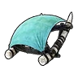
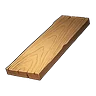
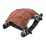
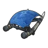
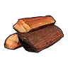
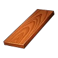
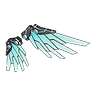

# 🪂 Глайдеры

<input type="search" class="pfq" name="pp-items-q" placeholder="Найти: глайдеры" autocomplete="off" autocorrect="off" autocapitalize="off" spellcheck="false" enterkeyhint="search">найдено 5

Мегаглайдер<small>⚖️ 15</small>

<h3>Мегаглайдер</h3>Обычный
Глайдер для планирования. Держи прыжок в воздухе, чтобы планировать и пролетать большие расстояния.

⚖️<small>Вес</small><b>15</b>

💰<small>Цена</small><b>15480</b>

📘<small>Технология</small><b>ур. 18</b>

<h4>🔨 Крафт</h4>
<a class="ich" href="../../../4_spravochniki/predmety/материалы/#деревянная-доска">Деревянная доска<b>×5</b></a><a class="ich" href="../../../4_spravochniki/predmety/материалы/#кость">Кость<b>×10</b></a><a class="ich" href="../../../4_spravochniki/predmety/материалы/#ткань">Ткань<b>×20</b></a>
<h5>Где сделать</h5>
<a class="ich" href="../../../4_spravochniki/predmety/постройки/#качественный-верстак">Качественный верстак</a><a class="ich" href="../../../4_spravochniki/predmety/постройки/#конвейерная-фабрика">Конвейерная фабрика</a><a class="ich" href="../../../4_spravochniki/predmety/постройки/#мастерская-развитой-цивилизации">Мастерская развитой цивилизации</a><a class="ich" href="../../../4_spravochniki/predmety/постройки/#древний-верстак">Древний верстак</a>

Из игры

Глайдер для планирования. Массовая модель, развивает умеренную скорость.

Стандартный парашют<small>⚖️ 10</small>

<h3>Стандартный парашют</h3>Обычный
Глайдер для планирования. Держи прыжок в воздухе, чтобы планировать и пролетать большие расстояния.

⚖️<small>Вес</small><b>10</b>

💰<small>Цена</small><b>1300</b>

📘<small>Технология</small><b>ур. 5</b>

<h4>🔨 Крафт</h4>
<a class="ich" href="../../../4_spravochniki/predmety/материалы/#древесина">Древесина<b>×10</b></a><a class="ich" href="../../../4_spravochniki/predmety/материалы/#ткань">Ткань<b>×2</b></a>
<h5>Где сделать</h5>
<a class="ich" href="../../../4_spravochniki/predmety/постройки/#качественный-верстак">Качественный верстак</a><a class="ich" href="../../../4_spravochniki/predmety/постройки/#конвейерная-фабрика">Конвейерная фабрика</a><a class="ich" href="../../../4_spravochniki/predmety/постройки/#мастерская-развитой-цивилизации">Мастерская развитой цивилизации</a><a class="ich" href="../../../4_spravochniki/predmety/постройки/#примитивный-верстак">Примитивный верстак</a><a class="ich" href="../../../4_spravochniki/predmety/постройки/#древний-верстак">Древний верстак</a>

Из игры

Глайдер для планирования. Простая конструкция не позволяет развить высокую скорость.

Гигаглайдер<small>⚖️ 20</small>

<h3>Гигаглайдер</h3>Необычный
Глайдер для планирования. Держи прыжок в воздухе, чтобы планировать и пролетать большие расстояния.

⚖️<small>Вес</small><b>20</b>

💰<small>Цена</small><b>76080</b>

📘<small>Технология</small><b>ур. 40</b>

<h4>🔨 Крафт</h4>
<a class="ich" href="../../../4_spravochniki/predmety/материалы/#слиток-рафинированного-металла">Слиток рафинированного металла<b>×20</b></a><a class="ich" href="../../../4_spravochniki/predmety/материалы/#твёрдая-древесина">Твёрдая древесина<b>×100</b></a><a class="ich" href="../../../4_spravochniki/predmety/материалы/#углеродное-волокно">Углеродное волокно<b>×15</b></a><a class="ich" href="../../../4_spravochniki/predmety/материалы/#качественная-ткань">Качественная ткань<b>×10</b></a>
<h5>Где сделать</h5>
<a class="ich" href="../../../4_spravochniki/predmety/постройки/#конвейерная-фабрика">Конвейерная фабрика</a><a class="ich" href="../../../4_spravochniki/predmety/постройки/#мастерская-развитой-цивилизации">Мастерская развитой цивилизации</a><a class="ich" href="../../../4_spravochniki/predmety/постройки/#древний-верстак">Древний верстак</a>

Из игры

Глайдер для планирования. Улучшенная модель, развивает высокую скорость.

Тераглайдер<small>⚖️ 25</small>

<h3>Тераглайдер</h3>Эпический
Глайдер для планирования. Держи прыжок в воздухе, чтобы планировать и пролетать большие расстояния.

⚖️<small>Вес</small><b>25</b>

💰<small>Цена</small><b>332880</b>

📘<small>Технология</small><b>ур. 52</b>

<h4>🔨 Крафт</h4>
<a class="ich" href="../../../4_spravochniki/predmety/материалы/#слиток-пал-металла">Слиток Пал-Металла<b>×40</b></a><a class="ich" href="../../../4_spravochniki/predmety/материалы/#качественная-деревянная-доска">Качественная деревянная доска<b>×20</b></a><a class="ich" href="../../../4_spravochniki/predmety/материалы/#углеродное-волокно">Углеродное волокно<b>×25</b></a><a class="ich" href="../../../4_spravochniki/predmety/материалы/#качественная-ткань">Качественная ткань<b>×20</b></a>
<h5>Где сделать</h5>
<a class="ich" href="../../../4_spravochniki/predmety/постройки/#мастерская-развитой-цивилизации">Мастерская развитой цивилизации</a><a class="ich" href="../../../4_spravochniki/predmety/постройки/#древний-верстак">Древний верстак</a>

Из игры

Глайдер для планирования. Улучшенная модель с высокой скоростью и увеличенной подъемной силой.

Крылатый ранец<small>⚖️ 25</small>

<h3>Крылатый ранец</h3>Легендарный
Крыловидное летательное устройство, крепящееся на спину. Держи прыжок в воздухе, чтобы планировать и пролетать большие расстояния.

⚖️<small>Вес</small><b>25</b>

💰<small>Цена</small><b>6508680</b>

📘<small>Технология</small><b>ур. 80</b>

<h4>🔨 Крафт</h4>
<a class="ich" href="../../../4_spravochniki/predmety/материалы/#осколок-палдиума">Осколок палдиума<b>×30</b></a><a class="ich" href="../../../4_spravochniki/predmety/материалы/#палкизитовый-слиток">Палкизитовый слиток<b>×6</b></a><a class="ich" href="../../../4_spravochniki/predmety/материалы/#ядро-ии">Ядро ИИ<b>×20</b></a><a class="ich" href="../../../4_spravochniki/predmety/материалы/#термоядро">Термоядро<b>×20</b></a><a class="ich" href="../../../4_spravochniki/predmety/материалы/#ядро-древней-цивилизации">Ядро древней цивилизации<b>×10</b></a>
<h5>Где сделать</h5>
<a class="ich" href="../../../4_spravochniki/predmety/постройки/#древний-верстак">Древний верстак</a>

Из игры

Крыловидное летательное устройство, крепящееся на спину. Получает тягу за счёт расхода Крыловая энергоячейка.

