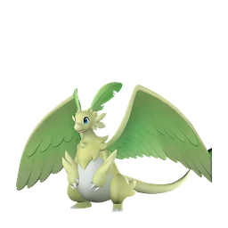
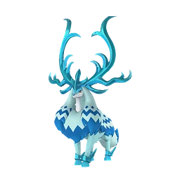
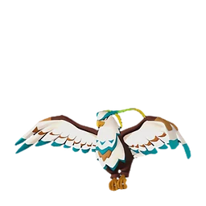
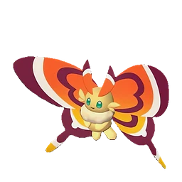

# Ингредиент

<input type="search" class="pfq" placeholder="Найти в разделе «Ингредиент»…" autocomplete="off">

## Гамбургер с Моззариной

Идеальное сочетание вкуса сочной говядины и сладости булочек. На некоторое время после еды немного увеличивается скорость работы, а снижение рассудка замедляется.

💎Редкость<b>Редкий</b>

⚖️Вес<b>0,5</b>

💰Цена<b>720</b>

🔨 Крафт
Мясо Моззарины <b>×1</b>Мука <b>×1</b>Латук <b>×2</b>
<small class="ist">Электрическая кухня Большая кухня Древняя кухня</small>

## Горячее молоко

Стало ещё вкуснее в подогретом виде. На удивление хорошо насыщает.

💎Редкость<b>Обычный</b>

⚖️Вес<b>1,5</b>

💰Цена<b>240</b>

🔨 Крафт
Молоко <b>×1</b>
<small class="ist">Костер Котелок Электрическая кухня Большая кухня Древняя кухня</small>

## Гратен

Картофель в соусе, запечённый до румяной корочки. Особенно вкусен в горячем виде. Даёт ощущение сытости на некоторое время и увеличивает Защита +10%.

💎Редкость<b>Редкий</b>

⚖️Вес<b>0,5</b>

💰Цена<b>1020</b>

🔨 Крафт
Молоко <b>×2</b>Картофель <b>×2</b>Мука <b>×1</b>
<small class="ist">Электрическая кухня Большая кухня Древняя кухня</small>

## Гриб

Гриб, который можно есть сырым. Если походить по острову, можно найти почти везде.

💎Редкость<b>Обычный</b>

⚖️Вес<b>1</b>

💰Цена<b>300</b>

📍 Где взять
📦 Экспедиция: Лес (сложная) <small>10–20 · 100%</small>📦 Пастбище: Шрумер сам даёт <small>1 · 66,667%</small>👤 Злостная изменщица Сирена <small>100%</small><a class="ichip src" href="../../../4_spravochniki/paly/tanzee/">Танзи</a><a class="ichip src" href="../../../4_spravochniki/paly/tanzee_ignis/">Танзи Игнис</a><a class="ichip src" href="../../../4_spravochniki/paly/lovander/">Ловандер</a><a class="ichip src" href="../../../4_spravochniki/paly/shroomer/">Шрумер</a><a class="ichip src" href="../../../4_spravochniki/paly/mycora/">Микора</a>🛒 торговец

## Грибной суп

Крем-суп с ингредиентом «Гриб». После употребления на некоторое время дольше сохраняется чувство сытости.

💎Редкость<b>Обычный</b>

⚖️Вес<b>0,5</b>

💰Цена<b>840</b>

🔨 Крафт
Гриб <b>×1</b>Молоко <b>×2</b>
<small class="ist">Котелок Электрическая кухня Большая кухня Древняя кухня</small>

📍 Где взять
🛒 торговец

## Грибной торт

Если поместить в сундук Пастбище свиданий, съевшие его Палы наберутся сил и отложат яйца. У потомства немного повышается шанс развития талантов.

💎Редкость<b>Необычный</b>

⚖️Вес<b>1</b>

💰Цена<b>7740</b>

📘Технология<b>ур. 30</b>

🔨 Крафт
Мука <b>×5</b>Гриб <b>×5</b>Пещерный гриб <b>×3</b>Яйцо <b>×8</b>Мёд <b>×2</b>
<small class="ist">Котелок Электрическая кухня Большая кухня Древняя кухня</small>

## Дзингискан из Ламболла

Тщательно обжаренная на углях маринованная баранина. На некоторое время после еды немного увеличивается скорость работы, а снижение рассудка замедляется.

💎Редкость<b>Необычный</b>

⚖️Вес<b>0,5</b>

💰Цена<b>340</b>

🔨 Крафт
Мясо Ламболла <b>×1</b>Латук <b>×2</b>
<small class="ist">Котелок Электрическая кухня Большая кухня Древняя кухня</small>

📍 Где взять
📦 Миссия <small>10 · 100%</small>📦 Охотница за деликатесами <small>3–10 · 100%</small>

## Жареные овощи

Блюдо из ингредиентов «Морковь» и «Лук», обжаренных в масле. Простое и вкусное овощное блюдо. Ненадолго немного повышает скорость работы и увеличивает Защита +10%.

💎Редкость<b>Необычный</b>

⚖️Вес<b>0,5</b>

💰Цена<b>480</b>

🔨 Крафт
Лук <b>×2</b>Морковь <b>×2</b>
<small class="ist">Котелок Электрическая кухня Большая кухня Древняя кухня</small>

## Жареные ягоды

Благодаря обжарке повысилась питательная ценность. На удивление хорошо насыщает.

💎Редкость<b>Обычный</b>

⚖️Вес<b>0,15</b>

💰Цена<b>60</b>

🔨 Крафт
Красная ягода <b>×1</b>
<small class="ist">Костер Котелок Электрическая кухня Большая кухня Древняя кухня</small>

## Жареный Скатласс с солью

Блюдо из свежего филе Скатласса, щедро посыпанного солью и запечённого на огне. На некоторое время делает невосприимчивым к отбрасыванию и оглушающему откату.

💎Редкость<b>Необычный</b>

⚖️Вес<b>1</b>

💰Цена<b>720</b>

🔨 Крафт
Филе Скатласса <b>×1</b>
<small class="ist">Костер Котелок Электрическая кухня Большая кухня Древняя кухня</small>

## Жареный гриб

Гриб, ставший более питательным после обжарки. На удивление хорошо насыщает.

💎Редкость<b>Обычный</b>

⚖️Вес<b>1</b>

💰Цена<b>360</b>

🔨 Крафт
Гриб <b>×1</b>
<small class="ist">Костер Котелок Электрическая кухня Большая кухня Древняя кухня</small>

## Загадочный гриб

Гриб, непригодный для употребления в сыром виде. После употребления вызывает быстрое чувство голода.

💎Редкость<b>Обычный</b>

⚖️Вес<b>1</b>

💰Цена<b>800</b>

📍 Где взять
<a class="ichip src" href="../../../4_spravochniki/paly/shroomer_noct/">Шрумер Нокт</a><a class="ichip src" href="../../../4_spravochniki/paly/dualith_noct/">Дуалит Нокт</a><a class="ichip src" href="../../../4_spravochniki/paly/mycora/">Микора</a>🛒 торговец

## Запечённый Иктирдир

Тщательно запечённое мясо оленя, наполненное ароматом густого леса. Изысканный вкус этого блюда приносит уют и особую атмосферу в повседневную жизнь.

💎Редкость<b>Обычный</b>

⚖️Вес<b>2</b>

💰Цена<b>220</b>

🔨 Крафт
Мясо Иктирдира <b>×1</b>
<small class="ist">Костер Котелок Электрическая кухня Большая кухня Древняя кухня</small>

## Запечённый Каприти с травами

Деликатно обжаренное мясо с природным ароматом трав и ягод. В походных условиях дарит тепло и чувство полного удовлетворения.

💎Редкость<b>Обычный</b>

⚖️Вес<b>2,5</b>

💰Цена<b>200</b>

🔨 Крафт
Мясо Каприти <b>×1</b>
<small class="ist">Костер Котелок Электрическая кухня Большая кухня Древняя кухня</small>

📍 Где взять
📦 Охотница за деликатесами <small>3–10 · 100%</small>

## Запечённый Ламболл с травами

Свежие ягоды подчёркивают характерный вкус баранины, придавая блюду аппетитный аромат. На некоторое время после еды Защита +10%

💎Редкость<b>Необычный</b>

⚖️Вес<b>0,5</b>

💰Цена<b>260</b>

🔨 Крафт
Мясо Ламболла <b>×1</b>Красная ягода <b>×2</b>
<small class="ist">Котелок Электрическая кухня Большая кухня Древняя кухня</small>

📍 Где взять
📦 Охотница за деликатесами <small>3–10 · 100%</small>👤 Адепт Организации по Защите Палов <small>2%</small>👤 Самовлюбленный болтун Эго <small>2%</small>👤 Агрессивный защитник Кирпич <small>2%</small>

## Запечённый Рашоа

Кусок сочного мяса кабана, зажаренный на открытом огне. Снаружи — хрустящая корочка, внутри — нежная, тающая текстура. Идеально подойдёт для праздничного стола.

💎Редкость<b>Обычный</b>

⚖️Вес<b>2</b>

💰Цена<b>180</b>

🔨 Крафт
Мясо Рашоа <b>×1</b>
<small class="ist">Костер Котелок Электрическая кухня Большая кухня Древняя кухня</small>

## Запечённый Рейндрикс

Мясо ледяного оленя обладает уникальным свойством — после извлечения из огня оно мгновенно остывает, сохраняя свежесть. Превосходный вариант для длительного хранения и экстренных ситуаций.

💎Редкость<b>Обычный</b>

⚖️Вес<b>2</b>

💰Цена<b>420</b>

🔨 Крафт
Мясо Рейндрикса <b>×1</b>
<small class="ist">Костер Котелок Электрическая кухня Большая кухня Древняя кухня</small>

## Запечённый на кости Брончерри

Отборный кусок жареного мяса, в котором чувствуется вкус дикого властелина. Из костей сочится насыщенный мясной сок, а само мясо — упругое снаружи, но удивительно нежное внутри.

💎Редкость<b>Необычный</b>

⚖️Вес<b>5</b>

💰Цена<b>600</b>

🔨 Крафт
Мясо Брончерри <b>×1</b>
<small class="ist">Костер Котелок Электрическая кухня Большая кухня Древняя кухня</small>

## Зонтик медузы Джелиэтты

Зонтик Джелиэтта. Уникальная хрустящая текстура, от которой невозможно отказаться — настоящий морской деликатес.

💎Редкость<b>Необычный</b>

⚖️Вес<b>5</b>

💰Цена<b>250</b>

📍 Где взять
📦 Экспедиция: Санрич (сложная) <small>10–20 · 100%</small><a class="ichip src" href="../../../4_spravochniki/paly/jelliette/">Джелиэтта</a>🛒 торговец

## Зонтик медузы Джелроя

Зонтик Джелрой. Уникальная плотная и упругая текстура, от которой невозможно отказаться — настоящий морской деликатес.

💎Редкость<b>Необычный</b>

⚖️Вес<b>5</b>

💰Цена<b>250</b>

📍 Где взять
📦 Экспедиция: Санрич (сложная) <small>10–20 · 100%</small><a class="ichip src" href="../../../4_spravochniki/paly/jellroy/">Джелрой</a>🛒 торговец

## Кабаяки из Думада

Обжаренная в секретном соусе рыба, настолько вкусная, что исцеляет и тело, и душу. Идеальное блюдо для уставшего укротителя Палов.

💎Редкость<b>Обычный</b>

⚖️Вес<b>2</b>

💰Цена<b>260</b>

🔨 Крафт
Мясо Думада <b>×1</b>
<small class="ist">Костер Котелок Электрическая кухня Большая кухня Древняя кухня</small>

## Караагэ из Чикипи

Невероятно сочное блюдо из курицы. На некоторое время после еды скорость работы немного повышается, снижение рассудка замедляется.

💎Редкость<b>Редкий</b>

⚖️Вес<b>0,5</b>

💰Цена<b>1020</b>

🔨 Крафт
Мясо Чикипи <b>×1</b>Мука <b>×1</b>Яйцо <b>×1</b>Качественное масло Пала <b>×1</b>
<small class="ist">Электрическая кухня Большая кухня Древняя кухня</small>

📍 Где взять
📦 Охотница за деликатесами <small>3–10 · 100%</small>

## Карамельная сахарная вата

Сахарная вата со вкусом карамели, добываемая из пала «Вулипоп Терра». Нежная сладость, тающая во рту.

💎Редкость<b>Необычный</b>

⚖️Вес<b>0,2</b>

💰Цена<b>500</b>

📍 Где взять
📦 Пастбище: Вулипоп сам даёт <small>1 · 100%</small><a class="ichip src" href="../../../4_spravochniki/paly/woolipop_terra/">Вулипоп Терра</a>

## Карбонара

Блюдо из пасты с ингредиентами «Яйцо» и «Молоко». После употребления на некоторое время увеличивает Защита +20%.

💎Редкость<b>Обычный</b>

⚖️Вес<b>0,5</b>

💰Цена<b>1260</b>

🔨 Крафт
Мука <b>×1</b>Яйцо <b>×2</b>Молоко <b>×2</b>
<small class="ist">Электрическая кухня Большая кухня Древняя кухня</small>

## Карри с мясом Маммореста

Овощи и мясо, тушённые со специями. Блюдо с крупными кусками мяса и насыщенным вкусом. На некоторое время после употребления увеличивает Атака +25%.

💎Редкость<b>Эпический</b>

⚖️Вес<b>0,5</b>

💰Цена<b>2040</b>

🔨 Крафт
Мясо Маммореста <b>×1</b>Лук <b>×2</b>Морковь <b>×2</b>Картофель <b>×2</b>Красная ягода <b>×2</b>
<small class="ist">Большая кухня Древняя кухня</small>

📍 Где взять
📦 Сундук в поселении: Фейбрейк <small>2–3 · 26,531%</small>📦 Пещера Тэнраку <small>1–2 · 25,243%</small>📦 Лагерь врагов: Сакурадзима <small>1–2 · 24,762%</small>📦 Небесный свод Санрича <small>1–2 · 16,774%</small>🛒 торговец

## Картофель

Сытная, неприхотливая к почве и урожайная культура. Не подходит для употребления в сыром виде.

💎Редкость<b>Обычный</b>

⚖️Вес<b>1</b>

💰Цена<b>100</b>

🔨 Крафт
Мука <b>×12</b>Сахарная вата <b>×8</b>Картофель <b>×10</b>Лук <b>×6</b>Морковь <b>×8</b>
<small class="ist">Мельница</small>

📍 Где взять
🛒 торговец

## Картофель фри

Картофель, обжаренный в масле. Стоит попробовать — и остановиться невозможно. Немного замедляет снижение рассудка на некоторое время.

💎Редкость<b>Необычный</b>

⚖️Вес<b>0,5</b>

💰Цена<b>600</b>

🔨 Крафт
Картофель <b>×2</b>Качественное масло Пала <b>×1</b>
<small class="ist">Котелок Электрическая кухня Большая кухня Древняя кухня</small>

## Качающееся желе Джелроя

Причудливый десерт, для приготовления которого используется Зонтик медузы Джелроя и Красная ягода. На некоторое время немного увеличивает количество получаемого опыта. Защита +10%

💎Редкость<b>Необычный</b>

⚖️Вес<b>1</b>

💰Цена<b>720</b>

🔨 Крафт
Зонтик медузы Джелроя <b>×2</b>Красная ягода <b>×2</b>
<small class="ist">Котелок Электрическая кухня Большая кухня Древняя кухня</small>

📍 Где взять
🛒 торговец

## Кебаб из Ламболла

Блюдо из баранины, запечённой в пряном маринаде. Обладает насыщенным и ярко выраженным характером вкуса.

💎Редкость<b>Обычный</b>

⚖️Вес<b>1</b>

💰Цена<b>140</b>

🔨 Крафт
Мясо Ламболла <b>×1</b>
<small class="ist">Костер Котелок Электрическая кухня Большая кухня Древняя кухня</small>

## Келпси на углях

Свежая рыба, запечённая на углях, обладает нежной и воздушной текстурой.

💎Редкость<b>Обычный</b>

⚖️Вес<b>1</b>

💰Цена<b>170</b>

🔨 Крафт
Мясо Келпси <b>×1</b>
<small class="ist">Костер Котелок Электрическая кухня Большая кухня Древняя кухня</small>

## Келпси-фрай

Упругое рыбное филе в хрустящей корочке. На некоторое время после еды Защита +10%, снижение рассудка замедляется.

💎Редкость<b>Редкий</b>

⚖️Вес<b>0,5</b>

💰Цена<b>1070</b>

🔨 Крафт
Мясо Келпси <b>×1</b>Мука <b>×1</b>Яйцо <b>×1</b>Качественное масло Пала <b>×1</b>
<small class="ist">Электрическая кухня Большая кухня Древняя кухня</small>

## Киш с грибами

Пирог с начинкой из яиц, овощей, грибов и сливок. Остаётся вкусным даже в холодном виде. Даёт ощущение сытости на некоторое время и замедляет снижение рассудка.

💎Редкость<b>Эпический</b>

⚖️Вес<b>0,5</b>

💰Цена<b>2220</b>

🔨 Крафт
Мука <b>×1</b>Гриб <b>×2</b>Лук <b>×2</b>Яйцо <b>×2</b>Молоко <b>×2</b>
<small class="ist">Большая кухня Древняя кухня</small>

## Красная ягода

Универсальный продукт, вкусный как в сыром, так и в жареном виде. Растёт на всей территории острова.

💎Редкость<b>Обычный</b>

⚖️Вес<b>0,2</b>

💰Цена<b>50</b>

🔨 Крафт
Жидкость водного Пала <b>×2</b>Красная ягода <b>×4</b>Мука <b>×2</b>
<small class="ist">Мельница</small>

📍 Где взять
📦 Пастбище: Каприти сам даёт <small>1 · 100%</small>📦 Дикое дерево плодов мастерства <small>1–3 · 100%</small>📦 Миссия <small>5 · 100%</small><a class="ichip src" href="../../../4_spravochniki/paly/cattiva/">Каттива</a><a class="ichip src" href="../../../4_spravochniki/paly/caprity/">Каприти</a><a class="ichip src" href="../../../4_spravochniki/paly/caprity_noct/">Каприти Нокт</a><a class="ichip src" href="../../../4_spravochniki/paly/braloha/">Бралоха</a><a class="ichip src" href="../../../4_spravochniki/paly/shroomer/">Шрумер</a><a class="ichip src" href="../../../4_spravochniki/paly/quivern_botan/">Фэски Ботан</a><a class="ichip src" href="../../../4_spravochniki/paly/lullu/">Нежноцвет</a>🛒 торговец

## Крокодилье мясо Манчиллы

Мясо Манчилл. Плотное, с приятной жёсткостью, с каждым укусом раскрывается глубокий и насыщенный вкус.

💎Редкость<b>Необычный</b>

⚖️Вес<b>5</b>

💰Цена<b>250</b>

📍 Где взять
📦 Экспедиция: Снега (сложная) <small>10–20 · 100%</small><a class="ichip src" href="../../../4_spravochniki/paly/munchill/">Манчилл</a>🛒 торговец

## Латук

Эта зелень — настоящий король салатов. Хрустящая текстура и освежающий вкус — настоящее совершенство.

💎Редкость<b>Обычный</b>

⚖️Вес<b>1</b>

💰Цена<b>80</b>

🔨 Крафт
Мука <b>×8</b>Помидор <b>×8</b>Латук <b>×7</b>Яйцо <b>×8</b>Мёд <b>×4</b>
<small class="ist">Мельница</small>

📍 Где взять
🛒 торговец

## Локо-моко из Иктирдира

Сочная котлета и глазунья с нежным, тягучим желтком. Этот совершенный дуэт дарит во рту настоящее счастье. На некоторое время после еды Атака +20%.

💎Редкость<b>Редкий</b>

⚖️Вес<b>0,5</b>

💰Цена<b>820</b>

🔨 Крафт
Мясо Иктирдира <b>×1</b>Красная ягода <b>×2</b>Яйцо <b>×2</b>
<small class="ist">Электрическая кухня Большая кухня Древняя кухня</small>

📍 Где взять
📦 Охотница за деликатесами <small>3–10 · 100%</small>🛒 торговец

## Лук

Легко выращиваемая культура, любимая с давних времён. Не подходит для употребления в сыром виде.

💎Редкость<b>Обычный</b>

⚖️Вес<b>1</b>

💰Цена<b>100</b>

🔨 Крафт
Качественное масло Пала <b>×4</b>Лук <b>×4</b>Морковь <b>×3</b>Мука <b>×4</b>
<small class="ist">Мельница</small>

📍 Где взять
🛒 торговец

## Маринованные грибы

Маринованные в маринаде Гриб. После употребления на некоторое время увеличивает Защита +10%.

💎Редкость<b>Обычный</b>

⚖️Вес<b>0,5</b>

💰Цена<b>480</b>

🔨 Крафт
Гриб <b>×1</b>Красная ягода <b>×2</b>
<small class="ist">Котелок Электрическая кухня Большая кухня Древняя кухня</small>

📍 Где взять
🛒 торговец

## Минестроне

Суп с большим количеством овощей. Согревает изнутри. На некоторое время увеличивает скорость работы.

💎Редкость<b>Редкий</b>

⚖️Вес<b>0,5</b>

💰Цена<b>890</b>

🔨 Крафт
Помидор <b>×3</b>Морковь <b>×2</b>Лук <b>×2</b>Картофель <b>×1</b>
<small class="ist">Электрическая кухня Большая кухня Древняя кухня</small>

## Молоко

Можно пить как есть или использовать в готовке. Получается от пала «Моззарина».

💎Редкость<b>Обычный</b>

⚖️Вес<b>1,5</b>

💰Цена<b>200</b>

📍 Где взять
📦 Пастбище: Моззарина сам даёт <small>1–2 · 100%</small>👤 Коровий вор Лассо <small>100%</small><a class="ichip src" href="../../../4_spravochniki/paly/mozzarina/">Моззарина</a>🛒 торговец

## Морковь

Яркий и питательный корнеплод. Не подходит для употребления в сыром виде.

💎Редкость<b>Обычный</b>

⚖️Вес<b>1</b>

💰Цена<b>100</b>

🔨 Крафт
Качественное масло Пала <b>×4</b>Лук <b>×4</b>Морковь <b>×3</b>Мука <b>×4</b>
<small class="ist">Мельница</small>

📍 Где взять
<a class="ichip src" href="../../../4_spravochniki/paly/ribbuny_botan/">Риббани Ботан</a>🛒 торговец

## Мука

Мука из ингредиента «Пшеница». Применяется для приготовления Хлеб.

💎Редкость<b>Обычный</b>

⚖️Вес<b>0,1</b>

💰Цена<b>250</b>

🔨 Крафт
Пшеница <b>×3</b>
<small class="ist">Мельница</small>

## Мясо Брончерри

Мясо Брончерри. Огромный кусок мяса, таящий в себе мощную энергию. Кладезь питательных веществ, накопленных с помощью фотосинтеза.

💎Редкость<b>Необычный</b>

⚖️Вес<b>5</b>

💰Цена<b>500</b>

📍 Где взять
📦 Экспедиция: Сакурадзима (сложная) <small>10–20 · 100%</small><a class="ichip src" href="../../../4_spravochniki/paly/broncherry/">Брончерри</a><a class="ichip src" href="../../../4_spravochniki/paly/broncherry_aqua/">Брончерри Аква</a>🛒 торговец

## Мясо Думада

Мясо Думад. С жирной прослойкой, насыщенное вкусом и ароматом. Мягкая, пышная текстура придаёт ему особую привлекательность.

💎Редкость<b>Обычный</b>

⚖️Вес<b>2</b>

💰Цена<b>220</b>

📍 Где взять
📦 Экспедиция: Пустыня (сложная) <small>10–20 · 100%</small><a class="ichip src" href="../../../4_spravochniki/paly/dumud/">Думад</a><a class="ichip src" href="../../../4_spravochniki/paly/dumud_gild/">Думад Гилд</a>🛒 торговец

## Мясо Иктирдира

Мясо Иктирдир. Лёгкое и нежирное, но при этом очень вкусное мясо.

💎Редкость<b>Обычный</b>

⚖️Вес<b>2</b>

💰Цена<b>180</b>

📍 Где взять
📦 Экспедиция: Лес (сложная) <small>10–20 · 100%</small><a class="ichip src" href="../../../4_spravochniki/paly/eikthyrdeer/">Иктирдир</a><a class="ichip src" href="../../../4_spravochniki/paly/eikthyrdeer_terra/">Иктирдир Тэрра</a>🛒 торговец

## Мясо Каприти

Мясо Каприти. Полезное, богатое питательными веществами мясо. Исходящий от него ягодный аромат пробуждает аппетит.

💎Редкость<b>Обычный</b>

⚖️Вес<b>2,5</b>

💰Цена<b>170</b>

📍 Где взять
📦 Экспедиция: Сакурадзима (сложная) <small>10–20 · 100%</small><a class="ichip src" href="../../../4_spravochniki/paly/caprity/">Каприти</a><a class="ichip src" href="../../../4_spravochniki/paly/caprity_noct/">Каприти Нокт</a>🛒 торговец

## Мясо Келпси

Мясо Келпси. Отличается упругой текстурой и лёгкой сладостью. Рыбное мясо, поэтому быстро портится.

💎Редкость<b>Обычный</b>

⚖️Вес<b>1</b>

💰Цена<b>140</b>

📍 Где взять
📦 Экспедиция: Вулкан (сложная) <small>10–20 · 100%</small><a class="ichip src" href="../../../4_spravochniki/paly/kelpsea/">Келпси</a><a class="ichip src" href="../../../4_spravochniki/paly/kelpsea_ignis/">Келпси Игнис</a>🛒 торговец

## Мясо Ламболла

Мясо Ламболл. Красное мясо с выразительным, характерным вкусом. Имеет специфический привкус, но остаётся вкусным.

💎Редкость<b>Обычный</b>

⚖️Вес<b>1</b>

💰Цена<b>120</b>

📍 Где взять
📦 Экспедиция: Холмы (старт) (сложная) <small>10–20 · 100%</small>📦 Миссия <small>5 · 100%</small><a class="ichip src" href="../../../4_spravochniki/paly/lamball/">Ламболл</a>🛒 торговец

## Мясо Маммореста

Мясо Мамморест. Характеризуется мощным и впечатляющим вкусом. Огромный объем насытит даже самого прожорливого едока.

💎Редкость<b>Необычный</b>

⚖️Вес<b>5</b>

💰Цена<b>1000</b>

📍 Где взять
📦 Экспедиция: Мировое Древо <small>3–7 · 100%</small>👤 Озверевший Мамморест Крист <small>100%</small><a class="ichip src" href="../../../4_spravochniki/paly/mammorest/">Мамморест</a><a class="ichip src" href="../../../4_spravochniki/paly/mammorest_cryst/">Мамморест Крист</a>🛒 торговец

## Мясо Моззарины

Мясо Моззарина. Мясистое и сочное мраморное мясо с ярким вкусом. Любимое лакомство жителей острова Палпагос.

💎Редкость<b>Обычный</b>

⚖️Вес<b>2,5</b>

💰Цена<b>190</b>

📍 Где взять
📦 Экспедиция: Лес (сложная) <small>10–20 · 100%</small><a class="ichip src" href="../../../4_spravochniki/paly/mozzarina/">Моззарина</a>🛒 торговец

## Мясо Рашоа

Мясо Рашоа. Сочное, питательное и с ярко выраженным вкусом дичи.

💎Редкость<b>Обычный</b>

⚖️Вес<b>2</b>

💰Цена<b>150</b>

📍 Где взять
📦 Экспедиция: Вулкан (сложная) <small>10–20 · 100%</small><a class="ichip src" href="../../../4_spravochniki/paly/rushoar/">Рашоа</a>🛒 торговец

## Мясо Рейндрикса

Мясо Рейндрикс. Удивительное оленье мясо, всегда сохраняющее низкую температуру. Хранится невероятно долго.

💎Редкость<b>Обычный</b>

⚖️Вес<b>2</b>

💰Цена<b>350</b>

📍 Где взять
📦 Экспедиция: Снега (сложная) <small>10–20 · 100%</small><a class="ichip src" href="../../../4_spravochniki/paly/reindrix/">Рейндрикс</a>🛒 торговец

## Мясо Чикипи

Мясо Чикипи. Обладает лёгким вкусом и легко усваивается. Жители острова Палпагос едят его с удовольствием.

💎Редкость<b>Обычный</b>

⚖️Вес<b>1</b>

💰Цена<b>100</b>

📍 Где взять
📦 Экспедиция: Холмы (старт) (сложная) <small>10–20 · 100%</small><a class="ichip src" href="../../../4_spravochniki/paly/chikipi/">Чикипи</a>🛒 торговец

## Мясо Эрмурга

Мясо Эрмург. Питательное и обладает насыщенным вкусом.

💎Редкость<b>Обычный</b>

⚖️Вес<b>1</b>

💰Цена<b>200</b>

📍 Где взять
📦 Экспедиция: Пустыня (сложная) <small>10–20 · 100%</small><a class="ichip src" href="../../../4_spravochniki/paly/galeclaw/">Эрмург</a>🛒 торговец

## Мёд

Мёд, добываемый из пала «Бигард». Сладкий и вкусный.

💎Редкость<b>Обычный</b>

⚖️Вес<b>0,2</b>

💰Цена<b>300</b>

📍 Где взять
📦 Пастбище: Бигард сам даёт <small>1 · 100%</small><a class="ichip src" href="../../../4_spravochniki/paly/cinnamoth/">Синнамос</a><a class="ichip src" href="../../../4_spravochniki/paly/beegarde/">Бигард</a><a class="ichip src" href="../../../4_spravochniki/paly/elizabee/">Элизаби</a><a class="ichip src" href="../../../4_spravochniki/paly/warsect/">Ворсект</a><a class="ichip src" href="../../../4_spravochniki/paly/warsect_terra/">Ворсект Терра</a>

## Никудзяга из Эрмурга

Блюдо из мяса и картофеля, тушёных в сладко-солёном соусе. Необычайно тёплый и ностальгический вкус. На некоторое время после употребления увеличивает Защита +25%.

💎Редкость<b>Эпический</b>

⚖️Вес<b>0,5</b>

💰Цена<b>960</b>

🔨 Крафт
Мясо Эрмурга <b>×1</b>Лук <b>×2</b>Морковь <b>×2</b>Картофель <b>×2</b>
<small class="ist">Большая кухня Древняя кухня</small>

📍 Где взять
📦 Награда Заносчивого критика Палов <small>2 · 100%</small>📦 Сундук в поселении: Сакурадзима <small>2–3 · 27,083%</small>📦 Пещера Цветущей Сакуры <small>1–2 · 26%</small>📦 Лагерь врагов: Пустыня <small>2–3 · 23%</small>🛒 торговец

## Овощной торт

Если поместить в сундук Пастбище свиданий, съевшие его Палы наберутся сил и отложат яйца. За один раз откладывает два яйца.

💎Редкость<b>Редкий</b>

⚖️Вес<b>1</b>

💰Цена<b>7200</b>

📘Технология<b>ур. 47</b>

🔨 Крафт
Мука <b>×8</b>Помидор <b>×8</b>Латук <b>×7</b>Яйцо <b>×8</b>Мёд <b>×4</b>
<small class="ist">Электрическая кухня Большая кухня Древняя кухня</small>

## Омлет

Жареное Яйцо, сдобренное кетчупом. После употребления на некоторое время увеличивает Атака +10%.

💎Редкость<b>Обычный</b>

⚖️Вес<b>0,5</b>

💰Цена<b>580</b>

🔨 Крафт
Помидор <b>×1</b>Яйцо <b>×2</b>
<small class="ist">Котелок Электрическая кухня Большая кухня Древняя кухня</small>

📍 Где взять
🛒 торговец

## Панкейки

Блюдо, приготовленное из ингредиентов «Мука» и «Молоко». На некоторое время после еды снижение рассудка немного замедляется.

💎Редкость<b>Обычный</b>

⚖️Вес<b>0,5</b>

💰Цена<b>540</b>

🔨 Крафт
Мука <b>×1</b>Молоко <b>×1</b>
<small class="ist">Котелок Электрическая кухня Большая кухня Древняя кухня</small>

## Паста с морепродуктами

Паста с щупальцами Глуппи и ароматом моря. На некоторое время защищает от взрывного урона.

💎Редкость<b>Редкий</b>

⚖️Вес<b>1</b>

💰Цена<b>1810</b>

🔨 Крафт
Щупальце Глуппи <b>×3</b>Мука <b>×3</b>Помидор <b>×2</b>
<small class="ist">Электрическая кухня Большая кухня Древняя кухня</small>

📍 Где взять
📦 Лагерь врагов: Санрич <small>1–2 · 23,963%</small>

## Пещерный гриб

Грибы, растущие в пещерах. Ингредиент для целебных снадобий.

💎Редкость<b>Обычный</b>

⚖️Вес<b>1</b>

💰Цена<b>500</b>

📍 Где взять
📦 Экспедиция: Вулкан <small>4–8 · 100%</small>📦 Пастбище: Шрумер сам даёт <small>1 · 33,333%</small>🛒 торговец

## Пицца

Основа этого блюда — Хлеб с начинкой из ингредиентов «Красная ягода» и «Помидор» и сыра. После употребления на некоторое время немного повышается скорость работы и замедляется снижение сытости.

💎Редкость<b>Обычный</b>

⚖️Вес<b>0,5</b>

💰Цена<b>1090</b>

🔨 Крафт
Мука <b>×1</b>Красная ягода <b>×2</b>Помидор <b>×2</b>Молоко <b>×2</b>
<small class="ist">Электрическая кухня Большая кухня Древняя кухня</small>

📍 Где взять
👤 Любитель пиццы с ананасами Алоха <small>100%</small>

## Помидор

Яркий ингредиент, который придаёт блюдам насыщенный цвет. Богат ликопином и полезен для организма.

💎Редкость<b>Обычный</b>

⚖️Вес<b>0,5</b>

💰Цена<b>80</b>

🔨 Крафт
Жидкость водного Пала <b>×3</b>Помидор <b>×4</b>Мука <b>×3</b>
<small class="ist">Мельница</small>

📍 Где взять
🛒 торговец

## Пшеница

Ингредиент — основа для многих блюд. Пшеница это основа основ сельского хозяйства.

💎Редкость<b>Обычный</b>

⚖️Вес<b>0,2</b>

💰Цена<b>70</b>

🔨 Крафт
Пшеница <b>×3</b>
<small class="ist">Мельница</small>

📍 Где взять
🛒 торговец

## Роскошный овощной торт

Если поместить в сундук Пастбище свиданий, съевшие его Палы наберутся сил и отложат яйца. Повышает вероятность мутаций и облегчает развитие талантов.

💎Редкость<b>Эпический</b>

⚖️Вес<b>1</b>

💰Цена<b>9360</b>

📘Технология<b>ур. 60</b>

🔨 Крафт
Мука <b>×12</b>Сахарная вата <b>×8</b>Картофель <b>×10</b>Лук <b>×6</b>Морковь <b>×8</b>
<small class="ist">Большая кухня Древняя кухня</small>

📍 Где взять
📦 Миссия <small>10 · 100%</small>

## Салат

Салат, в состав которого входят Латук и Помидор. На некоторое время после еды скорость работы немного повышается.

💎Редкость<b>Обычный</b>

⚖️Вес<b>0,3</b>

💰Цена<b>380</b>

🔨 Крафт
Латук <b>×2</b>Помидор <b>×2</b>
<small class="ist">Котелок Электрическая кухня Большая кухня Древняя кухня</small>

## Салат из морепродуктов

Полезный салат, для приготовления которого используются Щупальце Глуппи и Латук. На некоторое время увеличивает количество получаемого опыта.

💎Редкость<b>Необычный</b>

⚖️Вес<b>1</b>

💰Цена<b>1100</b>

🔨 Крафт
Щупальце Глуппи <b>×3</b>Латук <b>×4</b>
<small class="ist">Электрическая кухня Большая кухня Древняя кухня</small>

📍 Где взять
🛒 торговец

## Сахарная вата

Сахарная вата, добываемая из пала «Вулипоп». Нежная сладость, тающая во рту.

💎Редкость<b>Обычный</b>

⚖️Вес<b>0,2</b>

💰Цена<b>300</b>

📍 Где взять
📦 Пастбище: Вулипоп сам даёт <small>1 · 100%</small><a class="ichip src" href="../../../4_spravochniki/paly/woolipop/">Вулипоп</a>

## Соте из мяса Чикипи

Блюдо из тушеных в сливочном масле толстых кусков курицы. Во вкусе чувствуются освежающие нотки лимона. На некоторое время после еды скорость работы немного повышается.

💎Редкость<b>Необычный</b>

⚖️Вес<b>0,5</b>

💰Цена<b>240</b>

🔨 Крафт
Мясо Чикипи <b>×1</b>Красная ягода <b>×2</b>
<small class="ist">Котелок Электрическая кухня Большая кухня Древняя кухня</small>

📍 Где взять
📦 Миссия <small>10 · 100%</small>📦 Охотница за деликатесами <small>3–10 · 100%</small>👤 Адепт Организации по Защите Палов <small>2%</small>👤 Судья Организации по Защите Палов <small>2%</small>

## Специальный торт

Если поместить в сундук Пастбище свиданий, съевшие его Палы наберутся сил и отложат яйца. Потомство с большей вероятностью унаследует больше пассивных навыков родителей.

💎Редкость<b>Легендарный</b>

⚖️Вес<b>1</b>

💰Цена<b>20400</b>

📘Технология<b>ур. 74</b>

🔨 Крафт
Мука <b>×20</b>Карамельная сахарная вата <b>×8</b>Молоко <b>×15</b>Яйцо <b>×15</b>Мясо Маммореста <b>×2</b>
<small class="ist">Древняя кухня</small>

📍 Где взять
📦 Миссия <small>5 · 100%</small>

## Спринг-роллы

Обжаренные роллы с начинкой из овощей и грибов. Приятно хрустят при укусе. На некоторое время замедляют снижение рассудка и увеличивают Атака +10%.

💎Редкость<b>Редкий</b>

⚖️Вес<b>0,5</b>

💰Цена<b>1260</b>

🔨 Крафт
Лук <b>×2</b>Гриб <b>×2</b>Мука <b>×1</b>
<small class="ist">Электрическая кухня Большая кухня Древняя кухня</small>

## Стейк из Маммореста

Благородный, насыщенный вкус. Каждый укус возвращает к воспоминаниям о дремучих лесах и ледяных просторах.

💎Редкость<b>Необычный</b>

⚖️Вес<b>5</b>

💰Цена<b>1200</b>

🔨 Крафт
Мясо Маммореста <b>×1</b>
<small class="ist">Костер Котелок Электрическая кухня Большая кухня Древняя кухня</small>

📍 Где взять
📦 Награда Заносчивого критика Палов <small>1 · 100%</small>

## Стейк из Манчилла

Хорошо прожаренный на углях стейк. Снаружи он ароматно поджарен, а внутри — сочный и тающий во рту. Особые ингредиенты сохраняют его насыщенный вкус и обеспечивают отличную сохранность.

💎Редкость<b>Необычный</b>

⚖️Вес<b>1</b>

💰Цена<b>300</b>

🔨 Крафт
Крокодилье мясо Манчиллы <b>×1</b>
<small class="ist">Костер Котелок Электрическая кухня Большая кухня Древняя кухня</small>

## Стейк из Моззарины

Хорошо прожаренный плотный стейк. Насыщенный вкус наполняет энергией.

💎Редкость<b>Обычный</b>

⚖️Вес<b>2,5</b>

💰Цена<b>230</b>

🔨 Крафт
Мясо Моззарины <b>×1</b>
<small class="ist">Костер Котелок Электрическая кухня Большая кухня Древняя кухня</small>

## Студенистое желе Джелиэтты

Причудливый десерт, для приготовления которого используется Зонтик медузы Джелиэтты и Жидкость водного Пала. На некоторое время немного увеличивает количество получаемого опыта. Атака +10%

💎Редкость<b>Необычный</b>

⚖️Вес<b>1</b>

💰Цена<b>1320</b>

🔨 Крафт
Зонтик медузы Джелиэтты <b>×2</b>Жидкость водного Пала <b>×2</b>
<small class="ist">Котелок Электрическая кухня Большая кухня Древняя кухня</small>

📍 Где взять
🛒 торговец

## Такояки из Глуппи

Блюдо из теста на основе ингредиента «Мука» с начинкой из ингредиента «Щупальце Глуппи», запечённое до румяной корочки. На некоторое время немного увеличивает количество получаемого опыта.

💎Редкость<b>Необычный</b>

⚖️Вес<b>1</b>

💰Цена<b>1380</b>

🔨 Крафт
Щупальце Глуппи <b>×2</b>Мука <b>×3</b>
<small class="ist">Котелок Электрическая кухня Большая кухня Древняя кухня</small>

## Торт

Блюдо, которое едят по случаю праздников. Если положить его в сундук Пастбище свиданий, Палы, съевшие его и набравшиеся сил, начнут откладывать яйца.

💎Редкость<b>Обычный</b>

⚖️Вес<b>1</b>

💰Цена<b>6300</b>

🔨 Крафт
Мука <b>×5</b>Красная ягода <b>×8</b>Молоко <b>×7</b>Яйцо <b>×8</b>Мёд <b>×2</b>
<small class="ist">Котелок Электрическая кухня Большая кухня Древняя кухня</small>

📍 Где взять
📦 Миссия <small>3 · 100%</small><a class="ichip src" href="../../../4_spravochniki/paly/lovander/">Ловандер</a>

## Тушёный Иктирдир

Рассыпчатое, мягчайшее мясо оленя, приготовленное с любовью. Нежное переплетение вкусов мяса и овощей рождает мягкость и гармонию. На некоторое время после еды Защита +20%.

💎Редкость<b>Редкий</b>

⚖️Вес<b>0,5</b>

💰Цена<b>1270</b>

🔨 Крафт
Мясо Иктирдира <b>×2</b>Гриб <b>×1</b>Молоко <b>×2</b>
<small class="ist">Электрическая кухня Большая кухня Древняя кухня</small>

📍 Где взять
📦 Награда Заносчивого критика Палов <small>2 · 100%</small>📦 Охотница за деликатесами <small>3–10 · 100%</small>🛒 торговец

## Тушёный Рейндрикс

Рагу из мягкого мяса оленя, выращенного в прохладных краях, тушёное с овощами. Нежная текстура сочетается с тонкой естественной сладостью. После употребления на некоторое время медленнее снижается уровень сытости.

💎Редкость<b>Необычный</b>

⚖️Вес<b>0,5</b>

💰Цена<b>610</b>

🔨 Крафт
Мясо Рейндрикса <b>×1</b>Помидор <b>×2</b>
<small class="ist">Котелок Электрическая кухня Большая кухня Древняя кухня</small>

📍 Где взять
📦 Сундук в поселении: Снега <small>2–3 · 27,083%</small>📦 Лагерь врагов: Снега <small>1 · 27%</small>📦 Пещера Священной Горы <small>1–2 · 26%</small>

## Тушёный Эрмург

Медленно тушёное блюдо с насыщенным вкусом умами и ярким ароматом дикого мяса. На некоторое время после еды снижение рассудка замедляется.

💎Редкость<b>Необычный</b>

⚖️Вес<b>0,5</b>

💰Цена<b>360</b>

🔨 Крафт
Мясо Эрмурга <b>×1</b>Красная ягода <b>×2</b>
<small class="ist">Котелок Электрическая кухня Большая кухня Древняя кухня</small>

## Филе Скатласса

Филе Скатласс. Отличается нежной и пышной текстурой мяса. Поскольку имеет позвоночник, похожий на меч, при приготовлении требуется осторожность.

💎Редкость<b>Необычный</b>

⚖️Вес<b>5</b>

💰Цена<b>600</b>

📍 Где взять
<a class="ichip src" href="../../../4_spravochniki/paly/skutlass/">Скатласс</a><a class="ichip src" href="../../../4_spravochniki/paly/skutlass_ignis/">Скатласс Игнис</a>🛒 торговец

## Хлеб

Хлеб приготовлен из ингредиента «Мука». Достаточно вкусный, чтобы стать основой рациона.

💎Редкость<b>Обычный</b>

⚖️Вес<b>0,3</b>

💰Цена<b>300</b>

🔨 Крафт
Мука <b>×1</b>
<small class="ist">Костер Котелок Электрическая кухня Большая кухня Древняя кухня</small>

📍 Где взять
📦 Сундук: Лес <small>5–7 · 28,037%</small>📦 Сундук в поселении: Холмы (старт) <small>5–8 · 23%</small>📦 Пещера Отдалённого Острова <small>2–3 · 21,698%</small>👤 Житель деревни <small>40%</small>👤 Житель острова <small>40%</small>👤 Браконьер-новичок <small>100%</small>👤 Пироманьяк Огонёк <small>100%</small>👤 Злостная изменщица Сирена <small>100%</small>👤 Охотница на охотников за головами Танко <small>100%</small>👤 Близнецы-подрывники Дина <small>100%</small>👤 Близнецы-подрывники Мит <small>100%</small>👤 Шарлатан с добрыми намерениями Квилл <small>100%</small>👤 Заядлый халявщик Скут <small>100%</small>👤 Мастер побегов Фантом <small>40%</small>👤 Неисправимая спойлерша Шепот <small>40%</small>👤 Злостный растратчик Ским <small>40%</small>👤 Фальшивомонетчик Мимик <small>40%</small>👤 Лошадиный вор Билли <small>40%</small>👤 Negotiator <small>40%</small>🛒 торговец

## Хлеб с вареньем

Хлеб с вареньем. Сладость ягод отлично дополняет вкус хлеба.

💎Редкость<b>Обычный</b>

⚖️Вес<b>0,3</b>

💰Цена<b>420</b>

🔨 Крафт
Мука <b>×1</b>Красная ягода <b>×2</b>
<small class="ist">Котелок Электрическая кухня Большая кухня Древняя кухня</small>

📍 Где взять
🛒 торговец

## Хот-дог из Рашоа

Блюдо с сочной сосиской, зажатой между двумя булочками. Хрустящая золотистая корочка и пряный вкус создают идеальное сочетание. На некоторое время после еды Защита +20%.

💎Редкость<b>Редкий</b>

⚖️Вес<b>0,5</b>

💰Цена<b>670</b>

🔨 Крафт
Мясо Рашоа <b>×1</b>Мука <b>×1</b>Латук <b>×2</b>
<small class="ist">Электрическая кухня Большая кухня Древняя кухня</small>

## Цзяоцзы с мясом Рашоа

Сваренное блюдо из грибов и мясного фарша, завернутого в пшеничное тесто. Обладает приятной мягкой и эластичной текстурой. Дает ощущение сытости на некоторое время и увеличивает Атака +10%.

💎Редкость<b>Необычный</b>

⚖️Вес<b>0,5</b>

💰Цена<b>840</b>

🔨 Крафт
Мясо Рашоа <b>×1</b>Гриб <b>×1</b>Мука <b>×1</b>
<small class="ist">Котелок Электрическая кухня Большая кухня Древняя кухня</small>

## Чаудер из Думада

Уникальный вкус, утопающий в кремовом супе. На некоторое время после еды скорость работы повышается, снижение уровня сытости немного замедляется.

💎Редкость<b>Редкий</b>

⚖️Вес<b>0,5</b>

💰Цена<b>650</b>

🔨 Крафт
Мясо Думада <b>×1</b>Латук <b>×2</b>Помидор <b>×2</b>
<small class="ist">Электрическая кухня Большая кухня Древняя кухня</small>

📍 Где взять
📦 Награда Заносчивого критика Палов <small>2 · 100%</small>📦 Охотница за деликатесами <small>3–10 · 100%</small>📦 Сундук в поселении: Пустыня <small>2–3 · 33,333%</small>📦 Пещера Песчаных Дюн <small>1 · 27%</small>

## Чизбургер с Моззариной

Добавление сыра вознесло блюдо в божественную сферу вкуса. На некоторое время после еды Атака +20%, и медленнее снижается уровень сытости.

💎Редкость<b>Редкий</b>

⚖️Вес<b>0,5</b>

💰Цена<b>1430</b>

🔨 Крафт
Мясо Моззарины <b>×2</b>Мука <b>×1</b>Помидор <b>×2</b>Молоко <b>×2</b>
<small class="ist">Электрическая кухня Большая кухня Древняя кухня</small>

📍 Где взять
📦 Миссия <small>5 · 100%</small>

## Шашлычки из Чикипи

Куриные шашлычки, медленно приготовленные на углях. Легкая текстура и нежный, освежающий вкус.

💎Редкость<b>Обычный</b>

⚖️Вес<b>1</b>

💰Цена<b>120</b>

🔨 Крафт
Мясо Чикипи <b>×1</b>
<small class="ist">Костер Котелок Электрическая кухня Большая кухня Древняя кухня</small>

## Щупальце Глуппи

Щупальце Глуппи. Отличается упругой текстурой и легким утонченным вкусом.

💎Редкость<b>Необычный</b>

⚖️Вес<b>5</b>

💰Цена<b>200</b>

📍 Где взять
📦 Экспедиция: Фейбрейк (сложная) <small>10–20 · 100%</small><a class="ichip src" href="../../../4_spravochniki/paly/gloopie/">Глуппи</a><a class="ichip src" href="../../../4_spravochniki/paly/gloopie_primo/">Глуппи Примо</a>🛒 торговец

## Эрмург на гриле

Блюдо из жареной птицы, наполненное мощью и энергией покорителя небес.

💎Редкость<b>Обычный</b>

⚖️Вес<b>1</b>

💰Цена<b>240</b>

🔨 Крафт
Мясо Эрмурга <b>×1</b>
<small class="ist">Костер Котелок Электрическая кухня Большая кухня Древняя кухня</small>

📍 Где взять
📦 Награда Заносчивого критика Палов <small>2 · 100%</small>📦 Охотница за деликатесами <small>3–10 · 100%</small>📦 Сундук в поселении: Лес <small>2–3 · 29,787%</small>📦 Пещера Горного Потока <small>2–3 · 28%</small>📦 Лагерь врагов: Холмы (старт) <small>2–3 · 23%</small>

## Яичница

Яйцо становится вкуснее в жареном виде. На удивление хорошо насыщает.

💎Редкость<b>Обычный</b>

⚖️Вес<b>0,5</b>

💰Цена<b>240</b>

🔨 Крафт
Яйцо <b>×1</b>
<small class="ist">Костер Котелок Электрическая кухня Большая кухня Древняя кухня</small>

## Яйца с беконом из Рашоа

Копчёный аромат бекона и нежная текстура яйца создают изысканную вкусовую гармонию. На некоторое время после еды Атака +10%

💎Редкость<b>Необычный</b>

⚖️Вес<b>0,5</b>

💰Цена<b>840</b>

🔨 Крафт
Мясо Рашоа <b>×2</b>Яйцо <b>×2</b>
<small class="ist">Котелок Электрическая кухня Большая кухня Древняя кухня</small>

📍 Где взять
📦 Охотница за деликатесами <small>3–10 · 100%</small>📦 Сундук в поселении: Вулкан <small>2–3 · 33,333%</small>📦 Пещера Вулкана <small>1–2 · 28%</small>

## Яйцо

Вкусно само по себе, также используется как ингредиент. Откладывается Чикипи.

💎Редкость<b>Обычный</b>

⚖️Вес<b>0,5</b>

💰Цена<b>200</b>

📍 Где взять
📦 Пастбище: Чикипи сам даёт <small>1–2 · 100%</small><a class="ichip src" href="../../../4_spravochniki/paly/chikipi/">Чикипи</a>🛒 торговец

## Якисоба с мясом Брончерри

Лапша, обжаренная с овощами и мясом. Насыщенный соус отлично подчёркивает вкус сочных мясных кусочков. После употребления на некоторое время увеличивает Атака +20%.

💎Редкость<b>Редкий</b>

⚖️Вес<b>0,5</b>

💰Цена<b>1140</b>

🔨 Крафт
Мясо Брончерри <b>×1</b>Лук <b>×1</b>Морковь <b>×1</b>Мука <b>×1</b>
<small class="ist">Электрическая кухня Большая кухня Древняя кухня</small>

