# 🍲 Ингредиент

<input type="search" class="pfq" name="pp-items-q" placeholder="Найти: ингредиент" autocomplete="off" autocorrect="off" autocapitalize="off" spellcheck="false" enterkeyhint="search">найдено 94

<button type="button" class="on" data-sub="">Все</button><button type="button" data-sub="Блюда из мяса">Блюда из мяса</button><button type="button" data-sub="Блюда из овощей">Блюда из овощей</button><button type="button" data-sub="Мясо">Мясо</button><button type="button" data-sub="Овощи и фрукты">Овощи и фрукты</button><button type="button" data-sub="Блюда из рыбы">Блюда из рыбы</button><button type="button" data-sub="Рыба">Рыба</button>

Горячее молоко<small>16 сытости</small>

<h3>Горячее молоко</h3>Обычный
Стало ещё вкуснее в подогретом виде. Съешь, чтобы утолить голод.

⚖️<small>Вес</small><b>1,5</b>

💰<small>Цена</small><b>240</b>

<h4>🔨 Крафт</h4>
<a class="ich" href="../../../4_spravochniki/predmety/ингредиент/#молоко">Молоко<b>×1</b></a>
<h5>Где сделать</h5>
<a class="ich" href="../../../4_spravochniki/predmety/постройки/#костер">Костер</a><a class="ich" href="../../../4_spravochniki/predmety/постройки/#котелок">Котелок</a><a class="ich" href="../../../4_spravochniki/predmety/постройки/#электрическая-кухня">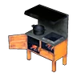Электрическая кухня</a><a class="ich" href="../../../4_spravochniki/predmety/постройки/#большая-кухня">📦Большая кухня</a><a class="ich" href="../../../4_spravochniki/predmety/постройки/#древняя-кухня">Древняя кухня</a>

Из игры

Стало ещё вкуснее в подогретом виде. На удивление хорошо насыщает.

Запечённый Иктирдир<small>70 сытости</small>

<h3>Запечённый Иктирдир</h3>Обычный
Тщательно запечённое мясо оленя, наполненное ароматом густого леса. Съешь, чтобы утолить голод.

⚖️<small>Вес</small><b>2</b>

💰<small>Цена</small><b>220</b>

<h4>🔨 Крафт</h4>
<a class="ich" href="../../../4_spravochniki/predmety/ингредиент/#мясо-иктирдира">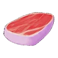Мясо Иктирдира<b>×1</b></a>
<h5>Где сделать</h5>
<a class="ich" href="../../../4_spravochniki/predmety/постройки/#костер">Костер</a><a class="ich" href="../../../4_spravochniki/predmety/постройки/#котелок">Котелок</a><a class="ich" href="../../../4_spravochniki/predmety/постройки/#электрическая-кухня">Электрическая кухня</a><a class="ich" href="../../../4_spravochniki/predmety/постройки/#большая-кухня">📦Большая кухня</a><a class="ich" href="../../../4_spravochniki/predmety/постройки/#древняя-кухня">Древняя кухня</a>

Из игры

Тщательно запечённое мясо оленя, наполненное ароматом густого леса. Изысканный вкус этого блюда приносит уют и особую атмосферу в повседневную жизнь.

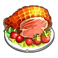Запечённый Каприти с травами<small>80 сытости</small>

<h3>Запечённый Каприти с травами</h3>Обычный
Деликатно обжаренное мясо с природным ароматом трав и ягод. Съешь, чтобы утолить голод.

⚖️<small>Вес</small><b>2,5</b>

💰<small>Цена</small><b>200</b>

<h4>🔨 Крафт</h4>
<a class="ich" href="../../../4_spravochniki/predmety/ингредиент/#мясо-каприти">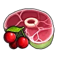Мясо Каприти<b>×1</b></a>
<h5>Где сделать</h5>
<a class="ich" href="../../../4_spravochniki/predmety/постройки/#костер">Костер</a><a class="ich" href="../../../4_spravochniki/predmety/постройки/#котелок">Котелок</a><a class="ich" href="../../../4_spravochniki/predmety/постройки/#электрическая-кухня">Электрическая кухня</a><a class="ich" href="../../../4_spravochniki/predmety/постройки/#большая-кухня">📦Большая кухня</a><a class="ich" href="../../../4_spravochniki/predmety/постройки/#древняя-кухня">Древняя кухня</a>

<h4>📍 Где взять</h4>

📍Охотница за деликатесами<small>×3–10</small><small>100 %</small>

Из игры

Деликатно обжаренное мясо с природным ароматом трав и ягод. В походных условиях дарит тепло и чувство полного удовлетворения.

Запечённый Рашоа<small>60 сытости</small>

<h3>Запечённый Рашоа</h3>Обычный
Кусок сочного мяса кабана, зажаренный на открытом огне. Съешь, чтобы утолить голод.

⚖️<small>Вес</small><b>2</b>

💰<small>Цена</small><b>180</b>

<h4>🔨 Крафт</h4>
<a class="ich" href="../../../4_spravochniki/predmety/ингредиент/#мясо-рашоа">Мясо Рашоа<b>×1</b></a>
<h5>Где сделать</h5>
<a class="ich" href="../../../4_spravochniki/predmety/постройки/#костер">Костер</a><a class="ich" href="../../../4_spravochniki/predmety/постройки/#котелок">Котелок</a><a class="ich" href="../../../4_spravochniki/predmety/постройки/#электрическая-кухня">Электрическая кухня</a><a class="ich" href="../../../4_spravochniki/predmety/постройки/#большая-кухня">📦Большая кухня</a><a class="ich" href="../../../4_spravochniki/predmety/постройки/#древняя-кухня">Древняя кухня</a>

Из игры

Кусок сочного мяса кабана, зажаренный на открытом огне. Снаружи — хрустящая корочка, внутри — нежная, тающая текстура. Идеально подойдёт для праздничного стола.

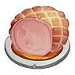Запечённый Рейндрикс<small>252 сытости</small>

<h3>Запечённый Рейндрикс</h3>Обычный
Блюдо из ингредиентов: «Мясо Рейндрикса». Съешь, чтобы утолить голод.

⚖️<small>Вес</small><b>2</b>

💰<small>Цена</small><b>420</b>

<h4>🔨 Крафт</h4>
<a class="ich" href="../../../4_spravochniki/predmety/ингредиент/#мясо-рейндрикса">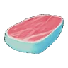Мясо Рейндрикса<b>×1</b></a>
<h5>Где сделать</h5>
<a class="ich" href="../../../4_spravochniki/predmety/постройки/#костер">Костер</a><a class="ich" href="../../../4_spravochniki/predmety/постройки/#котелок">Котелок</a><a class="ich" href="../../../4_spravochniki/predmety/постройки/#электрическая-кухня">Электрическая кухня</a><a class="ich" href="../../../4_spravochniki/predmety/постройки/#большая-кухня">📦Большая кухня</a><a class="ich" href="../../../4_spravochniki/predmety/постройки/#древняя-кухня">Древняя кухня</a>

Из игры

Мясо ледяного оленя обладает уникальным свойством — после извлечения из огня оно мгновенно остывает, сохраняя свежесть. Превосходный вариант для длительного хранения и экстренных ситуаций.

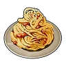Карбонара<small>129 сытости · 10 мин</small>

<h3>Карбонара</h3>Обычный
Блюдо из пасты с ингредиентами «Яйцо» и «Молоко». 10 мин после еды: защита +20 %.

⚖️<small>Вес</small><b>0,5</b>

💰<small>Цена</small><b>1260</b>

Защита +20 %

<h4>🔨 Крафт</h4>
<a class="ich" href="../../../4_spravochniki/predmety/ингредиент/#мука">Мука<b>×1</b></a><a class="ich" href="../../../4_spravochniki/predmety/ингредиент/#яйцо">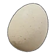Яйцо<b>×2</b></a><a class="ich" href="../../../4_spravochniki/predmety/ингредиент/#молоко">Молоко<b>×2</b></a>
<h5>Где сделать</h5>
<a class="ich" href="../../../4_spravochniki/predmety/постройки/#электрическая-кухня">Электрическая кухня</a><a class="ich" href="../../../4_spravochniki/predmety/постройки/#большая-кухня">📦Большая кухня</a><a class="ich" href="../../../4_spravochniki/predmety/постройки/#древняя-кухня">Древняя кухня</a>

Из игры

Блюдо из пасты с ингредиентами «Яйцо» и «Молоко». После употребления на некоторое время увеличивает Защита +20%.

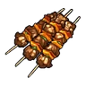Кебаб из Ламболла<small>52 сытости</small>

<h3>Кебаб из Ламболла</h3>Обычный
Блюдо из баранины, запечённой в пряном маринаде. Съешь, чтобы утолить голод.

⚖️<small>Вес</small><b>1</b>

💰<small>Цена</small><b>140</b>

<h4>🔨 Крафт</h4>
<a class="ich" href="../../../4_spravochniki/predmety/ингредиент/#мясо-ламболла">Мясо Ламболла<b>×1</b></a>
<h5>Где сделать</h5>
<a class="ich" href="../../../4_spravochniki/predmety/постройки/#костер">Костер</a><a class="ich" href="../../../4_spravochniki/predmety/постройки/#котелок">Котелок</a><a class="ich" href="../../../4_spravochniki/predmety/постройки/#электрическая-кухня">Электрическая кухня</a><a class="ich" href="../../../4_spravochniki/predmety/постройки/#большая-кухня">📦Большая кухня</a><a class="ich" href="../../../4_spravochniki/predmety/постройки/#древняя-кухня">Древняя кухня</a>

Из игры

Блюдо из баранины, запечённой в пряном маринаде. Обладает насыщенным и ярко выраженным характером вкуса.

Омлет<small>67 сытости · 10 мин</small>

<h3>Омлет</h3>Обычный
Блюдо из ингредиентов: «Помидор» и «Яйцо». 10 мин после еды: атака +10 %.

⚖️<small>Вес</small><b>0,5</b>

💰<small>Цена</small><b>580</b>

Атака +10 %

<h4>🔨 Крафт</h4>
<a class="ich" href="../../../4_spravochniki/predmety/ингредиент/#помидор">Помидор<b>×1</b></a><a class="ich" href="../../../4_spravochniki/predmety/ингредиент/#яйцо">Яйцо<b>×2</b></a>
<h5>Где сделать</h5>
<a class="ich" href="../../../4_spravochniki/predmety/постройки/#котелок">Котелок</a><a class="ich" href="../../../4_spravochniki/predmety/постройки/#электрическая-кухня">Электрическая кухня</a><a class="ich" href="../../../4_spravochniki/predmety/постройки/#большая-кухня">📦Большая кухня</a><a class="ich" href="../../../4_spravochniki/predmety/постройки/#древняя-кухня">Древняя кухня</a>

<h4>📍 Где взять</h4>

🛒Продаётся у торговцев<small>💰 580</small>

Из игры

Жареное Яйцо, сдобренное кетчупом. После употребления на некоторое время увеличивает Атака +10%.

Пицца<small>184 сытости · 10 мин</small>

<h3>Пицца</h3>Обычный
Блюдо из ингредиентов: «Мука», «Красная ягода», «Помидор» и ещё 1. 10 мин после еды: скорость работы +30 %, голод растёт на 25 % медленнее.

⚖️<small>Вес</small><b>0,5</b>

💰<small>Цена</small><b>1090</b>

Скорость работы +30 %Голод −25 % медленнее

<h4>🔨 Крафт</h4>
<a class="ich" href="../../../4_spravochniki/predmety/ингредиент/#мука">Мука<b>×1</b></a><a class="ich" href="../../../4_spravochniki/predmety/ингредиент/#красная-ягода">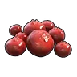Красная ягода<b>×2</b></a><a class="ich" href="../../../4_spravochniki/predmety/ингредиент/#помидор">Помидор<b>×2</b></a><a class="ich" href="../../../4_spravochniki/predmety/ингредиент/#молоко">Молоко<b>×2</b></a>
<h5>Где сделать</h5>
<a class="ich" href="../../../4_spravochniki/predmety/постройки/#электрическая-кухня">Электрическая кухня</a><a class="ich" href="../../../4_spravochniki/predmety/постройки/#большая-кухня">📦Большая кухня</a><a class="ich" href="../../../4_spravochniki/predmety/постройки/#древняя-кухня">Древняя кухня</a>

<h4>📍 Где взять</h4>

👤Любитель пиццы с ананасами Алоха<small>×1–2</small><small>100 %</small>

Из игры

Основа этого блюда — Хлеб с начинкой из ингредиентов «Красная ягода» и «Помидор» и сыра. После употребления на некоторое время немного повышается скорость работы и замедляется снижение сытости.

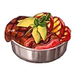Стейк из Моззарины<small>80 сытости</small>

<h3>Стейк из Моззарины</h3>Обычный
Хорошо прожаренный плотный стейк. Съешь, чтобы утолить голод.

⚖️<small>Вес</small><b>2,5</b>

💰<small>Цена</small><b>230</b>

<h4>🔨 Крафт</h4>
<a class="ich" href="../../../4_spravochniki/predmety/ингредиент/#мясо-моззарины">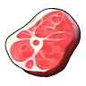Мясо Моззарины<b>×1</b></a>
<h5>Где сделать</h5>
<a class="ich" href="../../../4_spravochniki/predmety/постройки/#костер">Костер</a><a class="ich" href="../../../4_spravochniki/predmety/постройки/#котелок">Котелок</a><a class="ich" href="../../../4_spravochniki/predmety/постройки/#электрическая-кухня">Электрическая кухня</a><a class="ich" href="../../../4_spravochniki/predmety/постройки/#большая-кухня">📦Большая кухня</a><a class="ich" href="../../../4_spravochniki/predmety/постройки/#древняя-кухня">Древняя кухня</a>

Из игры

Хорошо прожаренный плотный стейк. Насыщенный вкус наполняет энергией.

Шашлычки из Чикипи<small>50 сытости</small>

<h3>Шашлычки из Чикипи</h3>Обычный
Куриные шашлычки, медленно приготовленные на углях. Съешь, чтобы утолить голод.

⚖️<small>Вес</small><b>1</b>

💰<small>Цена</small><b>120</b>

<h4>🔨 Крафт</h4>
<a class="ich" href="../../../4_spravochniki/predmety/ингредиент/#мясо-чикипи">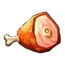Мясо Чикипи<b>×1</b></a>
<h5>Где сделать</h5>
<a class="ich" href="../../../4_spravochniki/predmety/постройки/#костер">Костер</a><a class="ich" href="../../../4_spravochniki/predmety/постройки/#котелок">Котелок</a><a class="ich" href="../../../4_spravochniki/predmety/постройки/#электрическая-кухня">Электрическая кухня</a><a class="ich" href="../../../4_spravochniki/predmety/постройки/#большая-кухня">📦Большая кухня</a><a class="ich" href="../../../4_spravochniki/predmety/постройки/#древняя-кухня">Древняя кухня</a>

Из игры

Куриные шашлычки, медленно приготовленные на углях. Легкая текстура и нежный, освежающий вкус.

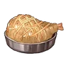Эрмург на гриле<small>50 сытости</small>

<h3>Эрмург на гриле</h3>Обычный
Блюдо из жареной птицы, наполненное мощью и энергией покорителя небес. Съешь, чтобы утолить голод.

⚖️<small>Вес</small><b>1</b>

💰<small>Цена</small><b>240</b>

<h4>🔨 Крафт</h4>
<a class="ich" href="../../../4_spravochniki/predmety/ингредиент/#мясо-эрмурга">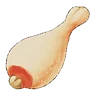Мясо Эрмурга<b>×1</b></a>
<h5>Где сделать</h5>
<a class="ich" href="../../../4_spravochniki/predmety/постройки/#костер">Костер</a><a class="ich" href="../../../4_spravochniki/predmety/постройки/#котелок">Котелок</a><a class="ich" href="../../../4_spravochniki/predmety/постройки/#электрическая-кухня">Электрическая кухня</a><a class="ich" href="../../../4_spravochniki/predmety/постройки/#большая-кухня">📦Большая кухня</a><a class="ich" href="../../../4_spravochniki/predmety/постройки/#древняя-кухня">Древняя кухня</a>

<h4>📍 Где взять</h4>

📍Награда Заносчивого критика Палов<small>×2</small><small>100 %</small>

📍Охотница за деликатесами<small>×3–10</small><small>100 %</small>

📍Сундук в поселении: Лес<small>×2–3</small><small>30 %</small>

📍Пещера Горного Потока<small>×2–3</small><small>28 %</small>

📍Лагерь врагов: Холмы (старт)<small>×2–3</small><small>23 %</small>

Из игры

Блюдо из жареной птицы, наполненное мощью и энергией покорителя небес.

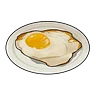Яичница<small>23 сытости</small>

<h3>Яичница</h3>Обычный
Яйцо становится вкуснее в жареном виде. Съешь, чтобы утолить голод.

⚖️<small>Вес</small><b>0,5</b>

💰<small>Цена</small><b>240</b>

<h4>🔨 Крафт</h4>
<a class="ich" href="../../../4_spravochniki/predmety/ингредиент/#яйцо">Яйцо<b>×1</b></a>
<h5>Где сделать</h5>
<a class="ich" href="../../../4_spravochniki/predmety/постройки/#костер">Костер</a><a class="ich" href="../../../4_spravochniki/predmety/постройки/#котелок">Котелок</a><a class="ich" href="../../../4_spravochniki/predmety/постройки/#электрическая-кухня">Электрическая кухня</a><a class="ich" href="../../../4_spravochniki/predmety/постройки/#большая-кухня">📦Большая кухня</a><a class="ich" href="../../../4_spravochniki/predmety/постройки/#древняя-кухня">Древняя кухня</a>

Из игры

Яйцо становится вкуснее в жареном виде. На удивление хорошо насыщает.

Дзингискан из Ламболла<small>147 сытости · 10 мин</small>

<h3>Дзингискан из Ламболла</h3>Необычный
Тщательно обжаренная на углях маринованная баранина. 10 мин после еды: рассудок падает на 20 % медленнее, скорость работы +30 %.

⚖️<small>Вес</small><b>0,5</b>

💰<small>Цена</small><b>340</b>

Рассудок −20 % медленнееСкорость работы +30 %

<h4>🔨 Крафт</h4>
<a class="ich" href="../../../4_spravochniki/predmety/ингредиент/#мясо-ламболла">Мясо Ламболла<b>×1</b></a><a class="ich" href="../../../4_spravochniki/predmety/ингредиент/#латук">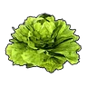Латук<b>×2</b></a>
<h5>Где сделать</h5>
<a class="ich" href="../../../4_spravochniki/predmety/постройки/#котелок">Котелок</a><a class="ich" href="../../../4_spravochniki/predmety/постройки/#электрическая-кухня">Электрическая кухня</a><a class="ich" href="../../../4_spravochniki/predmety/постройки/#большая-кухня">📦Большая кухня</a><a class="ich" href="../../../4_spravochniki/predmety/постройки/#древняя-кухня">Древняя кухня</a>

<h4>📍 Где взять</h4>

📍Миссия<small>×10</small><small>100 %</small>

📍Охотница за деликатесами<small>×3–10</small><small>100 %</small>

Из игры

Тщательно обжаренная на углях маринованная баранина. На некоторое время после еды немного увеличивается скорость работы, а снижение рассудка замедляется.

Запечённый Ламболл с травами<small>94 сытости · 10 мин</small>

<h3>Запечённый Ламболл с травами</h3>Необычный
Свежие ягоды подчёркивают характерный вкус баранины, придавая блюду аппетитный аромат. 10 мин после еды: защита +10 %.

⚖️<small>Вес</small><b>0,5</b>

💰<small>Цена</small><b>260</b>

Защита +10 %

<h4>🔨 Крафт</h4>
<a class="ich" href="../../../4_spravochniki/predmety/ингредиент/#мясо-ламболла">Мясо Ламболла<b>×1</b></a><a class="ich" href="../../../4_spravochniki/predmety/ингредиент/#красная-ягода">Красная ягода<b>×2</b></a>
<h5>Где сделать</h5>
<a class="ich" href="../../../4_spravochniki/predmety/постройки/#котелок">Котелок</a><a class="ich" href="../../../4_spravochniki/predmety/постройки/#электрическая-кухня">Электрическая кухня</a><a class="ich" href="../../../4_spravochniki/predmety/постройки/#большая-кухня">📦Большая кухня</a><a class="ich" href="../../../4_spravochniki/predmety/постройки/#древняя-кухня">Древняя кухня</a>

<h4>📍 Где взять</h4>

👤Адепт Организации по Защите Палов<small>×1</small><small>2 %</small>

👤Самовлюбленный болтун Эго<small>×1</small><small>2 %</small>

👤Агрессивный защитник Кирпич<small>×1</small><small>2 %</small>

📍Охотница за деликатесами<small>×3–10</small><small>100 %</small>

Из игры

Свежие ягоды подчёркивают характерный вкус баранины, придавая блюду аппетитный аромат. На некоторое время после еды Защита +10%

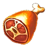Запечённый на кости Брончерри<small>252 сытости</small>

<h3>Запечённый на кости Брончерри</h3>Необычный
Отборный кусок жареного мяса, в котором чувствуется вкус дикого властелина. Съешь, чтобы утолить голод.

⚖️<small>Вес</small><b>5</b>

💰<small>Цена</small><b>600</b>

<h4>🔨 Крафт</h4>
<a class="ich" href="../../../4_spravochniki/predmety/ингредиент/#мясо-брончерри">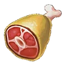Мясо Брончерри<b>×1</b></a>
<h5>Где сделать</h5>
<a class="ich" href="../../../4_spravochniki/predmety/постройки/#костер">Костер</a><a class="ich" href="../../../4_spravochniki/predmety/постройки/#котелок">Котелок</a><a class="ich" href="../../../4_spravochniki/predmety/постройки/#электрическая-кухня">Электрическая кухня</a><a class="ich" href="../../../4_spravochniki/predmety/постройки/#большая-кухня">📦Большая кухня</a><a class="ich" href="../../../4_spravochniki/predmety/постройки/#древняя-кухня">Древняя кухня</a>

Из игры

Отборный кусок жареного мяса, в котором чувствуется вкус дикого властелина. Из костей сочится насыщенный мясной сок, а само мясо — упругое снаружи, но удивительно нежное внутри.

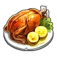Соте из мяса Чикипи<small>92 сытости · 10 мин</small>

<h3>Соте из мяса Чикипи</h3>Необычный
Блюдо из тушеных в сливочном масле толстых кусков курицы. 10 мин после еды: скорость работы +30 %.

⚖️<small>Вес</small><b>0,5</b>

💰<small>Цена</small><b>240</b>

Скорость работы +30 %

<h4>🔨 Крафт</h4>
<a class="ich" href="../../../4_spravochniki/predmety/ингредиент/#мясо-чикипи">Мясо Чикипи<b>×1</b></a><a class="ich" href="../../../4_spravochniki/predmety/ингредиент/#красная-ягода">Красная ягода<b>×2</b></a>
<h5>Где сделать</h5>
<a class="ich" href="../../../4_spravochniki/predmety/постройки/#котелок">Котелок</a><a class="ich" href="../../../4_spravochniki/predmety/постройки/#электрическая-кухня">Электрическая кухня</a><a class="ich" href="../../../4_spravochniki/predmety/постройки/#большая-кухня">📦Большая кухня</a><a class="ich" href="../../../4_spravochniki/predmety/постройки/#древняя-кухня">Древняя кухня</a>

<h4>📍 Где взять</h4>

👤Адепт Организации по Защите Палов<small>×1</small><small>2 %</small>

👤Судья Организации по Защите Палов<small>×1</small><small>2 %</small>

📍Миссия<small>×10</small><small>100 %</small>

📍Охотница за деликатесами<small>×3–10</small><small>100 %</small>

Из игры

Блюдо из тушеных в сливочном масле толстых кусков курицы. Во вкусе чувствуются освежающие нотки лимона. На некоторое время после еды скорость работы немного повышается.

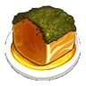Стейк из Маммореста<small>252 сытости</small>

<h3>Стейк из Маммореста</h3>Необычный
Благородный, насыщенный вкус. Съешь, чтобы утолить голод.

⚖️<small>Вес</small><b>5</b>

💰<small>Цена</small><b>1200</b>

<h4>🔨 Крафт</h4>
<a class="ich" href="../../../4_spravochniki/predmety/ингредиент/#мясо-маммореста">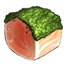Мясо Маммореста<b>×1</b></a>
<h5>Где сделать</h5>
<a class="ich" href="../../../4_spravochniki/predmety/постройки/#костер">Костер</a><a class="ich" href="../../../4_spravochniki/predmety/постройки/#котелок">Котелок</a><a class="ich" href="../../../4_spravochniki/predmety/постройки/#электрическая-кухня">Электрическая кухня</a><a class="ich" href="../../../4_spravochniki/predmety/постройки/#большая-кухня">📦Большая кухня</a><a class="ich" href="../../../4_spravochniki/predmety/постройки/#древняя-кухня">Древняя кухня</a>

<h4>📍 Где взять</h4>

📍Награда Заносчивого критика Палов<small>×1</small><small>100 %</small>

Из игры

Благородный, насыщенный вкус. Каждый укус возвращает к воспоминаниям о дремучих лесах и ледяных просторах.

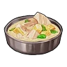Тушёный Рейндрикс<small>132 сытости · 10 мин</small>

<h3>Тушёный Рейндрикс</h3>Необычный
Рагу из мягкого мяса оленя, выращенного в прохладных краях, тушёное с овощами. 10 мин после еды: голод растёт на 25 % медленнее.

⚖️<small>Вес</small><b>0,5</b>

💰<small>Цена</small><b>610</b>

Голод −25 % медленнее

<h4>🔨 Крафт</h4>
<a class="ich" href="../../../4_spravochniki/predmety/ингредиент/#мясо-рейндрикса">Мясо Рейндрикса<b>×1</b></a><a class="ich" href="../../../4_spravochniki/predmety/ингредиент/#помидор">Помидор<b>×2</b></a>
<h5>Где сделать</h5>
<a class="ich" href="../../../4_spravochniki/predmety/постройки/#котелок">Котелок</a><a class="ich" href="../../../4_spravochniki/predmety/постройки/#электрическая-кухня">Электрическая кухня</a><a class="ich" href="../../../4_spravochniki/predmety/постройки/#большая-кухня">📦Большая кухня</a><a class="ich" href="../../../4_spravochniki/predmety/постройки/#древняя-кухня">Древняя кухня</a>

<h4>📍 Где взять</h4>

📍Сундук в поселении: Снега<small>×2–3</small><small>27 %</small>

📍Лагерь врагов: Снега<small>×1</small><small>27 %</small>

📍Пещера Священной Горы<small>×1–2</small><small>26 %</small>

Из игры

Рагу из мягкого мяса оленя, выращенного в прохладных краях, тушёное с овощами. Нежная текстура сочетается с тонкой естественной сладостью. После употребления на некоторое время медленнее снижается уровень сытости.

Тушёный Эрмург<small>92 сытости · 10 мин</small>

<h3>Тушёный Эрмург</h3>Необычный
Медленно тушёное блюдо с насыщенным вкусом умами и ярким ароматом дикого мяса. 10 мин после еды: рассудок падает на 20 % медленнее.

⚖️<small>Вес</small><b>0,5</b>

💰<small>Цена</small><b>360</b>

Рассудок −20 % медленнее

<h4>🔨 Крафт</h4>
<a class="ich" href="../../../4_spravochniki/predmety/ингредиент/#мясо-эрмурга">Мясо Эрмурга<b>×1</b></a><a class="ich" href="../../../4_spravochniki/predmety/ингредиент/#красная-ягода">Красная ягода<b>×2</b></a>
<h5>Где сделать</h5>
<a class="ich" href="../../../4_spravochniki/predmety/постройки/#котелок">Котелок</a><a class="ich" href="../../../4_spravochniki/predmety/постройки/#электрическая-кухня">Электрическая кухня</a><a class="ich" href="../../../4_spravochniki/predmety/постройки/#большая-кухня">📦Большая кухня</a><a class="ich" href="../../../4_spravochniki/predmety/постройки/#древняя-кухня">Древняя кухня</a>

Из игры

Медленно тушёное блюдо с насыщенным вкусом умами и ярким ароматом дикого мяса. На некоторое время после еды снижение рассудка замедляется.

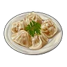Цзяоцзы с мясом Рашоа<small>115 сытости · 10 мин</small>

<h3>Цзяоцзы с мясом Рашоа</h3>Необычный
Сваренное блюдо из грибов и мясного фарша, завернутого в пшеничное тесто. 10 мин после еды: голод растёт на 25 % медленнее, атака +10 %.

⚖️<small>Вес</small><b>0,5</b>

💰<small>Цена</small><b>840</b>

Голод −25 % медленнееАтака +10 %

<h4>🔨 Крафт</h4>
<a class="ich" href="../../../4_spravochniki/predmety/ингредиент/#мясо-рашоа">Мясо Рашоа<b>×1</b></a><a class="ich" href="../../../4_spravochniki/predmety/ингредиент/#гриб">Гриб<b>×1</b></a><a class="ich" href="../../../4_spravochniki/predmety/ингредиент/#мука">Мука<b>×1</b></a>
<h5>Где сделать</h5>
<a class="ich" href="../../../4_spravochniki/predmety/постройки/#котелок">Котелок</a><a class="ich" href="../../../4_spravochniki/predmety/постройки/#электрическая-кухня">Электрическая кухня</a><a class="ich" href="../../../4_spravochniki/predmety/постройки/#большая-кухня">📦Большая кухня</a><a class="ich" href="../../../4_spravochniki/predmety/постройки/#древняя-кухня">Древняя кухня</a>

Из игры

Сваренное блюдо из грибов и мясного фарша, завернутого в пшеничное тесто. Обладает приятной мягкой и эластичной текстурой. Дает ощущение сытости на некоторое время и увеличивает Атака +10%.

Яйца с беконом из Рашоа<small>167 сытости · 10 мин</small>

<h3>Яйца с беконом из Рашоа</h3>Необычный
Копчёный аромат бекона и нежная текстура яйца создают изысканную вкусовую гармонию. 10 мин после еды: атака +10 %.

⚖️<small>Вес</small><b>0,5</b>

💰<small>Цена</small><b>840</b>

Атака +10 %

<h4>🔨 Крафт</h4>
<a class="ich" href="../../../4_spravochniki/predmety/ингредиент/#мясо-рашоа">Мясо Рашоа<b>×2</b></a><a class="ich" href="../../../4_spravochniki/predmety/ингредиент/#яйцо">Яйцо<b>×2</b></a>
<h5>Где сделать</h5>
<a class="ich" href="../../../4_spravochniki/predmety/постройки/#котелок">Котелок</a><a class="ich" href="../../../4_spravochniki/predmety/постройки/#электрическая-кухня">Электрическая кухня</a><a class="ich" href="../../../4_spravochniki/predmety/постройки/#большая-кухня">📦Большая кухня</a><a class="ich" href="../../../4_spravochniki/predmety/постройки/#древняя-кухня">Древняя кухня</a>

<h4>📍 Где взять</h4>

📍Охотница за деликатесами<small>×3–10</small><small>100 %</small>

📍Сундук в поселении: Вулкан<small>×2–3</small><small>33 %</small>

📍Пещера Вулкана<small>×1–2</small><small>28 %</small>

Из игры

Копчёный аромат бекона и нежная текстура яйца создают изысканную вкусовую гармонию. На некоторое время после еды Атака +10%

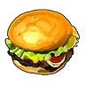Гамбургер с Моззариной<small>162 сытости · 10 мин</small>

<h3>Гамбургер с Моззариной</h3>Редкий
Идеальное сочетание вкуса сочной говядины и сладости булочек. 10 мин после еды: скорость работы +50 %, рассудок падает на 25 % медленнее.

⚖️<small>Вес</small><b>0,5</b>

💰<small>Цена</small><b>720</b>

Скорость работы +50 %Рассудок −25 % медленнее

<h4>🔨 Крафт</h4>
<a class="ich" href="../../../4_spravochniki/predmety/ингредиент/#мясо-моззарины">Мясо Моззарины<b>×1</b></a><a class="ich" href="../../../4_spravochniki/predmety/ингредиент/#мука">Мука<b>×1</b></a><a class="ich" href="../../../4_spravochniki/predmety/ингредиент/#латук">Латук<b>×2</b></a>
<h5>Где сделать</h5>
<a class="ich" href="../../../4_spravochniki/predmety/постройки/#электрическая-кухня">Электрическая кухня</a><a class="ich" href="../../../4_spravochniki/predmety/постройки/#большая-кухня">📦Большая кухня</a><a class="ich" href="../../../4_spravochniki/predmety/постройки/#древняя-кухня">Древняя кухня</a>

Из игры

Идеальное сочетание вкуса сочной говядины и сладости булочек. На некоторое время после еды немного увеличивается скорость работы, а снижение рассудка замедляется.

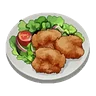Караагэ из Чикипи<small>108 сытости · 10 мин</small>

<h3>Караагэ из Чикипи</h3>Редкий
Невероятно сочное блюдо из курицы. 10 мин после еды: скорость работы +30 %, рассудок падает на 25 % медленнее.

⚖️<small>Вес</small><b>0,5</b>

💰<small>Цена</small><b>1020</b>

Скорость работы +30 %Рассудок −25 % медленнее

<h4>🔨 Крафт</h4>
<a class="ich" href="../../../4_spravochniki/predmety/ингредиент/#мясо-чикипи">Мясо Чикипи<b>×1</b></a><a class="ich" href="../../../4_spravochniki/predmety/ингредиент/#мука">Мука<b>×1</b></a><a class="ich" href="../../../4_spravochniki/predmety/ингредиент/#яйцо">Яйцо<b>×1</b></a><a class="ich" href="../../../4_spravochniki/predmety/материалы/#качественное-масло-пала">Качественное масло Пала<b>×1</b></a>
<h5>Где сделать</h5>
<a class="ich" href="../../../4_spravochniki/predmety/постройки/#электрическая-кухня">Электрическая кухня</a><a class="ich" href="../../../4_spravochniki/predmety/постройки/#большая-кухня">📦Большая кухня</a><a class="ich" href="../../../4_spravochniki/predmety/постройки/#древняя-кухня">Древняя кухня</a>

<h4>📍 Где взять</h4>

📍Охотница за деликатесами<small>×3–10</small><small>100 %</small>

Из игры

Невероятно сочное блюдо из курицы. На некоторое время после еды скорость работы немного повышается, снижение рассудка замедляется.

Локо-моко из Иктирдира<small>174 сытости · 10 мин</small>

<h3>Локо-моко из Иктирдира</h3>Редкий
Сочная котлета и глазунья с нежным, тягучим желтком. 10 мин после еды: атака +20 %.

⚖️<small>Вес</small><b>0,5</b>

💰<small>Цена</small><b>820</b>

Атака +20 %

<h4>🔨 Крафт</h4>
<a class="ich" href="../../../4_spravochniki/predmety/ингредиент/#мясо-иктирдира">Мясо Иктирдира<b>×1</b></a><a class="ich" href="../../../4_spravochniki/predmety/ингредиент/#красная-ягода">Красная ягода<b>×2</b></a><a class="ich" href="../../../4_spravochniki/predmety/ингредиент/#яйцо">Яйцо<b>×2</b></a>
<h5>Где сделать</h5>
<a class="ich" href="../../../4_spravochniki/predmety/постройки/#электрическая-кухня">Электрическая кухня</a><a class="ich" href="../../../4_spravochniki/predmety/постройки/#большая-кухня">📦Большая кухня</a><a class="ich" href="../../../4_spravochniki/predmety/постройки/#древняя-кухня">Древняя кухня</a>

<h4>📍 Где взять</h4>

🛒Продаётся у торговцев<small>💰 820</small>

📍Охотница за деликатесами<small>×3–10</small><small>100 %</small>

Из игры

Сочная котлета и глазунья с нежным, тягучим желтком. Этот совершенный дуэт дарит во рту настоящее счастье. На некоторое время после еды Атака +20%.

Спринг-роллы<small>115 сытости · 10 мин</small>

<h3>Спринг-роллы</h3>Редкий
Обжаренные роллы с начинкой из овощей и грибов. 10 мин после еды: рассудок падает на 50 % медленнее, атака +10 %.

⚖️<small>Вес</small><b>0,5</b>

💰<small>Цена</small><b>1260</b>

Рассудок −50 % медленнееАтака +10 %

<h4>🔨 Крафт</h4>
<a class="ich" href="../../../4_spravochniki/predmety/ингредиент/#лук">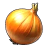Лук<b>×2</b></a><a class="ich" href="../../../4_spravochniki/predmety/ингредиент/#гриб">Гриб<b>×2</b></a><a class="ich" href="../../../4_spravochniki/predmety/ингредиент/#мука">Мука<b>×1</b></a>
<h5>Где сделать</h5>
<a class="ich" href="../../../4_spravochniki/predmety/постройки/#электрическая-кухня">Электрическая кухня</a><a class="ich" href="../../../4_spravochniki/predmety/постройки/#большая-кухня">📦Большая кухня</a><a class="ich" href="../../../4_spravochniki/predmety/постройки/#древняя-кухня">Древняя кухня</a>

Из игры

Обжаренные роллы с начинкой из овощей и грибов. Приятно хрустят при укусе. На некоторое время замедляют снижение рассудка и увеличивают Атака +10%.

Тушёный Иктирдир<small>212 сытости · 10 мин</small>

<h3>Тушёный Иктирдир</h3>Редкий
Рассыпчатое, мягчайшее мясо оленя, приготовленное с любовью. 10 мин после еды: защита +20 %.

⚖️<small>Вес</small><b>0,5</b>

💰<small>Цена</small><b>1270</b>

Защита +20 %

<h4>🔨 Крафт</h4>
<a class="ich" href="../../../4_spravochniki/predmety/ингредиент/#мясо-иктирдира">Мясо Иктирдира<b>×2</b></a><a class="ich" href="../../../4_spravochniki/predmety/ингредиент/#гриб">Гриб<b>×1</b></a><a class="ich" href="../../../4_spravochniki/predmety/ингредиент/#молоко">Молоко<b>×2</b></a>
<h5>Где сделать</h5>
<a class="ich" href="../../../4_spravochniki/predmety/постройки/#электрическая-кухня">Электрическая кухня</a><a class="ich" href="../../../4_spravochniki/predmety/постройки/#большая-кухня">📦Большая кухня</a><a class="ich" href="../../../4_spravochniki/predmety/постройки/#древняя-кухня">Древняя кухня</a>

<h4>📍 Где взять</h4>

🛒Продаётся у торговцев<small>💰 1270</small>

📍Награда Заносчивого критика Палов<small>×2</small><small>100 %</small>

📍Охотница за деликатесами<small>×3–10</small><small>100 %</small>

Из игры

Рассыпчатое, мягчайшее мясо оленя, приготовленное с любовью. Нежное переплетение вкусов мяса и овощей рождает мягкость и гармонию. На некоторое время после еды Защита +20%.

Хот-дог из Рашоа<small>140 сытости · 10 мин</small>

<h3>Хот-дог из Рашоа</h3>Редкий
Блюдо с сочной сосиской, зажатой между двумя булочками. 10 мин после еды: защита +20 %.

⚖️<small>Вес</small><b>0,5</b>

💰<small>Цена</small><b>670</b>

Защита +20 %

<h4>🔨 Крафт</h4>
<a class="ich" href="../../../4_spravochniki/predmety/ингредиент/#мясо-рашоа">Мясо Рашоа<b>×1</b></a><a class="ich" href="../../../4_spravochniki/predmety/ингредиент/#мука">Мука<b>×1</b></a><a class="ich" href="../../../4_spravochniki/predmety/ингредиент/#латук">Латук<b>×2</b></a>
<h5>Где сделать</h5>
<a class="ich" href="../../../4_spravochniki/predmety/постройки/#электрическая-кухня">Электрическая кухня</a><a class="ich" href="../../../4_spravochniki/predmety/постройки/#большая-кухня">📦Большая кухня</a><a class="ich" href="../../../4_spravochniki/predmety/постройки/#древняя-кухня">Древняя кухня</a>

Из игры

Блюдо с сочной сосиской, зажатой между двумя булочками. Хрустящая золотистая корочка и пряный вкус создают идеальное сочетание. На некоторое время после еды Защита +20%.

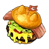Чизбургер с Моззариной<small>288 сытости · 10 мин</small>

<h3>Чизбургер с Моззариной</h3>Редкий
Добавление сыра вознесло блюдо в божественную сферу вкуса. 10 мин после еды: атака +20 %, голод растёт на 50 % медленнее.

⚖️<small>Вес</small><b>0,5</b>

💰<small>Цена</small><b>1430</b>

Атака +20 %Голод −50 % медленнее

<h4>🔨 Крафт</h4>
<a class="ich" href="../../../4_spravochniki/predmety/ингредиент/#мясо-моззарины">Мясо Моззарины<b>×2</b></a><a class="ich" href="../../../4_spravochniki/predmety/ингредиент/#мука">Мука<b>×1</b></a><a class="ich" href="../../../4_spravochniki/predmety/ингредиент/#помидор">Помидор<b>×2</b></a><a class="ich" href="../../../4_spravochniki/predmety/ингредиент/#молоко">Молоко<b>×2</b></a>
<h5>Где сделать</h5>
<a class="ich" href="../../../4_spravochniki/predmety/постройки/#электрическая-кухня">Электрическая кухня</a><a class="ich" href="../../../4_spravochniki/predmety/постройки/#большая-кухня">📦Большая кухня</a><a class="ich" href="../../../4_spravochniki/predmety/постройки/#древняя-кухня">Древняя кухня</a>

<h4>📍 Где взять</h4>

📍Миссия<small>×5</small><small>100 %</small>

Из игры

Добавление сыра вознесло блюдо в божественную сферу вкуса. На некоторое время после еды Атака +20%, и медленнее снижается уровень сытости.

Якисоба с мясом Брончерри<small>321 сытости · 10 мин</small>

<h3>Якисоба с мясом Брончерри</h3>Редкий
Лапша, обжаренная с овощами и мясом. 10 мин после еды: атака +20 %.

⚖️<small>Вес</small><b>0,5</b>

💰<small>Цена</small><b>1140</b>

Атака +20 %

<h4>🔨 Крафт</h4>
<a class="ich" href="../../../4_spravochniki/predmety/ингредиент/#мясо-брончерри">Мясо Брончерри<b>×1</b></a><a class="ich" href="../../../4_spravochniki/predmety/ингредиент/#лук">Лук<b>×1</b></a><a class="ich" href="../../../4_spravochniki/predmety/ингредиент/#морковь">Морковь<b>×1</b></a><a class="ich" href="../../../4_spravochniki/predmety/ингредиент/#мука">Мука<b>×1</b></a>
<h5>Где сделать</h5>
<a class="ich" href="../../../4_spravochniki/predmety/постройки/#электрическая-кухня">Электрическая кухня</a><a class="ich" href="../../../4_spravochniki/predmety/постройки/#большая-кухня">📦Большая кухня</a><a class="ich" href="../../../4_spravochniki/predmety/постройки/#древняя-кухня">Древняя кухня</a>

Из игры

Лапша, обжаренная с овощами и мясом. Насыщенный соус отлично подчёркивает вкус сочных мясных кусочков. После употребления на некоторое время увеличивает Атака +20%.

Карри с мясом Маммореста<small>418 сытости · 10 мин</small>

<h3>Карри с мясом Маммореста</h3>Эпический
Овощи и мясо, тушённые со специями. 10 мин после еды: атака +25 %.

⚖️<small>Вес</small><b>0,5</b>

💰<small>Цена</small><b>2040</b>

Атака +25 %

<h4>🔨 Крафт</h4>
<a class="ich" href="../../../4_spravochniki/predmety/ингредиент/#мясо-маммореста">Мясо Маммореста<b>×1</b></a><a class="ich" href="../../../4_spravochniki/predmety/ингредиент/#лук">Лук<b>×2</b></a><a class="ich" href="../../../4_spravochniki/predmety/ингредиент/#морковь">Морковь<b>×2</b></a><a class="ich" href="../../../4_spravochniki/predmety/ингредиент/#картофель">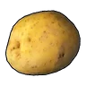Картофель<b>×2</b></a><a class="ich" href="../../../4_spravochniki/predmety/ингредиент/#красная-ягода">Красная ягода<b>×2</b></a>
<h5>Где сделать</h5>
<a class="ich" href="../../../4_spravochniki/predmety/постройки/#большая-кухня">📦Большая кухня</a><a class="ich" href="../../../4_spravochniki/predmety/постройки/#древняя-кухня">Древняя кухня</a>

<h4>📍 Где взять</h4>

🛒Продаётся у торговцев<small>💰 2040</small>

📍Сундук в поселении: Фейбрейк<small>×2–3</small><small>27 %</small>

📍Пещера Тэнраку<small>×1–2</small><small>25 %</small>

📍Лагерь врагов: Сакурадзима<small>×1–2</small><small>25 %</small>

📍Небесный свод Санрича<small>×1–2</small><small>17 %</small>

Из игры

Овощи и мясо, тушённые со специями. Блюдо с крупными кусками мяса и насыщенным вкусом. На некоторое время после употребления увеличивает Атака +25%.

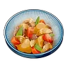Никудзяга из Эрмурга<small>150 сытости · 10 мин</small>

<h3>Никудзяга из Эрмурга</h3>Эпический
Блюдо из мяса и картофеля, тушёных в сладко-солёном соусе. 10 мин после еды: защита +25 %.

⚖️<small>Вес</small><b>0,5</b>

💰<small>Цена</small><b>960</b>

Защита +25 %

<h4>🔨 Крафт</h4>
<a class="ich" href="../../../4_spravochniki/predmety/ингредиент/#мясо-эрмурга">Мясо Эрмурга<b>×1</b></a><a class="ich" href="../../../4_spravochniki/predmety/ингредиент/#лук">Лук<b>×2</b></a><a class="ich" href="../../../4_spravochniki/predmety/ингредиент/#морковь">Морковь<b>×2</b></a><a class="ich" href="../../../4_spravochniki/predmety/ингредиент/#картофель">Картофель<b>×2</b></a>
<h5>Где сделать</h5>
<a class="ich" href="../../../4_spravochniki/predmety/постройки/#большая-кухня">📦Большая кухня</a><a class="ich" href="../../../4_spravochniki/predmety/постройки/#древняя-кухня">Древняя кухня</a>

<h4>📍 Где взять</h4>

🛒Продаётся у торговцев<small>💰 960</small>

📍Награда Заносчивого критика Палов<small>×2</small><small>100 %</small>

📍Сундук в поселении: Сакурадзима<small>×2–3</small><small>27 %</small>

📍Пещера Цветущей Сакуры<small>×1–2</small><small>26 %</small>

📍Лагерь врагов: Пустыня<small>×2–3</small><small>23 %</small>

Из игры

Блюдо из мяса и картофеля, тушёных в сладко-солёном соусе. Необычайно тёплый и ностальгический вкус. На некоторое время после употребления увеличивает Защита +25%.

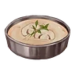Грибной суп<small>52 сытости · 10 мин</small>

<h3>Грибной суп</h3>Обычный
Крем-суп с ингредиентом «Гриб». 10 мин после еды: голод растёт на 25 % медленнее.

⚖️<small>Вес</small><b>0,5</b>

💰<small>Цена</small><b>840</b>

Голод −25 % медленнее

<h4>🔨 Крафт</h4>
<a class="ich" href="../../../4_spravochniki/predmety/ингредиент/#гриб">Гриб<b>×1</b></a><a class="ich" href="../../../4_spravochniki/predmety/ингредиент/#молоко">Молоко<b>×2</b></a>
<h5>Где сделать</h5>
<a class="ich" href="../../../4_spravochniki/predmety/постройки/#котелок">Котелок</a><a class="ich" href="../../../4_spravochniki/predmety/постройки/#электрическая-кухня">Электрическая кухня</a><a class="ich" href="../../../4_spravochniki/predmety/постройки/#большая-кухня">📦Большая кухня</a><a class="ich" href="../../../4_spravochniki/predmety/постройки/#древняя-кухня">Древняя кухня</a>

<h4>📍 Где взять</h4>

🛒Продаётся у торговцев<small>💰 840</small>

Из игры

Крем-суп с ингредиентом «Гриб». После употребления на некоторое время дольше сохраняется чувство сытости.

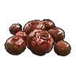Жареные ягоды<small>21 сытости</small>

<h3>Жареные ягоды</h3>Обычный
Благодаря обжарке повысилась питательная ценность. Съешь, чтобы утолить голод.

⚖️<small>Вес</small><b>0,15</b>

💰<small>Цена</small><b>60</b>

<h4>🔨 Крафт</h4>
<a class="ich" href="../../../4_spravochniki/predmety/ингредиент/#красная-ягода">Красная ягода<b>×1</b></a>
<h5>Где сделать</h5>
<a class="ich" href="../../../4_spravochniki/predmety/постройки/#костер">Костер</a><a class="ich" href="../../../4_spravochniki/predmety/постройки/#котелок">Котелок</a><a class="ich" href="../../../4_spravochniki/predmety/постройки/#электрическая-кухня">Электрическая кухня</a><a class="ich" href="../../../4_spravochniki/predmety/постройки/#большая-кухня">📦Большая кухня</a><a class="ich" href="../../../4_spravochniki/predmety/постройки/#древняя-кухня">Древняя кухня</a>

Из игры

Благодаря обжарке повысилась питательная ценность. На удивление хорошо насыщает.

Жареный гриб<small>18 сытости</small>

<h3>Жареный гриб</h3>Обычный
Гриб, ставший более питательным после обжарки. Съешь, чтобы утолить голод.

⚖️<small>Вес</small><b>1</b>

💰<small>Цена</small><b>360</b>

<h4>🔨 Крафт</h4>
<a class="ich" href="../../../4_spravochniki/predmety/ингредиент/#гриб">Гриб<b>×1</b></a>
<h5>Где сделать</h5>
<a class="ich" href="../../../4_spravochniki/predmety/постройки/#костер">Костер</a><a class="ich" href="../../../4_spravochniki/predmety/постройки/#котелок">Котелок</a><a class="ich" href="../../../4_spravochniki/predmety/постройки/#электрическая-кухня">Электрическая кухня</a><a class="ich" href="../../../4_spravochniki/predmety/постройки/#большая-кухня">📦Большая кухня</a><a class="ich" href="../../../4_spravochniki/predmety/постройки/#древняя-кухня">Древняя кухня</a>

Из игры

Гриб, ставший более питательным после обжарки. На удивление хорошо насыщает.

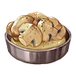Маринованные грибы<small>60 сытости · 10 мин</small>

<h3>Маринованные грибы</h3>Обычный
Блюдо из ингредиентов: «Гриб» и «Красная ягода». 10 мин после еды: защита +10 %.

⚖️<small>Вес</small><b>0,5</b>

💰<small>Цена</small><b>480</b>

Защита +10 %

<h4>🔨 Крафт</h4>
<a class="ich" href="../../../4_spravochniki/predmety/ингредиент/#гриб">Гриб<b>×1</b></a><a class="ich" href="../../../4_spravochniki/predmety/ингредиент/#красная-ягода">Красная ягода<b>×2</b></a>
<h5>Где сделать</h5>
<a class="ich" href="../../../4_spravochniki/predmety/постройки/#котелок">Котелок</a><a class="ich" href="../../../4_spravochniki/predmety/постройки/#электрическая-кухня">Электрическая кухня</a><a class="ich" href="../../../4_spravochniki/predmety/постройки/#большая-кухня">📦Большая кухня</a><a class="ich" href="../../../4_spravochniki/predmety/постройки/#древняя-кухня">Древняя кухня</a>

<h4>📍 Где взять</h4>

🛒Продаётся у торговцев<small>💰 480</small>

Из игры

Маринованные в маринаде Гриб. После употребления на некоторое время увеличивает Защита +10%.

Панкейки<small>42 сытости · 10 мин</small>

<h3>Панкейки</h3>Обычный
Блюдо, приготовленное из ингредиентов «Мука» и «Молоко». 10 мин после еды: рассудок падает на 25 % медленнее.

⚖️<small>Вес</small><b>0,5</b>

💰<small>Цена</small><b>540</b>

Рассудок −25 % медленнее

<h4>🔨 Крафт</h4>
<a class="ich" href="../../../4_spravochniki/predmety/ингредиент/#мука">Мука<b>×1</b></a><a class="ich" href="../../../4_spravochniki/predmety/ингредиент/#молоко">Молоко<b>×1</b></a>
<h5>Где сделать</h5>
<a class="ich" href="../../../4_spravochniki/predmety/постройки/#котелок">Котелок</a><a class="ich" href="../../../4_spravochniki/predmety/постройки/#электрическая-кухня">Электрическая кухня</a><a class="ich" href="../../../4_spravochniki/predmety/постройки/#большая-кухня">📦Большая кухня</a><a class="ich" href="../../../4_spravochniki/predmety/постройки/#древняя-кухня">Древняя кухня</a>

Из игры

Блюдо, приготовленное из ингредиентов «Мука» и «Молоко». На некоторое время после еды снижение рассудка немного замедляется.

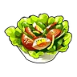Салат<small>84 сытости · 10 мин</small>

<h3>Салат</h3>Обычный
Блюдо из ингредиентов: «Латук» и «Помидор». 10 мин после еды: скорость работы +30 %.

⚖️<small>Вес</small><b>0,3</b>

💰<small>Цена</small><b>380</b>

Скорость работы +30 %

<h4>🔨 Крафт</h4>
<a class="ich" href="../../../4_spravochniki/predmety/ингредиент/#латук">Латук<b>×2</b></a><a class="ich" href="../../../4_spravochniki/predmety/ингредиент/#помидор">Помидор<b>×2</b></a>
<h5>Где сделать</h5>
<a class="ich" href="../../../4_spravochniki/predmety/постройки/#котелок">Котелок</a><a class="ich" href="../../../4_spravochniki/predmety/постройки/#электрическая-кухня">Электрическая кухня</a><a class="ich" href="../../../4_spravochniki/predmety/постройки/#большая-кухня">📦Большая кухня</a><a class="ich" href="../../../4_spravochniki/predmety/постройки/#древняя-кухня">Древняя кухня</a>

Из игры

Салат, в состав которого входят Латук и Помидор. На некоторое время после еды скорость работы немного повышается.

Торт<small>656 сытости</small>

<h3>Торт</h3>Обычный
Торт для разведения палов. Положи его в сундук на Пастбище свиданий, и палы отложат яйца.

⚖️<small>Вес</small><b>1</b>

💰<small>Цена</small><b>6300</b>

<h4>🔨 Крафт</h4>
<a class="ich" href="../../../4_spravochniki/predmety/ингредиент/#мука">Мука<b>×5</b></a><a class="ich" href="../../../4_spravochniki/predmety/ингредиент/#красная-ягода">Красная ягода<b>×8</b></a><a class="ich" href="../../../4_spravochniki/predmety/ингредиент/#молоко">Молоко<b>×7</b></a><a class="ich" href="../../../4_spravochniki/predmety/ингредиент/#яйцо">Яйцо<b>×8</b></a><a class="ich" href="../../../4_spravochniki/predmety/ингредиент/#мёд">Мёд<b>×2</b></a>
<h5>Где сделать</h5>
<a class="ich" href="../../../4_spravochniki/predmety/постройки/#котелок">Котелок</a><a class="ich" href="../../../4_spravochniki/predmety/постройки/#электрическая-кухня">Электрическая кухня</a><a class="ich" href="../../../4_spravochniki/predmety/постройки/#большая-кухня">📦Большая кухня</a><a class="ich" href="../../../4_spravochniki/predmety/постройки/#древняя-кухня">Древняя кухня</a>

<h4>📍 Где взять</h4>
<a class="igt" href="../../../4_spravochniki/paly/lovander/">🐾Ловандер<small>×1</small><small>1 %</small></a>
📍Миссия<small>×3</small><small>100 %</small>

Из игры

Блюдо, которое едят по случаю праздников. Если положить его в сундук Пастбище свиданий, Палы, съевшие его и набравшиеся сил, начнут откладывать яйца.

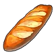Хлеб<small>27 сытости</small>

<h3>Хлеб</h3>Обычный
Хлеб приготовлен из ингредиента «Мука». Съешь, чтобы утолить голод.

⚖️<small>Вес</small><b>0,3</b>

💰<small>Цена</small><b>300</b>

<h4>🔨 Крафт</h4>
<a class="ich" href="../../../4_spravochniki/predmety/ингредиент/#мука">Мука<b>×1</b></a>
<h5>Где сделать</h5>
<a class="ich" href="../../../4_spravochniki/predmety/постройки/#костер">Костер</a><a class="ich" href="../../../4_spravochniki/predmety/постройки/#котелок">Котелок</a><a class="ich" href="../../../4_spravochniki/predmety/постройки/#электрическая-кухня">Электрическая кухня</a><a class="ich" href="../../../4_spravochniki/predmety/постройки/#большая-кухня">📦Большая кухня</a><a class="ich" href="../../../4_spravochniki/predmety/постройки/#древняя-кухня">Древняя кухня</a>

<h4>📍 Где взять</h4>

🛒Продаётся у торговцев<small>💰 300</small>

👤Житель деревни<small>×1–2</small><small>40 %</small>

👤Житель острова<small>×1–2</small><small>40 %</small>

👤Браконьер-новичок<small>×1</small><small>100 %</small>

👤Пироманьяк Огонёк<small>×1–2</small><small>100 %</small>

👤Злостная изменщица Сирена<small>×1–2</small><small>100 %</small>

👤Охотница на охотников за головами Танко<small>×1–2</small><small>100 %</small>

👤Близнецы-подрывники Дина<small>×1–2</small><small>100 %</small>

👤Близнецы-подрывники Мит<small>×1–2</small><small>100 %</small>

👤Шарлатан с добрыми намерениями Квилл<small>×1–2</small><small>100 %</small>

👤Заядлый халявщик Скут<small>×2–5</small><small>100 %</small>

👤Мастер побегов Фантом<small>×1–2</small><small>40 %</small>

👤Неисправимая спойлерша Шепот<small>×1–2</small><small>40 %</small>

👤Злостный растратчик Ским<small>×1–2</small><small>40 %</small>

👤Фальшивомонетчик Мимик<small>×1–2</small><small>40 %</small>

👤Лошадиный вор Билли<small>×1–2</small><small>40 %</small>

📍Сундук: Лес<small>×5–7</small><small>28 %</small>

📍Сундук в поселении: Холмы (старт)<small>×5–8</small><small>23 %</small>

📍Пещера Отдалённого Острова<small>×2–3</small><small>22 %</small>

Из игры

Хлеб приготовлен из ингредиента «Мука». Достаточно вкусный, чтобы стать основой рациона.

Хлеб с вареньем<small>51 сытости</small>

<h3>Хлеб с вареньем</h3>Обычный
Сладость ягод отлично дополняет вкус хлеба. Съешь, чтобы утолить голод.

⚖️<small>Вес</small><b>0,3</b>

💰<small>Цена</small><b>420</b>

<h4>🔨 Крафт</h4>
<a class="ich" href="../../../4_spravochniki/predmety/ингредиент/#мука">Мука<b>×1</b></a><a class="ich" href="../../../4_spravochniki/predmety/ингредиент/#красная-ягода">Красная ягода<b>×2</b></a>
<h5>Где сделать</h5>
<a class="ich" href="../../../4_spravochniki/predmety/постройки/#котелок">Котелок</a><a class="ich" href="../../../4_spravochniki/predmety/постройки/#электрическая-кухня">Электрическая кухня</a><a class="ich" href="../../../4_spravochniki/predmety/постройки/#большая-кухня">📦Большая кухня</a><a class="ich" href="../../../4_spravochniki/predmety/постройки/#древняя-кухня">Древняя кухня</a>

<h4>📍 Где взять</h4>

🛒Продаётся у торговцев<small>💰 420</small>

Из игры

Хлеб с вареньем. Сладость ягод отлично дополняет вкус хлеба.

Грибной торт<small>676 сытости</small>

<h3>Грибной торт</h3>Необычный
Торт для разведения палов. Положи его в сундук на Пастбище свиданий, и палы отложат яйца.

⚖️<small>Вес</small><b>1</b>

💰<small>Цена</small><b>7740</b>

📘<small>Технология</small><b>ур. 30</b>

<h4>🔨 Крафт</h4>
<a class="ich" href="../../../4_spravochniki/predmety/ингредиент/#мука">Мука<b>×5</b></a><a class="ich" href="../../../4_spravochniki/predmety/ингредиент/#гриб">Гриб<b>×5</b></a><a class="ich" href="../../../4_spravochniki/predmety/ингредиент/#пещерный-гриб">Пещерный гриб<b>×3</b></a><a class="ich" href="../../../4_spravochniki/predmety/ингредиент/#яйцо">Яйцо<b>×8</b></a><a class="ich" href="../../../4_spravochniki/predmety/ингредиент/#мёд">Мёд<b>×2</b></a>
<h5>Где сделать</h5>
<a class="ich" href="../../../4_spravochniki/predmety/постройки/#котелок">Котелок</a><a class="ich" href="../../../4_spravochniki/predmety/постройки/#электрическая-кухня">Электрическая кухня</a><a class="ich" href="../../../4_spravochniki/predmety/постройки/#большая-кухня">📦Большая кухня</a><a class="ich" href="../../../4_spravochniki/predmety/постройки/#древняя-кухня">Древняя кухня</a>

Из игры

Если поместить в сундук Пастбище свиданий, съевшие его Палы наберутся сил и отложат яйца. У потомства немного повышается шанс развития талантов.

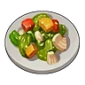Жареные овощи<small>54 сытости · 10 мин</small>

<h3>Жареные овощи</h3>Необычный
Блюдо из ингредиентов «Морковь» и «Лук», обжаренных в масле. 10 мин после еды: скорость работы +10 %, защита +10 %.

⚖️<small>Вес</small><b>0,5</b>

💰<small>Цена</small><b>480</b>

Скорость работы +10 %Защита +10 %

<h4>🔨 Крафт</h4>
<a class="ich" href="../../../4_spravochniki/predmety/ингредиент/#лук">Лук<b>×2</b></a><a class="ich" href="../../../4_spravochniki/predmety/ингредиент/#морковь">Морковь<b>×2</b></a>
<h5>Где сделать</h5>
<a class="ich" href="../../../4_spravochniki/predmety/постройки/#котелок">Котелок</a><a class="ich" href="../../../4_spravochniki/predmety/постройки/#электрическая-кухня">Электрическая кухня</a><a class="ich" href="../../../4_spravochniki/predmety/постройки/#большая-кухня">📦Большая кухня</a><a class="ich" href="../../../4_spravochniki/predmety/постройки/#древняя-кухня">Древняя кухня</a>

Из игры

Блюдо из ингредиентов «Морковь» и «Лук», обжаренных в масле. Простое и вкусное овощное блюдо. Ненадолго немного повышает скорость работы и увеличивает Защита +10%.

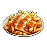Картофель фри<small>35 сытости · 10 мин</small>

<h3>Картофель фри</h3>Необычный
Картофель, обжаренный в масле. 10 мин после еды: рассудок падает на 25 % медленнее.

⚖️<small>Вес</small><b>0,5</b>

💰<small>Цена</small><b>600</b>

Рассудок −25 % медленнее

<h4>🔨 Крафт</h4>
<a class="ich" href="../../../4_spravochniki/predmety/ингредиент/#картофель">Картофель<b>×2</b></a><a class="ich" href="../../../4_spravochniki/predmety/материалы/#качественное-масло-пала">Качественное масло Пала<b>×1</b></a>
<h5>Где сделать</h5>
<a class="ich" href="../../../4_spravochniki/predmety/постройки/#котелок">Котелок</a><a class="ich" href="../../../4_spravochniki/predmety/постройки/#электрическая-кухня">Электрическая кухня</a><a class="ich" href="../../../4_spravochniki/predmety/постройки/#большая-кухня">📦Большая кухня</a><a class="ich" href="../../../4_spravochniki/predmety/постройки/#древняя-кухня">Древняя кухня</a>

Из игры

Картофель, обжаренный в масле. Стоит попробовать — и остановиться невозможно. Немного замедляет снижение рассудка на некоторое время.

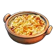Гратен<small>113 сытости · 10 мин</small>

<h3>Гратен</h3>Редкий
Картофель в соусе, запечённый до румяной корочки. 10 мин после еды: голод растёт на 50 % медленнее, защита +10 %.

⚖️<small>Вес</small><b>0,5</b>

💰<small>Цена</small><b>1020</b>

Голод −50 % медленнееЗащита +10 %

<h4>🔨 Крафт</h4>
<a class="ich" href="../../../4_spravochniki/predmety/ингредиент/#молоко">Молоко<b>×2</b></a><a class="ich" href="../../../4_spravochniki/predmety/ингредиент/#картофель">Картофель<b>×2</b></a><a class="ich" href="../../../4_spravochniki/predmety/ингредиент/#мука">Мука<b>×1</b></a>
<h5>Где сделать</h5>
<a class="ich" href="../../../4_spravochniki/predmety/постройки/#электрическая-кухня">Электрическая кухня</a><a class="ich" href="../../../4_spravochniki/predmety/постройки/#большая-кухня">📦Большая кухня</a><a class="ich" href="../../../4_spravochniki/predmety/постройки/#древняя-кухня">Древняя кухня</a>

Из игры

Картофель в соусе, запечённый до румяной корочки. Особенно вкусен в горячем виде. Даёт ощущение сытости на некоторое время и увеличивает Защита +10%.

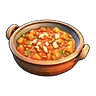Минестроне<small>146 сытости · 10 мин</small>

<h3>Минестроне</h3>Редкий
Суп с большим количеством овощей. 10 мин после еды: скорость работы +40 %.

⚖️<small>Вес</small><b>0,5</b>

💰<small>Цена</small><b>890</b>

Скорость работы +40 %

<h4>🔨 Крафт</h4>
<a class="ich" href="../../../4_spravochniki/predmety/ингредиент/#помидор">Помидор<b>×3</b></a><a class="ich" href="../../../4_spravochniki/predmety/ингредиент/#морковь">Морковь<b>×2</b></a><a class="ich" href="../../../4_spravochniki/predmety/ингредиент/#лук">Лук<b>×2</b></a><a class="ich" href="../../../4_spravochniki/predmety/ингредиент/#картофель">Картофель<b>×1</b></a>
<h5>Где сделать</h5>
<a class="ich" href="../../../4_spravochniki/predmety/постройки/#электрическая-кухня">Электрическая кухня</a><a class="ich" href="../../../4_spravochniki/predmety/постройки/#большая-кухня">📦Большая кухня</a><a class="ich" href="../../../4_spravochniki/predmety/постройки/#древняя-кухня">Древняя кухня</a>

Из игры

Суп с большим количеством овощей. Согревает изнутри. На некоторое время увеличивает скорость работы.

Овощной торт<small>696 сытости</small>

<h3>Овощной торт</h3>Редкий
Торт для разведения палов. Положи его в сундук на Пастбище свиданий, и палы отложат яйца.

⚖️<small>Вес</small><b>1</b>

💰<small>Цена</small><b>7200</b>

📘<small>Технология</small><b>ур. 47</b>

<h4>🔨 Крафт</h4>
<a class="ich" href="../../../4_spravochniki/predmety/ингредиент/#мука">Мука<b>×8</b></a><a class="ich" href="../../../4_spravochniki/predmety/ингредиент/#помидор">Помидор<b>×8</b></a><a class="ich" href="../../../4_spravochniki/predmety/ингредиент/#латук">Латук<b>×7</b></a><a class="ich" href="../../../4_spravochniki/predmety/ингредиент/#яйцо">Яйцо<b>×8</b></a><a class="ich" href="../../../4_spravochniki/predmety/ингредиент/#мёд">Мёд<b>×4</b></a>
<h5>Где сделать</h5>
<a class="ich" href="../../../4_spravochniki/predmety/постройки/#электрическая-кухня">Электрическая кухня</a><a class="ich" href="../../../4_spravochniki/predmety/постройки/#большая-кухня">📦Большая кухня</a><a class="ich" href="../../../4_spravochniki/predmety/постройки/#древняя-кухня">Древняя кухня</a>

Из игры

Если поместить в сундук Пастбище свиданий, съевшие его Палы наберутся сил и отложат яйца. За один раз откладывает два яйца.

Киш с грибами<small>184 сытости · 10 мин</small>

<h3>Киш с грибами</h3>Эпический
Пирог с начинкой из яиц, овощей, грибов и сливок. 10 мин после еды: голод растёт на 50 % медленнее, рассудок падает на 50 % медленнее.

⚖️<small>Вес</small><b>0,5</b>

💰<small>Цена</small><b>2220</b>

Голод −50 % медленнееРассудок −50 % медленнее

<h4>🔨 Крафт</h4>
<a class="ich" href="../../../4_spravochniki/predmety/ингредиент/#мука">Мука<b>×1</b></a><a class="ich" href="../../../4_spravochniki/predmety/ингредиент/#гриб">Гриб<b>×2</b></a><a class="ich" href="../../../4_spravochniki/predmety/ингредиент/#лук">Лук<b>×2</b></a><a class="ich" href="../../../4_spravochniki/predmety/ингредиент/#яйцо">Яйцо<b>×2</b></a><a class="ich" href="../../../4_spravochniki/predmety/ингредиент/#молоко">Молоко<b>×2</b></a>
<h5>Где сделать</h5>
<a class="ich" href="../../../4_spravochniki/predmety/постройки/#большая-кухня">📦Большая кухня</a><a class="ich" href="../../../4_spravochniki/predmety/постройки/#древняя-кухня">Древняя кухня</a>

Из игры

Пирог с начинкой из яиц, овощей, грибов и сливок. Остаётся вкусным даже в холодном виде. Даёт ощущение сытости на некоторое время и замедляет снижение рассудка.

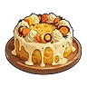Роскошный овощной торт<small>717 сытости</small>

<h3>Роскошный овощной торт</h3>Эпический
Торт для разведения палов. Положи его в сундук на Пастбище свиданий, и палы отложат яйца.

⚖️<small>Вес</small><b>1</b>

💰<small>Цена</small><b>9360</b>

📘<small>Технология</small><b>ур. 60</b>

<h4>🔨 Крафт</h4>
<a class="ich" href="../../../4_spravochniki/predmety/ингредиент/#мука">Мука<b>×12</b></a><a class="ich" href="../../../4_spravochniki/predmety/ингредиент/#сахарная-вата">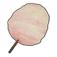Сахарная вата<b>×8</b></a><a class="ich" href="../../../4_spravochniki/predmety/ингредиент/#картофель">Картофель<b>×10</b></a><a class="ich" href="../../../4_spravochniki/predmety/ингредиент/#лук">Лук<b>×6</b></a><a class="ich" href="../../../4_spravochniki/predmety/ингредиент/#морковь">Морковь<b>×8</b></a>
<h5>Где сделать</h5>
<a class="ich" href="../../../4_spravochniki/predmety/постройки/#большая-кухня">📦Большая кухня</a><a class="ich" href="../../../4_spravochniki/predmety/постройки/#древняя-кухня">Древняя кухня</a>

<h4>📍 Где взять</h4>

📍Миссия<small>×10</small><small>100 %</small>

Из игры

Если поместить в сундук Пастбище свиданий, съевшие его Палы наберутся сил и отложат яйца. Повышает вероятность мутаций и облегчает развитие талантов.

Специальный торт<small>738 сытости</small>

<h3>Специальный торт</h3>Легендарный
Торт для разведения палов. Положи его в сундук на Пастбище свиданий, и палы отложат яйца.

⚖️<small>Вес</small><b>1</b>

💰<small>Цена</small><b>20400</b>

📘<small>Технология</small><b>ур. 74</b>

<h4>🔨 Крафт</h4>
<a class="ich" href="../../../4_spravochniki/predmety/ингредиент/#мука">Мука<b>×20</b></a><a class="ich" href="../../../4_spravochniki/predmety/ингредиент/#карамельная-сахарная-вата">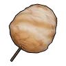Карамельная сахарная вата<b>×8</b></a><a class="ich" href="../../../4_spravochniki/predmety/ингредиент/#молоко">Молоко<b>×15</b></a><a class="ich" href="../../../4_spravochniki/predmety/ингредиент/#яйцо">Яйцо<b>×15</b></a><a class="ich" href="../../../4_spravochniki/predmety/ингредиент/#мясо-маммореста">Мясо Маммореста<b>×2</b></a>
<h5>Где сделать</h5>
<a class="ich" href="../../../4_spravochniki/predmety/постройки/#древняя-кухня">Древняя кухня</a>

<h4>📍 Где взять</h4>

📍Миссия<small>×5</small><small>100 %</small>

Из игры

Если поместить в сундук Пастбище свиданий, съевшие его Палы наберутся сил и отложат яйца. Потомство с большей вероятностью унаследует больше пассивных навыков родителей.

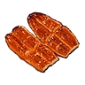Кабаяки из Думада<small>70 сытости</small>

<h3>Кабаяки из Думада</h3>Обычный
Обжаренная в секретном соусе рыба, настолько вкусная, что исцеляет и тело, и душу. Съешь, чтобы утолить голод.

⚖️<small>Вес</small><b>2</b>

💰<small>Цена</small><b>260</b>

<h4>🔨 Крафт</h4>
<a class="ich" href="../../../4_spravochniki/predmety/ингредиент/#мясо-думада">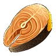Мясо Думада<b>×1</b></a>
<h5>Где сделать</h5>
<a class="ich" href="../../../4_spravochniki/predmety/постройки/#костер">Костер</a><a class="ich" href="../../../4_spravochniki/predmety/постройки/#котелок">Котелок</a><a class="ich" href="../../../4_spravochniki/predmety/постройки/#электрическая-кухня">Электрическая кухня</a><a class="ich" href="../../../4_spravochniki/predmety/постройки/#большая-кухня">📦Большая кухня</a><a class="ich" href="../../../4_spravochniki/predmety/постройки/#древняя-кухня">Древняя кухня</a>

Из игры

Обжаренная в секретном соусе рыба, настолько вкусная, что исцеляет и тело, и душу. Идеальное блюдо для уставшего укротителя Палов.

Келпси на углях<small>50 сытости</small>

<h3>Келпси на углях</h3>Обычный
Свежая рыба, запечённая на углях, обладает нежной и воздушной текстурой. Съешь, чтобы утолить голод.

⚖️<small>Вес</small><b>1</b>

💰<small>Цена</small><b>170</b>

<h4>🔨 Крафт</h4>
<a class="ich" href="../../../4_spravochniki/predmety/ингредиент/#мясо-келпси">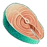Мясо Келпси<b>×1</b></a>
<h5>Где сделать</h5>
<a class="ich" href="../../../4_spravochniki/predmety/постройки/#костер">Костер</a><a class="ich" href="../../../4_spravochniki/predmety/постройки/#котелок">Котелок</a><a class="ich" href="../../../4_spravochniki/predmety/постройки/#электрическая-кухня">Электрическая кухня</a><a class="ich" href="../../../4_spravochniki/predmety/постройки/#большая-кухня">📦Большая кухня</a><a class="ich" href="../../../4_spravochniki/predmety/постройки/#древняя-кухня">Древняя кухня</a>

Из игры

Свежая рыба, запечённая на углях, обладает нежной и воздушной текстурой.

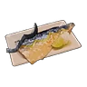Жареный Скатласс с солью<small>90 сытости · 10 мин</small>

<h3>Жареный Скатласс с солью</h3>Необычный
Блюдо из свежего филе Скатласса, щедро посыпанного солью и запечённого на огне. 10 мин после еды: тебя не отбрасывает ударами.

⚖️<small>Вес</small><b>1</b>

💰<small>Цена</small><b>720</b>

Не отбрасывает

<h4>🔨 Крафт</h4>
<a class="ich" href="../../../4_spravochniki/predmety/ингредиент/#филе-скатласса">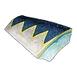Филе Скатласса<b>×1</b></a>
<h5>Где сделать</h5>
<a class="ich" href="../../../4_spravochniki/predmety/постройки/#костер">Костер</a><a class="ich" href="../../../4_spravochniki/predmety/постройки/#котелок">Котелок</a><a class="ich" href="../../../4_spravochniki/predmety/постройки/#электрическая-кухня">Электрическая кухня</a><a class="ich" href="../../../4_spravochniki/predmety/постройки/#большая-кухня">📦Большая кухня</a><a class="ich" href="../../../4_spravochniki/predmety/постройки/#древняя-кухня">Древняя кухня</a>

Из игры

Блюдо из свежего филе Скатласса, щедро посыпанного солью и запечённого на огне. На некоторое время делает невосприимчивым к отбрасыванию и оглушающему откату.

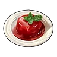Качающееся желе Джелроя<small>60 сытости · 10 мин</small>

<h3>Качающееся желе Джелроя</h3>Необычный
Блюдо из ингредиентов: «Зонтик медузы Джелроя» и «Красная ягода». 10 мин после еды: опыт +10 %, защита +10 %.

⚖️<small>Вес</small><b>1</b>

💰<small>Цена</small><b>720</b>

Опыт +10 %Защита +10 %

<h4>🔨 Крафт</h4>
<a class="ich" href="../../../4_spravochniki/predmety/ингредиент/#зонтик-медузы-джелроя">Зонтик медузы Джелроя<b>×2</b></a><a class="ich" href="../../../4_spravochniki/predmety/ингредиент/#красная-ягода">Красная ягода<b>×2</b></a>
<h5>Где сделать</h5>
<a class="ich" href="../../../4_spravochniki/predmety/постройки/#котелок">Котелок</a><a class="ich" href="../../../4_spravochniki/predmety/постройки/#электрическая-кухня">Электрическая кухня</a><a class="ich" href="../../../4_spravochniki/predmety/постройки/#большая-кухня">📦Большая кухня</a><a class="ich" href="../../../4_spravochniki/predmety/постройки/#древняя-кухня">Древняя кухня</a>

<h4>📍 Где взять</h4>

🛒Продаётся у торговцев<small>💰 720</small>

Из игры

Причудливый десерт, для приготовления которого используется Зонтик медузы Джелроя и Красная ягода. На некоторое время немного увеличивает количество получаемого опыта. Защита +10%

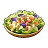Салат из морепродуктов<small>95 сытости · 30 мин</small>

<h3>Салат из морепродуктов</h3>Необычный
Блюдо из ингредиентов: «Щупальце Глуппи» и «Латук». 30 мин после еды: опыт +20 %.

⚖️<small>Вес</small><b>1</b>

💰<small>Цена</small><b>1100</b>

Опыт +20 %

<h4>🔨 Крафт</h4>
<a class="ich" href="../../../4_spravochniki/predmety/ингредиент/#щупальце-глуппи">Щупальце Глуппи<b>×3</b></a><a class="ich" href="../../../4_spravochniki/predmety/ингредиент/#латук">Латук<b>×4</b></a>
<h5>Где сделать</h5>
<a class="ich" href="../../../4_spravochniki/predmety/постройки/#электрическая-кухня">Электрическая кухня</a><a class="ich" href="../../../4_spravochniki/predmety/постройки/#большая-кухня">📦Большая кухня</a><a class="ich" href="../../../4_spravochniki/predmety/постройки/#древняя-кухня">Древняя кухня</a>

<h4>📍 Где взять</h4>

🛒Продаётся у торговцев<small>💰 1100</small>

Из игры

Полезный салат, для приготовления которого используются Щупальце Глуппи и Латук. На некоторое время увеличивает количество получаемого опыта.

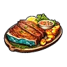Стейк из Манчилла<small>85 сытости</small>

<h3>Стейк из Манчилла</h3>Необычный
Хорошо прожаренный на углях стейк. Съешь, чтобы утолить голод.

⚖️<small>Вес</small><b>1</b>

💰<small>Цена</small><b>300</b>

<h4>🔨 Крафт</h4>
<a class="ich" href="../../../4_spravochniki/predmety/ингредиент/#крокодилье-мясо-манчиллы">Крокодилье мясо Манчиллы<b>×1</b></a>
<h5>Где сделать</h5>
<a class="ich" href="../../../4_spravochniki/predmety/постройки/#костер">Костер</a><a class="ich" href="../../../4_spravochniki/predmety/постройки/#котелок">Котелок</a><a class="ich" href="../../../4_spravochniki/predmety/постройки/#электрическая-кухня">Электрическая кухня</a><a class="ich" href="../../../4_spravochniki/predmety/постройки/#большая-кухня">📦Большая кухня</a><a class="ich" href="../../../4_spravochniki/predmety/постройки/#древняя-кухня">Древняя кухня</a>

Из игры

Хорошо прожаренный на углях стейк. Снаружи он ароматно поджарен, а внутри — сочный и тающий во рту. Особые ингредиенты сохраняют его насыщенный вкус и обеспечивают отличную сохранность.

Студенистое желе Джелиэтты<small>58 сытости · 10 мин</small>

<h3>Студенистое желе Джелиэтты</h3>Необычный
Блюдо из ингредиентов: «Зонтик медузы Джелиэтты» и «Жидкость водного Пала». 10 мин после еды: опыт +10 %, атака +10 %.

⚖️<small>Вес</small><b>1</b>

💰<small>Цена</small><b>1320</b>

Опыт +10 %Атака +10 %

<h4>🔨 Крафт</h4>
<a class="ich" href="../../../4_spravochniki/predmety/ингредиент/#зонтик-медузы-джелиэтты">Зонтик медузы Джелиэтты<b>×2</b></a><a class="ich" href="../../../4_spravochniki/predmety/материалы/#жидкость-водного-пала">Жидкость водного Пала<b>×2</b></a>
<h5>Где сделать</h5>
<a class="ich" href="../../../4_spravochniki/predmety/постройки/#котелок">Котелок</a><a class="ich" href="../../../4_spravochniki/predmety/постройки/#электрическая-кухня">Электрическая кухня</a><a class="ich" href="../../../4_spravochniki/predmety/постройки/#большая-кухня">📦Большая кухня</a><a class="ich" href="../../../4_spravochniki/predmety/постройки/#древняя-кухня">Древняя кухня</a>

<h4>📍 Где взять</h4>

🛒Продаётся у торговцев<small>💰 1320</small>

Из игры

Причудливый десерт, для приготовления которого используется Зонтик медузы Джелиэтты и Жидкость водного Пала. На некоторое время немного увеличивает количество получаемого опыта. Атака +10%

Такояки из Глуппи<small>80 сытости · 30 мин</small>

<h3>Такояки из Глуппи</h3>Необычный
Блюдо из ингредиентов: «Щупальце Глуппи» и «Мука». 30 мин после еды: опыт +10 %.

⚖️<small>Вес</small><b>1</b>

💰<small>Цена</small><b>1380</b>

Опыт +10 %

<h4>🔨 Крафт</h4>
<a class="ich" href="../../../4_spravochniki/predmety/ингредиент/#щупальце-глуппи">Щупальце Глуппи<b>×2</b></a><a class="ich" href="../../../4_spravochniki/predmety/ингредиент/#мука">Мука<b>×3</b></a>
<h5>Где сделать</h5>
<a class="ich" href="../../../4_spravochniki/predmety/постройки/#котелок">Котелок</a><a class="ich" href="../../../4_spravochniki/predmety/постройки/#электрическая-кухня">Электрическая кухня</a><a class="ich" href="../../../4_spravochniki/predmety/постройки/#большая-кухня">📦Большая кухня</a><a class="ich" href="../../../4_spravochniki/predmety/постройки/#древняя-кухня">Древняя кухня</a>

Из игры

Блюдо из теста на основе ингредиента «Мука» с начинкой из ингредиента «Щупальце Глуппи», запечённое до румяной корочки. На некоторое время немного увеличивает количество получаемого опыта.

Келпси-фрай<small>108 сытости · 10 мин</small>

<h3>Келпси-фрай</h3>Редкий
Упругое рыбное филе в хрустящей корочке. 10 мин после еды: защита +10 %, рассудок падает на 50 % медленнее.

⚖️<small>Вес</small><b>0,5</b>

💰<small>Цена</small><b>1070</b>

Защита +10 %Рассудок −50 % медленнее

<h4>🔨 Крафт</h4>
<a class="ich" href="../../../4_spravochniki/predmety/ингредиент/#мясо-келпси">Мясо Келпси<b>×1</b></a><a class="ich" href="../../../4_spravochniki/predmety/ингредиент/#мука">Мука<b>×1</b></a><a class="ich" href="../../../4_spravochniki/predmety/ингредиент/#яйцо">Яйцо<b>×1</b></a><a class="ich" href="../../../4_spravochniki/predmety/материалы/#качественное-масло-пала">Качественное масло Пала<b>×1</b></a>
<h5>Где сделать</h5>
<a class="ich" href="../../../4_spravochniki/predmety/постройки/#электрическая-кухня">Электрическая кухня</a><a class="ich" href="../../../4_spravochniki/predmety/постройки/#большая-кухня">📦Большая кухня</a><a class="ich" href="../../../4_spravochniki/predmety/постройки/#древняя-кухня">Древняя кухня</a>

Из игры

Упругое рыбное филе в хрустящей корочке. На некоторое время после еды Защита +10%, снижение рассудка замедляется.

Паста с морепродуктами<small>193 сытости · 10 мин</small>

<h3>Паста с морепродуктами</h3>Редкий
Блюдо из ингредиентов: «Щупальце Глуппи», «Мука» и «Помидор». 10 мин после еды: защита от взрывов +100 %.

⚖️<small>Вес</small><b>1</b>

💰<small>Цена</small><b>1810</b>

Защита от взрывов +100 %

<h4>🔨 Крафт</h4>
<a class="ich" href="../../../4_spravochniki/predmety/ингредиент/#щупальце-глуппи">Щупальце Глуппи<b>×3</b></a><a class="ich" href="../../../4_spravochniki/predmety/ингредиент/#мука">Мука<b>×3</b></a><a class="ich" href="../../../4_spravochniki/predmety/ингредиент/#помидор">Помидор<b>×2</b></a>
<h5>Где сделать</h5>
<a class="ich" href="../../../4_spravochniki/predmety/постройки/#электрическая-кухня">Электрическая кухня</a><a class="ich" href="../../../4_spravochniki/predmety/постройки/#большая-кухня">📦Большая кухня</a><a class="ich" href="../../../4_spravochniki/predmety/постройки/#древняя-кухня">Древняя кухня</a>

<h4>📍 Где взять</h4>

📍Лагерь врагов: Санрич<small>×1–2</small><small>24 %</small>

Из игры

Паста с щупальцами Глуппи и ароматом моря. На некоторое время защищает от взрывного урона.

Чаудер из Думада<small>170 сытости · 10 мин</small>

<h3>Чаудер из Думада</h3>Редкий
Уникальный вкус, утопающий в кремовом супе. 10 мин после еды: скорость работы +50 %, голод растёт на 25 % медленнее.

⚖️<small>Вес</small><b>0,5</b>

💰<small>Цена</small><b>650</b>

Скорость работы +50 %Голод −25 % медленнее

<h4>🔨 Крафт</h4>
<a class="ich" href="../../../4_spravochniki/predmety/ингредиент/#мясо-думада">Мясо Думада<b>×1</b></a><a class="ich" href="../../../4_spravochniki/predmety/ингредиент/#латук">Латук<b>×2</b></a><a class="ich" href="../../../4_spravochniki/predmety/ингредиент/#помидор">Помидор<b>×2</b></a>
<h5>Где сделать</h5>
<a class="ich" href="../../../4_spravochniki/predmety/постройки/#электрическая-кухня">Электрическая кухня</a><a class="ich" href="../../../4_spravochniki/predmety/постройки/#большая-кухня">📦Большая кухня</a><a class="ich" href="../../../4_spravochniki/predmety/постройки/#древняя-кухня">Древняя кухня</a>

<h4>📍 Где взять</h4>

📍Награда Заносчивого критика Палов<small>×2</small><small>100 %</small>

📍Охотница за деликатесами<small>×3–10</small><small>100 %</small>

📍Сундук в поселении: Пустыня<small>×2–3</small><small>33 %</small>

📍Пещера Песчаных Дюн<small>×1</small><small>27 %</small>

Из игры

Уникальный вкус, утопающий в кремовом супе. На некоторое время после еды скорость работы повышается, снижение уровня сытости немного замедляется.

Молоко<small>12 сытости</small>

<h3>Молоко</h3>Обычный
Можно пить как есть или использовать в готовке. Можно съесть сразу или приготовить из этого что-то вкуснее.

⚖️<small>Вес</small><b>1,5</b>

💰<small>Цена</small><b>200</b>

<h4>📍 Где взять</h4>

🛒Продаётся у торговцев<small>💰 200</small>
<a class="igt" href="../../../4_spravochniki/paly/mozzarina/">🐾Моззарина<small>×1</small><small>100 %</small></a>
👤Коровий вор Лассо<small>×1</small><small>100 %</small>

🐑Пастбище: Моззарина сам даёт<small>×1–2</small><small>100 %</small>

<h4>Где используется</h4>
<a class="ich" href="../../../4_spravochniki/predmety/ингредиент/#горячее-молоко">Горячее молоко</a><a class="ich" href="../../../4_spravochniki/predmety/ингредиент/#панкейки">Панкейки</a><a class="ich" href="../../../4_spravochniki/predmety/ингредиент/#грибной-суп">Грибной суп</a><a class="ich" href="../../../4_spravochniki/predmety/ингредиент/#карбонара">Карбонара</a><a class="ich" href="../../../4_spravochniki/predmety/ингредиент/#пицца">Пицца</a><a class="ich" href="../../../4_spravochniki/predmety/ингредиент/#торт">Торт</a><a class="ich" href="../../../4_spravochniki/predmety/ингредиент/#тушёный-иктирдир">Тушёный Иктирдир</a><a class="ich" href="../../../4_spravochniki/predmety/ингредиент/#чизбургер-с-моззариной">Чизбургер с Моззариной</a><a class="ich" href="../../../4_spravochniki/predmety/ингредиент/#гратен">Гратен</a><a class="ich" href="../../../4_spravochniki/predmety/ингредиент/#киш-с-грибами">Киш с грибами</a><a class="ich" href="../../../4_spravochniki/predmety/ингредиент/#специальный-торт">Специальный торт</a>

Из игры

Можно пить как есть или использовать в готовке. Получается от пала «Моззарина».

Мясо Иктирдира<small>50 сытости</small>

<h3>Мясо Иктирдира</h3>Обычный
Лёгкое и нежирное, но при этом очень вкусное мясо. Можно съесть сразу или приготовить из этого что-то вкуснее.

⚖️<small>Вес</small><b>2</b>

💰<small>Цена</small><b>180</b>

<h4>📍 Где взять</h4>

🛒Продаётся у торговцев<small>💰 180</small>
<a class="igt" href="../../../4_spravochniki/paly/eikthyrdeer/">🐾Иктирдир<small>×2</small><small>100 %</small></a><a class="igt" href="../../../4_spravochniki/paly/eikthyrdeer_terra/">🐾Иктирдир Тэрра<small>×2</small><small>100 %</small></a>
🧭Экспедиция: Лес (сложная)<small>×10–20</small><small>100 %</small>

<h4>Где используется</h4>
<a class="ich" href="../../../4_spravochniki/predmety/ингредиент/#запечённый-иктирдир">Запечённый Иктирдир</a><a class="ich" href="../../../4_spravochniki/predmety/ингредиент/#локо-моко-из-иктирдира">Локо-моко из Иктирдира</a><a class="ich" href="../../../4_spravochniki/predmety/ингредиент/#тушёный-иктирдир">Тушёный Иктирдир</a>

Из игры

Мясо Иктирдир. Лёгкое и нежирное, но при этом очень вкусное мясо.

Мясо Каприти<small>57 сытости</small>

<h3>Мясо Каприти</h3>Обычный
Полезное, богатое питательными веществами мясо. Можно съесть сразу или приготовить из этого что-то вкуснее.

⚖️<small>Вес</small><b>2,5</b>

💰<small>Цена</small><b>170</b>

<h4>📍 Где взять</h4>

🛒Продаётся у торговцев<small>💰 170</small>
<a class="igt" href="../../../4_spravochniki/paly/caprity/">🐾Каприти<small>×2</small><small>100 %</small></a><a class="igt" href="../../../4_spravochniki/paly/caprity_noct/">🐾Каприти Нокт<small>×2</small><small>100 %</small></a>
🧭Экспедиция: Сакурадзима (сложная)<small>×10–20</small><small>100 %</small>

<h4>Где используется</h4>
<a class="ich" href="../../../4_spravochniki/predmety/ингредиент/#запечённый-каприти-с-травами">Запечённый Каприти с травами</a>

Из игры

Мясо Каприти. Полезное, богатое питательными веществами мясо. Исходящий от него ягодный аромат пробуждает аппетит.

Мясо Ламболла<small>37 сытости</small>

<h3>Мясо Ламболла</h3>Обычный
Красное мясо с выразительным, характерным вкусом. Можно съесть сразу или приготовить из этого что-то вкуснее.

⚖️<small>Вес</small><b>1</b>

💰<small>Цена</small><b>120</b>

<h4>📍 Где взять</h4>

🛒Продаётся у торговцев<small>💰 120</small>
<a class="igt" href="../../../4_spravochniki/paly/lamball/">🐾Ламболл<small>×1</small><small>100 %</small></a>
🧭Экспедиция: Холмы (старт) (сложная)<small>×10–20</small><small>100 %</small>

📍Миссия<small>×5</small><small>100 %</small>

<h4>Где используется</h4>
<a class="ich" href="../../../4_spravochniki/predmety/ингредиент/#кебаб-из-ламболла">Кебаб из Ламболла</a><a class="ich" href="../../../4_spravochniki/predmety/ингредиент/#запечённый-ламболл-с-травами">Запечённый Ламболл с травами</a><a class="ich" href="../../../4_spravochniki/predmety/ингредиент/#дзингискан-из-ламболла">Дзингискан из Ламболла</a>

Из игры

Мясо Ламболл. Красное мясо с выразительным, характерным вкусом. Имеет специфический привкус, но остаётся вкусным.

Мясо Моззарины<small>57 сытости</small>

<h3>Мясо Моззарины</h3>Обычный
Мясистое и сочное мраморное мясо с ярким вкусом. Можно съесть сразу или приготовить из этого что-то вкуснее.

⚖️<small>Вес</small><b>2,5</b>

💰<small>Цена</small><b>190</b>

<h4>📍 Где взять</h4>

🛒Продаётся у торговцев<small>💰 190</small>
<a class="igt" href="../../../4_spravochniki/paly/mozzarina/">🐾Моззарина<small>×2–3</small><small>100 %</small></a>
🧭Экспедиция: Лес (сложная)<small>×10–20</small><small>100 %</small>

<h4>Где используется</h4>
<a class="ich" href="../../../4_spravochniki/predmety/ингредиент/#стейк-из-моззарины">Стейк из Моззарины</a><a class="ich" href="../../../4_spravochniki/predmety/ингредиент/#гамбургер-с-моззариной">Гамбургер с Моззариной</a><a class="ich" href="../../../4_spravochniki/predmety/ингредиент/#чизбургер-с-моззариной">Чизбургер с Моззариной</a>

Из игры

Мясо Моззарина. Мясистое и сочное мраморное мясо с ярким вкусом. Любимое лакомство жителей острова Палпагос.

Мясо Рашоа<small>43 сытости</small>

<h3>Мясо Рашоа</h3>Обычный
Сочное, питательное и с ярко выраженным вкусом дичи. Можно съесть сразу или приготовить из этого что-то вкуснее.

⚖️<small>Вес</small><b>2</b>

💰<small>Цена</small><b>150</b>

<h4>📍 Где взять</h4>

🛒Продаётся у торговцев<small>💰 150</small>
<a class="igt" href="../../../4_spravochniki/paly/rushoar/">🐾Рашоа<small>×1–2</small><small>100 %</small></a>
🧭Экспедиция: Вулкан (сложная)<small>×10–20</small><small>100 %</small>

<h4>Где используется</h4>
<a class="ich" href="../../../4_spravochniki/predmety/ингредиент/#запечённый-рашоа">Запечённый Рашоа</a><a class="ich" href="../../../4_spravochniki/predmety/ингредиент/#яйца-с-беконом-из-рашоа">Яйца с беконом из Рашоа</a><a class="ich" href="../../../4_spravochniki/predmety/ингредиент/#хот-дог-из-рашоа">Хот-дог из Рашоа</a><a class="ich" href="../../../4_spravochniki/predmety/ингредиент/#цзяоцзы-с-мясом-рашоа">Цзяоцзы с мясом Рашоа</a>

Из игры

Мясо Рашоа. Сочное, питательное и с ярко выраженным вкусом дичи.

Мясо Рейндрикса<small>64 сытости</small>

<h3>Мясо Рейндрикса</h3>Обычный
Удивительное оленье мясо, всегда сохраняющее низкую температуру. Можно съесть сразу или приготовить из этого что-то вкуснее.

⚖️<small>Вес</small><b>2</b>

💰<small>Цена</small><b>350</b>

<h4>📍 Где взять</h4>

🛒Продаётся у торговцев<small>💰 350</small>
<a class="igt" href="../../../4_spravochniki/paly/reindrix/">🐾Рейндрикс<small>×2</small><small>100 %</small></a>
🧭Экспедиция: Снега (сложная)<small>×10–20</small><small>100 %</small>

<h4>Где используется</h4>
<a class="ich" href="../../../4_spravochniki/predmety/ингредиент/#запечённый-рейндрикс">Запечённый Рейндрикс</a><a class="ich" href="../../../4_spravochniki/predmety/ингредиент/#тушёный-рейндрикс">Тушёный Рейндрикс</a>

Из игры

Мясо Рейндрикс. Удивительное оленье мясо, всегда сохраняющее низкую температуру. Хранится невероятно долго.

Мясо Чикипи<small>36 сытости</small>

<h3>Мясо Чикипи</h3>Обычный
Обладает лёгким вкусом и легко усваивается. Можно съесть сразу или приготовить из этого что-то вкуснее.

⚖️<small>Вес</small><b>1</b>

💰<small>Цена</small><b>100</b>

<h4>📍 Где взять</h4>

🛒Продаётся у торговцев<small>💰 100</small>
<a class="igt" href="../../../4_spravochniki/paly/chikipi/">🐾Чикипи<small>×1</small><small>100 %</small></a>
🧭Экспедиция: Холмы (старт) (сложная)<small>×10–20</small><small>100 %</small>

<h4>Где используется</h4>
<a class="ich" href="../../../4_spravochniki/predmety/ингредиент/#шашлычки-из-чикипи">Шашлычки из Чикипи</a><a class="ich" href="../../../4_spravochniki/predmety/ингредиент/#соте-из-мяса-чикипи">Соте из мяса Чикипи</a><a class="ich" href="../../../4_spravochniki/predmety/ингредиент/#караагэ-из-чикипи">Караагэ из Чикипи</a>

Из игры

Мясо Чикипи. Обладает лёгким вкусом и легко усваивается. Жители острова Палпагос едят его с удовольствием.

Мясо Эрмурга<small>36 сытости</small>

<h3>Мясо Эрмурга</h3>Обычный
Питательное и обладает насыщенным вкусом. Можно съесть сразу или приготовить из этого что-то вкуснее.

⚖️<small>Вес</small><b>1</b>

💰<small>Цена</small><b>200</b>

<h4>📍 Где взять</h4>

🛒Продаётся у торговцев<small>💰 200</small>
<a class="igt" href="../../../4_spravochniki/paly/galeclaw/">🐾Эрмург<small>×1</small><small>100 %</small></a>
🧭Экспедиция: Пустыня (сложная)<small>×10–20</small><small>100 %</small>

<h4>Где используется</h4>
<a class="ich" href="../../../4_spravochniki/predmety/ингредиент/#эрмург-на-гриле">Эрмург на гриле</a><a class="ich" href="../../../4_spravochniki/predmety/ингредиент/#тушёный-эрмург">Тушёный Эрмург</a><a class="ich" href="../../../4_spravochniki/predmety/ингредиент/#никудзяга-из-эрмурга">Никудзяга из Эрмурга</a>

Из игры

Мясо Эрмург. Питательное и обладает насыщенным вкусом.

Яйцо<small>16 сытости</small>

<h3>Яйцо</h3>Обычный
Вкусно само по себе, также используется как ингредиент. Можно съесть сразу или приготовить из этого что-то вкуснее.

⚖️<small>Вес</small><b>0,5</b>

💰<small>Цена</small><b>200</b>

<h4>📍 Где взять</h4>

🛒Продаётся у торговцев<small>💰 200</small>
<a class="igt" href="../../../4_spravochniki/paly/chikipi/">🐾Чикипи<small>×1</small><small>100 %</small></a>
🐑Пастбище: Чикипи сам даёт<small>×1–2</small><small>100 %</small>

<h4>Где используется</h4>
<a class="ich" href="../../../4_spravochniki/predmety/ингредиент/#омлет">Омлет</a><a class="ich" href="../../../4_spravochniki/predmety/ингредиент/#карбонара">Карбонара</a><a class="ich" href="../../../4_spravochniki/predmety/ингредиент/#торт">Торт</a><a class="ich" href="../../../4_spravochniki/predmety/ингредиент/#яичница">Яичница</a><a class="ich" href="../../../4_spravochniki/predmety/ингредиент/#яйца-с-беконом-из-рашоа">Яйца с беконом из Рашоа</a><a class="ich" href="../../../4_spravochniki/predmety/ингредиент/#караагэ-из-чикипи">Караагэ из Чикипи</a><a class="ich" href="../../../4_spravochniki/predmety/ингредиент/#локо-моко-из-иктирдира">Локо-моко из Иктирдира</a><a class="ich" href="../../../4_spravochniki/predmety/ингредиент/#келпси-фрай">Келпси-фрай</a><a class="ich" href="../../../4_spravochniki/predmety/ингредиент/#киш-с-грибами">Киш с грибами</a><a class="ich" href="../../../4_spravochniki/predmety/ингредиент/#грибной-торт">Грибной торт</a><a class="ich" href="../../../4_spravochniki/predmety/ингредиент/#овощной-торт">Овощной торт</a><a class="ich" href="../../../4_spravochniki/predmety/ингредиент/#специальный-торт">Специальный торт</a>

Из игры

Вкусно само по себе, также используется как ингредиент. Откладывается Чикипи.

Зонтик медузы Джелиэтты<small>35 сытости</small>

<h3>Зонтик медузы Джелиэтты</h3>Необычный
Уникальная хрустящая текстура, от которой невозможно отказаться — настоящий морской деликатес. Можно съесть сразу или приготовить из этого что-то вкуснее.

⚖️<small>Вес</small><b>5</b>

💰<small>Цена</small><b>250</b>

<h4>📍 Где взять</h4>

🛒Продаётся у торговцев<small>💰 250</small>
<a class="igt" href="../../../4_spravochniki/paly/jelliette/">🐾Джелиэтта<small>×1</small><small>100 %</small></a>
🧭Экспедиция: Санрич (сложная)<small>×10–20</small><small>100 %</small>

<h4>Где используется</h4>
<a class="ich" href="../../../4_spravochniki/predmety/ингредиент/#студенистое-желе-джелиэтты">Студенистое желе Джелиэтты</a>

Из игры

Зонтик Джелиэтта. Уникальная хрустящая текстура, от которой невозможно отказаться — настоящий морской деликатес.

Зонтик медузы Джелроя<small>37 сытости</small>

<h3>Зонтик медузы Джелроя</h3>Необычный
Можно съесть сразу или приготовить из этого что-то вкуснее.

⚖️<small>Вес</small><b>5</b>

💰<small>Цена</small><b>250</b>

<h4>📍 Где взять</h4>

🛒Продаётся у торговцев<small>💰 250</small>
<a class="igt" href="../../../4_spravochniki/paly/jellroy/">🐾Джелрой<small>×1</small><small>100 %</small></a>
🧭Экспедиция: Санрич (сложная)<small>×10–20</small><small>100 %</small>

<h4>Где используется</h4>
<a class="ich" href="../../../4_spravochniki/predmety/ингредиент/#качающееся-желе-джелроя">Качающееся желе Джелроя</a>

Из игры

Зонтик Джелрой. Уникальная плотная и упругая текстура, от которой невозможно отказаться — настоящий морской деликатес.

Крокодилье мясо Манчиллы<small>42 сытости</small>

<h3>Крокодилье мясо Манчиллы</h3>Необычный
Плотное, с приятной жёсткостью, с каждым укусом раскрывается глубокий и насыщенный вкус. Можно съесть сразу или приготовить из этого что-то вкуснее.

⚖️<small>Вес</small><b>5</b>

💰<small>Цена</small><b>250</b>

<h4>📍 Где взять</h4>

🛒Продаётся у торговцев<small>💰 250</small>
<a class="igt" href="../../../4_spravochniki/paly/munchill/">🐾Манчилл<small>×1</small><small>100 %</small></a>
🧭Экспедиция: Снега (сложная)<small>×10–20</small><small>100 %</small>

<h4>Где используется</h4>
<a class="ich" href="../../../4_spravochniki/predmety/ингредиент/#стейк-из-манчилла">Стейк из Манчилла</a>

Из игры

Мясо Манчилл. Плотное, с приятной жёсткостью, с каждым укусом раскрывается глубокий и насыщенный вкус.

Мясо Брончерри<small>180 сытости</small>

<h3>Мясо Брончерри</h3>Необычный
Огромный кусок мяса, таящий в себе мощную энергию. Можно съесть сразу или приготовить из этого что-то вкуснее.

⚖️<small>Вес</small><b>5</b>

💰<small>Цена</small><b>500</b>

<h4>📍 Где взять</h4>

🛒Продаётся у торговцев<small>💰 500</small>
<a class="igt" href="../../../4_spravochniki/paly/broncherry/">🐾Брончерри<small>×2</small><small>100 %</small></a><a class="igt" href="../../../4_spravochniki/paly/broncherry_aqua/">🐾Брончерри Аква<small>×2</small><small>100 %</small></a>
🧭Экспедиция: Сакурадзима (сложная)<small>×10–20</small><small>100 %</small>

<h4>Где используется</h4>
<a class="ich" href="../../../4_spravochniki/predmety/ингредиент/#запечённый-на-кости-брончерри">Запечённый на кости Брончерри</a><a class="ich" href="../../../4_spravochniki/predmety/ингредиент/#якисоба-с-мясом-брончерри">Якисоба с мясом Брончерри</a>

Из игры

Мясо Брончерри. Огромный кусок мяса, таящий в себе мощную энергию. Кладезь питательных веществ, накопленных с помощью фотосинтеза.

Мясо Маммореста<small>180 сытости</small>

<h3>Мясо Маммореста</h3>Необычный
Характеризуется мощным и впечатляющим вкусом. Можно съесть сразу или приготовить из этого что-то вкуснее.

⚖️<small>Вес</small><b>5</b>

💰<small>Цена</small><b>1000</b>

<h4>📍 Где взять</h4>

🛒Продаётся у торговцев<small>💰 1000</small>
<a class="igt" href="../../../4_spravochniki/paly/mammorest/">🐾Мамморест<small>×2</small><small>100 %</small></a><a class="igt" href="../../../4_spravochniki/paly/mammorest_cryst/">🐾Мамморест Крист<small>×2</small><small>100 %</small></a>
👤Озверевший Мамморест Крист<small>×2</small><small>100 %</small>

🧭Экспедиция: Мировое Древо<small>×3–7</small><small>100 %</small>

<h4>Где используется</h4>
<a class="ich" href="../../../4_spravochniki/predmety/ингредиент/#стейк-из-маммореста">Стейк из Маммореста</a><a class="ich" href="../../../4_spravochniki/predmety/ингредиент/#карри-с-мясом-маммореста">Карри с мясом Маммореста</a><a class="ich" href="../../../4_spravochniki/predmety/ингредиент/#специальный-торт">Специальный торт</a>

Из игры

Мясо Мамморест. Характеризуется мощным и впечатляющим вкусом. Огромный объем насытит даже самого прожорливого едока.

Филе Скатласса<small>80 сытости</small>

<h3>Филе Скатласса</h3>Необычный
Отличается нежной и пышной текстурой мяса. Можно съесть сразу или приготовить из этого что-то вкуснее.

⚖️<small>Вес</small><b>5</b>

💰<small>Цена</small><b>600</b>

<h4>📍 Где взять</h4>

🛒Продаётся у торговцев<small>💰 600</small>
<a class="igt" href="../../../4_spravochniki/paly/skutlass/">🐾Скатласс<small>×1–2</small><small>100 %</small></a><a class="igt" href="../../../4_spravochniki/paly/skutlass_ignis/">🐾Скатласс Игнис<small>×1–2</small><small>100 %</small></a>

<h4>Где используется</h4>
<a class="ich" href="../../../4_spravochniki/predmety/ингредиент/#жареный-скатласс-с-солью">Жареный Скатласс с солью</a>

Из игры

Филе Скатласс. Отличается нежной и пышной текстурой мяса. Поскольку имеет позвоночник, похожий на меч, при приготовлении требуется осторожность.

Щупальце Глуппи<small>40 сытости</small>

<h3>Щупальце Глуппи</h3>Необычный
Отличается упругой текстурой и легким утонченным вкусом. Можно съесть сразу или приготовить из этого что-то вкуснее.

⚖️<small>Вес</small><b>5</b>

💰<small>Цена</small><b>200</b>

<h4>📍 Где взять</h4>

🛒Продаётся у торговцев<small>💰 200</small>
<a class="igt" href="../../../4_spravochniki/paly/gloopie/">🐾Глуппи<small>×1–2</small><small>100 %</small></a><a class="igt" href="../../../4_spravochniki/paly/gloopie_primo/">🐾Глуппи Примо<small>×1–2</small><small>100 %</small></a>
🧭Экспедиция: Фейбрейк (сложная)<small>×10–20</small><small>100 %</small>

<h4>Где используется</h4>
<a class="ich" href="../../../4_spravochniki/predmety/ингредиент/#такояки-из-глуппи">Такояки из Глуппи</a><a class="ich" href="../../../4_spravochniki/predmety/ингредиент/#салат-из-морепродуктов">Салат из морепродуктов</a><a class="ich" href="../../../4_spravochniki/predmety/ингредиент/#паста-с-морепродуктами">Паста с морепродуктами</a>

Из игры

Щупальце Глуппи. Отличается упругой текстурой и легким утонченным вкусом.

Гриб<small>13 сытости</small>

<h3>Гриб</h3>Обычный
Гриб, который можно есть сырым. Можно съесть сразу или приготовить из этого что-то вкуснее.

⚖️<small>Вес</small><b>1</b>

💰<small>Цена</small><b>300</b>

<h4>📍 Где взять</h4>

🛒Продаётся у торговцев<small>💰 300</small>
<a class="igt" href="../../../4_spravochniki/paly/tanzee/">🐾Танзи<small>×1</small><small>100 %</small></a><a class="igt" href="../../../4_spravochniki/paly/tanzee_ignis/">🐾Танзи Игнис<small>×1</small><small>100 %</small></a><a class="igt" href="../../../4_spravochniki/paly/lovander/">🐾Ловандер<small>×2–4</small><small>100 %</small></a><a class="igt" href="../../../4_spravochniki/paly/shroomer/">🐾Шрумер<small>×1–2</small><small>100 %</small></a><a class="igt" href="../../../4_spravochniki/paly/mycora/">🐾Микора<small>×2–3</small><small>100 %</small></a>
👤Злостная изменщица Сирена<small>×2–4</small><small>100 %</small>

🧭Экспедиция: Лес (сложная)<small>×10–20</small><small>100 %</small>

🐑Пастбище: Шрумер сам даёт<small>×1</small><small>67 %</small>

<h4>Где используется</h4>
<a class="ich" href="../../../4_spravochniki/predmety/ингредиент/#маринованные-грибы">Маринованные грибы</a><a class="ich" href="../../../4_spravochniki/predmety/ингредиент/#грибной-суп">Грибной суп</a><a class="ich" href="../../../4_spravochniki/predmety/ингредиент/#жареный-гриб">Жареный гриб</a><a class="ich" href="../../../4_spravochniki/predmety/ингредиент/#тушёный-иктирдир">Тушёный Иктирдир</a><a class="ich" href="../../../4_spravochniki/predmety/ключевые_предметы/#седло-шрумера">Седло Шрумера</a><a class="ich" href="../../../4_spravochniki/predmety/ингредиент/#цзяоцзы-с-мясом-рашоа">Цзяоцзы с мясом Рашоа</a><a class="ich" href="../../../4_spravochniki/predmety/ингредиент/#спринг-роллы">Спринг-роллы</a><a class="ich" href="../../../4_spravochniki/predmety/ингредиент/#киш-с-грибами">Киш с грибами</a><a class="ich" href="../../../4_spravochniki/predmety/ингредиент/#грибной-торт">Грибной торт</a>

Из игры

Гриб, который можно есть сырым. Если походить по острову, можно найти почти везде.

Загадочный гриб<small>1 сытости · 1 мин</small>

<h3>Загадочный гриб</h3>Обычный
Гриб, непригодный для употребления в сыром виде. 1 мин после еды: голод растёт на 25 % быстрее.

⚖️<small>Вес</small><b>1</b>

💰<small>Цена</small><b>800</b>

Голод +25 % быстрее

<h4>📍 Где взять</h4>

🛒Продаётся у торговцев<small>💰 800</small>
<a class="igt" href="../../../4_spravochniki/paly/shroomer_noct/">🐾Шрумер Нокт<small>×1–2</small><small>100 %</small></a><a class="igt" href="../../../4_spravochniki/paly/dualith_noct/">🐾Дуалит Нокт<small>×3–5</small><small>100 %</small></a><a class="igt" href="../../../4_spravochniki/paly/mycora/">🐾Микора<small>×2–3</small><small>50 %</small></a>

<h4>Где используется</h4>
<a class="ich" href="../../../4_spravochniki/predmety/ключевые_предметы/#седло-шрумер-нокта">Седло Шрумер Нокта</a><a class="ich" href="../../../4_spravochniki/predmety/расходник/#сок-загадочного-гриба">Сок загадочного гриба</a><a class="ich" href="../../../4_spravochniki/predmety/аксессуары/#колокольчик-ускорения-роста">Колокольчик ускорения роста</a>

Из игры

Гриб, непригодный для употребления в сыром виде. После употребления вызывает быстрое чувство голода.

Картофель<small>11 сытости</small>

<h3>Картофель</h3>Обычный
Сытная, неприхотливая к почве и урожайная культура. Можно съесть сразу или приготовить из этого что-то вкуснее.

⚖️<small>Вес</small><b>1</b>

💰<small>Цена</small><b>100</b>

<h4>📍 Где взять</h4>

🛒Продаётся у торговцев<small>💰 100</small>

<h4>Где используется</h4>
<a class="ich" href="../../../4_spravochniki/predmety/ингредиент/#картофель-фри">Картофель фри</a><a class="ich" href="../../../4_spravochniki/predmety/ингредиент/#гратен">Гратен</a><a class="ich" href="../../../4_spravochniki/predmety/ингредиент/#минестроне">Минестроне</a><a class="ich" href="../../../4_spravochniki/predmety/ингредиент/#карри-с-мясом-маммореста">Карри с мясом Маммореста</a><a class="ich" href="../../../4_spravochniki/predmety/ингредиент/#никудзяга-из-эрмурга">Никудзяга из Эрмурга</a><a class="ich" href="../../../4_spravochniki/predmety/ингредиент/#роскошный-овощной-торт">Роскошный овощной торт</a>

Из игры

Сытная, неприхотливая к почве и урожайная культура. Не подходит для употребления в сыром виде.

Красная ягода<small>15 сытости</small>

<h3>Красная ягода</h3>Обычный
Универсальный продукт, вкусный как в сыром, так и в жареном виде. Можно съесть сразу или приготовить из этого что-то вкуснее.

⚖️<small>Вес</small><b>0,2</b>

💰<small>Цена</small><b>50</b>

<h4>📍 Где взять</h4>

🛒Продаётся у торговцев<small>💰 50</small>
<a class="igt" href="../../../4_spravochniki/paly/cattiva/">🐾Каттива<small>×1</small><small>100 %</small></a><a class="igt" href="../../../4_spravochniki/paly/caprity/">🐾Каприти<small>×2–4</small><small>100 %</small></a><a class="igt" href="../../../4_spravochniki/paly/caprity_noct/">🐾Каприти Нокт<small>×2–4</small><small>100 %</small></a><a class="igt" href="../../../4_spravochniki/paly/braloha/">🐾Бралоха<small>×1–2</small><small>60 %</small></a><a class="igt" href="../../../4_spravochniki/paly/shroomer/">🐾Шрумер<small>×1–2</small><small>60 %</small></a><a class="igt" href="../../../4_spravochniki/paly/quivern_botan/">🐾Фэски Ботан<small>×1–2</small><small>60 %</small></a><a class="igt" href="../../../4_spravochniki/paly/lullu/">🐾Нежноцвет<small>×1–2</small><small>60 %</small></a>
🐑Пастбище: Каприти сам даёт<small>×1</small><small>100 %</small>

🌳Дикое дерево плодов мастерства<small>×1–3</small><small>100 %</small>

📍Миссия<small>×5</small><small>100 %</small>

<h4>Где используется</h4>
<a class="ich" href="../../../4_spravochniki/predmety/ингредиент/#жареные-ягоды">Жареные ягоды</a><a class="ich" href="../../../4_spravochniki/predmety/расходник/#медикаменты-низкого-качества">Медикаменты низкого качества</a><a class="ich" href="../../../4_spravochniki/predmety/ингредиент/#хлеб-с-вареньем">Хлеб с вареньем</a><a class="ich" href="../../../4_spravochniki/predmety/ингредиент/#маринованные-грибы">Маринованные грибы</a><a class="ich" href="../../../4_spravochniki/predmety/ингредиент/#пицца">Пицца</a><a class="ich" href="../../../4_spravochniki/predmety/ингредиент/#торт">Торт</a><a class="ich" href="../../../4_spravochniki/predmety/ингредиент/#соте-из-мяса-чикипи">Соте из мяса Чикипи</a><a class="ich" href="../../../4_spravochniki/predmety/ингредиент/#запечённый-ламболл-с-травами">Запечённый Ламболл с травами</a><a class="ich" href="../../../4_spravochniki/predmety/ингредиент/#тушёный-эрмург">Тушёный Эрмург</a><a class="ich" href="../../../4_spravochniki/predmety/ингредиент/#локо-моко-из-иктирдира">Локо-моко из Иктирдира</a><a class="ich" href="../../../4_spravochniki/predmety/расходник/#простое-снадобье-восстановления">Простое снадобье восстановления</a><a class="ich" href="../../../4_spravochniki/predmety/расходник/#снадобье-восстановления">Снадобье восстановления</a>+6

Из игры

Универсальный продукт, вкусный как в сыром, так и в жареном виде. Растёт на всей территории острова.

Латук<small>15 сытости</small>

<h3>Латук</h3>Обычный
Эта зелень — настоящий король салатов. Можно съесть сразу или приготовить из этого что-то вкуснее.

⚖️<small>Вес</small><b>1</b>

💰<small>Цена</small><b>80</b>

<h4>📍 Где взять</h4>

🛒Продаётся у торговцев<small>💰 80</small>

<h4>Где используется</h4>
<a class="ich" href="../../../4_spravochniki/predmety/ингредиент/#салат">Салат</a><a class="ich" href="../../../4_spravochniki/predmety/ингредиент/#дзингискан-из-ламболла">Дзингискан из Ламболла</a><a class="ich" href="../../../4_spravochniki/predmety/ингредиент/#хот-дог-из-рашоа">Хот-дог из Рашоа</a><a class="ich" href="../../../4_spravochniki/predmety/ингредиент/#гамбургер-с-моззариной">Гамбургер с Моззариной</a><a class="ich" href="../../../4_spravochniki/predmety/ингредиент/#чаудер-из-думада">Чаудер из Думада</a><a class="ich" href="../../../4_spravochniki/predmety/ингредиент/#салат-из-морепродуктов">Салат из морепродуктов</a><a class="ich" href="../../../4_spravochniki/predmety/ингредиент/#овощной-торт">Овощной торт</a>

Из игры

Эта зелень — настоящий король салатов. Хрустящая текстура и освежающий вкус — настоящее совершенство.

Лук<small>9 сытости</small>

<h3>Лук</h3>Обычный
Легко выращиваемая культура, любимая с давних времён. Можно съесть сразу или приготовить из этого что-то вкуснее.

⚖️<small>Вес</small><b>1</b>

💰<small>Цена</small><b>100</b>

<h4>📍 Где взять</h4>

🛒Продаётся у торговцев<small>💰 100</small>

<h4>Где используется</h4>
<a class="ich" href="../../../4_spravochniki/predmety/ингредиент/#жареные-овощи">Жареные овощи</a><a class="ich" href="../../../4_spravochniki/predmety/ингредиент/#якисоба-с-мясом-брончерри">Якисоба с мясом Брончерри</a><a class="ich" href="../../../4_spravochniki/predmety/ингредиент/#спринг-роллы">Спринг-роллы</a><a class="ich" href="../../../4_spravochniki/predmety/ингредиент/#минестроне">Минестроне</a><a class="ich" href="../../../4_spravochniki/predmety/ингредиент/#карри-с-мясом-маммореста">Карри с мясом Маммореста</a><a class="ich" href="../../../4_spravochniki/predmety/ингредиент/#никудзяга-из-эрмурга">Никудзяга из Эрмурга</a><a class="ich" href="../../../4_spravochniki/predmety/ингредиент/#киш-с-грибами">Киш с грибами</a><a class="ich" href="../../../4_spravochniki/predmety/расходник/#роскошная-приманка">Роскошная приманка</a><a class="ich" href="../../../4_spravochniki/predmety/расходник/#питательный-препарат">Питательный препарат</a><a class="ich" href="../../../4_spravochniki/predmety/ингредиент/#роскошный-овощной-торт">Роскошный овощной торт</a>

Из игры

Легко выращиваемая культура, любимая с давних времён. Не подходит для употребления в сыром виде.

Морковь<small>10 сытости</small>

<h3>Морковь</h3>Обычный
Яркий и питательный корнеплод. Можно съесть сразу или приготовить из этого что-то вкуснее.

⚖️<small>Вес</small><b>1</b>

💰<small>Цена</small><b>100</b>

<h4>📍 Где взять</h4>

🛒Продаётся у торговцев<small>💰 100</small>
<a class="igt" href="../../../4_spravochniki/paly/ribbuny_botan/">🐾Риббани Ботан<small>×1</small><small>100 %</small></a>

<h4>Где используется</h4>
<a class="ich" href="../../../4_spravochniki/predmety/ингредиент/#жареные-овощи">Жареные овощи</a><a class="ich" href="../../../4_spravochniki/predmety/ингредиент/#якисоба-с-мясом-брончерри">Якисоба с мясом Брончерри</a><a class="ich" href="../../../4_spravochniki/predmety/ингредиент/#минестроне">Минестроне</a><a class="ich" href="../../../4_spravochniki/predmety/ингредиент/#карри-с-мясом-маммореста">Карри с мясом Маммореста</a><a class="ich" href="../../../4_spravochniki/predmety/ингредиент/#никудзяга-из-эрмурга">Никудзяга из Эрмурга</a><a class="ich" href="../../../4_spravochniki/predmety/расходник/#роскошная-приманка">Роскошная приманка</a><a class="ich" href="../../../4_spravochniki/predmety/расходник/#заманчивая-приманка">Заманчивая приманка</a><a class="ich" href="../../../4_spravochniki/predmety/ингредиент/#роскошный-овощной-торт">Роскошный овощной торт</a>

Из игры

Яркий и питательный корнеплод. Не подходит для употребления в сыром виде.

Мука<small>3 сытости</small>

<h3>Мука</h3>Обычный
Мука из ингредиента «Пшеница». Можно съесть сразу или приготовить из этого что-то вкуснее.

⚖️<small>Вес</small><b>0,1</b>

💰<small>Цена</small><b>250</b>

<h4>🔨 Крафт</h4>
<a class="ich" href="../../../4_spravochniki/predmety/ингредиент/#пшеница">Пшеница<b>×3</b></a>
<h5>Где сделать</h5>
<a class="ich" href="../../../4_spravochniki/predmety/постройки/#мельница">Мельница</a>

<h4>Где используется</h4>
<a class="ich" href="../../../4_spravochniki/predmety/ингредиент/#хлеб">Хлеб</a><a class="ich" href="../../../4_spravochniki/predmety/ингредиент/#хлеб-с-вареньем">Хлеб с вареньем</a><a class="ich" href="../../../4_spravochniki/predmety/ингредиент/#панкейки">Панкейки</a><a class="ich" href="../../../4_spravochniki/predmety/ингредиент/#карбонара">Карбонара</a><a class="ich" href="../../../4_spravochniki/predmety/ингредиент/#пицца">Пицца</a><a class="ich" href="../../../4_spravochniki/predmety/ингредиент/#торт">Торт</a><a class="ich" href="../../../4_spravochniki/predmety/ингредиент/#караагэ-из-чикипи">Караагэ из Чикипи</a><a class="ich" href="../../../4_spravochniki/predmety/ингредиент/#хот-дог-из-рашоа">Хот-дог из Рашоа</a><a class="ich" href="../../../4_spravochniki/predmety/ингредиент/#гамбургер-с-моззариной">Гамбургер с Моззариной</a><a class="ich" href="../../../4_spravochniki/predmety/ингредиент/#чизбургер-с-моззариной">Чизбургер с Моззариной</a><a class="ich" href="../../../4_spravochniki/predmety/ингредиент/#келпси-фрай">Келпси-фрай</a><a class="ich" href="../../../4_spravochniki/predmety/ингредиент/#цзяоцзы-с-мясом-рашоа">Цзяоцзы с мясом Рашоа</a>+14

Из игры

Мука из ингредиента «Пшеница». Применяется для приготовления Хлеб.

Мёд<small>10 сытости</small>

<h3>Мёд</h3>Обычный
Мёд, добываемый из пала «Бигард». Можно съесть сразу или приготовить из этого что-то вкуснее.

⚖️<small>Вес</small><b>0,2</b>

💰<small>Цена</small><b>300</b>

<h4>📍 Где взять</h4>
<a class="igt" href="../../../4_spravochniki/paly/cinnamoth/">🐾Синнамос<small>×1</small><small>100 %</small></a><a class="igt" href="../../../4_spravochniki/paly/beegarde/">🐾Бигард<small>×1–2</small><small>100 %</small></a><a class="igt" href="../../../4_spravochniki/paly/elizabee/">🐾Элизаби<small>×5</small><small>100 %</small></a><a class="igt" href="../../../4_spravochniki/paly/warsect/">🐾Ворсект<small>×3–4</small><small>100 %</small></a><a class="igt" href="../../../4_spravochniki/paly/warsect_terra/">🐾Ворсект Терра<small>×3–4</small><small>100 %</small></a>
🐑Пастбище: Бигард сам даёт<small>×1</small><small>100 %</small>

<h4>Где используется</h4>
<a class="ich" href="../../../4_spravochniki/predmety/ингредиент/#торт">Торт</a><a class="ich" href="../../../4_spravochniki/predmety/аксессуары/#пояс-ворсект-терры">Пояс Ворсект Терры</a><a class="ich" href="../../../4_spravochniki/predmety/ингредиент/#грибной-торт">Грибной торт</a><a class="ich" href="../../../4_spravochniki/predmety/ингредиент/#овощной-торт">Овощной торт</a>

Из игры

Мёд, добываемый из пала «Бигард». Сладкий и вкусный.

Пещерный гриб<small>15 сытости</small>

<h3>Пещерный гриб</h3>Обычный
Грибы, растущие в пещерах. Можно съесть сразу или приготовить из этого что-то вкуснее.

⚖️<small>Вес</small><b>1</b>

💰<small>Цена</small><b>500</b>

<h4>📍 Где взять</h4>

🛒Продаётся у торговцев<small>💰 500</small>

🧭Экспедиция: Вулкан<small>×4–8</small><small>100 %</small>

🐑Пастбище: Шрумер сам даёт<small>×1</small><small>33 %</small>

<h4>Где используется</h4>
<a class="ich" href="../../../4_spravochniki/predmety/расходник/#простое-снадобье-восстановления">Простое снадобье восстановления</a><a class="ich" href="../../../4_spravochniki/predmety/расходник/#снадобье-восстановления">Снадобье восстановления</a><a class="ich" href="../../../4_spravochniki/predmety/расходник/#качественное-снадобье-восстановления">Качественное снадобье восстановления</a><a class="ich" href="../../../4_spravochniki/predmety/расходник/#снадобье-возрождения">Снадобье возрождения</a><a class="ich" href="../../../4_spravochniki/predmety/расходник/#превосходное-снадобье-восстановления">Превосходное снадобье восстановления</a><a class="ich" href="../../../4_spravochniki/predmety/оружие/#исцеляющая-граната-для-палов">Исцеляющая граната для Палов</a><a class="ich" href="../../../4_spravochniki/predmety/расходник/#заманчивая-приманка">Заманчивая приманка</a><a class="ich" href="../../../4_spravochniki/predmety/расходник/#питательный-препарат">Питательный препарат</a><a class="ich" href="../../../4_spravochniki/predmety/ингредиент/#грибной-торт">Грибной торт</a>

Из игры

Грибы, растущие в пещерах. Ингредиент для целебных снадобий.

Помидор<small>15 сытости</small>

<h3>Помидор</h3>Обычный
Яркий ингредиент, который придаёт блюдам насыщенный цвет. Можно съесть сразу или приготовить из этого что-то вкуснее.

⚖️<small>Вес</small><b>0,5</b>

💰<small>Цена</small><b>80</b>

<h4>📍 Где взять</h4>

🛒Продаётся у торговцев<small>💰 80</small>

<h4>Где используется</h4>
<a class="ich" href="../../../4_spravochniki/predmety/ингредиент/#салат">Салат</a><a class="ich" href="../../../4_spravochniki/predmety/ингредиент/#омлет">Омлет</a><a class="ich" href="../../../4_spravochniki/predmety/ингредиент/#пицца">Пицца</a><a class="ich" href="../../../4_spravochniki/predmety/ингредиент/#тушёный-рейндрикс">Тушёный Рейндрикс</a><a class="ich" href="../../../4_spravochniki/predmety/ингредиент/#чизбургер-с-моззариной">Чизбургер с Моззариной</a><a class="ich" href="../../../4_spravochniki/predmety/ингредиент/#чаудер-из-думада">Чаудер из Думада</a><a class="ich" href="../../../4_spravochniki/predmety/ингредиент/#минестроне">Минестроне</a><a class="ich" href="../../../4_spravochniki/predmety/расходник/#качественная-приманка">Качественная приманка</a><a class="ich" href="../../../4_spravochniki/predmety/ингредиент/#паста-с-морепродуктами">Паста с морепродуктами</a><a class="ich" href="../../../4_spravochniki/predmety/ингредиент/#овощной-торт">Овощной торт</a>

Из игры

Яркий ингредиент, который придаёт блюдам насыщенный цвет. Богат ликопином и полезен для организма.

Пшеница<small>6 сытости</small>

<h3>Пшеница</h3>Обычный
Ингредиент — основа для многих блюд. Можно съесть сразу или приготовить из этого что-то вкуснее.

⚖️<small>Вес</small><b>0,2</b>

💰<small>Цена</small><b>70</b>

<h4>📍 Где взять</h4>

🛒Продаётся у торговцев<small>💰 70</small>

<h4>Где используется</h4>
<a class="ich" href="../../../4_spravochniki/predmety/ингредиент/#мука">Мука</a>

Из игры

Ингредиент — основа для многих блюд. Пшеница это основа основ сельского хозяйства.

Сахарная вата<small>5 сытости</small>

<h3>Сахарная вата</h3>Обычный
Сахарная вата, добываемая из пала «Вулипоп». Можно съесть сразу или приготовить из этого что-то вкуснее.

⚖️<small>Вес</small><b>0,2</b>

💰<small>Цена</small><b>300</b>

<h4>📍 Где взять</h4>
<a class="igt" href="../../../4_spravochniki/paly/woolipop/">🐾Вулипоп<small>×1–2</small><small>100 %</small></a>
🐑Пастбище: Вулипоп сам даёт<small>×1</small><small>100 %</small>

<h4>Где используется</h4>
<a class="ich" href="../../../4_spravochniki/predmety/расходник/#снадобье-восстановления">Снадобье восстановления</a><a class="ich" href="../../../4_spravochniki/predmety/расходник/#качественное-снадобье-восстановления">Качественное снадобье восстановления</a><a class="ich" href="../../../4_spravochniki/predmety/расходник/#снадобье-возрождения">Снадобье возрождения</a><a class="ich" href="../../../4_spravochniki/predmety/расходник/#превосходное-снадобье-восстановления">Превосходное снадобье восстановления</a><a class="ich" href="../../../4_spravochniki/predmety/ингредиент/#роскошный-овощной-торт">Роскошный овощной торт</a>

Из игры

Сахарная вата, добываемая из пала «Вулипоп». Нежная сладость, тающая во рту.

Карамельная сахарная вата<small>5 сытости</small>

<h3>Карамельная сахарная вата</h3>Необычный
Сахарная вата со вкусом карамели, добываемая из пала «Вулипоп Терра». Можно съесть сразу или приготовить из этого что-то вкуснее.

⚖️<small>Вес</small><b>0,2</b>

💰<small>Цена</small><b>500</b>

<h4>📍 Где взять</h4>
<a class="igt" href="../../../4_spravochniki/paly/woolipop_terra/">🐾Вулипоп Терра<small>×1–2</small><small>100 %</small></a>
🐑Пастбище: Вулипоп сам даёт<small>×1</small><small>100 %</small>

<h4>Где используется</h4>
<a class="ich" href="../../../4_spravochniki/predmety/расходник/#питательный-препарат">Питательный препарат</a><a class="ich" href="../../../4_spravochniki/predmety/ингредиент/#специальный-торт">Специальный торт</a>

Из игры

Сахарная вата со вкусом карамели, добываемая из пала «Вулипоп Терра». Нежная сладость, тающая во рту.

Мясо Думада<small>50 сытости</small>

<h3>Мясо Думада</h3>Обычный
С жирной прослойкой, насыщенное вкусом и ароматом. Можно съесть сразу или приготовить из этого что-то вкуснее.

⚖️<small>Вес</small><b>2</b>

💰<small>Цена</small><b>220</b>

<h4>📍 Где взять</h4>

🛒Продаётся у торговцев<small>💰 220</small>
<a class="igt" href="../../../4_spravochniki/paly/dumud/">🐾Думад<small>×2</small><small>100 %</small></a><a class="igt" href="../../../4_spravochniki/paly/dumud_gild/">🐾Думад Гилд<small>×2</small><small>100 %</small></a>
🧭Экспедиция: Пустыня (сложная)<small>×10–20</small><small>100 %</small>

<h4>Где используется</h4>
<a class="ich" href="../../../4_spravochniki/predmety/ингредиент/#кабаяки-из-думада">Кабаяки из Думада</a><a class="ich" href="../../../4_spravochniki/predmety/ингредиент/#чаудер-из-думада">Чаудер из Думада</a>

Из игры

Мясо Думад. С жирной прослойкой, насыщенное вкусом и ароматом. Мягкая, пышная текстура придаёт ему особую привлекательность.

Мясо Келпси<small>36 сытости</small>

<h3>Мясо Келпси</h3>Обычный
Отличается упругой текстурой и лёгкой сладостью. Можно съесть сразу или приготовить из этого что-то вкуснее.

⚖️<small>Вес</small><b>1</b>

💰<small>Цена</small><b>140</b>

<h4>📍 Где взять</h4>

🛒Продаётся у торговцев<small>💰 140</small>
<a class="igt" href="../../../4_spravochniki/paly/kelpsea/">🐾Келпси<small>×1</small><small>100 %</small></a><a class="igt" href="../../../4_spravochniki/paly/kelpsea_ignis/">🐾Келпси Игнис<small>×1</small><small>100 %</small></a>
🧭Экспедиция: Вулкан (сложная)<small>×10–20</small><small>100 %</small>

<h4>Где используется</h4>
<a class="ich" href="../../../4_spravochniki/predmety/ингредиент/#келпси-на-углях">Келпси на углях</a><a class="ich" href="../../../4_spravochniki/predmety/ингредиент/#келпси-фрай">Келпси-фрай</a>

Из игры

Мясо Келпси. Отличается упругой текстурой и лёгкой сладостью. Рыбное мясо, поэтому быстро портится.

