# Материалы

<input type="search" class="pfq" placeholder="Найти в разделе «Материалы»…" autocomplete="off">

## Абсолютная душа Пала

Душа, оставленная закалённым в боях Палом. Принеси её в дар Монумент Силы, чтобы пробудить скрытые способности.

💎Редкость<b>Легендарный</b>

⚖️Вес<b>0,2</b>

💰Цена<b>10</b>

🔨 Крафт
Большая душа Пала <b>×2</b>
<small class="ist">Дробилка Замораживающий измельчитель</small>

📍 Где взять
📦 Экспедиция: Фейбрейк <small>4–8 · 100%</small>📦 Награда Заносчивого критика Палов <small>2 · 100%</small>📦 Со дна моря (Магнит/спасение) <small>1 · 44,248%</small>📦 Небесный свод Санрича <small>1 · 36,488%</small>📦 Нефтяная вышка ур. 60: обычный сундук <small>1 · 31,137%</small>📦 Лагерь врагов: Сакурадзима <small>1 · 30,921%</small>📦 Рыбный пруд на базе: Фейбрейк <small>1 · 17,422%</small>📦 Сундук в поселении: Фейбрейк <small>1 · 16,667%</small>📦 Рыбалка: Санрич <small>1 · 15,644%</small>👤 Озверевший Горират <small>100%</small>👤 Озверевший Ванвирм <small>100%</small>👤 Озверевший Дайэхаул <small>100%</small>👤 Озверевший Ловандер <small>100%</small>👤 Озверевший Ванфу <small>100%</small>👤 Озверевший Моссанда <small>100%</small>👤 Озверевший Релаксаурус <small>100%</small>👤 Озверевший Тарантрисс <small>100%</small>👤 Озверевший Омаскул <small>100%</small>👤 Озверевший Старрион <small>100%</small>👤 Озверевший Райхаунд <small>100%</small>👤 Озверевший Рагнахавк <small>100%</small>👤 Озверевший Мараит <small>100%</small>👤 Озверевший Диноссум <small>100%</small>👤 Озверевший Рептиро Крист <small>100%</small>

## Алмаз

Редкий драгоценный камень, излучающий яркое сияние. Можно продать торговцу по высокой цене.

💎Редкость<b>Эпический</b>

⚖️Вес<b>5</b>

💰Цена<b>50000</b>

📍 Где взять
📦 Сундуки и ящики: Снега <small>1 · 100%</small>📦 Сундуки и ящики: Сакурадзима <small>1 · 100%</small>📦 Экспедиция: Снега (сложная) <small>6–12 · 100%</small>📦 Сундуки и ящики: Фейбрейк <small>1 · 100%</small>📦 Сундуки и ящики: Санрич <small>1 · 100%</small>📦 Лагерь врагов <small>1 · 100%</small>📦 Награда Заносчивого критика Палов <small>1 · 100%</small>📦 Эмиссар пустынного города <small>1–5 · 100%</small>📦 Рыбный пруд на базе: Мировое Древо <small>1 · 90,698%</small>📦 Рыбалка: Санрич <small>1 · 24,405%</small>👤 Цудзигири Урчин <small>1%</small><a class="ichip src" href="../../../4_spravochniki/paly/paladius/">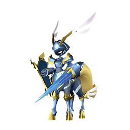Паладиус</a><a class="ichip src" href="../../../4_spravochniki/paly/necromus/">Некромус</a><a class="ichip src" href="../../../4_spravochniki/paly/frostallion/">Фросталлион</a><a class="ichip src" href="../../../4_spravochniki/paly/frostallion_noct/">Фросталлион Нокт</a><a class="ichip src" href="../../../4_spravochniki/paly/neptilius/">Нептилиус</a><a class="ichip src" href="../../../4_spravochniki/paly/jetragon/">Джетрагон</a><a class="ichip src" href="../../../4_spravochniki/paly/panthalus/">Панталус</a>🛒 торговец

## Бант Риббани

Бант, выпавший с пала «Риббани». Благодаря милому цвету и дизайну используется как материал для одежды.

💎Редкость<b>Обычный</b>

⚖️Вес<b>0,2</b>

💰Цена<b>500</b>

📍 Где взять
<a class="ichip src" href="../../../4_spravochniki/paly/ribbuny/">Риббани</a><a class="ichip src" href="../../../4_spravochniki/paly/ribbuny_botan/">Риббани Ботан</a>🛒 торговец

## Биобатарея

Устройство, накапливающее биологическую энергию в виде электричества. Используется в оборудовании с высокими требованиями к энергоёмкости. Создаётся на станцию «Конвейерная фабрика II»

💎Редкость<b>Обычный</b>

⚖️Вес<b>5</b>

💰Цена<b>2230</b>

📘Технология<b>ур. 44</b>

🔨 Крафт
Электрический орган <b>×1</b>Слиток рафинированного металла <b>×1</b>Углеродное волокно <b>×1</b>
<small class="ist">Конвейерная фабрика II Мастерская развитой цивилизации Древний верстак</small>

## Боевой билет

Можно получить за победу в одиночном бою на арене. Можно обменять на премиальные награды.

💎Редкость<b>Эпический</b>

💰Цена<b>10</b>

📍 Где взять
📦 Арена (первая победа) <small>5 · 100%</small>📦 Арена (повторно) <small>1 · 100%</small>

## Большая душа Пала

Душа, оставшаяся после большого Пала. Поднесите её в дар Монумент Силы, чтобы раскрыть скрытые способности.

💎Редкость<b>Эпический</b>

⚖️Вес<b>0,2</b>

💰Цена<b>10</b>

🔨 Крафт
Средняя душа Пала <b>×2</b>
<small class="ist">Дробилка Замораживающий измельчитель</small>

📍 Где взять
📦 Экспедиция: Снега <small>5–7 · 100%</small>📦 Награда Заносчивого критика Палов <small>2 · 100%</small>📦 Пещера Тэнраку <small>1 · 40,193%</small>📦 Пещера Священной Горы <small>1 · 37,785%</small>📦 Лагерь врагов: Санрич <small>1 · 35,6%</small>📦 Пещера Цветущей Сакуры <small>1 · 33,092%</small>📦 Нефтяная вышка ур. 55: обычный сундук <small>1 · 27,886%</small>📦 Рыбный пруд на базе: Сакурадзима <small>1–2 · 17,452%</small>📦 Сундук в поселении: Снега <small>1 · 16,667%</small>📦 Рыбалка: Сакурадзима <small>1 · 14,849%</small>📦 Сундуки и ящики: Мировое Древо <small>1–2 · 13,682%</small>📦 Сундуки и ящики: Санрич <small>1–2 · 9,334%</small>📦 Сундуки и ящики: Сакурадзима <small>1 · 8,698%</small>📦 Сундуки и ящики: Фейбрейк <small>1–2 · 8,56%</small>📦 Сундуки и ящики: Снега <small>1 · 6,872%</small>📦 Сундуки и ящики: Пустыня <small>1 · 5,657%</small>📦 Сундуки и ящики: Вулкан <small>1 · 3,957%</small>👤 Лаборант отряда Генетических Исследований <small>30%</small>👤 Царь-спаситель Харталис <small>30%</small><a class="ichip src" href="../../../4_spravochniki/paly/dualith/">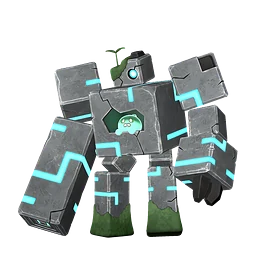Дуалит</a><a class="ichip src" href="../../../4_spravochniki/paly/dualith_noct/">Дуалит Нокт</a><a class="ichip src" href="../../../4_spravochniki/paly/anubis/">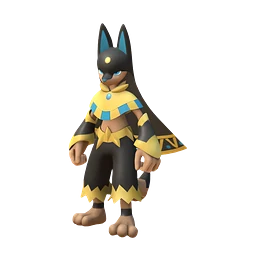Анубис</a><a class="ichip src" href="../../../4_spravochniki/paly/sekhmet/">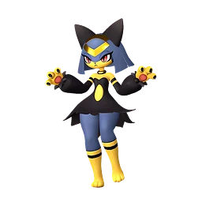Сехмет</a><a class="ichip src" href="../../../4_spravochniki/paly/tetroise/">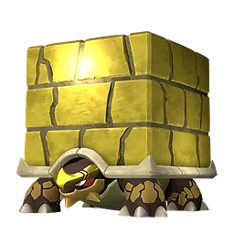Тетроис</a>

## Большое зловещее яйцо

Большое зловещее яйцо. Таинственное яйцо, в котором заключена энергия Мирового Древа. Поместите яйцо в Инкубатор для выведения.

💎Редкость<b>Редкий</b>

⚖️Вес<b>25</b>

💰Цена<b>10</b>

## Большое мутировавшее яйцо

Большое мутировавшее яйцо. Крайне редкое яйцо, прошедшее особую мутацию. Поместите яйцо в Инкубатор для выведения.

💎Редкость<b>Редкий</b>

⚖️Вес<b>25</b>

💰Цена<b>10</b>

## Большое обычное яйцо

Большое обычное яйцо. Внутри ощущается спокойный, размеренный пульс. Поместите яйцо в Инкубатор для выведения.

💎Редкость<b>Редкий</b>

⚖️Вес<b>25</b>

💰Цена<b>10</b>

## Большое раскалённое яйцо

Большое раскалённое яйцо. Внутри ощущается мощный, пылкий ритм. Поместите яйцо в Инкубатор для выведения.

💎Редкость<b>Редкий</b>

⚖️Вес<b>25</b>

💰Цена<b>10</b>

## Большое яйцо воды

Большое яйцо воды. Внутри ощущается чистая и спокойная пульсация. Поместите яйцо в Инкубатор для выведения.

💎Редкость<b>Редкий</b>

⚖️Вес<b>25</b>

💰Цена<b>10</b>

## Большое яйцо дракона

Большое яйцо дракона. Внутри ощущается аномальный пульс. Поместите яйцо в Инкубатор для выведения.

💎Редкость<b>Редкий</b>

⚖️Вес<b>25</b>

💰Цена<b>10</b>

## Большое яйцо земли

Большое яйцо земли. Чувствуется спокойный и мощный ритм внутри. Поместите яйцо в Инкубатор для выведения.

💎Редкость<b>Редкий</b>

⚖️Вес<b>25</b>

💰Цена<b>10</b>

## Большое яйцо молнии

Большое яйцо молнии. Внутри ощущается мощный энергетический пульс. Поместите яйцо в Инкубатор для выведения.

💎Редкость<b>Редкий</b>

⚖️Вес<b>25</b>

💰Цена<b>10</b>

## Большое яйцо свежей листвы

Большое яйцо свежей листвы. Внутри ощущается пульсация, полная жизненной энергии. Поместите яйцо в Инкубатор для выведения.

💎Редкость<b>Редкий</b>

⚖️Вес<b>25</b>

💰Цена<b>10</b>

## Большое яйцо тьмы

Большое яйцо тьмы. Внутри ощущается зловещий ритм. Поместите яйцо в Инкубатор для выведения.

💎Редкость<b>Редкий</b>

⚖️Вес<b>25</b>

💰Цена<b>10</b>

## Ветхий пергамент

Древний текст, написанный на коже Пала. Иногда Палы находят его во время экспедиций. Необходим для проведения исследований.

💎Редкость<b>Редкий</b>

⚖️Вес<b>0,1</b>

💰Цена<b>1000</b>

📍 Где взять
📦 Экспедиция: Холмы (старт) <small>5–7 · 100%</small>📦 Рыбалка: Санрич <small>5–11 · 6,258%</small>📦 Рыбный пруд на базе: Санрич <small>3–8 · 0%</small>

## Взрывоустойчивое волокно

Волокно с тела Сильванс. Смягчает ударную волну взрывов.

💎Редкость<b>Легендарный</b>

⚖️Вес<b>1</b>

💰Цена<b>5000</b>

## Водный самоцвет

Камень, образованный из энергии Мирового Древа, накопленной в теле Пала. После обработки становится предметом, раскрывающим скрытый потенциал Пала Вода.

💎Редкость<b>Редкий</b>

⚖️Вес<b>1</b>

💰Цена<b>1000</b>

📍 Где взять
📦 Сундук: Мировое Древо <small>5–10 · 33,333%</small>📦 Экспедиция: Мировое Древо <small>1–3 · 11,111%</small>📦 Рыбалка: Мировое Древо <small>1–3 · 2,641%</small>📦 Блестящая древняя реликвия (переработка) <small>1 · 2,304%</small>📦 Спящая древняя реликвия (переработка) <small>1 · 1,333%</small>📦 Истлевшая древняя реликвия (переработка) <small>1 · 1,111%</small>📦 Светящаяся древняя реликвия (переработка) <small>1 · 1,92%</small>📦 Роскошная древняя реликвия (переработка) <small>1 · 1,6%</small>👤 Экстремальная модификация Шаолонг <small>100%</small>

## Волокно

Волокно, добываемое из дерева. Используется для создания луков и других предметов. Также можно получить, переработав материал «Древесина» в станцию «Дробилка».

💎Редкость<b>Обычный</b>

⚖️Вес<b>0,5</b>

💰Цена<b>8</b>

🔨 Крафт
Древесина <b>×1</b>
<small class="ist">Дробилка Замораживающий измельчитель</small>

📍 Где взять
📦 Миссия <small>20 · 100%</small><a class="ichip src" href="../../../4_spravochniki/paly/hoocrates/">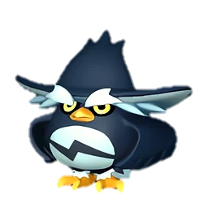Хукрат</a><a class="ichip src" href="../../../4_spravochniki/paly/hangyu/">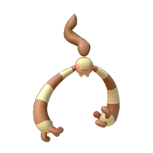Хангю</a><a class="ichip src" href="../../../4_spravochniki/paly/hangyu_cryst/">Хангю Крист</a><a class="ichip src" href="../../../4_spravochniki/paly/tarantriss/">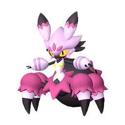Тарантрисс</a><a class="ichip src" href="../../../4_spravochniki/paly/needoll/">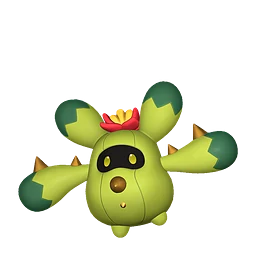Нидолл</a><a class="ichip src" href="../../../4_spravochniki/paly/needoll_noct/">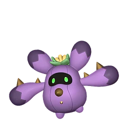Нидолл Нокт</a><a class="ichip src" href="../../../4_spravochniki/paly/carnibora/">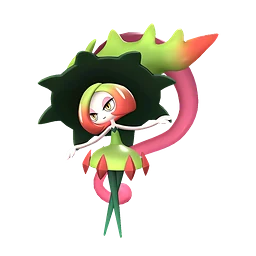Карнибора</a><a class="ichip src" href="../../../4_spravochniki/paly/bulldosu/">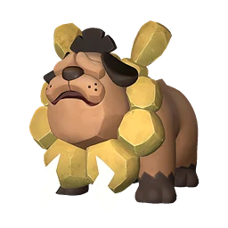Буллдос</a><a class="ichip src" href="../../../4_spravochniki/paly/tropicaw/">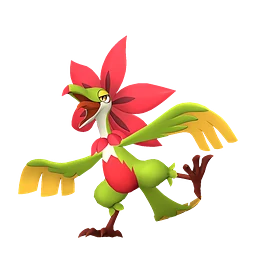Тропикау</a>

## Волосы Катресса

Волосы, выпавшие с пала «Катресс». Мягкие на ощупь, используются как материал для одежды и других нужд.

💎Редкость<b>Обычный</b>

⚖️Вес<b>0,2</b>

💰Цена<b>500</b>

📍 Где взять
<a class="ichip src" href="../../../4_spravochniki/paly/katress/">Катресс</a><a class="ichip src" href="../../../4_spravochniki/paly/katress_ignis/">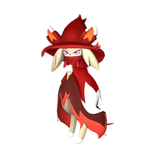Катресс Игнис</a>🛒 торговец

## Волосы Сви

Волосы, выпавшие с пала «Сви». Мягкий и пушистый, используется как материал для одежды.

💎Редкость<b>Обычный</b>

⚖️Вес<b>0,2</b>

💰Цена<b>500</b>

📍 Где взять
<a class="ichip src" href="../../../4_spravochniki/paly/swee/">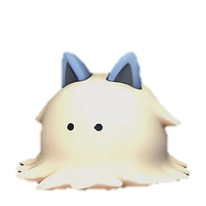Сви</a>🛒 торговец

## Гвоздь

Деталь, необходимая для создания многих построек.

💎Редкость<b>Обычный</b>

⚖️Вес<b>2</b>

💰Цена<b>60</b>

📘Технология<b>ур. 10</b>

🔨 Крафт
Металлический слиток <b>×1</b>
<small class="ist">Качественный верстак Конвейерная фабрика Конвейерная фабрика II Мастерская развитой цивилизации Примитивный верстак Древний верстак</small>

📍 Где взять
📦 Награда Заносчивого критика Палов <small>12 · 100%</small>📦 Мусорный сундук: Холмы (старт) <small>1–3 · 40%</small>

## Гексокварц

Ценный кристалл, встречающийся только в землях Тэнраку. За долгие годы палдиум уплотнился и изменился, приобретя радужное сияние.

💎Редкость<b>Обычный</b>

⚖️Вес<b>2</b>

💰Цена<b>1000</b>

📍 Где взять
📦 Экспедиция: Фейбрейк (сложная) <small>10–20 · 100%</small>📦 Награда Заносчивого критика Палов <small>5 · 100%</small>📦 Сундуки и ящики: Фейбрейк <small>1–2 · 15,218%</small><a class="ichip src" href="../../../4_spravochniki/paly/celesdir/">Селесдир</a>

## Гексолит

Сплав из материалов «Хромаит» и «Гексокварц». Используется для создания продвинутого снаряжения и построек. Выплавляется в печи.

💎Редкость<b>Обычный</b>

⚖️Вес<b>1</b>

💰Цена<b>3000</b>

📘Технология<b>ур. 58</b>

🔨 Крафт
Хромаит <b>×1</b>Гексокварц <b>×1</b>
<small class="ist">Древняя печь</small>

📍 Где взять
<a class="ichip src" href="../../../4_spravochniki/paly/paladius/">Паладиус</a><a class="ichip src" href="../../../4_spravochniki/paly/necromus/">Некромус</a><a class="ichip src" href="../../../4_spravochniki/paly/neptilius/">Нептилиус</a>

## Гребень Лизпанка

Гребень, выпавший с пала «Лизпанк». Колючий материал, используемый для изготовления одежды.

💎Редкость<b>Обычный</b>

⚖️Вес<b>0,2</b>

💰Цена<b>500</b>

📍 Где взять
<a class="ichip src" href="../../../4_spravochniki/paly/leezpunk/">Лизпанк</a><a class="ichip src" href="../../../4_spravochniki/paly/leezpunk_ignis/">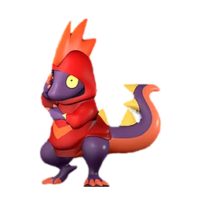Лизпанк Игнис</a>🛒 торговец

## Грозовой самоцвет

Камень, образованный из энергии Мирового Древа, накопленной в теле Пала. После обработки становится предметом, раскрывающим скрытый потенциал Пала Молния.

💎Редкость<b>Редкий</b>

⚖️Вес<b>1</b>

💰Цена<b>1000</b>

📍 Где взять
📦 Сундук: Мировое Древо <small>5–10 · 33,333%</small>📦 Экспедиция: Мировое Древо <small>1–3 · 11,111%</small>📦 Рыбалка: Мировое Древо <small>1–3 · 2,641%</small>📦 Блестящая древняя реликвия (переработка) <small>1 · 2,304%</small>📦 Спящая древняя реликвия (переработка) <small>1 · 1,333%</small>📦 Истлевшая древняя реликвия (переработка) <small>1 · 1,111%</small>📦 Светящаяся древняя реликвия (переработка) <small>1 · 1,92%</small>📦 Роскошная древняя реликвия (переработка) <small>1 · 1,6%</small>👤 Экстремальная модификация Гриззболт <small>100%</small>

## Деревянная доска

Доски из обработанной древесины. Универсальнее обычных брёвен и имеют множество способов применения.

💎Редкость<b>Обычный</b>

⚖️Вес<b>2</b>

💰Цена<b>260</b>

📘Технология<b>ур. 15</b>

🔨 Крафт
Древесина <b>×10</b>Волокно <b>×5</b>Гвоздь <b>×1</b>
<small class="ist">Качественный верстак Конвейерная фабрика Конвейерная фабрика II Мастерская развитой цивилизации Примитивный верстак Древний верстак</small>

## Деталь древней цивилизации

Старый предмет, обнаруженный в древних руинах. Кладезь утерянных технологий. Многие желают обладать этой невероятно ценной вещицей.

💎Редкость<b>Редкий</b>

⚖️Вес<b>1</b>

💰Цена<b>1000</b>

📍 Где взять
📦 Экспедиция: Холмы (старт) <small>1–2 · 100%</small>👤 Кокетливые ножки Мелпака <small>100%</small>👤 Хранитель лазурного пламени Кицун <small>100%</small>👤 Хранитель тёмного солнца Анубис <small>100%</small>👤 Гиена пустошей Инсинерам <small>100%</small>👤 Гиена темной ночи Инсинерам Нокт <small>100%</small>👤 Благородное сияние Мау <small>100%</small>👤 Чистое сияние Мау Крист <small>100%</small>👤 Ходячая ферма Каприти <small>100%</small>👤 Воздушный налётчик Ванвирм <small>100%</small>👤 Налётчик холодного неба Ванвирм Крист <small>100%</small>👤 Легендарный тёмный рыцарь Некромус <small>100%</small>👤 Неизвестный организм Шэдоубик <small>100%</small>👤 Озерная королева Азуроб <small>100%</small>👤 Стальной Драконий Владыка Астегон <small>100%</small>👤 Дерзкий серфер Камоноске <small>100%</small>👤 Лесной хулиган Рашоа <small>100%</small>👤 Первопроходец ледяного моря Пенкинг <small>100%</small>👤 Главный трус на равнине Лифманк <small>100%</small>👤 Пройдоха Томбат <small>100%</small>👤 Тёмный кот-маг Катресс <small>100%</small>👤 Сумеречный вампир Фелбэт <small>100%</small>👤 Хорошо упитанный Чикипи <small>100%</small>👤 Взрыв — вот моя жизнь Токотоко <small>100%</small>

## Доказательство ликвидации

Доказательство убийства разыскиваемой цели. Отдайте его вигилантам в городах и поселениях, чтобы получить награду.

💎Редкость<b>Эпический</b>

💰Цена<b>10</b>

📍 Где взять
👤 Охотник на новичков Ястреб <small>100%</small>👤 Напористый интервьюер Гриль <small>100%</small>👤 Самовлюбленный болтун Эго <small>100%</small>👤 Агрессивный защитник Кирпич <small>100%</small>👤 Закоренелый тиран Кнут <small>100%</small>👤 Любитель тёмной магии Тень <small>100%</small>👤 Похититель Виск <small>100%</small>👤 Мастер промахов Мямля <small>100%</small>👤 Цудзигири Урчин <small>100%</small>👤 Каннибал Глод <small>100%</small>👤 Коллекционер людей Схрон <small>100%</small>👤 Мошенница Джейд <small>100%</small>👤 Жаждущий внимания монстр Мишура <small>100%</small>👤 Любитель пиццы с ананасами Алоха <small>100%</small>👤 Воришка данго Ловкач <small>100%</small>👤 Аварийный мошенник Краш <small>100%</small>👤 Любитель курить на ходу Окурок <small>100%</small>👤 Безумный стрелок Клинт <small>100%</small>👤 Коровий вор Лассо <small>100%</small>👤 Пироманьяк Огонёк <small>100%</small>👤 Злостная изменщица Сирена <small>100%</small>👤 Охотница на охотников за головами Танко <small>100%</small>👤 Близнецы-подрывники Дина <small>100%</small>👤 Близнецы-подрывники Мит <small>100%</small>

## Драконий самоцвет

Камень, образованный из энергии Мирового Древа, накопленной в теле Пала. После обработки становится предметом, раскрывающим скрытый потенциал Пала Дракон.

💎Редкость<b>Редкий</b>

⚖️Вес<b>1</b>

💰Цена<b>1000</b>

📍 Где взять
📦 Сундук: Мировое Древо <small>5–10 · 33,333%</small>📦 Экспедиция: Мировое Древо <small>1–3 · 11,111%</small>📦 Рыбалка: Мировое Древо <small>1–3 · 2,641%</small>📦 Блестящая древняя реликвия (переработка) <small>1 · 2,304%</small>📦 Спящая древняя реликвия (переработка) <small>1 · 1,333%</small>📦 Истлевшая древняя реликвия (переработка) <small>1 · 1,111%</small>📦 Светящаяся древняя реликвия (переработка) <small>1 · 1,92%</small>📦 Роскошная древняя реликвия (переработка) <small>1 · 1,6%</small>👤 Экстремальная модификация Орсерк <small>100%</small>

## Древесина

Материал для строительства и создания предметов. В основном добывается при рубке деревьев. Можно переработать в материал «Волокно» с помощью станции «Дробилка».

💎Редкость<b>Обычный</b>

⚖️Вес<b>3</b>

💰Цена<b>12</b>

📍 Где взять
🛒 торговец

## Древесный уголь

Древесный уголь образуется при сжигании материала «Древесина». В сочетании с материалом «Сера» используется для создания материала «Порох».

💎Редкость<b>Обычный</b>

⚖️Вес<b>2</b>

💰Цена<b>30</b>

🔨 Крафт
Древесина <b>×2</b>
<small class="ist">Примитивная печь Улучшенная печь Электрическая печь Древняя печь</small>

📍 Где взять
📦 Подмастерье кузнеца <small>30–40 · 100%</small>

## Древний кусок лавы

Сгусток лавы, сформировавшаяся за долгие годы в экстремальных условиях. Заключённая внутри синяя лава всё ещё излучает тепло.

💎Редкость<b>Необычный</b>

⚖️Вес<b>8</b>

💰Цена<b>1000</b>

## Древняя кора

Кора дерева, прожившего долгие годы в экстремальных условиях. Даже тонкий слой этой коры излучает безграничную жизненную силу.

💎Редкость<b>Необычный</b>

⚖️Вес<b>5</b>

💰Цена<b>800</b>

## Древняя кость

Кость зверя, выветренные за долгие годы в экстремальных условиях. Даже лишённые плоти, они сохраняют мощное ощущение присутствия.

💎Редкость<b>Необычный</b>

⚖️Вес<b>8</b>

💰Цена<b>1200</b>

## Едкий растворитель

Опасный химический растворитель, обладающим мощным эффектом расщепления. Используется для точной обработки и особой утилизации.

💎Редкость<b>Обычный</b>

⚖️Вес<b>3</b>

💰Цена<b>720</b>

📘Технология<b>ур. 37</b>

🔨 Крафт
Ядовитая железа <b>×1</b>Сера <b>×1</b>
<small class="ist">Конвейерная фабрика Конвейерная фабрика II Мастерская развитой цивилизации Древний верстак</small>

## Жидкость водного Пала

Жидкость, получаемая из водных Палов. Густая и полезная в использовании.

💎Редкость<b>Обычный</b>

⚖️Вес<b>0,2</b>

💰Цена<b>300</b>

📍 Где взять
📦 Пастбище: Келпси сам даёт <small>1 · 100%</small>📦 Экспедиция: Холмы (старт) (сложная) <small>10–20 · 100%</small>📦 Сундук: Лес <small>10–20 · 86,957%</small>📦 Рыбный пруд на базе: Холмы (старт) <small>1–3 · 60%</small><a class="ichip src" href="../../../4_spravochniki/paly/fuack/">Камоноске</a><a class="ichip src" href="../../../4_spravochniki/paly/fuack_ignis/">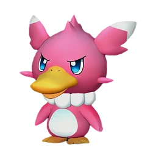Камоноске Игнис</a><a class="ichip src" href="../../../4_spravochniki/paly/celaray/">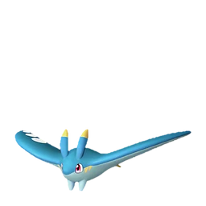Селарай</a><a class="ichip src" href="../../../4_spravochniki/paly/celaray_lux/">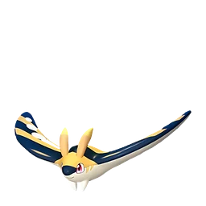Селарай Лакс</a><a class="ichip src" href="../../../4_spravochniki/paly/croajiro/">Кроадзиро</a><a class="ichip src" href="../../../4_spravochniki/paly/croajiro_noct/">Кроадзиро Нокт</a><a class="ichip src" href="../../../4_spravochniki/paly/teafant/">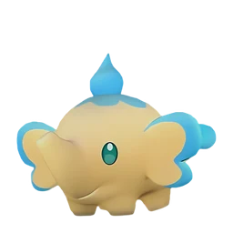Тифант</a><a class="ichip src" href="../../../4_spravochniki/paly/pengullet/">Пенгуллет</a><a class="ichip src" href="../../../4_spravochniki/paly/pengullet_lux/">Пенгуллет Лакс</a><a class="ichip src" href="../../../4_spravochniki/paly/killamari/">Килламари</a><a class="ichip src" href="../../../4_spravochniki/paly/killamari_primo/">Килламари Примо</a><a class="ichip src" href="../../../4_spravochniki/paly/turtacle/">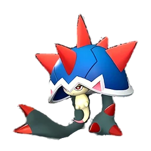Туртакл</a>🛒 торговец

## Земной самоцвет

Камень, образованный из энергии Мирового Древа, накопленной в теле Пала. После обработки становится предметом, раскрывающим скрытый потенциал Пала Земля.

💎Редкость<b>Редкий</b>

⚖️Вес<b>1</b>

💰Цена<b>1000</b>

📍 Где взять
📦 Сундук: Мировое Древо <small>5–10 · 33,333%</small>📦 Экспедиция: Мировое Древо <small>1–3 · 11,111%</small>📦 Рыбалка: Мировое Древо <small>1–3 · 2,641%</small>📦 Блестящая древняя реликвия (переработка) <small>1 · 2,304%</small>📦 Спящая древняя реликвия (переработка) <small>1 · 1,333%</small>📦 Истлевшая древняя реликвия (переработка) <small>1 · 1,111%</small>📦 Светящаяся древняя реликвия (переработка) <small>1 · 1,92%</small>📦 Роскошная древняя реликвия (переработка) <small>1 · 1,6%</small>

## Зловещее яйцо

Зловещее яйцо. Таинственное яйцо, в котором заключена энергия Мирового Древа. Поместите яйцо в Инкубатор для выведения.

💎Редкость<b>Обычный</b>

⚖️Вес<b>10</b>

💰Цена<b>10</b>

## Золотая монета

Валюта, используемая на острове Палпагос. Можно обменивать у торговцев на предметы и Палов.

💎Редкость<b>Обычный</b>

💰Цена<b>1</b>

🔨 Крафт
Металлический слиток <b>×30</b>
<small class="ist">Сборочная линия золотых монет</small>

📍 Где взять
📦 Пещера Отдалённого Острова <small>700–1000 · 100%</small>📦 Пещера Горного Потока <small>1200–1600 · 100%</small>📦 Пещера Песчаных Дюн <small>1700–2300 · 100%</small>📦 Пещера Вулкана <small>1500–2100 · 100%</small>📦 Пещера Священной Горы <small>2000–2500 · 100%</small>📦 Пастбище: Мау Крист сам даёт <small>10 · 100%</small>📦 Пещера Цветущей Сакуры <small>2500–3000 · 100%</small>📦 Пещера Тэнраку <small>3000–3500 · 100%</small>📦 Небесный свод Санрича <small>3500–4000 · 100%</small>📦 Лагерь врагов: Холмы (старт) <small>1000–1500 · 100%</small>📦 Со дна моря (Магнит/спасение) <small>1 · 100%</small>📦 Подземелье: Холмы (старт) <small>1000–1300 · 100%</small>📦 Сундук: Мировое Древо <small>7000–7500 · 100%</small>📦 Сундук в поселении: Холмы (старт) <small>50–99 · 100%</small>📦 Награда Заносчивого критика Палов <small>100 · 100%</small>📦 Миссия <small>2000 · 100%</small>📦 Нефтяная вышка ур. 30: обычный сундук <small>2000–2500 · 65%</small>📦 Рыбный пруд на базе: Сакурадзима <small>3500–4000 · 34,904%</small>📦 Мусорный сундук: Холмы (старт) <small>1000–1200 · 25%</small>📦 Рыбалка: Санрич <small>3500–4000 · 13,141%</small>👤 Адепт Организации по Защите Палов <small>40%</small>👤 Судья Организации по Защите Палов <small>40%</small>👤 Житель деревни <small>40%</small>👤 Мученик Братства Вечного Пламени <small>40%</small>

## Изумруд

Драгоценный камень, излучающий зеленое сияние. Можно продать торговцу по высокой цене.

💎Редкость<b>Редкий</b>

⚖️Вес<b>5</b>

💰Цена<b>40000</b>

📍 Где взять
📦 Сундуки и ящики: Пустыня <small>1 · 100%</small>📦 Сундуки и ящики: Вулкан <small>1–2 · 100%</small>📦 Лагерь врагов <small>1–2 · 100%</small>📦 Рыбный пруд на базе: Вулкан <small>1–2 · 35,211%</small>📦 Рыбалка: Вулкан <small>1 · 22,754%</small><a class="ichip src" href="../../../4_spravochniki/paly/tetroise_primo/">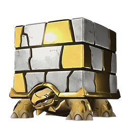Тетроис Примо</a>🛒 торговец

## Камень

Материал для строительства и создания предметов. Можно получить при добыче камня.

💎Редкость<b>Обычный</b>

⚖️Вес<b>3</b>

💰Цена<b>12</b>

📍 Где взять
🛒 торговец

## Качественная деревянная доска

Доски, тщательно изготовленные из материала «Твёрдая древесина». Обладают красивой текстурой дерева и используются в роскошных сооружениях.

💎Редкость<b>Редкий</b>

⚖️Вес<b>3</b>

💰Цена<b>7680</b>

📘Технология<b>ур. 43</b>

🔨 Крафт
Твёрдая древесина <b>×10</b>Древесина <b>×10</b>Качественная ткань <b>×2</b>
<small class="ist">Конвейерная фабрика II Мастерская развитой цивилизации Древний верстак</small>

## Качественная ткань

Качественная ткань из большого количества материала «Шерсть». Необходима для создания качественного снаряжения.

💎Редкость<b>Необычный</b>

⚖️Вес<b>1</b>

💰Цена<b>2640</b>

📘Технология<b>ур. 36</b>

🔨 Крафт
Шерсть <b>×10</b>Кожа <b>×1</b>
<small class="ist">Качественный верстак Конвейерная фабрика Конвейерная фабрика II Мастерская развитой цивилизации Древний верстак</small>

📍 Где взять
📦 Пастбище: Сибеликс сам даёт <small>1 · 100%</small>📦 Эмиссар пустынного города <small>10–20 · 100%</small><a class="ichip src" href="../../../4_spravochniki/paly/sibelyx/">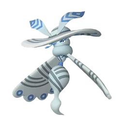Сибеликс</a><a class="ichip src" href="../../../4_spravochniki/paly/sibelyx_primo/">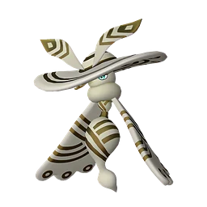Сибеликс Примо</a><a class="ichip src" href="../../../4_spravochniki/paly/selyne/">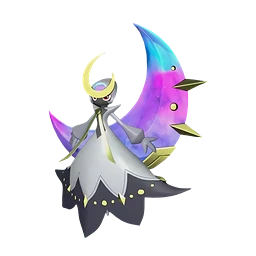Селена</a>🛒 торговец

## Качественное масло Пала

Качественное масло, получаемое из Палов. Используется для создания: Полимер.

💎Редкость<b>Обычный</b>

⚖️Вес<b>0,2</b>

💰Цена<b>300</b>

📍 Где взять
📦 Пастбище: Думад Гилд сам даёт <small>1 · 100%</small>📦 Экспедиция: Пустыня (сложная) <small>10–20 · 100%</small>📦 Рыбный пруд на базе: Снега <small>1–2 · 40%</small><a class="ichip src" href="../../../4_spravochniki/paly/flambelle/">Фламбелль</a><a class="ichip src" href="../../../4_spravochniki/paly/woolipop/">Вулипоп</a><a class="ichip src" href="../../../4_spravochniki/paly/elphidran/">Элфидран</a><a class="ichip src" href="../../../4_spravochniki/paly/elphidran_aqua/">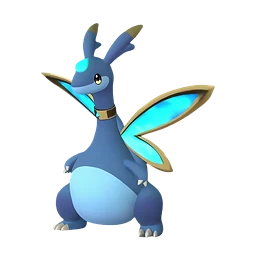Элфидран Аква</a><a class="ichip src" href="../../../4_spravochniki/paly/grintale/">Гринтэйл</a><a class="ichip src" href="../../../4_spravochniki/paly/mammorest/">Мамморест</a><a class="ichip src" href="../../../4_spravochniki/paly/mammorest_cryst/">Мамморест Крист</a><a class="ichip src" href="../../../4_spravochniki/paly/relaxaurus/">Релаксаурус</a><a class="ichip src" href="../../../4_spravochniki/paly/relaxaurus_lux/">Релаксаурус Лакс</a><a class="ichip src" href="../../../4_spravochniki/paly/digtoise/">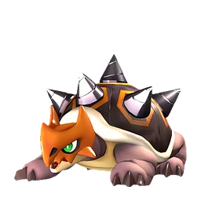Дигтос</a><a class="ichip src" href="../../../4_spravochniki/paly/dumud/">Думад</a><a class="ichip src" href="../../../4_spravochniki/paly/dumud_gild/">Думад Гилд</a>🛒 торговец

## Кожа

Кожа - можно получить с некоторых Палов. Используется как материал для изготовления снаряжения.

💎Редкость<b>Обычный</b>

⚖️Вес<b>2</b>

💰Цена<b>200</b>

📍 Где взять
📦 Экспедиция: Холмы (старт) (сложная) <small>10–20 · 100%</small>📦 Миссия <small>10 · 100%</small>📦 Сундуки и ящики: Холмы (старт) <small>1 · 18,966%</small>📦 Сундуки и ящики: Сакурадзима <small>1–3 · 13,048%</small>📦 Сундуки и ящики: Снега <small>1 · 8,836%</small>📦 Сундуки и ящики: Пустыня <small>1 · 7,543%</small>📦 Сундуки и ящики: Вулкан <small>1 · 6,331%</small><a class="ichip src" href="../../../4_spravochniki/paly/fuack/">Камоноске</a><a class="ichip src" href="../../../4_spravochniki/paly/fuack_ignis/">Камоноске Игнис</a><a class="ichip src" href="../../../4_spravochniki/paly/vixy/">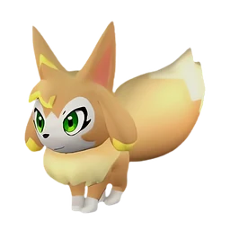Викси</a><a class="ichip src" href="../../../4_spravochniki/paly/herbil/">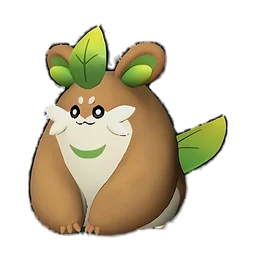Хербил</a><a class="ichip src" href="../../../4_spravochniki/paly/melpaca/">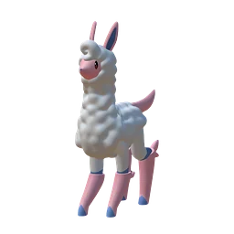Мелпака</a><a class="ichip src" href="../../../4_spravochniki/paly/nox/">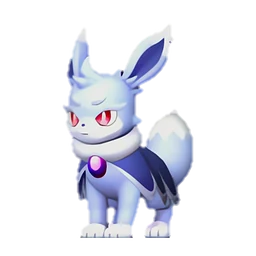Нокс</a><a class="ichip src" href="../../../4_spravochniki/paly/rooby/">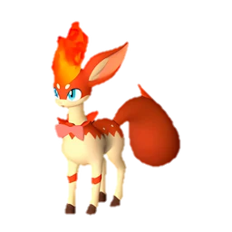Руби</a><a class="ichip src" href="../../../4_spravochniki/paly/mau/">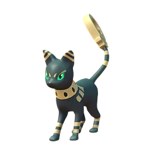Мау</a><a class="ichip src" href="../../../4_spravochniki/paly/rushoar/">Рашоа</a><a class="ichip src" href="../../../4_spravochniki/paly/foxparks/">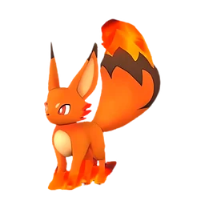Фокспаркс</a><a class="ichip src" href="../../../4_spravochniki/paly/foxparks_cryst/">Фокспаркс Крист</a><a class="ichip src" href="../../../4_spravochniki/paly/fuddler/">Фуддлер</a>🛒 торговец

## Компьютер

Используется для управления автоматизированным оборудованием и сложными механизмами. Ключевой компонент современных технологий.

💎Редкость<b>Обычный</b>

⚖️Вес<b>5</b>

💰Цена<b>22440</b>

📘Технология<b>ур. 50</b>

🔨 Крафт
Печатная плата <b>×2</b>Сталепластик <b>×3</b>Биобатарея <b>×2</b>Углеродное волокно <b>×2</b>
<small class="ist">Конвейерная фабрика II Мастерская развитой цивилизации Древний верстак</small>

## Кораллиновая руда

Редкая руда, долго формировавшаяся в морских глубинах. Можно выловить в глубоком море с помощью магнита и удочки.

💎Редкость<b>Обычный</b>

⚖️Вес<b>3</b>

💰Цена<b>2000</b>

📍 Где взять
📦 Экспедиция: Санрич <small>30–50 · 100%</small>📦 Со дна моря (Магнит/спасение) <small>6–11 · 100%</small>📦 Рыбный пруд на базе: Фейбрейк <small>8–18 · 100%</small>📦 Рыбалка: Мировое Древо <small>12–25 · 100%</small>📦 Нефтяная вышка ур. 55: обычный сундук <small>8–12 · 83,333%</small>📦 Лагерь врагов: Сакурадзима <small>10–15 · 15,707%</small><a class="ichip src" href="../../../4_spravochniki/paly/whalaska/">Валаска</a><a class="ichip src" href="../../../4_spravochniki/paly/whalaska_ignis/">Валаска Игнис</a><a class="ichip src" href="../../../4_spravochniki/paly/neptilius/">Нептилиус</a>

## Кораллиновый слиток

Сплав из материала «Кораллиновая руда», покоящейся на морском дне. Обладает высокой энергопрочностью и используется для изготовления оружия и других предметов. Выплавляется в печи.

💎Редкость<b>Обычный</b>

⚖️Вес<b>3</b>

💰Цена<b>6000</b>

📘Технология<b>ур. 62</b>

🔨 Крафт
Кораллиновая руда <b>×2</b>Уголь <b>×5</b>
<small class="ist">Древняя печь</small>

## Кость

Кость добывается с Палов. Является хорошим источником кальция.

💎Редкость<b>Обычный</b>

⚖️Вес<b>1</b>

💰Цена<b>200</b>

📍 Где взять
📦 Пастбище: Гостлайт сам даёт <small>1 · 100%</small><a class="ichip src" href="../../../4_spravochniki/paly/vixy/">Викси</a><a class="ichip src" href="../../../4_spravochniki/paly/pupperai/">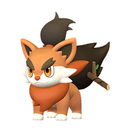Паппирай</a><a class="ichip src" href="../../../4_spravochniki/paly/rushoar/">Рашоа</a><a class="ichip src" href="../../../4_spravochniki/paly/turtacle/">Туртакл</a><a class="ichip src" href="../../../4_spravochniki/paly/turtacle_terra/">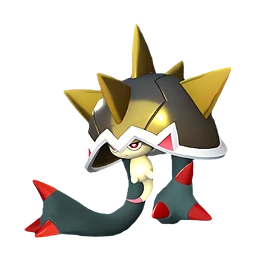Туртакл Терра</a><a class="ichip src" href="../../../4_spravochniki/paly/loupmoon/">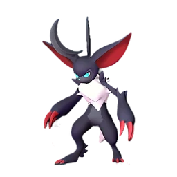Лупмун</a><a class="ichip src" href="../../../4_spravochniki/paly/loupmoon_cryst/">Лупмун Крист</a><a class="ichip src" href="../../../4_spravochniki/paly/cawgnito/">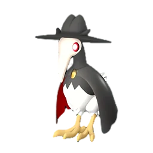Когнито</a><a class="ichip src" href="../../../4_spravochniki/paly/vanwyrm/">Ванвирм</a><a class="ichip src" href="../../../4_spravochniki/paly/vanwyrm_cryst/">Ванвирм Крист</a><a class="ichip src" href="../../../4_spravochniki/paly/gorirat/">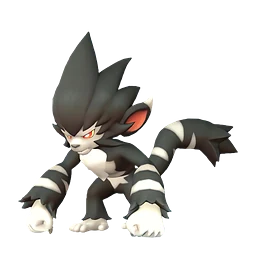Горират</a><a class="ichip src" href="../../../4_spravochniki/paly/gorirat_terra/">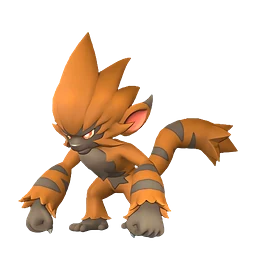Горират Терра</a>🛒 торговец

## Красивые артефакты древн. цив.

Обломок сооружений и инструментов древней цивилизации. Хорошо сохранился, внутри ощущается поток энергии.

💎Редкость<b>Редкий</b>

⚖️Вес<b>1</b>

💰Цена<b>10</b>

📍 Где взять
📦 Экспедиция: Мировое Древо (сложная) <small>2–4 · 57,143%</small>📦 Сундук: Мировое Древо <small>1–3 · 14,586%</small>📦 Мусорный сундук: Мировое Древо <small>1 · 3,15%</small>📦 Рыбалка: Мировое Древо <small>1–3 · 1,1%</small>📦 Сундуки и ящики: Мировое Древо <small>1 · 0,802%</small>📦 Таинственная древесина <small>5–7 · 100%</small>📦 Палкзит <small>5–7 · 100%</small>📦 Водный самоцвет <small>1 · 1,6%</small>📦 Грозовой самоцвет <small>1 · 1,6%</small>📦 Земной самоцвет <small>1 · 1,6%</small>📦 Травяной самоцвет <small>1 · 1,6%</small>📦 Огненный самоцвет <small>1 · 1,6%</small>📦 Ледяной самоцвет <small>1 · 1,6%</small>📦 Драконий самоцвет <small>1 · 1,6%</small>📦 Темный самоцвет <small>1 · 1,6%</small>📦 Нейтральный самоцвет <small>1 · 1,6%</small>📦 Расходуемый имплант: Обоюдоострый святой меч <small>1 · 0,203%</small>📦 Расходуемый имплант: Живая стена святилища <small>1 · 0,203%</small>📦 Расходуемый имплант: Дьявольские руки <small>1 · 0,203%</small>📦 Расходуемый имплант: Рассада божественного древа <small>1 · 0,203%</small>📦 Расходуемый имплант: Небожитель <small>1 · 0,203%</small>📦 Расходуемый имплант: Прыжок между измерениями <small>1 · 0,203%</small>📦 Расходуемый имплант: Бог разрушения <small>1 · 0,203%</small>📦 Расходуемый имплант: Виртуоз <small>1 · 0,203%</small>

## Красивый цветок

Растение с яркими цветами. Используется для изготовления материалов «Подозрительный сок» и «Странный сок».

💎Редкость<b>Обычный</b>

⚖️Вес<b>0,2</b>

💰Цена<b>500</b>

📍 Где взять
<a class="ichip src" href="../../../4_spravochniki/paly/ribbuny/">Риббани</a><a class="ichip src" href="../../../4_spravochniki/paly/bristla/">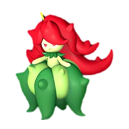Бристла</a><a class="ichip src" href="../../../4_spravochniki/paly/petallia/">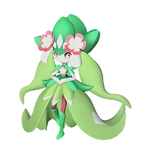Петаллия</a><a class="ichip src" href="../../../4_spravochniki/paly/petallia_ignis/">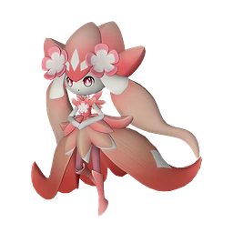Петаллия Игнис</a><a class="ichip src" href="../../../4_spravochniki/paly/quivern_botan/">Фэски Ботан</a><a class="ichip src" href="../../../4_spravochniki/paly/lullu/">Нежноцвет</a><a class="ichip src" href="../../../4_spravochniki/paly/wumpo/">Вумпо</a><a class="ichip src" href="../../../4_spravochniki/paly/wumpo_botan/">Вумпо Ботан</a><a class="ichip src" href="../../../4_spravochniki/paly/dualith/">Дуалит</a><a class="ichip src" href="../../../4_spravochniki/paly/prunelia/">Прунелия</a><a class="ichip src" href="../../../4_spravochniki/paly/tropicaw/">Тропикау</a><a class="ichip src" href="../../../4_spravochniki/paly/lyleen/">Лилин</a>🛒 торговец

## Криогенный хладагент

Высокоэффективная охлаждающая среда, использующая особые компоненты, полученные от Палов. Применяется для контроля температуры высокомощных устройств.

💎Редкость<b>Обычный</b>

⚖️Вес<b>3</b>

💰Цена<b>720</b>

📘Технология<b>ур. 31</b>

🔨 Крафт
Жидкость водного Пала <b>×1</b>Ледяной орган <b>×1</b>
<small class="ist">Конвейерная фабрика Конвейерная фабрика II Мастерская развитой цивилизации Древний верстак</small>

## Ледяной орган

Материал, получаемый от Палов с элементом Лёд. Используется для изготовления Замораживающая мина и других предметов.

💎Редкость<b>Обычный</b>

⚖️Вес<b>0,5</b>

💰Цена<b>300</b>

📍 Где взять
📦 Экспедиция: Снега (сложная) <small>10–20 · 100%</small>📦 Пастбище: Фоксайкл сам даёт <small>1 · 100%</small>📦 Сундуки и ящики: Снега <small>1 · 4,909%</small>👤 Танцор равнин Чиллет <small>100%</small>👤 Озверевший Элгрув Крист <small>100%</small><a class="ichip src" href="../../../4_spravochniki/paly/jolthog_cryst/">Джолтхог Крист</a><a class="ichip src" href="../../../4_spravochniki/paly/pengullet/">Пенгуллет</a><a class="ichip src" href="../../../4_spravochniki/paly/penking/">Пенкинг</a><a class="ichip src" href="../../../4_spravochniki/paly/kingpaca_cryst/">Кингпака Крист</a><a class="ichip src" href="../../../4_spravochniki/paly/mau_cryst/">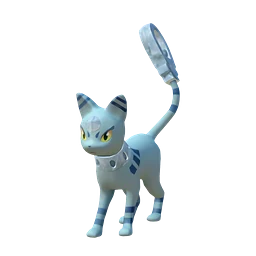Мау Крист</a><a class="ichip src" href="../../../4_spravochniki/paly/foxparks_cryst/">Фокспаркс Крист</a><a class="ichip src" href="../../../4_spravochniki/paly/hangyu_cryst/">Хангю Крист</a><a class="ichip src" href="../../../4_spravochniki/paly/azurobe_cryst/">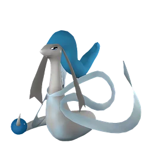Азуроб Крист</a><a class="ichip src" href="../../../4_spravochniki/paly/univolt_cryst/">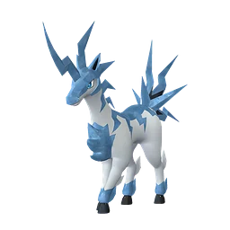Юнивольт Крист</a><a class="ichip src" href="../../../4_spravochniki/paly/muffly/">Маффли</a><a class="ichip src" href="../../../4_spravochniki/paly/vanwyrm_cryst/">Ванвирм Крист</a><a class="ichip src" href="../../../4_spravochniki/paly/polapup/">Полапап</a>🛒 торговец

## Ледяной самоцвет

Камень, образованный из энергии Мирового Древа, накопленной в теле Пала. После обработки становится предметом, раскрывающим скрытый потенциал Пала Лёд.

💎Редкость<b>Редкий</b>

⚖️Вес<b>1</b>

💰Цена<b>1000</b>

📍 Где взять
📦 Сундук: Мировое Древо <small>5–10 · 33,333%</small>📦 Экспедиция: Мировое Древо <small>1–3 · 11,111%</small>📦 Рыбалка: Мировое Древо <small>1–3 · 2,641%</small>📦 Блестящая древняя реликвия (переработка) <small>1 · 2,304%</small>📦 Спящая древняя реликвия (переработка) <small>1 · 1,333%</small>📦 Истлевшая древняя реликвия (переработка) <small>1 · 1,111%</small>📦 Светящаяся древняя реликвия (переработка) <small>1 · 1,92%</small>📦 Роскошная древняя реликвия (переработка) <small>1 · 1,6%</small>👤 Экстремальная модификация Бастигор <small>100%</small>

## Лист Гумосса

Лист, выпавший с пала «Гумосс». Обладает свежестью и сочностью, используется как материал для одежды.

💎Редкость<b>Обычный</b>

⚖️Вес<b>0,2</b>

💰Цена<b>500</b>

📍 Где взять
<a class="ichip src" href="../../../4_spravochniki/paly/gumoss/">Гумосс</a>🛒 торговец

## Лотос выносливости (большой)

Крайне редкий большой жёлтый цветок. Служит ингредиентом для чудесного снадобья выносливости.

💎Редкость<b>Эпический</b>

⚖️Вес<b>0,1</b>

💰Цена<b>30000</b>

📍 Где взять
📦 Нефтяная вышка ур. 60: редкий сундук <small>1–3 · 10%</small>📦 Блестящая древняя реликвия (переработка) <small>1 · 0,041%</small>📦 Светящаяся древняя реликвия (переработка) <small>1 · 0,035%</small>📦 Роскошная древняя реликвия (переработка) <small>1 · 0,029%</small>📦 Спящая древняя реликвия (переработка) <small>1 · 0,024%</small>📦 Истлевшая древняя реликвия (переработка) <small>1 · 0,02%</small>

## Лотос выносливости (малый)

Крайне редкий маленький жёлтый цветок. Служит ингредиентом для тайного снадобья выносливости.

💎Редкость<b>Редкий</b>

⚖️Вес<b>0,1</b>

💰Цена<b>20000</b>

📍 Где взять
📦 Нефтяная вышка ур. 55: обычный сундук <small>1 · 4%</small>📦 Блестящая древняя реликвия (переработка) <small>1 · 0,083%</small>📦 Светящаяся древняя реликвия (переработка) <small>1 · 0,069%</small>📦 Роскошная древняя реликвия (переработка) <small>1 · 0,058%</small>📦 Спящая древняя реликвия (переработка) <small>1 · 0,048%</small>📦 Истлевшая древняя реликвия (переработка) <small>1 · 0,04%</small>

## Лотос жизни (большой)

Крайне редкий большой зелёный цветок. Служит ингредиентом для чудесного снадобья жизненной силы.

💎Редкость<b>Эпический</b>

⚖️Вес<b>0,1</b>

💰Цена<b>30000</b>

📍 Где взять
📦 Нефтяная вышка ур. 60: редкий сундук <small>1–3 · 10%</small>📦 Блестящая древняя реликвия (переработка) <small>1 · 0,041%</small>📦 Светящаяся древняя реликвия (переработка) <small>1 · 0,035%</small>📦 Роскошная древняя реликвия (переработка) <small>1 · 0,029%</small>📦 Спящая древняя реликвия (переработка) <small>1 · 0,024%</small>📦 Истлевшая древняя реликвия (переработка) <small>1 · 0,02%</small>

## Лотос жизни (малый)

Крайне редкий маленький зелёный цветок. Служит ингредиентом для тайного снадобья жизненной силы.

💎Редкость<b>Редкий</b>

⚖️Вес<b>0,1</b>

💰Цена<b>20000</b>

📍 Где взять
📦 Нефтяная вышка ур. 55: обычный сундук <small>1 · 4%</small>📦 Блестящая древняя реликвия (переработка) <small>1 · 0,083%</small>📦 Светящаяся древняя реликвия (переработка) <small>1 · 0,069%</small>📦 Роскошная древняя реликвия (переработка) <small>1 · 0,058%</small>📦 Спящая древняя реликвия (переработка) <small>1 · 0,048%</small>📦 Истлевшая древняя реликвия (переработка) <small>1 · 0,04%</small>

## Лотос переносимости (большой)

Крайне редкий большой фиолетовый цветок. Служит ингредиентом для чудесного снадобья гиганта.

💎Редкость<b>Эпический</b>

⚖️Вес<b>0,1</b>

💰Цена<b>30000</b>

📍 Где взять
📦 Нефтяная вышка ур. 60: редкий сундук <small>1–3 · 10%</small>📦 Блестящая древняя реликвия (переработка) <small>1 · 0,041%</small>📦 Светящаяся древняя реликвия (переработка) <small>1 · 0,035%</small>📦 Роскошная древняя реликвия (переработка) <small>1 · 0,029%</small>📦 Спящая древняя реликвия (переработка) <small>1 · 0,024%</small>📦 Истлевшая древняя реликвия (переработка) <small>1 · 0,02%</small>

## Лотос переносимости (малый)

Крайне редкий маленький фиолетовый цветок. Служит ингредиентом для тайного снадобья гиганта.

💎Редкость<b>Редкий</b>

⚖️Вес<b>0,1</b>

💰Цена<b>20000</b>

📍 Где взять
📦 Нефтяная вышка ур. 55: обычный сундук <small>1 · 4%</small>📦 Блестящая древняя реликвия (переработка) <small>1 · 0,083%</small>📦 Светящаяся древняя реликвия (переработка) <small>1 · 0,069%</small>📦 Роскошная древняя реликвия (переработка) <small>1 · 0,058%</small>📦 Спящая древняя реликвия (переработка) <small>1 · 0,048%</small>📦 Истлевшая древняя реликвия (переработка) <small>1 · 0,04%</small>

## Лотос силы (большой)

Крайне редкий большой красный цветок. Служит ингредиентом для чудесного снадобья яростной атаки.

💎Редкость<b>Эпический</b>

⚖️Вес<b>0,1</b>

💰Цена<b>30000</b>

📍 Где взять
📦 Нефтяная вышка ур. 60: редкий сундук <small>1–3 · 10%</small>📦 Блестящая древняя реликвия (переработка) <small>1 · 0,041%</small>📦 Светящаяся древняя реликвия (переработка) <small>1 · 0,035%</small>📦 Роскошная древняя реликвия (переработка) <small>1 · 0,029%</small>📦 Спящая древняя реликвия (переработка) <small>1 · 0,024%</small>📦 Истлевшая древняя реликвия (переработка) <small>1 · 0,02%</small>

## Лотос силы (малый)

Крайне редкий маленький красный цветок. Служит ингредиентом для тайного снадобья яростной атаки.

💎Редкость<b>Редкий</b>

⚖️Вес<b>0,1</b>

💰Цена<b>20000</b>

📍 Где взять
📦 Нефтяная вышка ур. 55: обычный сундук <small>1 · 4%</small>📦 Блестящая древняя реликвия (переработка) <small>1 · 0,083%</small>📦 Светящаяся древняя реликвия (переработка) <small>1 · 0,069%</small>📦 Роскошная древняя реликвия (переработка) <small>1 · 0,058%</small>📦 Спящая древняя реликвия (переработка) <small>1 · 0,048%</small>📦 Истлевшая древняя реликвия (переработка) <small>1 · 0,04%</small>

## Лотос скорости (большой)

Крайне редкий большой оранжевый цветок. Служит ингредиентом для чудесного снадобья труда.

💎Редкость<b>Эпический</b>

⚖️Вес<b>0,1</b>

💰Цена<b>30000</b>

📍 Где взять
📦 Нефтяная вышка ур. 60: редкий сундук <small>1–3 · 10%</small>📦 Блестящая древняя реликвия (переработка) <small>1 · 0,041%</small>📦 Светящаяся древняя реликвия (переработка) <small>1 · 0,035%</small>📦 Роскошная древняя реликвия (переработка) <small>1 · 0,029%</small>📦 Спящая древняя реликвия (переработка) <small>1 · 0,024%</small>📦 Истлевшая древняя реликвия (переработка) <small>1 · 0,02%</small>

## Лотос скорости (малый)

Крайне редкий маленький оранжевый цветок. Служит ингредиентом для тайного снадобья труда.

💎Редкость<b>Редкий</b>

⚖️Вес<b>0,1</b>

💰Цена<b>20000</b>

📍 Где взять
📦 Нефтяная вышка ур. 55: обычный сундук <small>1 · 4%</small>📦 Блестящая древняя реликвия (переработка) <small>1 · 0,083%</small>📦 Светящаяся древняя реликвия (переработка) <small>1 · 0,069%</small>📦 Роскошная древняя реликвия (переработка) <small>1 · 0,058%</small>📦 Спящая древняя реликвия (переработка) <small>1 · 0,048%</small>📦 Истлевшая древняя реликвия (переработка) <small>1 · 0,04%</small>

## Маленькая душа Пала

Душа, оставшаяся после маленького Пала. Поднесите её в дар Монумент Силы, чтобы раскрыть скрытые способности.

💎Редкость<b>Необычный</b>

⚖️Вес<b>0,1</b>

💰Цена<b>10</b>

🔨 Крафт
Средняя душа Пала <b>×1</b>
<small class="ist">Дробилка Замораживающий измельчитель</small>

📍 Где взять
📦 Экспедиция: Холмы (старт) <small>3–5 · 100%</small>📦 Награда Заносчивого критика Палов <small>4 · 100%</small>📦 Пещера Отдалённого Острова <small>1–2 · 42,379%</small>📦 Пещера Горного Потока <small>1–3 · 40,258%</small>📦 Лагерь врагов: Холмы (старт) <small>1–2 · 30,967%</small>📦 Со дна моря (Магнит/спасение) <small>1–2 · 25,873%</small>📦 Сундуки и ящики: Холмы (старт) <small>1 · 18,966%</small>📦 Сундук: Лес <small>1–2 · 18,692%</small>📦 Сундуки и ящики: Мировое Древо <small>1–3 · 18,657%</small>📦 Рыбный пруд на базе: Лес <small>1–3 · 16,584%</small>📦 Сундуки и ящики: Сакурадзима <small>1–3 · 16,31%</small>📦 Сундуки и ящики: Снега <small>1–3 · 14,726%</small>📦 Рыбалка: Лес <small>1–3 · 14,587%</small>📦 Сундуки и ящики: Фейбрейк <small>1–3 · 14,267%</small>📦 Сундуки и ящики: Пустыня <small>1 · 14,143%</small>📦 Сундуки и ящики: Санрич <small>1–3 · 14%</small>📦 Сундуки и ящики: Вулкан <small>1 · 11,871%</small>📦 Сундук в поселении: Холмы (старт) <small>1–2 · 7,143%</small>👤 Браконьер-стрелок <small>30%</small>👤 Браконьер-новичок <small>30%</small>👤 Браконьер-охотник <small>30%</small>👤 Браконьер-гренадер <small>30%</small><a class="ichip src" href="../../../4_spravochniki/paly/daedream/">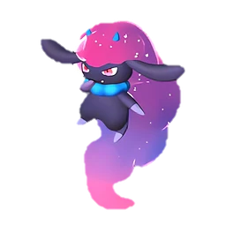Даэдрим</a><a class="ichip src" href="../../../4_spravochniki/paly/nox/">Нокс</a>

## Мембрана нейтрализации яда

Орган Дандилорд, защищающий его от собственного коррозионного тумана. Фильтрует и нейтрализует его.

💎Редкость<b>Легендарный</b>

⚖️Вес<b>1</b>

💰Цена<b>5000</b>

## Металлическая руда

При выплавке в печи превращается в слиток. Встречается в пещерах и других местах.

💎Редкость<b>Обычный</b>

⚖️Вес<b>8</b>

💰Цена<b>100</b>

📍 Где взять
📦 Экспедиция: Холмы (старт) <small>30–50 · 100%</small>📦 Подмастерье кузнеца <small>30–40 · 100%</small>📦 Сундуки и ящики: Фейбрейк <small>1–5 · 15,218%</small>📦 Сундуки и ящики: Пустыня <small>2–4 · 14,143%</small>📦 Сундуки и ящики: Сакурадзима <small>1–5 · 13,048%</small>📦 Сундуки и ящики: Снега <small>2–4 · 12,763%</small>📦 Сундуки и ящики: Вулкан <small>2–4 · 11,871%</small>👤 Воплощение клубов песка Серфент Терра <small>100%</small><a class="ichip src" href="../../../4_spravochniki/paly/gorirat_terra/">Горират Терра</a><a class="ichip src" href="../../../4_spravochniki/paly/surfent_terra/">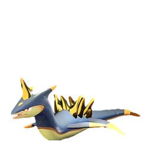Серфент Терра</a><a class="ichip src" href="../../../4_spravochniki/paly/surfent_terra/">Серфент Терра</a><a class="ichip src" href="../../../4_spravochniki/paly/digtoise/">Дигтос</a><a class="ichip src" href="../../../4_spravochniki/paly/pierdon/">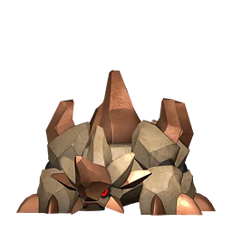Пиродон</a><a class="ichip src" href="../../../4_spravochniki/paly/cryolinx_terra/">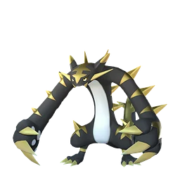Криолинкс Терра</a><a class="ichip src" href="../../../4_spravochniki/paly/knocklem/">Теранайт</a><a class="ichip src" href="../../../4_spravochniki/paly/knocklem_ignis/">Теранайт Игнис</a>🛒 торговец

## Металлический слиток

Материал для изготовления металлического оружия и брони. Можно получить, переплавив в печи Металлическая руда.

💎Редкость<b>Обычный</b>

⚖️Вес<b>5</b>

💰Цена<b>240</b>

🔨 Крафт
Металлическая руда <b>×2</b>
<small class="ist">Примитивная печь Улучшенная печь Электрическая печь Древняя печь</small>

📍 Где взять
📦 Подмастерье кузнеца <small>20–30 · 100%</small>📦 Сундук: Холмы (старт) <small>1 · 0%</small><a class="ichip src" href="../../../4_spravochniki/paly/bushi/">Буси</a><a class="ichip src" href="../../../4_spravochniki/paly/bushi_noct/">Буси Нокт</a>

## Мутировавшее яйцо

Мутировавшее яйцо. Крайне редкое яйцо, прошедшее особую мутацию. Поместите яйцо в Инкубатор для выведения.

💎Редкость<b>Обычный</b>

⚖️Вес<b>10</b>

💰Цена<b>10</b>

## Нейтральный самоцвет

Камень, образованный из энергии Мирового Древа, накопленной в теле Пала. После обработки становится предметом, раскрывающим скрытый потенциал Пала Нейтральный.

💎Редкость<b>Редкий</b>

⚖️Вес<b>1</b>

💰Цена<b>1000</b>

📍 Где взять
📦 Сундук: Мировое Древо <small>5–10 · 33,333%</small>📦 Экспедиция: Мировое Древо <small>1–3 · 11,111%</small>📦 Рыбалка: Мировое Древо <small>1–3 · 2,641%</small>📦 Блестящая древняя реликвия (переработка) <small>1 · 2,304%</small>📦 Спящая древняя реликвия (переработка) <small>1 · 1,333%</small>📦 Истлевшая древняя реликвия (переработка) <small>1 · 1,111%</small>📦 Светящаяся древняя реликвия (переработка) <small>1 · 1,92%</small>📦 Роскошная древняя реликвия (переработка) <small>1 · 1,6%</small>👤 Экстремальная модификация Селена <small>100%</small>

## Ночная звёздная пыль

Песок, собираемый ночью в пустыне. Служит материалом для создания некоторых аксессуаров и других предметов.

💎Редкость<b>Обычный</b>

⚖️Вес<b>1</b>

💰Цена<b>1000</b>

📍 Где взять
<a class="ichip src" href="../../../4_spravochniki/paly/starryon_primo/">Старрион Примо</a><a class="ichip src" href="../../../4_spravochniki/paly/wistella/">Вистелла</a>

## Облако Даззи

Облако, выпавшее с пала «Даззи». Пушистый и объёмный материал, используемый для изготовления одежды.

💎Редкость<b>Обычный</b>

⚖️Вес<b>0,2</b>

💰Цена<b>500</b>

📍 Где взять
<a class="ichip src" href="../../../4_spravochniki/paly/dazzi/">Даззи</a><a class="ichip src" href="../../../4_spravochniki/paly/dazzi_noct/">Даззи Нокт</a>🛒 торговец

## Обломок метеорита

Осколок камня, упавший с неба. Внутри содержится большое количество ресурса Осколок палдиума. Для извлечения используйте ｢Дробилка｣.

💎Редкость<b>Обычный</b>

⚖️Вес<b>3</b>

💰Цена<b>1000</b>

📍 Где взять
<a class="ichip src" href="../../../4_spravochniki/paly/xenovader/">Зеноведа</a><a class="ichip src" href="../../../4_spravochniki/paly/xenogard/">Зеногард</a><a class="ichip src" href="../../../4_spravochniki/paly/xenolord/">Зенолорд</a>

## Обычное яйцо

Обычное яйцо. Внутри ощущается нежное шевеление. Поместите яйцо в Инкубатор для выведения.

💎Редкость<b>Обычный</b>

⚖️Вес<b>10</b>

💰Цена<b>10</b>

## Огненный орган

Материал, добываемый из Палов (Огонь). Из него изготавливаются такие предметы, как Огненная стрела.

💎Редкость<b>Обычный</b>

⚖️Вес<b>0,5</b>

💰Цена<b>300</b>

📍 Где взять
📦 Пастбище: Фламбелль сам даёт <small>1 · 100%</small>📦 Экспедиция: Вулкан (сложная) <small>10–20 · 100%</small>📦 Сундук: Лес <small>10–20 · 86,957%</small>📦 Сундуки и ящики: Вулкан <small>2–3 · 3,166%</small>👤 Мученик Братства Вечного Пламени <small>100%</small><a class="ichip src" href="../../../4_spravochniki/paly/fuack_ignis/">Камоноске Игнис</a><a class="ichip src" href="../../../4_spravochniki/paly/tanzee_ignis/">Танзи Игнис</a><a class="ichip src" href="../../../4_spravochniki/paly/flambelle/">Фламбелль</a><a class="ichip src" href="../../../4_spravochniki/paly/rooby/">Руби</a><a class="ichip src" href="../../../4_spravochniki/paly/foxparks/">Фокспаркс</a><a class="ichip src" href="../../../4_spravochniki/paly/kelpsea_ignis/">Келпси Игнис</a><a class="ichip src" href="../../../4_spravochniki/paly/gobfin_ignis/">Гобфин Игнис</a><a class="ichip src" href="../../../4_spravochniki/paly/arsox/">Арсокс</a><a class="ichip src" href="../../../4_spravochniki/paly/leezpunk_ignis/">Лизпанк Игнис</a><a class="ichip src" href="../../../4_spravochniki/paly/wixen/">Виксен</a><a class="ichip src" href="../../../4_spravochniki/paly/katress_ignis/">Катресс Игнис</a><a class="ichip src" href="../../../4_spravochniki/paly/bushi_noct/">Буси Нокт</a>🛒 торговец

## Огненный самоцвет

Камень, образованный из энергии Мирового Древа, накопленной в теле Пала. После обработки становится предметом, раскрывающим скрытый потенциал Пала Огонь.

💎Редкость<b>Редкий</b>

⚖️Вес<b>1</b>

💰Цена<b>1000</b>

📍 Где взять
📦 Сундук: Мировое Древо <small>5–10 · 33,333%</small>📦 Экспедиция: Мировое Древо <small>1–3 · 11,111%</small>📦 Рыбалка: Мировое Древо <small>1–3 · 2,641%</small>📦 Блестящая древняя реликвия (переработка) <small>1 · 2,304%</small>📦 Спящая древняя реликвия (переработка) <small>1 · 1,333%</small>📦 Истлевшая древняя реликвия (переработка) <small>1 · 1,111%</small>📦 Светящаяся древняя реликвия (переработка) <small>1 · 1,92%</small>📦 Роскошная древняя реликвия (переработка) <small>1 · 1,6%</small>👤 Экстремальная модификация Фалерис <small>100%</small>

## Огромное зловещее яйцо

Огромное зловещее яйцо. Таинственное яйцо, в котором заключена энергия Мирового Древа. Поместите яйцо в Инкубатор для выведения.

💎Редкость<b>Легендарный</b>

⚖️Вес<b>50</b>

💰Цена<b>10</b>

## Огромное обычное яйцо

Огромное обычное яйцо. Внутри ощущается биение души, исполненной милосердия. Похоже, на свет вот-вот появится чудовище. Поместите яйцо в Инкубатор для выведения.

💎Редкость<b>Легендарный</b>

⚖️Вес<b>50</b>

💰Цена<b>10</b>

## Огромное раскалённое яйцо

Огромное раскалённое яйцо. Внутри ощущается биение пылающей души. Похоже, на свет вот-вот появится чудовище. Поместите яйцо в Инкубатор для выведения.

💎Редкость<b>Легендарный</b>

⚖️Вес<b>50</b>

💰Цена<b>10</b>

## Огромное яйцо воды

Огромное яйцо воды. Внутри ощущается биение чистой души. Похоже, на свет вот-вот появится чудовище. Поместите яйцо в Инкубатор для выведения.

💎Редкость<b>Легендарный</b>

⚖️Вес<b>50</b>

💰Цена<b>10</b>

## Огромное яйцо дракона

Огромное яйцо дракона. Внутри ощущается биение величественной души. Похоже, на свет вот-вот появится чудовище. Поместите яйцо в Инкубатор для выведения.

💎Редкость<b>Легендарный</b>

⚖️Вес<b>50</b>

💰Цена<b>10</b>

## Огромное яйцо земли

Огромное яйцо земли. Внутри ощущается биение души земли. Похоже, на свет вот-вот появится чудовище. Поместите яйцо в Инкубатор для выведения.

💎Редкость<b>Легендарный</b>

⚖️Вес<b>50</b>

💰Цена<b>10</b>

## Огромное яйцо молнии

Огромное яйцо молнии. Внутри ощущается бурное биение неистовой души. Похоже, на свет вот-вот появится чудовище. Поместите яйцо в Инкубатор для выведения.

💎Редкость<b>Легендарный</b>

⚖️Вес<b>50</b>

💰Цена<b>10</b>

## Огромное яйцо свежей листвы

Огромное яйцо свежей листвы. Внутри ощущается биение души глубокого зелёного цвета. Похоже, на свет вот-вот появится чудовище. Поместите яйцо в Инкубатор для выведения.

💎Редкость<b>Легендарный</b>

⚖️Вес<b>50</b>

💰Цена<b>10</b>

## Огромное яйцо тьмы

Огромное яйцо тьмы. Внутри ощущается биение души бездны. Похоже, на свет вот-вот появится чудовище. Поместите яйцо в Инкубатор для выведения.

💎Редкость<b>Легендарный</b>

⚖️Вес<b>50</b>

💰Цена<b>10</b>

## Осколок палдиума

Кристаллизованная энергия Мирового Древа. Используется для создания сверхъестественных предметов и сооружений.

💎Редкость<b>Обычный</b>

⚖️Вес<b>1</b>

💰Цена<b>70</b>

🔨 Крафт
Камень <b>×5</b>
<small class="ist">Дробилка Замораживающий измельчитель</small>

📍 Где взять
📦 Экспедиция: Холмы (старт) <small>10–30 · 100%</small>📦 Миссия <small>20 · 100%</small>📦 Сундуки и ящики: Холмы (старт) <small>1–3 · 40,09%</small>📦 Сундуки и ящики: Снега <small>2–7 · 26,507%</small>📦 Мусорный сундук: Холмы (старт) <small>4–6 · 25%</small>📦 Сундуки и ящики: Сакурадзима <small>1–5 · 19,572%</small>📦 Сундуки и ящики: Пустыня <small>2–7 · 18,857%</small>📦 Сундуки и ящики: Вулкан <small>2–7 · 15,828%</small>📦 Сундуки и ящики: Фейбрейк <small>1–5 · 15,218%</small>📦 Сундуки и ящики: Санрич <small>1–5 · 14,934%</small><a class="ichip src" href="../../../4_spravochniki/paly/lunaris/">Лунарис</a>🛒 торговец

## Осколок тьмы

Получается с некоторых сильных Палов с элементом Тьма. Материал для создания мощных аксессуаров и других вещей.

💎Редкость<b>Обычный</b>

⚖️Вес<b>0,2</b>

💰Цена<b>500</b>

📍 Где взять
📦 Сундуки и ящики: Фейбрейк <small>1 · 15,218%</small>📦 Сундуки и ящики: Санрич <small>1 · 14,934%</small><a class="ichip src" href="../../../4_spravochniki/paly/dazzi_noct/">Даззи Нокт</a><a class="ichip src" href="../../../4_spravochniki/paly/kitsun_noct/">Кицун Нокт</a><a class="ichip src" href="../../../4_spravochniki/paly/starryon/">Старрион</a><a class="ichip src" href="../../../4_spravochniki/paly/omascul/">Омаскул</a><a class="ichip src" href="../../../4_spravochniki/paly/splatterina/">Сплаттерина</a><a class="ichip src" href="../../../4_spravochniki/paly/celesdir_noct/">Селесдир Нокт</a><a class="ichip src" href="../../../4_spravochniki/paly/solenne/">Соленна</a><a class="ichip src" href="../../../4_spravochniki/paly/bellanoir/">Бэллануар</a><a class="ichip src" href="../../../4_spravochniki/paly/bellanoir_libero/">Бэллануар Либеро</a>

## Палкзит

Кристалл, образованный за долгие эпохи из утёкшей энергии Мирового Древа. Тот, кто лишён благословения, при прикосновении мгновенно покроется ржавчиной и обратится в прах. Лишь тот, кто способен обуздать его хрупкую природу, может достичь вершины древних технологий.

💎Редкость<b>Обычный</b>

⚖️Вес<b>5</b>

💰Цена<b>3000</b>

📍 Где взять
📦 Истлевшая древняя реликвия (переработка) <small>1–3 · 100%</small>📦 Спящая древняя реликвия (переработка) <small>3–5 · 100%</small>📦 Роскошная древняя реликвия (переработка) <small>5–7 · 100%</small>📦 Светящаяся древняя реликвия (переработка) <small>7–9 · 100%</small>📦 Блестящая древняя реликвия (переработка) <small>9–11 · 100%</small>📦 Экспедиция: Мировое Древо <small>15–30 · 100%</small>📦 Сундуки и ящики: Мировое Древо <small>1–5 · 18,657%</small>

## Палкизитовый слиток

Сплав высочайшего качества, полученный из материалов «Соллайт» и «Палкзит». Чрезвычайно редкий материал, в котором кристаллизованы технологии древней цивилизации и сила Мирового Древа. Незаменим для создания снаряжения и сооружений высшего уровня.

💎Редкость<b>Обычный</b>

⚖️Вес<b>3</b>

💰Цена<b>16200</b>

📘Технология<b>ур. 74</b>

🔨 Крафт
Соллайт <b>×1</b>Палкзит <b>×2</b>Святая вода Мирового Древа <b>×1</b>
<small class="ist">Древняя печь</small>

## Перо Пенкинга

Перо, выпавшее с пала «Пенкинг». Отличается яркой окраской и используется как материал для одежды.

💎Редкость<b>Обычный</b>

⚖️Вес<b>0,2</b>

💰Цена<b>500</b>

📍 Где взять
<a class="ichip src" href="../../../4_spravochniki/paly/penking/">Пенкинг</a><a class="ichip src" href="../../../4_spravochniki/paly/penking_lux/">Пенкинг Лакс</a>🛒 торговец

## Перо Токотоко

Перо, выпавшее с пала «Токотоко». Благодаря красивой окраске пользуется популярностью и используется как материал для одежды.

💎Редкость<b>Обычный</b>

⚖️Вес<b>0,2</b>

💰Цена<b>500</b>

📍 Где взять
<a class="ichip src" href="../../../4_spravochniki/paly/tocotoco/">Токотоко</a>🛒 торговец

## Печатная плата

Печатная плата — необходимый компонент для изготовления точного оборудования.

💎Редкость<b>Необычный</b>

⚖️Вес<b>2</b>

💰Цена<b>2500</b>

📘Технология<b>ур. 35</b>

🔨 Крафт
Чистый кварц <b>×2</b>Полимер <b>×1</b>
<small class="ist">Конвейерная фабрика Конвейерная фабрика II Мастерская развитой цивилизации Древний верстак</small>

📍 Где взять
📦 Награда Заносчивого критика Палов <small>2 · 100%</small>📦 Мусорный сундук: Снега <small>1–3 · 28,571%</small>👤 Лаборант отряда Генетических Исследований <small>10%</small>👤 Похититель Виск <small>10%</small>

## Полимер

Полимер получают из переработанной нефти. Требуется для изготовления огнестрельного оружия и других предметов.

💎Редкость<b>Обычный</b>

⚖️Вес<b>0,5</b>

💰Цена<b>1080</b>

📘Технология<b>ур. 33</b>

🔨 Крафт
Качественное масло Пала <b>×2</b>Сера <b>×1</b>
<small class="ist">Конвейерная фабрика Конвейерная фабрика II Мастерская развитой цивилизации Древний верстак</small>

📍 Где взять
👤 Мученик Братства Вечного Пламени <small>20%</small>👤 Любитель тёмной магии Тень <small>20%</small>

## Порох

Порох для стрельбы из огнестрельного оружия. Требуется для создания боеприпасов.

💎Редкость<b>Обычный</b>

⚖️Вес<b>0,2</b>

💰Цена<b>430</b>

📘Технология<b>ур. 21</b>

🔨 Крафт
Древесный уголь <b>×2</b>Сера <b>×1</b>
<small class="ist">Качественный верстак Конвейерная фабрика Конвейерная фабрика II Мастерская развитой цивилизации Древний верстак</small>

📍 Где взять
👤 Близнецы-подрывники Дина <small>100%</small>👤 Близнецы-подрывники Мит <small>100%</small><a class="ichip src" href="../../../4_spravochniki/paly/tocotoco/">Токотоко</a>

## Разрушенные артефакты древн. цив.

Обломок сооружений и инструментов древней цивилизации. Крайне ветхий, внутри совсем не осталось энергии.

💎Редкость<b>Обычный</b>

⚖️Вес<b>1</b>

💰Цена<b>10</b>

📍 Где взять
📦 Экспедиция: Мировое Древо <small>1–3 · 51,613%</small>📦 Сундук: Мировое Древо <small>1–10 · 43,802%</small>📦 Мусорный сундук: Мировое Древо <small>1 · 12,598%</small>📦 Рыбалка: Мировое Древо <small>1–3 · 4,401%</small>📦 Сундуки и ящики: Мировое Древо <small>1 · 3,21%</small>📦 Таинственная древесина <small>1–3 · 100%</small>📦 Палкзит <small>1–3 · 100%</small>📦 Водный самоцвет <small>1 · 1,111%</small>📦 Грозовой самоцвет <small>1 · 1,111%</small>📦 Земной самоцвет <small>1 · 1,111%</small>📦 Травяной самоцвет <small>1 · 1,111%</small>📦 Огненный самоцвет <small>1 · 1,111%</small>📦 Ледяной самоцвет <small>1 · 1,111%</small>📦 Драконий самоцвет <small>1 · 1,111%</small>📦 Темный самоцвет <small>1 · 1,111%</small>📦 Нейтральный самоцвет <small>1 · 1,111%</small>📦 Расходуемый имплант: Обоюдоострый святой меч <small>1 · 0,051%</small>📦 Расходуемый имплант: Живая стена святилища <small>1 · 0,051%</small>📦 Расходуемый имплант: Дьявольские руки <small>1 · 0,051%</small>📦 Расходуемый имплант: Рассада божественного древа <small>1 · 0,051%</small>📦 Расходуемый имплант: Небожитель <small>1 · 0,051%</small>📦 Расходуемый имплант: Прыжок между измерениями <small>1 · 0,051%</small>📦 Расходуемый имплант: Бог разрушения <small>1 · 0,051%</small>📦 Расходуемый имплант: Виртуоз <small>1 · 0,051%</small>

## Раскалённое яйцо

Раскалённое яйцо. Внутри чувствуется горячее, пульсирующее шевеление. Поместите яйцо в Инкубатор для выведения.

💎Редкость<b>Обычный</b>

⚖️Вес<b>10</b>

💰Цена<b>10</b>

## Рог

Рог добывается с Палов. Используется как материал для изготовления медикаментов.

💎Редкость<b>Обычный</b>

⚖️Вес<b>1</b>

💰Цена<b>200</b>

📍 Где взять
<a class="ichip src" href="../../../4_spravochniki/paly/eikthyrdeer/">Иктирдир</a><a class="ichip src" href="../../../4_spravochniki/paly/eikthyrdeer_terra/">Иктирдир Тэрра</a><a class="ichip src" href="../../../4_spravochniki/paly/caprity/">Каприти</a><a class="ichip src" href="../../../4_spravochniki/paly/caprity_noct/">Каприти Нокт</a><a class="ichip src" href="../../../4_spravochniki/paly/univolt/">Юнивольт</a><a class="ichip src" href="../../../4_spravochniki/paly/univolt_cryst/">Юнивольт Крист</a><a class="ichip src" href="../../../4_spravochniki/paly/arsox/">Арсокс</a><a class="ichip src" href="../../../4_spravochniki/paly/elgrove/">Элгрув</a><a class="ichip src" href="../../../4_spravochniki/paly/elgrove_cryst/">Элгрув Крист</a><a class="ichip src" href="../../../4_spravochniki/paly/fenglope/">Фенглоп</a><a class="ichip src" href="../../../4_spravochniki/paly/fenglope_lux/">Фенглоп Лакс</a><a class="ichip src" href="../../../4_spravochniki/paly/incineram/">Инсинерам</a>🛒 торговец

## Рубин

Драгоценный камень, излучающий красное сияние. Можно продать торговцу по высокой цене.

💎Редкость<b>Обычный</b>

⚖️Вес<b>5</b>

💰Цена<b>20000</b>

📍 Где взять
📦 Сундуки и ящики: Холмы (старт) <small>1 · 100%</small>📦 Рыбный пруд на базе: Холмы (старт) <small>1–2 · 44,444%</small>📦 Рыбалка: Холмы (старт) <small>1 · 22,726%</small>📦 Со дна моря (Магнит/спасение) <small>1–3 · 1,294%</small>👤 Охотник равнин Дайэхаул <small>3%</small><a class="ichip src" href="../../../4_spravochniki/paly/direhowl/">Дайэхаул</a><a class="ichip src" href="../../../4_spravochniki/paly/direhowl/">Дайэхаул</a><a class="ichip src" href="../../../4_spravochniki/paly/vanwyrm/">Ванвирм</a><a class="ichip src" href="../../../4_spravochniki/paly/relaxaurus/">Релаксаурус</a><a class="ichip src" href="../../../4_spravochniki/paly/tetroise/">Тетроис</a><a class="ichip src" href="../../../4_spravochniki/paly/roujay/">Роуджей</a>🛒 торговец

## Сапфир

Драгоценный камень, излучающий голубое сияние. Можно продать торговцу по высокой цене.

💎Редкость<b>Необычный</b>

⚖️Вес<b>5</b>

💰Цена<b>30000</b>

📍 Где взять
📦 Сундуки и ящики: Лес <small>1 · 100%</small>📦 Лагерь врагов <small>1 · 100%</small>📦 Награда Заносчивого критика Палов <small>1 · 100%</small>📦 Рыбный пруд на базе: Лес <small>1–2 · 33,333%</small>📦 Рыбалка: Лес <small>1 · 22,756%</small><a class="ichip src" href="../../../4_spravochniki/paly/mau_cryst/">Мау Крист</a><a class="ichip src" href="../../../4_spravochniki/paly/vanwyrm_cryst/">Ванвирм Крист</a><a class="ichip src" href="../../../4_spravochniki/paly/relaxaurus_lux/">Релаксаурус Лакс</a><a class="ichip src" href="../../../4_spravochniki/paly/menasting_terra/">Менастинг Терра</a><a class="ichip src" href="../../../4_spravochniki/paly/selyne/">Селена</a>🛒 торговец

## Светящиеся артефакты древн. цив.

Обломок сооружений и инструментов древней цивилизации. Очень хорошо сохранился, изнутри сочится свет.

💎Редкость<b>Эпический</b>

⚖️Вес<b>1</b>

💰Цена<b>10</b>

📍 Где взять
📦 Экспедиция: Мировое Древо (сложная) <small>2–4 · 28,571%</small>📦 Сундук: Мировое Древо <small>1–2 · 10,951%</small>📦 Мусорный сундук: Мировое Древо <small>1 · 1,575%</small>📦 Сундуки и ящики: Мировое Древо <small>1 · 0,401%</small>📦 Рыбалка: Мировое Древо <small>1–3 · 0,55%</small>📦 Таинственная древесина <small>7–9 · 100%</small>📦 Палкзит <small>7–9 · 100%</small>📦 Водный самоцвет <small>1 · 1,92%</small>📦 Грозовой самоцвет <small>1 · 1,92%</small>📦 Земной самоцвет <small>1 · 1,92%</small>📦 Травяной самоцвет <small>1 · 1,92%</small>📦 Огненный самоцвет <small>1 · 1,92%</small>📦 Ледяной самоцвет <small>1 · 1,92%</small>📦 Драконий самоцвет <small>1 · 1,92%</small>📦 Темный самоцвет <small>1 · 1,92%</small>📦 Нейтральный самоцвет <small>1 · 1,92%</small>📦 Расходуемый имплант: Обоюдоострый святой меч <small>1 · 0,406%</small>📦 Расходуемый имплант: Живая стена святилища <small>1 · 0,406%</small>📦 Расходуемый имплант: Дьявольские руки <small>1 · 0,406%</small>📦 Расходуемый имплант: Рассада божественного древа <small>1 · 0,406%</small>📦 Расходуемый имплант: Небожитель <small>1 · 0,406%</small>📦 Расходуемый имплант: Прыжок между измерениями <small>1 · 0,406%</small>📦 Расходуемый имплант: Бог разрушения <small>1 · 0,406%</small>📦 Расходуемый имплант: Виртуоз <small>1 · 0,406%</small>

## Святой слиток

[Коллаборация с Terraria] Наполненный священной силой материал. Используется для создания различных предметов из Terraria.

💎Редкость<b>Обычный</b>

💰Цена<b>300</b>

📍 Где взять
📦 Сундук <small>4–10 · 100%</small><a class="ichip src" href="../../../4_spravochniki/paly/blue_slime/">Синий слизень</a><a class="ichip src" href="../../../4_spravochniki/paly/cave_bat/">Пещерная летучая мышь</a><a class="ichip src" href="../../../4_spravochniki/paly/demon_eye/">Демонический глаз</a><a class="ichip src" href="../../../4_spravochniki/paly/enchanted_sword/">Зачарованный меч</a><a class="ichip src" href="../../../4_spravochniki/paly/eye_of_cthulhu/">Глаз Ктулху</a><a class="ichip src" href="../../../4_spravochniki/paly/green_slime/">Зеленый слизень</a><a class="ichip src" href="../../../4_spravochniki/paly/illuminant_bat/">Светящаяся летучая мышь</a><a class="ichip src" href="../../../4_spravochniki/paly/illuminant_slime/">Светящийся слизень</a><a class="ichip src" href="../../../4_spravochniki/paly/purple_slime/">Фиолетовый слизень</a><a class="ichip src" href="../../../4_spravochniki/paly/rainbow_slime/">Радужный слизень</a><a class="ichip src" href="../../../4_spravochniki/paly/red_slime/">Красный слизень</a>

## Семена латука

Семена для выращивания Латук. Необходимы для создания плантации. Можно приобрести у торговца.

💎Редкость<b>Обычный</b>

⚖️Вес<b>0,05</b>

💰Цена<b>40</b>

📍 Где взять
📦 Пастбище: Ваэлет сам даёт <small>1–2 · 11,111%</small>👤 Озверевший Флопи <small>100%</small><a class="ichip src" href="../../../4_spravochniki/paly/cinnamoth/">Синнамос</a><a class="ichip src" href="../../../4_spravochniki/paly/flopie/">Флопи</a><a class="ichip src" href="../../../4_spravochniki/paly/dinossom/">Диноссум</a><a class="ichip src" href="../../../4_spravochniki/paly/braloha/">Бралоха</a>🛒 торговец

## Семена лука

Семена для выращивания Лук. Необходимы для создания плантации.

💎Редкость<b>Обычный</b>

⚖️Вес<b>0,05</b>

💰Цена<b>70</b>

📍 Где взять
📦 Пастбище: Ваэлет сам даёт <small>1–2 · 13,333%</small><a class="ichip src" href="../../../4_spravochniki/paly/vaelet/">Ваэлет</a><a class="ichip src" href="../../../4_spravochniki/paly/palumba/">Палумба</a><a class="ichip src" href="../../../4_spravochniki/paly/broncherry/">Брончерри</a><a class="ichip src" href="../../../4_spravochniki/paly/broncherry_aqua/">Брончерри Аква</a>🛒 торговец

## Семена моркови

Семена для выращивания Морковь. Необходимы для создания плантации.

💎Редкость<b>Обычный</b>

⚖️Вес<b>0,05</b>

💰Цена<b>60</b>

📍 Где взять
📦 Пастбище: Ваэлет сам даёт <small>1–2 · 15,556%</small><a class="ichip src" href="../../../4_spravochniki/paly/ribbuny_botan/">Риббани Ботан</a><a class="ichip src" href="../../../4_spravochniki/paly/dinossom_lux/">Диноссум Лакс</a><a class="ichip src" href="../../../4_spravochniki/paly/mossanda/">Моссанда</a><a class="ichip src" href="../../../4_spravochniki/paly/palumba/">Палумба</a><a class="ichip src" href="../../../4_spravochniki/paly/wumpo_botan/">Вумпо Ботан</a><a class="ichip src" href="../../../4_spravochniki/paly/prunelia/">Прунелия</a>🛒 торговец

## Семена помидоров

Семена для выращивания Помидор. Необходимы для создания плантации. Можно приобрести у торговца.

💎Редкость<b>Обычный</b>

⚖️Вес<b>0,05</b>

💰Цена<b>30</b>

📍 Где взять
📦 Пастбище: Ваэлет сам даёт <small>1–2 · 22,222%</small><a class="ichip src" href="../../../4_spravochniki/paly/bristla/">Бристла</a><a class="ichip src" href="../../../4_spravochniki/paly/cinnamoth/">Синнамос</a><a class="ichip src" href="../../../4_spravochniki/paly/vaelet/">Ваэлет</a><a class="ichip src" href="../../../4_spravochniki/paly/dinossom/">Диноссум</a><a class="ichip src" href="../../../4_spravochniki/paly/dinossom_lux/">Диноссум Лакс</a><a class="ichip src" href="../../../4_spravochniki/paly/braloha/">Бралоха</a>🛒 торговец

## Семена пшеницы

Семена для выращивания Пшеница. Необходимы для создания плантации. Можно приобрести у торговца.

💎Редкость<b>Обычный</b>

⚖️Вес<b>0,05</b>

💰Цена<b>20</b>

📍 Где взять
📦 Пастбище: Ваэлет сам даёт <small>1–2 · 20%</small><a class="ichip src" href="../../../4_spravochniki/paly/lifmunk/">Лифманк</a><a class="ichip src" href="../../../4_spravochniki/paly/herbil/">Хербил</a><a class="ichip src" href="../../../4_spravochniki/paly/hangyu/">Хангю</a><a class="ichip src" href="../../../4_spravochniki/paly/souffline/">Суффлин</a>🛒 торговец

## Семена ягод

Семена для выращивания Красная ягода. Необходимы для создания плантации. Можно получить при сборе Красная ягода.

💎Редкость<b>Обычный</b>

⚖️Вес<b>0,05</b>

💰Цена<b>10</b>

📍 Где взять
<a class="ichip src" href="../../../4_spravochniki/paly/gumoss/">Гумосс</a><a class="ichip src" href="../../../4_spravochniki/paly/clovee/">Клови</a><a class="ichip src" href="../../../4_spravochniki/paly/ribbuny/">Риббани</a>🛒 торговец

## Семенной картофель

Семенной картофель для выращивания Картофель. Необходим для создания плантации.

💎Редкость<b>Обычный</b>

⚖️Вес<b>0,05</b>

💰Цена<b>50</b>

📍 Где взять
📦 Пастбище: Ваэлет сам даёт <small>1–2 · 17,778%</small><a class="ichip src" href="../../../4_spravochniki/paly/robinquill/">Робинквилл</a><a class="ichip src" href="../../../4_spravochniki/paly/robinquill_terra/">Робинквилл Терра</a><a class="ichip src" href="../../../4_spravochniki/paly/petallia/">Петаллия</a>🛒 торговец

## Сера

Минерал, встречающийся на склонах вулканов. Сера используется для создания материала «Порох».

💎Редкость<b>Обычный</b>

⚖️Вес<b>3</b>

💰Цена<b>300</b>

📍 Где взять
📦 Экспедиция: Вулкан <small>20–40 · 100%</small>📦 Сундуки и ящики: Вулкан <small>1–3 · 11,871%</small><a class="ichip src" href="../../../4_spravochniki/paly/pierdon/">Пиродон</a>

## Сияющие артефакты древн. цив.

Обломок сооружений и инструментов древней цивилизации. Наполнен энергией и излучает сияние.

💎Редкость<b>Легендарный</b>

⚖️Вес<b>1</b>

💰Цена<b>10</b>

📍 Где взять
📦 Экспедиция: Мировое Древо (сложная) <small>2–4 · 14,286%</small>📦 Сундук: Мировое Древо <small>1 · 8,76%</small>📦 Мусорный сундук: Мировое Древо <small>1 · 0,787%</small>📦 Рыбалка: Мировое Древо <small>1–3 · 0,275%</small>📦 Сундуки и ящики: Мировое Древо <small>1 · 0,201%</small>📦 Таинственная древесина <small>9–11 · 100%</small>📦 Палкзит <small>9–11 · 100%</small>📦 Водный самоцвет <small>1 · 2,304%</small>📦 Грозовой самоцвет <small>1 · 2,304%</small>📦 Земной самоцвет <small>1 · 2,304%</small>📦 Травяной самоцвет <small>1 · 2,304%</small>📦 Огненный самоцвет <small>1 · 2,304%</small>📦 Ледяной самоцвет <small>1 · 2,304%</small>📦 Драконий самоцвет <small>1 · 2,304%</small>📦 Темный самоцвет <small>1 · 2,304%</small>📦 Нейтральный самоцвет <small>1 · 2,304%</small>📦 Расходуемый имплант: Обоюдоострый святой меч <small>1 · 0,813%</small>📦 Расходуемый имплант: Живая стена святилища <small>1 · 0,813%</small>📦 Расходуемый имплант: Дьявольские руки <small>1 · 0,813%</small>📦 Расходуемый имплант: Рассада божественного древа <small>1 · 0,813%</small>📦 Расходуемый имплант: Небожитель <small>1 · 0,813%</small>📦 Расходуемый имплант: Прыжок между измерениями <small>1 · 0,813%</small>📦 Расходуемый имплант: Бог разрушения <small>1 · 0,813%</small>📦 Расходуемый имплант: Виртуоз <small>1 · 0,813%</small>

## Слиток Пал-Металла

Материал для изготовления оружия и брони из пал-металла. Добавление палдиума в сплав повышает его прочность.

💎Редкость<b>Обычный</b>

⚖️Вес<b>5</b>

💰Цена<b>1250</b>

🔨 Крафт
Металлическая руда <b>×4</b>Чистый кварц <b>×1</b>Осколок палдиума <b>×2</b>
<small class="ist">Электрическая печь Древняя печь</small>

## Слиток рафинированного металла

Материал для изготовления оружия и брони из высококачественного металла.

💎Редкость<b>Обычный</b>

⚖️Вес<b>5</b>

💰Цена<b>720</b>

🔨 Крафт
Металлическая руда <b>×2</b>Уголь <b>×2</b>
<small class="ist">Улучшенная печь Электрическая печь Древняя печь</small>

📍 Где взять
📦 Подмастерье кузнеца <small>20–30 · 100%</small>📦 Сундук: Лес <small>1 · 4,673%</small>

## Собачья монета

Загадочная монета. Говорят, у неё есть свои ценители. Такие монеты носит с собой Мимидог, но при его разделке получить их почему-то нельзя.

💎Редкость<b>Эпический</b>

💰Цена<b>10</b>

📍 Где взять
📦 Древние руины: Небольшое поселение (85, -575) <small>20 · 100%</small>📦 Древние руины: Башня Организации по Защите Паллов - Вход (49, -330) <small>20 · 100%</small>📦 Древние руины: Холмы истока (169, -586) <small>20 · 100%</small>📦 Древние руины: Обитель Пекла (-72, -489) <small>20 · 100%</small>📦 Древние руины: Руины церкви на Острове безмолвия (-495, -44) <small>20 · 100%</small>📦 Древние руины: Побережье Келпси (-379, -154) <small>20 · 100%</small>📦 Древние руины: Дюны Анубиса (-102, -102) <small>20 · 100%</small>📦 Древние руины: Развилка исследователей (-195, -194) <small>20 · 100%</small>📦 Древние руины: Небольшая бухта (-276, -559) <small>20 · 100%</small>📦 Древние руины: Склон шелестящего бамбука (-311, -312) <small>20 · 100%</small>📦 Древние руины: Долина завывающих ветров (-167, -449) <small>20 · 100%</small>📦 Древние руины: Кричащий остров (-271, 91) <small>20 · 100%</small>📦 Древние руины: Побережье кричащего острова (-251, -75) <small>20 · 100%</small>📦 Древние руины: Небольшая бухта (-164, -548) <small>20 · 100%</small>📦 Древние руины: Склон шелестящего бамбука (-216, -279) <small>20 · 100%</small>📦 Древние руины: Наблюдательная башня архипелага Морских ветров (-161, -719) <small>20 · 100%</small>📦 Древние руины: Лес разноцветных бабочек (-49, -219) <small>25 · 100%</small>📦 Древние руины: Лес разноцветных бабочек (-78, -331) <small>25 · 100%</small>📦 Древние руины: Холм лицемеров (106, -232) <small>25 · 100%</small>📦 Древние руины: Центр озера (19, -157) <small>25 · 100%</small>📦 Древние руины: Лес разноцветных бабочек (-90, -244) <small>25 · 100%</small>📦 Древние руины: Холм лицемеров (46, -253) <small>25 · 100%</small>📦 Древние руины: Вершина Горы Флопи (-26, -92) <small>25 · 100%</small>📦 Древние руины: Обитель Тайны (93, -64) <small>25 · 100%</small>

## Соллайт

Редкая руда, встречающаяся только в Санриче. Материнская порода с поразительной плотностью содержит таинственные узоры и сияние.

💎Редкость<b>Обычный</b>

⚖️Вес<b>5</b>

💰Цена<b>2500</b>

📍 Где взять
📦 Экспедиция: Санрич <small>30–50 · 100%</small>📦 Ящик снабжения (с неба): Санрич <small>30–40 · 100%</small>📦 Лагерь врагов: Санрич <small>5–10 · 27,65%</small>📦 Сундуки и ящики: Санрич <small>1–2 · 14,934%</small>📦 Рыбалка: Санрич <small>18–29 · 11,088%</small><a class="ichip src" href="../../../4_spravochniki/paly/pierdon_cryst/">Пиродон Крист</a><a class="ichip src" href="../../../4_spravochniki/paly/jetragon/">Джетрагон</a>

## Соллайтовый слиток

Металлический материал древней цивилизации, выплавляемый из руды, скрытой в Санриче. Редкий обработанный материал, служащий основой для высокоуровневого снаряжения и построек. Выплавляется в станцию «Древняя печь».

💎Редкость<b>Обычный</b>

⚖️Вес<b>3</b>

💰Цена<b>7200</b>

📘Технология<b>ур. 66</b>

🔨 Крафт
Соллайт <b>×2</b>Чистый кварц <b>×2</b>
<small class="ist">Древняя печь</small>

## Спящие артефакты древн. цив.

Обломок сооружений и инструментов древней цивилизации. Неплохо сохранился, но энергии внутри почти не осталось.

💎Редкость<b>Необычный</b>

⚖️Вес<b>1</b>

💰Цена<b>10</b>

📍 Где взять
📦 Экспедиция: Мировое Древо <small>1–3 · 25,806%</small>📦 Сундук: Мировое Древо <small>1–5 · 21,901%</small>📦 Мусорный сундук: Мировое Древо <small>1 · 6,299%</small>📦 Рыбалка: Мировое Древо <small>1–3 · 2,201%</small>📦 Сундуки и ящики: Мировое Древо <small>1 · 1,605%</small>📦 Таинственная древесина <small>3–5 · 100%</small>📦 Палкзит <small>3–5 · 100%</small>📦 Водный самоцвет <small>1 · 1,333%</small>📦 Грозовой самоцвет <small>1 · 1,333%</small>📦 Земной самоцвет <small>1 · 1,333%</small>📦 Травяной самоцвет <small>1 · 1,333%</small>📦 Огненный самоцвет <small>1 · 1,333%</small>📦 Ледяной самоцвет <small>1 · 1,333%</small>📦 Драконий самоцвет <small>1 · 1,333%</small>📦 Темный самоцвет <small>1 · 1,333%</small>📦 Нейтральный самоцвет <small>1 · 1,333%</small>📦 Расходуемый имплант: Обоюдоострый святой меч <small>1 · 0,102%</small>📦 Расходуемый имплант: Живая стена святилища <small>1 · 0,102%</small>📦 Расходуемый имплант: Дьявольские руки <small>1 · 0,102%</small>📦 Расходуемый имплант: Рассада божественного древа <small>1 · 0,102%</small>📦 Расходуемый имплант: Небожитель <small>1 · 0,102%</small>📦 Расходуемый имплант: Прыжок между измерениями <small>1 · 0,102%</small>📦 Расходуемый имплант: Бог разрушения <small>1 · 0,102%</small>📦 Расходуемый имплант: Виртуоз <small>1 · 0,102%</small>

## Средняя душа Пала

Душа, оставшаяся после Пала. Поднесите её в дар Монумент Силы, чтобы раскрыть скрытые способности.

💎Редкость<b>Редкий</b>

⚖️Вес<b>0,15</b>

💰Цена<b>10</b>

🔨 Крафт
Маленькая душа Пала <b>×2</b>
<small class="ist">Дробилка Замораживающий измельчитель</small>

📍 Где взять
📦 Награда Заносчивого критика Палов <small>2 · 100%</small>📦 Экспедиция: Лес <small>3–5 · 50%</small>📦 Пещера Вулкана <small>1–2 · 38,697%</small>📦 Пещера Песчаных Дюн <small>1–2 · 37,893%</small>📦 Лагерь врагов: Снега <small>1–2 · 31,016%</small>📦 Сундук <small>1–2 · 17,671%</small>📦 Сундуки и ящики: Мировое Древо <small>1–2 · 17,413%</small>📦 Сундук в поселении: Пустыня <small>1–2 · 16,667%</small>📦 Рыбный пруд на базе: Вулкан <small>1–2 · 16,313%</small>📦 Рыбалка: Вулкан <small>1–2 · 14,586%</small>📦 Сундуки и ящики: Санрич <small>1–2 · 12,134%</small>📦 Сундуки и ящики: Фейбрейк <small>1–2 · 11,413%</small>📦 Сундуки и ящики: Сакурадзима <small>1–2 · 11,96%</small>📦 Сундуки и ящики: Снега <small>1 · 9,817%</small>📦 Сундуки и ящики: Пустыня <small>1 · 8,486%</small>📦 Сундуки и ящики: Вулкан <small>1 · 6,331%</small>👤 Элитный браконьер <small>30%</small>👤 Браконьер-чистильщик <small>30%</small>👤 Браконьер-громила <small>30%</small>👤 Адепт Организации по Защите Палов <small>30%</small>👤 Мученик Братства Вечного Пламени <small>30%</small><a class="ichip src" href="../../../4_spravochniki/paly/wixen_noct/">Виксен Нокт</a><a class="ichip src" href="../../../4_spravochniki/paly/helzephyr/">Хэлзефир</a><a class="ichip src" href="../../../4_spravochniki/paly/helzephyr_lux/">Хэлзефир Лакс</a>

## Сталепластик

Особый материал, получаемый при обработке ресурса Сырая нефть и металла. Производится на станцию «Электрическая печь».

💎Редкость<b>Обычный</b>

⚖️Вес<b>1</b>

💰Цена<b>2520</b>

📘Технология<b>ур. 50</b>

🔨 Крафт
Сырая нефть <b>×2</b>Металлическая руда <b>×5</b>
<small class="ist">Электрическая печь Древняя печь</small>

📍 Где взять
📦 Подмастерье кузнеца <small>20–30 · 100%</small><a class="ichip src" href="../../../4_spravochniki/paly/astegon/">Астегон</a><a class="ichip src" href="../../../4_spravochniki/paly/shadowbeak/">Шэдоубик</a>

## Сырая нефть

Обработка этого ресурса позволяет получить множество изделий. Для добычи требуется Нефтяная вышка на нефтяном месторождении.

💎Редкость<b>Обычный</b>

⚖️Вес<b>0,5</b>

💰Цена<b>800</b>

📍 Где взять
📦 Нефтяная вышка ур. 55: редкий сундук <small>50–150 · 100%</small>📦 Ящик снабжения (с неба): Холмы (старт) <small>10–20 · 100%</small>📦 Экспедиция: Сакурадзима <small>15–30 · 100%</small>📦 Эмиссар пустынного города <small>20–30 · 100%</small>👤 Браконьер-стрелок <small>30%</small>👤 Браконьер-охотник <small>30%</small>👤 Браконьер-гренадер <small>30%</small>👤 Браконьер-чистильщик <small>30%</small>👤 Элитный браконьер <small>30%</small>👤 Браконьер-ветеран <small>30%</small>👤 Браконьер-перехватчик <small>30%</small>👤 Браконьер-громила <small>60%</small>👤 Браконьер-новичок <small>15%</small>👤 Браконьер-технарь <small>30%</small>👤 Браконьер-арбалетчик <small>30%</small>👤 Браконьер-мечник <small>30%</small><a class="ichip src" href="../../../4_spravochniki/paly/maraith/">Мараит</a><a class="ichip src" href="../../../4_spravochniki/paly/kikit/">Бронебол</a><a class="ichip src" href="../../../4_spravochniki/paly/sootseer/">Гостлайт</a>

## Таинственная древесина

Редкая древесина, наполненная силой Мирового Древа. Даже опытным мастерам непросто её обработать.

💎Редкость<b>Редкий</b>

⚖️Вес<b>8</b>

💰Цена<b>1000</b>

📍 Где взять
📦 Истлевшая древняя реликвия (переработка) <small>1–3 · 100%</small>📦 Спящая древняя реликвия (переработка) <small>3–5 · 100%</small>📦 Роскошная древняя реликвия (переработка) <small>5–7 · 100%</small>📦 Светящаяся древняя реликвия (переработка) <small>7–9 · 100%</small>📦 Блестящая древняя реликвия (переработка) <small>9–11 · 100%</small>📦 Сундуки и ящики: Мировое Древо <small>1–5 · 18,657%</small>

## Твёрдая древесина

Отборная высококачественная древесина. Получается из прочных деревьев, выросших в суровых условиях, таких как пустыни, вулканы и снежные горы.

💎Редкость<b>Необычный</b>

⚖️Вес<b>5</b>

💰Цена<b>100</b>

📍 Где взять
<a class="ichip src" href="../../../4_spravochniki/paly/mossanda/">Моссанда</a><a class="ichip src" href="../../../4_spravochniki/paly/mossanda_lux/">Моссанда Лакс</a><a class="ichip src" href="../../../4_spravochniki/paly/palumba/">Палумба</a><a class="ichip src" href="../../../4_spravochniki/paly/wumpo_botan/">Вумпо Ботан</a>🛒 торговец

## Темный самоцвет

Камень, образованный из энергии Мирового Древа, накопленной в теле Пала. После обработки становится предметом, раскрывающим скрытый потенциал Пала Тьма.

💎Редкость<b>Редкий</b>

⚖️Вес<b>1</b>

💰Цена<b>1000</b>

📍 Где взять
📦 Сундук: Мировое Древо <small>5–10 · 33,333%</small>📦 Экспедиция: Мировое Древо <small>1–3 · 11,111%</small>📦 Рыбалка: Мировое Древо <small>1–3 · 2,641%</small>📦 Блестящая древняя реликвия (переработка) <small>1 · 2,304%</small>📦 Спящая древняя реликвия (переработка) <small>1 · 1,333%</small>📦 Истлевшая древняя реликвия (переработка) <small>1 · 1,111%</small>📦 Светящаяся древняя реликвия (переработка) <small>1 · 1,92%</small>📦 Роскошная древняя реликвия (переработка) <small>1 · 1,6%</small>👤 Экстремальная модификация Шэдоубик <small>100%</small>

## Термоядро

Реакционное ядро, содержащее колоссальные объёмы тепловой энергии. Используется в качестве мощного источника энергии для привода передовых устройств.

💎Редкость<b>Обычный</b>

⚖️Вес<b>8</b>

💰Цена<b>12290</b>

📘Технология<b>ур. 59</b>

🔨 Крафт
Огненный орган <b>×4</b>Уголь <b>×8</b>Едкий растворитель <b>×2</b>Гексолит <b>×2</b>
<small class="ist">Конвейерная фабрика II Мастерская развитой цивилизации Древний верстак</small>

📍 Где взять
<a class="ichip src" href="../../../4_spravochniki/paly/aegidron/">Аэгидрон</a><a class="ichip src" href="../../../4_spravochniki/paly/jetragon/">Джетрагон</a>

## Ткань

Ткань, сотканная из материала «Шерсть». Необходима для создания снаряжения.

💎Редкость<b>Обычный</b>

⚖️Вес<b>1</b>

💰Цена<b>480</b>

📘Технология<b>ур. 4</b>

🔨 Крафт
Шерсть <b>×2</b>
<small class="ist">Качественный верстак Конвейерная фабрика Конвейерная фабрика II Мастерская развитой цивилизации Примитивный верстак Древний верстак</small>

📍 Где взять
📦 Сундук: Холмы (старт) <small>1 · 0%</small><a class="ichip src" href="../../../4_spravochniki/paly/croajiro/">Кроадзиро</a><a class="ichip src" href="../../../4_spravochniki/paly/croajiro_noct/">Кроадзиро Нокт</a><a class="ichip src" href="../../../4_spravochniki/paly/azurobe/">Азуроб</a><a class="ichip src" href="../../../4_spravochniki/paly/azurobe_cryst/">Азуроб Крист</a><a class="ichip src" href="../../../4_spravochniki/paly/felbat/">Фелбэт</a><a class="ichip src" href="../../../4_spravochniki/paly/gildra/">Йомира</a><a class="ichip src" href="../../../4_spravochniki/paly/bakemi/">Бакеми</a>🛒 торговец

## Травяной самоцвет

Камень, образованный из энергии Мирового Древа, накопленной в теле Пала. После обработки становится предметом, раскрывающим скрытый потенциал Пала Трава.

💎Редкость<b>Редкий</b>

⚖️Вес<b>1</b>

💰Цена<b>1000</b>

📍 Где взять
📦 Сундук: Мировое Древо <small>5–10 · 33,333%</small>📦 Экспедиция: Мировое Древо <small>1–3 · 11,111%</small>📦 Рыбалка: Мировое Древо <small>1–3 · 2,641%</small>📦 Блестящая древняя реликвия (переработка) <small>1 · 2,304%</small>📦 Спящая древняя реликвия (переработка) <small>1 · 1,333%</small>📦 Истлевшая древняя реликвия (переработка) <small>1 · 1,111%</small>📦 Светящаяся древняя реликвия (переработка) <small>1 · 1,92%</small>📦 Роскошная древняя реликвия (переработка) <small>1 · 1,6%</small>👤 Экстремальная модификация Лилин <small>100%</small>

## Углеродное волокно

Лёгкий и прочный высококачественный материал. Используется для создания брони и другого снаряжения.

💎Редкость<b>Обычный</b>

⚖️Вес<b>0,2</b>

💰Цена<b>840</b>

📘Технология<b>ур. 35</b>

🔨 Крафт
Уголь <b>×2</b>Огненный орган <b>×1</b>
<small class="ist">Конвейерная фабрика Конвейерная фабрика II Мастерская развитой цивилизации Древний верстак</small>

📍 Где взять
<a class="ichip src" href="../../../4_spravochniki/paly/shadowbeak/">Шэдоубик</a>

## Уголь

Уголь можно найти в пещерах и других местах. Используется для создания качественного металла.

💎Редкость<b>Обычный</b>

⚖️Вес<b>5</b>

💰Цена<b>200</b>

📍 Где взять
📦 Экспедиция: Пустыня <small>20–40 · 100%</small>📦 Подмастерье кузнеца <small>30–40 · 100%</small>📦 Сундуки и ящики: Пустыня <small>1–3 · 14,143%</small>📦 Сундуки и ящики: Сакурадзима <small>1–5 · 13,048%</small>📦 Сундуки и ящики: Снега <small>1–3 · 12,763%</small><a class="ichip src" href="../../../4_spravochniki/paly/pierdon/">Пиродон</a><a class="ichip src" href="../../../4_spravochniki/paly/blazamut/">Блазамут</a><a class="ichip src" href="../../../4_spravochniki/paly/blazamut_ryu/">Блазамут Рю</a>

## Хромаит

Металл, залегающий в земле. На некоторых островах его можно обнаружить с помощью оружия «Металлоискатель» и выкопать.

💎Редкость<b>Обычный</b>

⚖️Вес<b>3</b>

💰Цена<b>1500</b>

📍 Где взять
📦 Экспедиция: Фейбрейк <small>30–50 · 100%</small>📦 Ящик снабжения (с неба): Фейбрейк <small>30–40 · 100%</small>📦 Награда Заносчивого критика Палов <small>15 · 100%</small>📦 Сундуки и ящики: Санрич <small>1–5 · 14,934%</small>👤 Озверевший Силвегис <small>100%</small><a class="ichip src" href="../../../4_spravochniki/paly/smokie/">Смоки</a><a class="ichip src" href="../../../4_spravochniki/paly/silvegis/">Силвегис</a>

## Цемент

Цемент используется как строительный материал. Производится на станцию «Качественный верстак».

💎Редкость<b>Обычный</b>

⚖️Вес<b>5</b>

💰Цена<b>90</b>

📘Технология<b>ур. 19</b>

🔨 Крафт
Камень <b>×20</b>Кость <b>×1</b>Жидкость водного Пала <b>×1</b>
<small class="ist">Качественный верстак Конвейерная фабрика Конвейерная фабрика II Мастерская развитой цивилизации Древний верстак</small>

📍 Где взять
📦 Мусорный сундук: Пустыня <small>4–8 · 40%</small>

## Ценное перо

Сверкающее перо, добываемое с Пала. Можно продать торговцу по высокой цене.

💎Редкость<b>Необычный</b>

💰Цена<b>10000</b>

📍 Где взять
📦 Эмиссар пустынного города <small>5–10 · 100%</small>👤 Воздушный налётчик Ванвирм <small>100%</small>👤 Налётчик холодного неба Ванвирм Крист <small>100%</small>👤 Неизвестный организм Шэдоубик <small>100%</small>👤 Хорошо упитанный Чикипи <small>100%</small>👤 Взрыв — вот моя жизнь Токотоко <small>100%</small>👤 Танец мечтающей бабочки Синнамос <small>100%</small>👤 Коварная чёрная птица Когнито <small>100%</small>👤 Гордый курьер Эрмург <small>100%</small>👤 Добродушный небесный дракон Элфидран <small>100%</small>👤 Чудовище водоворота Элфидран Аква <small>100%</small>👤 Плывущая по небу рыба Селарай <small>100%</small>👤 Крылья Преисподней Хэлзефир <small>100%</small>👤 Крылья, рассекающие небеса Найтвинг <small>100%</small>👤 Воин в тяжёлых доспехах Ворсект <small>100%</small>👤 Властелин рассветов Фалерис <small>100%</small>👤 Королева улья Элизаби <small>100%</small>👤 Пламенеющие крылья Рагнахавк <small>100%</small>👤 Белоснежный странник небес Фэски <small>100%</small>👤 Командир стражи Бигард <small>100%</small>👤 Алый хозяин небес Судзаку <small>100%</small>👤 Лазурный хозяин небес Судзаку Аква <small>100%</small>👤 Молниеносный бегун Райхаунд <small>100%</small>👤 Крылья грома Райберд <small>100%</small>

## Ценные внутренности

Не прекращающее биться сердце Пала. Можно продать торговцу по высокой цене.

💎Редкость<b>Редкий</b>

💰Цена<b>12500</b>

📍 Где взять
👤 Хранитель тёмного солнца Анубис <small>100%</small>👤 Легендарный тёмный рыцарь Некромус <small>100%</small>👤 Леди цветочного сада Петаллия <small>100%</small>👤 Удобная лейка Тифант <small>100%</small>👤 Легендарный ледяной Пегас Фросталлион <small>100%</small>👤 Легендарный тёмный Пегас Фросталлион Нокт <small>100%</small>👤 Дитя морской пучины Келпси <small>100%</small>👤 Дитя лавы Келпси Игнис <small>100%</small>👤 Императрица Лилий Лилин <small>100%</small>👤 Императрица Бездны Лилин Нокт <small>100%</small>👤 Цветок терновника Бристла <small>100%</small>👤 Самопровозглашённый гений Лизпанк <small>100%</small>👤 Самопровозглашённый законодатель моды Лизпанк Игнис <small>100%</small>👤 Пришелец из космоса Лунарис <small>100%</small>👤 Неожиданная мутация Гумосс <small>100%</small>👤 Лесной лучник Робинквилл <small>100%</small>👤 Пустынный лучник Робинквилл Терра <small>100%</small>👤 Странствующий воин Буси <small>100%</small>👤 Легендарный светлый рыцарь Паладиус <small>100%</small>👤 Воплощение рокота волн Серфент <small>100%</small>👤 Воплощение клубов песка Серфент Терра <small>100%</small>👤 Фиалковый морок Ваэлет <small>100%</small>👤 Пожиратель лавы Рептиро <small>100%</small>👤 Пожиратель льда Рептиро Крист <small>100%</small>

## Ценный драконий самоцвет

Самоцвет, добываемый с Палов, похожий на драгоценный камень. Можно продать торговцу по высокой цене.

💎Редкость<b>Редкий</b>

💰Цена<b>15000</b>

📍 Где взять
👤 Озерная королева Азуроб <small>100%</small>👤 Стальной Драконий Владыка Астегон <small>100%</small>👤 Дракон-хранитель цветения Диноссум <small>100%</small>👤 Дракон-хранитель молнии Диноссум Лакс <small>100%</small>👤 Легендарный метеорный дракон Джетрагон <small>100%</small>👤 Дракон-обжора Релаксаурус <small>100%</small>👤 Громовой дракон-обжора Релаксаурус Лакс <small>100%</small>👤 Ветер, вестник весны Брончерри <small>100%</small>👤 Прибой, вестник лета Брончерри Аква <small>100%</small>👤 Раскаты грома Орсерк <small>100%</small>👤 Властелин морей Йормунтайд <small>100%</small>👤 Властелин вулканов Йормунтайд Игнис <small>100%</small>👤 Захватчик из космоса Зенолорд <small>100%</small>👤 Стальной дракон-хранитель Силвегис <small>100%</small>👤 Цветоносный древний дракон Бралоха <small>100%</small>👤 Легендарное морское чудище Нептилиус <small>100%</small>👤 Королева ледяного озера Азуроб Крист <small>100%</small>👤 Ступающий по выжженной земле Молдрон <small>100%</small>👤 Ступающий по ледяной земле Молдрон Крист <small>100%</small>👤 Крылья свободы Айдролон <small>100%</small>👤 Крылья сомнения Айдролон Игнис <small>100%</small>👤 Дракон-хранитель световых следов Аэгидрон <small>100%</small>👤 Невинный дракон водяных цветов Офидия <small>100%</small>👤 Бог воды Шаолонг <small>100%</small>

## Ценный коготь

Невероятно острый коготь Пала. Можно продать торговцу по высокой цене.

💎Редкость<b>Необычный</b>

💰Цена<b>7500</b>

📍 Где взять
👤 Гиена пустошей Инсинерам <small>100%</small>👤 Гиена темной ночи Инсинерам Нокт <small>100%</small>👤 Благородное сияние Мау <small>100%</small>👤 Чистое сияние Мау Крист <small>100%</small>👤 Лесной хулиган Рашоа <small>100%</small>👤 Пройдоха Томбат <small>100%</small>👤 Подземный исследователь Фуддлер <small>100%</small>👤 Всепронзающее копьё Менастинг <small>100%</small>👤 Вращающийся бур Дигтос <small>100%</small>👤 Дерзкая полосатая кошка Спаркит <small>100%</small>👤 Громовые когти Гриззболт <small>100%</small>👤 Быстроногий скакун раскалённых песков Пирин <small>100%</small>👤 Быстроногий скакун тёмного пламени Пирин Нокт <small>100%</small>👤 Охотник равнин Дайэхаул <small>100%</small>👤 Посланник загробного мира Мараит <small>100%</small>👤 Отборный драчун Горират <small>100%</small>👤 Не тронь — будет больно! Джолтхог <small>100%</small>👤 Не наступи — будет больно! Джолтхог Крист <small>100%</small>👤 Деспот Чистилища Блазамут <small>100%</small>👤 Стремительный вихрь Юнивольт <small>100%</small>👤 Повелитель огненных всполохов Блейзхаул <small>100%</small>👤 Повелитель тёмного пламени Блейзхаул Нокт <small>100%</small>👤 Ловкие пальцы Танзи <small>100%</small>👤 Чертовски самодовольный Каттива <small>100%</small>

## Ценный мех

Пушистый и лёгкий мех Пала. Можно продать торговцу по высокой цене.

💎Редкость<b>Необычный</b>

💰Цена<b>5000</b>

📍 Где взять
📦 Награда Заносчивого критика Палов <small>1 · 100%</small>👤 Кокетливые ножки Мелпака <small>100%</small>👤 Хранитель лазурного пламени Кицун <small>100%</small>👤 Ходячая ферма Каприти <small>100%</small>👤 Дерзкий серфер Камоноске <small>100%</small>👤 Первопроходец ледяного моря Пенкинг <small>100%</small>👤 Главный трус на равнине Лифманк <small>100%</small>👤 Тёмный кот-маг Катресс <small>100%</small>👤 Сумеречный вампир Фелбэт <small>100%</small>👤 Вагю высшего сорта Моззарина <small>100%</small>👤 Звезда равнин Викси <small>100%</small>👤 Вожак-защитник стаи Иктирдир <small>100%</small>👤 Золотой рог Иктирдир Тэрра <small>100%</small>👤 Пожиратель снов Даэдрим <small>100%</small>👤 Дрейфующее облако Фенглоп <small>100%</small>👤 Пылающий рогатый зверь Арсокс <small>100%</small>👤 Звезда цветочной поляны Флопи <small>100%</small>👤 Огненный лис-маг Виксен <small>100%</small>👤 Неистовые бивни Мамморест <small>100%</small>👤 Ледяные бивни Мамморест Крист <small>100%</small>👤 Лесной чудак Моссанда <small>100%</small>👤 Чудак, поражённый молнией Моссанда Лакс <small>100%</small>👤 Лесной вихрь Вердаш <small>100%</small>👤 Непокорный верный пёс Якумо <small>100%</small>

## Чистый кварц

Чистый кварц можно найти в снежных горах. Чистый кварц используется для создания материала «Печатная плата».

💎Редкость<b>Обычный</b>

⚖️Вес<b>5</b>

💰Цена<b>500</b>

📍 Где взять
📦 Экспедиция: Снега <small>20–40 · 100%</small>📦 Подмастерье кузнеца <small>20–30 · 100%</small><a class="ichip src" href="../../../4_spravochniki/paly/pierdon_cryst/">Пиродон Крист</a>

## Шерсть

Материал, получаемый из Палов-овец. Из него изготавливаются кровати и Ткань.

💎Редкость<b>Обычный</b>

⚖️Вес<b>1</b>

💰Цена<b>200</b>

📍 Где взять
📦 Пастбище: Кремис сам даёт <small>1 · 100%</small>📦 Миссия <small>10 · 100%</small>📦 Сундуки и ящики: Холмы (старт) <small>1 · 6,414%</small><a class="ichip src" href="../../../4_spravochniki/paly/lamball/">Ламболл</a><a class="ichip src" href="../../../4_spravochniki/paly/cremis/">Кремис</a><a class="ichip src" href="../../../4_spravochniki/paly/melpaca/">Мелпака</a><a class="ichip src" href="../../../4_spravochniki/paly/kingpaca/">Кингпака</a><a class="ichip src" href="../../../4_spravochniki/paly/kingpaca_cryst/">Кингпака Крист</a><a class="ichip src" href="../../../4_spravochniki/paly/swee/">Сви</a><a class="ichip src" href="../../../4_spravochniki/paly/sweepa/">Свипа</a><a class="ichip src" href="../../../4_spravochniki/paly/woolipop_terra/">Вулипоп Терра</a><a class="ichip src" href="../../../4_spravochniki/paly/snugloo/">Снаглоу</a>🛒 торговец

## Щупальце Килламари

Щупальце, выпавшее с пала «Килламари». Материал с необычной текстурой, используемый для изготовления одежды.

💎Редкость<b>Обычный</b>

⚖️Вес<b>0,2</b>

💰Цена<b>500</b>

📍 Где взять
<a class="ichip src" href="../../../4_spravochniki/paly/killamari/">Килламари</a><a class="ichip src" href="../../../4_spravochniki/paly/killamari_primo/">Килламари Примо</a>🛒 торговец

## Электрический орган

Материал, добываемый из Палов (Молния). Заряжен электричеством, требует осторожности в обращении.

💎Редкость<b>Обычный</b>

⚖️Вес<b>0,5</b>

💰Цена<b>300</b>

📍 Где взять
📦 Экспедиция: Пустыня (сложная) <small>10–20 · 100%</small>📦 Пастбище: Спаркит сам даёт <small>1 · 100%</small>📦 Сундук: Лес <small>10–20 · 82,645%</small>👤 Вигилант-наездник <small>100%</small><a class="ichip src" href="../../../4_spravochniki/paly/jolthog/">Джолтхог</a><a class="ichip src" href="../../../4_spravochniki/paly/pengullet_lux/">Пенгуллет Лакс</a><a class="ichip src" href="../../../4_spravochniki/paly/penking_lux/">Пенкинг Лакс</a><a class="ichip src" href="../../../4_spravochniki/paly/sparkit/">Спаркит</a><a class="ichip src" href="../../../4_spravochniki/paly/univolt/">Юнивольт</a><a class="ichip src" href="../../../4_spravochniki/paly/puffolt/">Пуффольт</a><a class="ichip src" href="../../../4_spravochniki/paly/helzephyr_lux/">Хэлзефир Лакс</a><a class="ichip src" href="../../../4_spravochniki/paly/fenglope_lux/">Фенглоп Лакс</a><a class="ichip src" href="../../../4_spravochniki/paly/dazzi/">Даззи</a><a class="ichip src" href="../../../4_spravochniki/paly/dazzi_noct/">Даззи Нокт</a><a class="ichip src" href="../../../4_spravochniki/paly/relaxaurus_lux/">Релаксаурус Лакс</a><a class="ichip src" href="../../../4_spravochniki/paly/beakon/">Райберд</a>🛒 торговец

## Ядовитая железа

Материал, добываемый с ядовитых Палов. Используется для создания таких предметов, как Ядовитая стрела.

💎Редкость<b>Обычный</b>

⚖️Вес<b>0,5</b>

💰Цена<b>300</b>

📍 Где взять
📦 Пастбище: Каприти Нокт сам даёт <small>1 · 100%</small>📦 Экспедиция: Фейбрейк (сложная) <small>10–20 · 100%</small><a class="ichip src" href="../../../4_spravochniki/paly/croajiro_noct/">Кроадзиро Нокт</a><a class="ichip src" href="../../../4_spravochniki/paly/depresso/">Депрессо</a><a class="ichip src" href="../../../4_spravochniki/paly/daedream/">Даэдрим</a><a class="ichip src" href="../../../4_spravochniki/paly/killamari/">Килламари</a><a class="ichip src" href="../../../4_spravochniki/paly/caprity_noct/">Каприти Нокт</a><a class="ichip src" href="../../../4_spravochniki/paly/cawgnito/">Когнито</a><a class="ichip src" href="../../../4_spravochniki/paly/tarantriss/">Тарантрисс</a><a class="ichip src" href="../../../4_spravochniki/paly/helzephyr/">Хэлзефир</a><a class="ichip src" href="../../../4_spravochniki/paly/ghangler/">Ганглер</a><a class="ichip src" href="../../../4_spravochniki/paly/menasting/">Менастинг</a><a class="ichip src" href="../../../4_spravochniki/paly/needoll_noct/">Нидолл Нокт</a><a class="ichip src" href="../../../4_spravochniki/paly/shroomer_noct/">Шрумер Нокт</a>🛒 торговец

## Ядро ИИ

Ключевой компонент высокотехнологичных устройств, позволяющий выполнять сложные операции и обеспечивать автономное управление.

💎Редкость<b>Обычный</b>

⚖️Вес<b>10</b>

💰Цена<b>252940</b>

📘Технология<b>ур. 67</b>

🔨 Крафт
Компьютер <b>×5</b>Соллайтовый слиток <b>×10</b>Термоядро <b>×2</b>Ядро древней цивилизации <b>×1</b>
<small class="ist">Мастерская развитой цивилизации Древний верстак</small>

## Ядро древней цивилизации

Ядро древних утерянных технологий. Сегодня его почти невозможно отыскать на острове Палпагос. Оно хранит в себе забытое знание прошлого.

💎Редкость<b>Легендарный</b>

⚖️Вес<b>1</b>

💰Цена<b>2000</b>

📍 Где взять
📦 Экспедиция: Снега <small>1 · 100%</small>📦 Нефтяная вышка ур. 55: редкий сундук <small>1–5 · 55,03%</small>📦 Блестящая древняя реликвия (переработка) <small>5–10 · 41,472%</small>📦 Светящаяся древняя реликвия (переработка) <small>5–10 · 34,56%</small>📦 Рыбный пруд на базе: Мировое Древо <small>1–3 · 30,769%</small>📦 Роскошная древняя реликвия (переработка) <small>5–10 · 28,8%</small>📦 Спящая древняя реликвия (переработка) <small>5–10 · 24%</small>📦 Истлевшая древняя реликвия (переработка) <small>1 · 20%</small>📦 Мусорный сундук: Мировое Древо <small>1–3 · 20%</small>📦 Сундук: Мировое Древо <small>1–3 · 12,371%</small>📦 Рыбалка: Мировое Древо <small>1–3 · 4,968%</small>👤 Безумная Леди Бэллануар <small>100%</small><a class="ichip src" href="../../../4_spravochniki/paly/silvance/">Сильванс</a><a class="ichip src" href="../../../4_spravochniki/paly/dandilord/">Дандилорд</a>

## Ядро хищника

Ядро, выпадающее из Палов-хищников. Наполнено загадочной энергией.

💎Редкость<b>Эпический</b>

💰Цена<b>20000</b>

📍 Где взять
👤 Озверевший Горират <small>100%</small>👤 Озверевший Ванвирм <small>100%</small>👤 Озверевший Дайэхаул <small>100%</small>👤 Озверевший Ловандер <small>100%</small>👤 Озверевший Ванфу <small>100%</small>👤 Озверевший Моссанда <small>100%</small>👤 Озверевший Релаксаурус <small>100%</small>👤 Озверевший Тарантрисс <small>100%</small>👤 Озверевший Омаскул <small>100%</small>👤 Озверевший Старрион <small>100%</small>👤 Озверевший Райхаунд <small>100%</small>👤 Озверевший Рагнахавк <small>100%</small>👤 Озверевший Мараит <small>100%</small>👤 Озверевший Диноссум <small>100%</small>👤 Озверевший Рептиро Крист <small>100%</small>👤 Озверевший Дигтос <small>100%</small>👤 Озверевший Йормунтайд Игнис <small>100%</small>👤 Озверевший Гилдейн <small>100%</small>👤 Озверевший Дазему <small>100%</small>👤 Озверевший Скорпио <small>100%</small>👤 Озверевший Криолинкс Терра <small>100%</small>👤 Озверевший Кицун <small>100%</small>👤 Озверевший Фалерис Аква <small>100%</small>👤 Озверевший Лупмун Крист <small>100%</small>

## Яйцо воды

Яйцо воды. Внутри ощущается чистое и живое шевеление. Поместите яйцо в Инкубатор для выведения.

💎Редкость<b>Обычный</b>

⚖️Вес<b>10</b>

💰Цена<b>10</b>

## Яйцо дракона

Яйцо дракона. Внутри ощущается озорное шевеление. Поместите яйцо в Инкубатор для выведения.

💎Редкость<b>Обычный</b>

⚖️Вес<b>10</b>

💰Цена<b>10</b>

## Яйцо земли

Яйцо земли. Чувствуется спокойное шевеление внутри. Поместите яйцо в Инкубатор для выведения.

💎Редкость<b>Обычный</b>

⚖️Вес<b>10</b>

💰Цена<b>10</b>

## Яйцо льда

Яйцо льда. Внутри чувствуется отдающее холодом шевеление. Поместите яйцо в Инкубатор для выведения.

💎Редкость<b>Обычный</b>

⚖️Вес<b>10</b>

💰Цена<b>10</b>

## Яйцо молнии

Яйцо молнии. Внутри ощущается пульсация зарождающейся энергии. Поместите яйцо в Инкубатор для выведения.

💎Редкость<b>Обычный</b>

⚖️Вес<b>10</b>

💰Цена<b>10</b>

## Яйцо свежей листвы

Яйцо свежей листвы. Внутри ощущается живое, полное энергии шевеление. Поместите яйцо в Инкубатор для выведения.

💎Редкость<b>Обычный</b>

⚖️Вес<b>10</b>

💰Цена<b>10</b>

## Яйцо тьмы

Яйцо тьмы. Внутри ощущается беспорядочное шевеление. Поместите яйцо в Инкубатор для выведения.

💎Редкость<b>Обычный</b>

⚖️Вес<b>10</b>

💰Цена<b>10</b>

