# 🧩 Модуль для сферы

<input type="search" class="pfq" name="pp-items-q" placeholder="Найти: модуль для сферы" autocomplete="off" autocorrect="off" autocapitalize="off" spellcheck="false" enterkeyhint="search">найдено 6

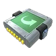Модуль дуги<small>⚖️ 1</small>

<h3>Модуль дуги</h3>Необычный
При использовании сфера летит по дуге.

✨ Искривление траектории сферы +1✨ Увеличение силы захвата +2

⚖️<small>Вес</small><b>1</b>

💰<small>Цена</small><b>14280</b>

📘<small>Технология</small><b>ур. 23</b>

<h4>🔨 Крафт</h4>
<a class="ich" href="../../../4_spravochniki/predmety/материалы/#осколок-палдиума">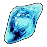Осколок палдиума<b>×30</b></a><a class="ich" href="../../../4_spravochniki/predmety/материалы/#металлический-слиток">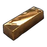Металлический слиток<b>×30</b></a><a class="ich" href="../../../4_spravochniki/predmety/материалы/#камень">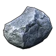Камень<b>×50</b></a><a class="ich" href="../../../4_spravochniki/predmety/материалы/#деталь-древней-цивилизации">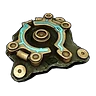Деталь древней цивилизации<b>×2</b></a>
<h5>Где сделать</h5>
<a class="ich" href="../../../4_spravochniki/predmety/постройки/#сферическая-мастерская">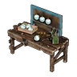Сферическая Мастерская</a><a class="ich" href="../../../4_spravochniki/predmety/постройки/#конвейерная-фабрика-сфер">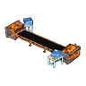Конвейерная фабрика сфер</a><a class="ich" href="../../../4_spravochniki/predmety/постройки/#сборочная-линия-сфер-разв-цив">Сборочная линия сфер разв. цив.</a><a class="ich" href="../../../4_spravochniki/predmety/постройки/#древний-верстак">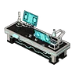Древний верстак</a>

Из игры

При использовании сфера летит по дуге. Позволяет застать Палов врасплох и увеличивает силу захвата.

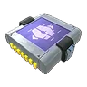Утяжеляющий модуль<small>⚖️ 1</small>

<h3>Утяжеляющий модуль</h3>Необычный
При использовании утяжеляет сферу, что снижает дальность её полёта, но увеличивает силу захвата.

⚖️<small>Вес</small><b>1</b>

💰<small>Цена</small><b>4010</b>

📘<small>Технология</small><b>ур. 19</b>

<h4>🔨 Крафт</h4>
<a class="ich" href="../../../4_spravochniki/predmety/материалы/#осколок-палдиума">Осколок палдиума<b>×10</b></a><a class="ich" href="../../../4_spravochniki/predmety/материалы/#металлический-слиток">Металлический слиток<b>×10</b></a><a class="ich" href="../../../4_spravochniki/predmety/материалы/#камень">Камень<b>×20</b></a>
<h5>Где сделать</h5>
<a class="ich" href="../../../4_spravochniki/predmety/постройки/#сферическая-мастерская">Сферическая Мастерская</a><a class="ich" href="../../../4_spravochniki/predmety/постройки/#конвейерная-фабрика-сфер">Конвейерная фабрика сфер</a><a class="ich" href="../../../4_spravochniki/predmety/постройки/#сборочная-линия-сфер-разв-цив">Сборочная линия сфер разв. цив.</a><a class="ich" href="../../../4_spravochniki/predmety/постройки/#древний-верстак">Древний верстак</a>

Из игры

При использовании утяжеляет сферу, что снижает дальность её полёта, но увеличивает силу захвата. Вес сфер +1 Увеличение силы захвата +1

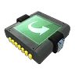Модуль слайдера<small>⚖️ 1</small>

<h3>Модуль слайдера</h3>Редкий
При использовании сфера приобретает скользящее вращение, сильно изгибается и позволяет застать Палов врасплох, увеличивая силу захвата.

✨ Отклонение траектории сферы✨ Увеличение силы захвата +3

⚖️<small>Вес</small><b>1</b>

💰<small>Цена</small><b>68350</b>

📘<small>Технология</small><b>ур. 39</b>

<h4>🔨 Крафт</h4>
<a class="ich" href="../../../4_spravochniki/predmety/материалы/#осколок-палдиума">Осколок палдиума<b>×100</b></a><a class="ich" href="../../../4_spravochniki/predmety/материалы/#слиток-рафинированного-металла">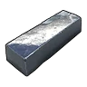Слиток рафинированного металла<b>×30</b></a><a class="ich" href="../../../4_spravochniki/predmety/материалы/#углеродное-волокно">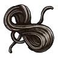Углеродное волокно<b>×15</b></a><a class="ich" href="../../../4_spravochniki/predmety/материалы/#едкий-растворитель">Едкий растворитель<b>×8</b></a><a class="ich" href="../../../4_spravochniki/predmety/материалы/#деталь-древней-цивилизации">Деталь древней цивилизации<b>×10</b></a>
<h5>Где сделать</h5>
<a class="ich" href="../../../4_spravochniki/predmety/постройки/#сферическая-мастерская">Сферическая Мастерская</a><a class="ich" href="../../../4_spravochniki/predmety/постройки/#конвейерная-фабрика-сфер">Конвейерная фабрика сфер</a><a class="ich" href="../../../4_spravochniki/predmety/постройки/#сборочная-линия-сфер-разв-цив">Сборочная линия сфер разв. цив.</a><a class="ich" href="../../../4_spravochniki/predmety/постройки/#древний-верстак">Древний верстак</a>

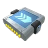Снайперский модуль<small>⚖️ 1</small>

<h3>Снайперский модуль</h3>Редкий
Увеличивает дальность броска сферы и шанс поимки Пала.

⚖️<small>Вес</small><b>1</b>

💰<small>Цена</small><b>31440</b>

📘<small>Технология</small><b>ур. 31</b>

<h4>🔨 Крафт</h4>
<a class="ich" href="../../../4_spravochniki/predmety/материалы/#осколок-палдиума">Осколок палдиума<b>×50</b></a><a class="ich" href="../../../4_spravochniki/predmety/материалы/#металлический-слиток">Металлический слиток<b>×50</b></a><a class="ich" href="../../../4_spravochniki/predmety/материалы/#цемент">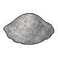Цемент<b>×30</b></a><a class="ich" href="../../../4_spravochniki/predmety/материалы/#деталь-древней-цивилизации">Деталь древней цивилизации<b>×8</b></a>
<h5>Где сделать</h5>
<a class="ich" href="../../../4_spravochniki/predmety/постройки/#сферическая-мастерская">Сферическая Мастерская</a><a class="ich" href="../../../4_spravochniki/predmety/постройки/#конвейерная-фабрика-сфер">Конвейерная фабрика сфер</a><a class="ich" href="../../../4_spravochniki/predmety/постройки/#сборочная-линия-сфер-разв-цив">Сборочная линия сфер разв. цив.</a><a class="ich" href="../../../4_spravochniki/predmety/постройки/#древний-верстак">Древний верстак</a>

Из игры

Увеличивает дальность броска сферы и шанс поимки Пала. Дальность полёта сферы +1 Увеличение силы захвата +2

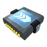Снайперский модуль II<small>⚖️ 1</small>

<h3>Снайперский модуль II</h3>Эпический
При использовании значительно увеличивает дальность полёта сфер, позволяет точнее поражать Палов и увеличивает силу захвата.

✨ Дальность полёта сферы +2✨ Увеличение силы захвата +3

⚖️<small>Вес</small><b>1</b>

💰<small>Цена</small><b>120840</b>

📘<small>Технология</small><b>ур. 48</b>

<h4>🔨 Крафт</h4>
<a class="ich" href="../../../4_spravochniki/predmety/материалы/#осколок-палдиума">Осколок палдиума<b>×200</b></a><a class="ich" href="../../../4_spravochniki/predmety/материалы/#слиток-пал-металла">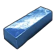Слиток Пал-Металла<b>×30</b></a><a class="ich" href="../../../4_spravochniki/predmety/материалы/#углеродное-волокно">Углеродное волокно<b>×30</b></a><a class="ich" href="../../../4_spravochniki/predmety/материалы/#деталь-древней-цивилизации">Деталь древней цивилизации<b>×20</b></a><a class="ich" href="../../../4_spravochniki/predmety/материалы/#ядро-древней-цивилизации">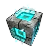Ядро древней цивилизации<b>×2</b></a>
<h5>Где сделать</h5>
<a class="ich" href="../../../4_spravochniki/predmety/постройки/#сферическая-мастерская">Сферическая Мастерская</a><a class="ich" href="../../../4_spravochniki/predmety/постройки/#конвейерная-фабрика-сфер">Конвейерная фабрика сфер</a><a class="ich" href="../../../4_spravochniki/predmety/постройки/#сборочная-линия-сфер-разв-цив">Сборочная линия сфер разв. цив.</a><a class="ich" href="../../../4_spravochniki/predmety/постройки/#древний-верстак">Древний верстак</a>

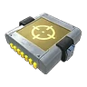Модуль самонаведения<small>⚖️ 1</small>

<h3>Модуль самонаведения</h3>Легендарный
При использовании сферы автоматически наводятся на Палов, а также увеличивается сила захвата.

✨ Самонаведение сферы✨ Увеличение силы захвата +3

⚖️<small>Вес</small><b>1</b>

💰<small>Цена</small><b>1432580</b>

📘<small>Технология</small><b>ур. 69</b>

<h4>🔨 Крафт</h4>
<a class="ich" href="../../../4_spravochniki/predmety/материалы/#соллайтовый-слиток">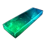Соллайтовый слиток<b>×50</b></a><a class="ich" href="../../../4_spravochniki/predmety/материалы/#ядро-ии">Ядро ИИ<b>×3</b></a><a class="ich" href="../../../4_spravochniki/predmety/материалы/#деталь-древней-цивилизации">Деталь древней цивилизации<b>×40</b></a><a class="ich" href="../../../4_spravochniki/predmety/материалы/#осколок-тьмы">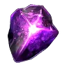Осколок тьмы<b>×50</b></a><a class="ich" href="../../../4_spravochniki/predmety/материалы/#ядро-древней-цивилизации">Ядро древней цивилизации<b>×5</b></a>
<h5>Где сделать</h5>
<a class="ich" href="../../../4_spravochniki/predmety/постройки/#древний-верстак">Древний верстак</a>

