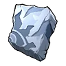
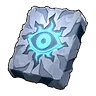
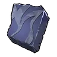
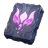
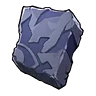
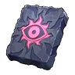
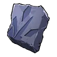
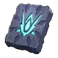
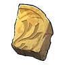
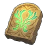

# 🪨 Обломки плит

<input type="search" class="pfq" name="pp-items-q" placeholder="Найти: обломки плит" autocomplete="off" autocorrect="off" autocapitalize="off" spellcheck="false" enterkeyhint="search">найдено 5

Обломок плиты Бэллануар<small>⚖️ 0,25</small>

<h3>Обломок плиты Бэллануар</h3>Обычный
Обломок плиты с изображением пала «Бэллануар».

⚖️<small>Вес</small><b>0,25</b>

💰<small>Цена</small><b>10</b>

<h4>📍 Где взять</h4>

🧭Экспедиция: Лес<small>×1–2</small><small>100 %</small>

📍Награда Заносчивого критика Палов<small>×1</small><small>100 %</small>

🎁Сундуки и ящики: Лес<small>×1</small><small>50 %</small>

🎁Сундуки и ящики: Пустыня<small>×1</small><small>30 %</small>

🎁Сундуки и ящики: Вулкан<small>×1</small><small>29 %</small>

📍Лагерь врагов<small>×1</small><small>29 %</small>

<h4>Где используется</h4>
<a class="ich" href="../../../4_spravochniki/predmety/расходник/#плита-бэллануар">Плита Бэллануар</a>

Из игры

Обломок плиты с изображением пала «Бэллануар». После объединения всех частей можно создать полноценную плиту.

Обломок плиты Блазамут Рю<small>⚖️ 0,25</small>

<h3>Обломок плиты Блазамут Рю</h3>Необычный
Обломок плиты с изображением пала «Блазамут Рю».

⚖️<small>Вес</small><b>0,25</b>

💰<small>Цена</small><b>10</b>

<h4>📍 Где взять</h4>

🧭Экспедиция: Пустыня (сложная)<small>×1–2</small><small>100 %</small>

📍Награда Заносчивого критика Палов<small>×1</small><small>100 %</small>

🎁Сундуки и ящики: Снега<small>×1</small><small>50 %</small>

📍Лагерь врагов<small>×1</small><small>50 %</small>

🎁Сундуки и ящики: Сакурадзима<small>×1</small><small>33 %</small>

🎁Сундуки и ящики: Фейбрейк<small>×1</small><small>33 %</small>

🎁Сундуки и ящики: Санрич<small>×1</small><small>33 %</small>

<h4>Где используется</h4>
<a class="ich" href="../../../4_spravochniki/predmety/расходник/#плита-блазамут-рю">Плита Блазамут Рю</a>

Из игры

Обломок плиты с изображением пала «Блазамут Рю». После объединения всех частей можно создать полноценную плиту.

Обломок плиты Бэллануар Либеро<small>⚖️ 0,25</small>

<h3>Обломок плиты Бэллануар Либеро</h3>Необычный
Обломок плиты с изображением пала «Бэллануар Либеро».

⚖️<small>Вес</small><b>0,25</b>

💰<small>Цена</small><b>10</b>

<h4>📍 Где взять</h4>

🧭Экспедиция: Пустыня<small>×1–2</small><small>100 %</small>

🎁Сундуки и ящики: Снега<small>×1</small><small>50 %</small>

📍Лагерь врагов<small>×1</small><small>50 %</small>

🎁Сундуки и ящики: Пустыня<small>×1</small><small>45 %</small>

🎁Сундуки и ящики: Вулкан<small>×1</small><small>43 %</small>

<h4>Где используется</h4>
<a class="ich" href="../../../4_spravochniki/predmety/расходник/#плита-бэллануар-либеро">Плита Бэллануар Либеро</a>

Из игры

Обломок плиты с изображением пала «Бэллануар Либеро». После объединения всех частей можно создать полноценную плиту.

Обломок плиты Зенолорда<small>⚖️ 0,25</small>

<h3>Обломок плиты Зенолорда</h3>Необычный
Обломок плиты с изображением пала «Зенолорд».

⚖️<small>Вес</small><b>0,25</b>

💰<small>Цена</small><b>10</b>

<h4>📍 Где взять</h4>

🧭Экспедиция: Вулкан (сложная)<small>×1–2</small><small>100 %</small>

📍Награда Заносчивого критика Палов<small>×1</small><small>100 %</small>

🎁Сундуки и ящики: Сакурадзима<small>×1</small><small>33 %</small>

🎁Сундуки и ящики: Фейбрейк<small>×1</small><small>33 %</small>

🎁Сундуки и ящики: Санрич<small>×1</small><small>33 %</small>

📍Лагерь врагов<small>×1</small><small>33 %</small>

<h4>Где используется</h4>
<a class="ich" href="../../../4_spravochniki/predmety/расходник/#плита-зенолорда">Плита Зенолорда</a>

Из игры

Обломок плиты с изображением пала «Зенолорд». После объединения всех частей можно создать полноценную плиту.

Обломок плиты Харталис<small>⚖️ 0,25</small>

<h3>Обломок плиты Харталис</h3>Необычный
Обломок плиты, излучающий силу пала «Харталис».

⚖️<small>Вес</small><b>0,25</b>

💰<small>Цена</small><b>10</b>

<h4>📍 Где взять</h4>

🧭Экспедиция: Фейбрейк (сложная)<small>×1–2</small><small>100 %</small>

🎁Сундуки и ящики: Сакурадзима<small>×1</small><small>33 %</small>

🎁Сундуки и ящики: Фейбрейк<small>×1</small><small>33 %</small>

🎁Сундуки и ящики: Санрич<small>×1</small><small>33 %</small>

📍Лагерь врагов<small>×1</small><small>33 %</small>

<h4>Где используется</h4>
<a class="ich" href="../../../4_spravochniki/predmety/расходник/#плита-харталис">Плита Харталис</a>

Из игры

Обломок плиты, излучающий силу пала «Харталис». После объединения всех частей можно создать полноценную плиту.

