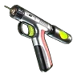
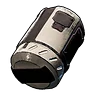
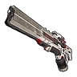

# 📦 Прочее

<input type="search" class="pfq" name="pp-items-q" placeholder="Найти: прочее" autocomplete="off" autocorrect="off" autocapitalize="off" spellcheck="false" enterkeyhint="search">найдено 4

Мегабустерная пушка<small></small>

<h3>Мегабустерная пушка</h3>Обычный
При выстреле в союзного Пала усиливаются его атака и защита, при выстреле во врага наносится урон. Благодаря улучшениям увеличена сила и продолжительность усиления, а также урон по врагам.

Патрон для перегревающейся винтовки<small></small>

<h3>Патрон для перегревающейся винтовки</h3>Обычный
Боеприпасы для оружия: «Перегревающаяся винтовка». Без них оружие не выстрелит, поэтому держи запас в сумке.

<h4>Подходит к оружию</h4>
<a class="ich" href="../../../4_spravochniki/predmety/оружие/#перегревающаяся-винтовка">Перегревающаяся винтовка</a>

Из игры

Патрон для оружия: Перегревающаяся винтовка — и похожего.

Большое яйцо льда<small></small>

<h3>Большое яйцо льда</h3>Редкий
Внутри ощущается холодный и бесстрастный ритм. Положи яйцо в инкубатор, и из него вылупится пал.

Из игры

Большое яйцо льда. Внутри ощущается холодный и бесстрастный ритм. Поместите яйцо в Инкубатор для выведения.

Огромное яйцо льда<small></small>

<h3>Огромное яйцо льда</h3>Легендарный
Внутри ощущается биение души абсолютного холода. Положи яйцо в инкубатор, и из него вылупится пал.

Из игры

Огромное яйцо льда. Внутри ощущается биение души абсолютного холода. Похоже, на свет вот-вот появится чудовище. Поместите яйцо в Инкубатор для выведения.

