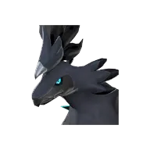
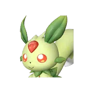

# Расходник

<input type="search" class="pfq" placeholder="Найти в разделе «Расходник»…" autocomplete="off">

## Бронзовый ключ

Позволяет отрывать запертые на ключ сундуки.

💎Редкость<b>Необычный</b>

⚖️Вес<b>0.1</b>

💰Цена<b>1</b>

📍 Где взять
📦 Награда Заносчивого критика Палов <small>1 · 100%</small>📦 Сундук в поселении: Холмы (старт) <small>2–3 · 35.714%</small>📦 Мусорный сундук: Холмы (старт) <small>1 · 20%</small>📦 Пещера Отдалённого Острова <small>1 · 16.951%</small>📦 Рыбный пруд на базе: Холмы (старт) <small>1–2 · 6.319%</small>📦 Рыбалка: Холмы (старт) <small>1 · 5.827%</small>👤 Адепт Организации по Защите Палов <small>1%</small>👤 Судья Организации по Защите Палов <small>1%</small>👤 Браконьер-новичок <small>1%</small>👤 Браконьер-стрелок <small>1%</small>👤 Элитный браконьер <small>1%</small>👤 Браконьер-охотник <small>1%</small>👤 Браконьер-гренадер <small>1%</small>👤 Браконьер-чистильщик <small>1%</small>👤 Браконьер-громила <small>1%</small>👤 Браконьер-ветеран <small>1%</small>👤 Браконьер-технарь <small>1%</small>👤 Браконьер-арбалетчик <small>1%</small>👤 Браконьер-мечник <small>1%</small>👤 Охотник на новичков Ястреб <small>1%</small>👤 Напористый интервьюер Гриль <small>1%</small>👤 Самовлюбленный болтун Эго <small>1%</small>👤 Агрессивный защитник Кирпич <small>1%</small>👤 Стрелок Вигилантов <small>1%</small>

## Водный кристалл пробуждения

Кристалл, содержащий энергию Мирового Древа. Пробуждает Пала Вода и раскрывает его потенциал.

💎Редкость<b>Эпический</b>

⚖️Вес<b>1</b>

💰Цена<b>120000</b>

🔨 Крафт
Водный самоцвет <b>×50</b>Святая вода Мирового Древа <b>×10</b>
<small class="ist">Древний верстак</small>

## Грозовое облако возвращения

Позволяет переместиться к ближайшей базе. Не работает в подземельях и некоторых других зонах.

💎Редкость<b>Необычный</b>

⚖️Вес<b>1</b>

💰Цена<b>2400</b>

📘Технология<b>ур. 22</b>

🔨 Крафт
Облако Даззи <b>×1</b>Электрический орган <b>×5</b>
<small class="ist">Качественный верстак Конвейерная фабрика Конвейерная фабрика II Мастерская развитой цивилизации Древний верстак</small>

📍 Где взять
📦 Миссия <small>3 · 100%</small>📦 Эмиссар пустынного города <small>1–5 · 100%</small>

## Драгоценный персик дружбы

Редкий волшебный плод. Бытует поверье, что съевший такой плод Пал откроет сердце человеку. Выбирайте с умом, какого Пала им угостить.

💎Редкость<b>Эпический</b>

⚖️Вес<b>1</b>

💰Цена<b>30000</b>

📍 Где взять
📦 Экспедиция: Холмы (старт) (сложная) <small>1 · 100%</small>📦 Лагерь врагов <small>1 · 100%</small>📦 Награда Надменного гурмана <small>1 · 100%</small>📦 Миссия <small>1 · 100%</small>📦 Блестящая древняя реликвия (переработка) <small>1 · 0.194%</small>📦 Светящаяся древняя реликвия (переработка) <small>1 · 0.161%</small>📦 Роскошная древняя реликвия (переработка) <small>1 · 0.134%</small>📦 Спящая древняя реликвия (переработка) <small>1 · 0.112%</small>📦 Истлевшая древняя реликвия (переработка) <small>1 · 0.093%</small>🛒 торговец

## Драконий кристалл пробуждения

Кристалл, содержащий энергию Мирового Древа. Пробуждает Пала Дракон и раскрывает его потенциал.

💎Редкость<b>Эпический</b>

⚖️Вес<b>1</b>

💰Цена<b>120000</b>

🔨 Крафт
Драконий самоцвет <b>×50</b>Святая вода Мирового Древа <b>×10</b>
<small class="ist">Древний верстак</small>

## Заманчивая приманка

Приманка для привлечения Палов.  С этой улучшенной приманкой в мини-игре индикатор становится больше, а количество получаемых трофеев увеличивается.

💎Редкость<b>Эпический</b>

⚖️Вес<b>0.025</b>

💰Цена<b>2020</b>

📘Технология<b>ур. 52</b>

🔨 Крафт
Качественное масло Пала <b>×10</b>Пещерный гриб <b>×1</b>Морковь <b>×3</b>Мука <b>×5</b>
<small class="ist">Качественный верстак Конвейерная фабрика Конвейерная фабрика II Мастерская развитой цивилизации Примитивный верстак Древний верстак</small>

📍 Где взять
📦 Лагерь врагов: Снега <small>3–5 · 100%</small>📦 Сундук: Мировое Древо <small>2–4 · 11.25%</small>📦 Мусорный сундук: Мировое Древо <small>2–4 · 8.333%</small>📦 Небесный свод Санрича <small>2–4 · 7.5%</small>

## Земной кристалл пробуждения

Кристалл, содержащий энергию Мирового Древа. Пробуждает Пала Земля и раскрывает его потенциал.

💎Редкость<b>Эпический</b>

⚖️Вес<b>1</b>

💰Цена<b>120000</b>

🔨 Крафт
Земной самоцвет <b>×50</b>Святая вода Мирового Древа <b>×10</b>
<small class="ist">Древний верстак</small>

## Золотой ключ

Позволяет отрывать запертые на ключ сундуки.

💎Редкость<b>Эпический</b>

⚖️Вес<b>0.1</b>

💰Цена<b>10</b>

📍 Где взять
📦 Сундук: Мировое Древо <small>1–2 · 100%</small>📦 Награда Заносчивого критика Палов <small>2 · 100%</small>📦 Сундук в поселении: Снега <small>1–2 · 83.333%</small>📦 Рыбный пруд на базе: Мировое Древо <small>1 · 30.769%</small>📦 Мусорный сундук: Мировое Древо <small>1 · 25.197%</small>📦 Со дна моря (Магнит/спасение) <small>1–2 · 17.699%</small>📦 Пещера Тэнраку <small>1 · 16.077%</small>📦 Нефтяная вышка ур. 60: обычный сундук <small>1 · 15.569%</small>📦 Пещера Священной Горы <small>1 · 15.114%</small>📦 Небесный свод Санрича <small>1 · 14.595%</small>📦 Лагерь врагов: Санрич <small>1 · 14.24%</small>📦 Пещера Цветущей Сакуры <small>1 · 13.237%</small>📦 Рыбалка: Санрич <small>1 · 6.258%</small>👤 Подпольный торговец <small>100%</small>👤 Торговец медалями <small>100%</small>👤 Браконьер-громила <small>1%</small>👤 Мастер побегов Фантом <small>10%</small>👤 Грабитель-налётчик Рам <small>100%</small>

## Карта сокровищ

Старинная карта с отмеченным местом сокровища. При использовании добавляет метку на карте.

💎Редкость<b>Обычный</b>

💰Цена<b>1</b>

📍 Где взять
📦 Награда Надменного гурмана <small>1 · 100%</small>📦 Лагерь врагов <small>1 · 40%</small>📦 Сундуки и ящики: Пустыня <small>1 · 20%</small>📦 Сундуки и ящики: Вулкан <small>1 · 20%</small>📦 Сундуки и ящики: Снега <small>1 · 12.5%</small>📦 Подземелье: Вулкан <small>1 · 10.101%</small>📦 Сундуки и ящики: Сакурадзима <small>1 · 11.25%</small>📦 Сундуки и ящики: Фейбрейк <small>1 · 11.25%</small>📦 Сундуки и ящики: Санрич <small>1 · 11.25%</small>📦 Со дна моря (Магнит/спасение) <small>1 · 0.118%</small>📦 Чертёж старого лука 2 <small>1 · 4.808%</small>📦 Чертёж старого лука 3 <small>1 · 1.923%</small>📦 Чертёж старого лука 4 <small>1 · 0.769%</small>📦 Чертёж украшения для волос с перьями 2 <small>1 · 4.808%</small>📦 Чертёж украшения для волос с перьями 3 <small>1 · 1.923%</small>📦 Чертёж украшения для волос с перьями 4 <small>1 · 0.769%</small>📦 Чертёж тканой одежды 2 <small>1 · 4.808%</small>📦 Чертёж тканой одежды 3 <small>1 · 1.923%</small>📦 Чертёж тканой одежды 4 <small>1 · 0.769%</small>📦 Чертёж тропической одежды 2 <small>1 · 4.808%</small>📦 Чертёж тропической одежды 3 <small>1 · 1.923%</small>📦 Чертёж тропической одежды 4 <small>1 · 0.769%</small>📦 Чертёж тундровой одежды 2 <small>1 · 4.808%</small>📦 Чертёж тундровой одежды 3 <small>1 · 1.923%</small>

## Качественная приманка

Рыболовная приманка для привлечения Палов. Улучшена, благодаря чему Палы легче клюют на приманку, а количество предметов, получаемых при рыбалке, совсем немного увеличивается.

💎Редкость<b>Необычный</b>

⚖️Вес<b>0.025</b>

💰Цена<b>240</b>

📘Технология<b>ур. 22</b>

🔨 Крафт
Жидкость водного Пала <b>×3</b>Помидор <b>×4</b>Мука <b>×3</b>
<small class="ist">Качественный верстак Конвейерная фабрика Конвейерная фабрика II Мастерская развитой цивилизации Примитивный верстак Древний верстак</small>

📍 Где взять
📦 Штурмовой Отряд Браконьеров <small>10–20 · 100%</small>📦 Стая агрессивных диких Палов <small>10–20 · 100%</small>📦 Радикальные активисты Организации по Защите Палов <small>10–20 · 100%</small>📦 Апокалиптики Братства Вечного Пламени <small>10–20 · 100%</small>📦 Исполнительный Отряд Генетических Исследований <small>10–20 · 100%</small>📦 Штурмовой отряд Общества Лунных Цветов <small>10–20 · 100%</small>📦 Грабители Тэнраку <small>10–20 · 100%</small>📦 Испытание клятвы: Ускорение <small>10–20 · 100%</small>📦 Лагерь врагов: Холмы (старт) <small>3–5 · 50%</small>📦 Пещера Священной Горы <small>2–3 · 25%</small>📦 Мусорный сундук: Лес <small>2–3 · 25%</small>📦 Пещера Цветущей Сакуры <small>2–3 · 25%</small>📦 Пещера Тэнраку <small>2–3 · 25%</small>📦 Со дна моря (Магнит/спасение) <small>2–3 · 25%</small>📦 Пещера Вулкана <small>2–3 · 16.667%</small>📦 Пещера Песчаных Дюн <small>2–3 · 8.333%</small>🛒 торговец

## Качественное снадобье восстановления

Снадобье, постепенно исцеляющее раны. Высококачественное средство, хорошо восстанавливающее HP.

💎Редкость<b>Редкий</b>

⚖️Вес<b>0.2</b>

💰Цена<b>12600</b>

🔨 Крафт
Пещерный гриб <b>×10</b>Красная ягода <b>×20</b>Качественное масло Пала <b>×5</b>Сахарная вата <b>×5</b>Сера <b>×5</b>
<small class="ist">Электрический стол фармацевта Древний верстак</small>

📍 Где взять
📦 Сундук <small>5 · 100%</small>📦 Миссия <small>10 · 100%</small>📦 Сундук в поселении: Сакурадзима <small>1–2 · 12.5%</small>📦 Нефтяная вышка ур. 55: обычный сундук <small>1 · 4.183%</small>📦 Рыбный пруд на базе: Мировое Древо <small>1 · 3.488%</small>📦 Со дна моря (Магнит/спасение) <small>1 · 2.655%</small>📦 Пещера Тэнраку <small>1 · 2.412%</small>📦 Небесный свод Санрича <small>1 · 2.189%</small>📦 Лагерь врагов: Санрич <small>1 · 2.136%</small>📦 Пещера Цветущей Сакуры <small>1 · 1.985%</small>📦 Рыбалка: Санрич <small>1 · 0.939%</small><a class="ichip src" href="../../../4_spravochniki/paly/solenne/">Соленна</a><a class="ichip src" href="../../../4_spravochniki/paly/lyleen/">Лилин</a><a class="ichip src" href="../../../4_spravochniki/paly/lyleen_noct/">Лилин Нокт</a><a class="ichip src" href="../../../4_spravochniki/paly/bellanoir_libero/">Бэллануар Либеро</a>🛒 торговец

## Качественные медикаменты

Качественные медикаменты — средство от Слабость и Депрессия. Не восстанавливает HP.

💎Редкость<b>Редкий</b>

⚖️Вес<b>0.2</b>

💰Цена<b>3120</b>

🔨 Крафт
Металлический слиток <b>×5</b>Рог <b>×5</b>Кость <b>×2</b>
<small class="ist">Средневековый стол фармацевта Электрический стол фармацевта Древний верстак</small>

📍 Где взять
📦 Награда Надменного гурмана <small>1 · 100%</small>📦 Сундук в поселении: Фейбрейк <small>1–2 · 18.75%</small>📦 Нефтяная вышка ур. 60: обычный сундук <small>1 · 7.784%</small>📦 Рыбный пруд на базе: Мировое Древо <small>1 · 5.814%</small>📦 Со дна моря (Магнит/спасение) <small>1 · 4.425%</small>📦 Сундук: Мировое Древо <small>1 · 4.103%</small>📦 Пещера Тэнраку <small>1 · 4.019%</small>📦 Небесный свод Санрича <small>1 · 3.649%</small>📦 Лагерь врагов: Санрич <small>1 · 3.56%</small>📦 Рыбалка: Санрич <small>1 · 1.564%</small>👤 Лаборант отряда Генетических Исследований <small>10%</small>🛒 торговец

## Книга высоких технологий

Книга, в которой описаны поразительные технологии. При использовании даёт небольшое количество очков технологий.

💎Редкость<b>Необычный</b>

💰Цена<b>10</b>

📍 Где взять
📦 Награда Заносчивого критика Палов <small>1 · 100%</small>📦 Пещера Отдалённого Острова <small>1 · 50%</small>📦 Подземелье: Холмы (старт) <small>1 · 50%</small>📦 Лагерь врагов <small>1 · 36.38%</small>📦 Сундуки и ящики: Холмы (старт) <small>1 · 22.995%</small>📦 Сундуки и ящики: Лес <small>1–2 · 19.582%</small>📦 Рыбалка: Лес <small>1–2 · 14.72%</small>📦 Рыбный пруд на базе: Холмы (старт) <small>1 · 11.111%</small>📦 Нефтяная вышка ур. 30: обычный сундук <small>1 · 4.212%</small>📦 Со дна моря (Магнит/спасение) <small>1–3 · 1.294%</small>📦 Блестящая древняя реликвия (переработка) <small>1 · 0.277%</small>📦 Роскошная древняя реликвия (переработка) <small>1 · 0.192%</small>📦 Истлевшая древняя реликвия (переработка) <small>1 · 0.133%</small>📦 Светящаяся древняя реликвия (переработка) <small>1 · 0.115%</small>📦 Спящая древняя реликвия (переработка) <small>1 · 0.16%</small>👤 Огненный лис-маг Виксен <small>1%</small>👤 Светоч мудрости Хукрат <small>1%</small>👤 Тёмный лис-маг Виксен Нокт <small>1%</small>👤 Палящий кот-маг Катресс Игнис <small>1%</small><a class="ichip src" href="../../../4_spravochniki/paly/hoocrates/">Хукрат</a><a class="ichip src" href="../../../4_spravochniki/paly/hoocrates/">Хукрат</a><a class="ichip src" href="../../../4_spravochniki/paly/wixen/">Виксен</a><a class="ichip src" href="../../../4_spravochniki/paly/wixen/">Виксен</a><a class="ichip src" href="../../../4_spravochniki/paly/wixen_noct/">Виксен Нокт</a>

## Книга революционных технологий

Книга, в которой описаны передовые технологии. При использовании дает очки технологий.

💎Редкость<b>Редкий</b>

💰Цена<b>10</b>

📍 Где взять
📦 Лагерь врагов <small>1 · 33.82%</small>📦 Подземелье: Пустыня <small>1 · 32.323%</small>📦 Сундуки и ящики: Вулкан <small>1–2 · 22.912%</small>📦 Сундуки и ящики: Пустыня <small>1 · 22.275%</small>📦 Рыбалка: Пустыня <small>1 · 18.703%</small>📦 Рыбный пруд на базе: Пустыня <small>1 · 12.5%</small>📦 Блестящая древняя реликвия (переработка) <small>1 · 0.194%</small>📦 Светящаяся древняя реликвия (переработка) <small>1 · 0.161%</small>📦 Роскошная древняя реликвия (переработка) <small>1 · 0.134%</small>📦 Спящая древняя реликвия (переработка) <small>1 · 0.112%</small>📦 Истлевшая древняя реликвия (переработка) <small>1 · 0.093%</small><a class="ichip src" href="../../../4_spravochniki/paly/anubis/">Анубис</a><a class="ichip src" href="../../../4_spravochniki/paly/lyleen/">Лилин</a><a class="ichip src" href="../../../4_spravochniki/paly/lyleen_noct/">Лилин Нокт</a><a class="ichip src" href="../../../4_spravochniki/paly/shadowbeak/">Шэдоубик</a>

## Книга технологий будущего

Книга, в которой описаны опережающие время технологии. При использовании дает много очков технологий.

💎Редкость<b>Эпический</b>

💰Цена<b>10</b>

📍 Где взять
📦 Награда Заносчивого критика Палов <small>1 · 100%</small>📦 Подземелье <small>1 · 50%</small>📦 Лагерь врагов: Санрич <small>1–2 · 35.837%</small>📦 Сундуки и ящики: Снега <small>1 · 23.82%</small>📦 Рыбалка: Снега <small>1 · 23.64%</small>📦 Сундуки и ящики: Сакурадзима <small>1 · 21.908%</small>📦 Сундуки и ящики: Фейбрейк <small>1–2 · 17.473%</small>📦 Сундуки и ящики: Санрич <small>1–2 · 17.462%</small>📦 Рыбный пруд на базе: Снега <small>1 · 5.556%</small>📦 Блестящая древняя реликвия (переработка) <small>1 · 0.083%</small>📦 Светящаяся древняя реликвия (переработка) <small>1 · 0.069%</small>📦 Роскошная древняя реликвия (переработка) <small>1 · 0.058%</small>📦 Спящая древняя реликвия (переработка) <small>1 · 0.048%</small>📦 Истлевшая древняя реликвия (переработка) <small>1 · 0.04%</small>

## Книга технологий древности

Книга, в которой описаны утраченные древние технологии. При использовании даёт очки древних технологий.

💎Редкость<b>Легендарный</b>

💰Цена<b>10</b>

📍 Где взять
📦 Награда Заносчивого критика Палов <small>1 · 100%</small>📦 Пещера Отдалённого Острова <small>1 · 50%</small>📦 Подземелье: Холмы (старт) <small>1 · 50%</small>📦 Лагерь врагов <small>1 · 36.38%</small>📦 Сундуки и ящики: Снега <small>1–3 · 23.82%</small>📦 Рыбалка: Снега <small>1–3 · 23.64%</small>📦 Сундуки и ящики: Холмы (старт) <small>1 · 22.995%</small>📦 Сундуки и ящики: Вулкан <small>1–2 · 22.912%</small>📦 Сундуки и ящики: Пустыня <small>1–2 · 22.275%</small>📦 Сундуки и ящики: Сакурадзима <small>1–3 · 21.908%</small>📦 Сундуки и ящики: Лес <small>1 · 19.582%</small>📦 Сундуки и ящики: Фейбрейк <small>1–3 · 17.473%</small>📦 Сундуки и ящики: Санрич <small>1–3 · 17.462%</small>📦 Рыбный пруд на базе: Пустыня <small>1 · 12.5%</small>📦 Нефтяная вышка ур. 30: обычный сундук <small>1 · 2.808%</small>📦 Со дна моря (Магнит/спасение) <small>1–3 · 1.294%</small>📦 Блестящая древняя реликвия (переработка) <small>1 · 0.083%</small>📦 Светящаяся древняя реликвия (переработка) <small>1 · 0.069%</small>📦 Роскошная древняя реликвия (переработка) <small>1 · 0.058%</small>📦 Спящая древняя реликвия (переработка) <small>1 · 0.048%</small>📦 Истлевшая древняя реликвия (переработка) <small>1 · 0.04%</small>

## Костюм Зои на Хэллоуин

Костюм на Хэллоуин для Зои. Даже ей должно понравиться. Отнесите Зои!

💎Редкость<b>Легендарный</b>

💰Цена<b>4080</b>

🔨 Крафт
Ткань <b>×5</b>Кожа <b>×5</b>
<small class="ist">Качественный верстак Конвейерная фабрика Конвейерная фабрика II Мастерская развитой цивилизации Примитивный верстак Древний верстак</small>

## Кристалл обучения

Таинственный кристалл. Повышает уровень Пала на 1 при использовании.

💎Редкость<b>Легендарный</b>

⚖️Вес<b>0.1</b>

💰Цена<b>10</b>

📍 Где взять
📦 Лагерь врагов: Сакурадзима <small>1 · 100%</small>📦 Легендарный Отряд Браконьеров <small>1 · 100%</small>📦 Стая крайне свирепых диких Палов <small>1 · 100%</small>📦 Каратели Организации по Защите Палов <small>1 · 100%</small>📦 Вершители Вечного Пламени <small>1 · 100%</small>📦 Спецотряд Генетических Исследований <small>1 · 100%</small>📦 Спецотряд Общества Лунных Цветов <small>1 · 100%</small>📦 Берсеркеры Тэнраку <small>1 · 100%</small>📦 Испытание клятвы: Небеса <small>1 · 100%</small>📦 Борцы с фальшивомонетчиками <small>1 · 100%</small>📦 Блестящая древняя реликвия (переработка) <small>1 · 0.028%</small>📦 Светящаяся древняя реликвия (переработка) <small>1 · 0.023%</small>📦 Роскошная древняя реликвия (переработка) <small>1 · 0.019%</small>📦 Спящая древняя реликвия (переработка) <small>1 · 0.016%</small>📦 Истлевшая древняя реликвия (переработка) <small>1 · 0.013%</small>👤 Таинственная Леди (ультра) Бэллануар Либеро (Raid) <small>100%</small>🛒 торговец

## Крыловая энергоячейка

Энергия, используемая для полёта Крылатый ранец.

💎Редкость<b>Обычный</b>

⚖️Вес<b>0.025</b>

💰Цена<b>31200</b>

📘Технология<b>ур. 80</b>

🔨 Крафт
Таинственная древесина <b>×10</b>Сырая нефть <b>×20</b>
<small class="ist">Древний верстак</small>

## Ледяной кристалл пробуждения

Кристалл, содержащий энергию Мирового Древа. Пробуждает Пала Лёд и раскрывает его потенциал.

💎Редкость<b>Эпический</b>

⚖️Вес<b>1</b>

💰Цена<b>120000</b>

🔨 Крафт
Ледяной самоцвет <b>×50</b>Святая вода Мирового Древа <b>×10</b>
<small class="ist">Древний верстак</small>

## Любимый Пал заводчика

Сфера с дорогим для заводчика Палом. Верните её хозяину.

💎Редкость<b>Редкий</b>

💰Цена<b>10</b>

## Маленький персик дружбы

Небольшой плод, наполненный добротой. Бытует поверье, что съевший такой плод Пал откроет сердце человеку. Выбирайте с умом, какого Пала им угостить.

💎Редкость<b>Необычный</b>

⚖️Вес<b>1</b>

💰Цена<b>20000</b>

📍 Где взять
📦 Клетка с пойманным палом (в лагерях) <small>1 · 100%</small>📦 Миссия <small>1 · 100%</small>📦 Блестящая древняя реликвия (переработка) <small>1 · 0.387%</small>📦 Светящаяся древняя реликвия (переработка) <small>1 · 0.323%</small>📦 Роскошная древняя реликвия (переработка) <small>1 · 0.269%</small>📦 Спящая древняя реликвия (переработка) <small>1 · 0.224%</small>📦 Истлевшая древняя реликвия (переработка) <small>1 · 0.187%</small>

## Медикаменты

Необычное Медикаменты — помогает при Язва желудка и Перелом. Не восстанавливает HP.

💎Редкость<b>Необычный</b>

⚖️Вес<b>0.2</b>

💰Цена<b>1820</b>

🔨 Крафт
Металлический слиток <b>×3</b>Рог <b>×3</b>Кость <b>×1</b>
<small class="ist">Средневековый стол фармацевта Электрический стол фармацевта Древний верстак</small>

📍 Где взять
📦 Награда Заносчивого критика Палов <small>1 · 100%</small>📦 Миссия <small>5 · 100%</small>📦 Сундук в поселении: Лес <small>2–3 · 50%</small>📦 Пещера Горного Потока <small>1 · 4.026%</small>📦 Пещера Песчаных Дюн <small>1 · 3.789%</small>📦 Пещера Священной Горы <small>1 · 3.778%</small>📦 Пещера Цветущей Сакуры <small>1 · 3.309%</small>📦 Лагерь врагов: Лес <small>1 · 3.128%</small>📦 Пещера Вулкана <small>1 · 3.87%</small>📦 Сундук <small>1 · 1.767%</small>📦 Рыбный пруд на базе: Сакурадзима <small>1–2 · 1.745%</small>📦 Пещера Отдалённого Острова <small>1 · 1.695%</small>📦 Рыбалка: Сакурадзима <small>1 · 1.485%</small>📦 Со дна моря (Магнит/спасение) <small>1–3 · 1.294%</small>👤 Адепт Организации по Защите Палов <small>5%</small>👤 Судья Организации по Защите Палов <small>5%</small>👤 Самовлюбленный болтун Эго <small>5%</small>👤 Агрессивный защитник Кирпич <small>5%</small>👤 Шарлатан с добрыми намерениями Квилл <small>50%</small>🛒 торговец

## Медикаменты низкого качества

Медикаменты низкого качества — средство от Простуда, Растяжение и Обжора. При употреблении не восстанавливает HP.

💎Редкость<b>Обычный</b>

⚖️Вес<b>0.2</b>

💰Цена<b>780</b>

🔨 Крафт
Красная ягода <b>×5</b>Рог <b>×2</b>
<small class="ist">Средневековый стол фармацевта Электрический стол фармацевта Древний верстак</small>

📍 Где взять
📦 Награда Заносчивого критика Палов <small>3 · 100%</small>📦 Сундук в поселении: Холмы (старт) <small>1–2 · 35.714%</small>📦 Пещера Отдалённого Острова <small>1 · 8.476%</small>📦 Лагерь врагов: Холмы (старт) <small>1 · 6.193%</small>📦 Рыбный пруд на базе: Холмы (старт) <small>1–2 · 3.16%</small>📦 Рыбалка: Холмы (старт) <small>1 · 2.914%</small>👤 Озверевший Флопи <small>20%</small><a class="ichip src" href="../../../4_spravochniki/paly/lifmunk/">Лифманк</a><a class="ichip src" href="../../../4_spravochniki/paly/vaelet/">Ваэлет</a><a class="ichip src" href="../../../4_spravochniki/paly/flopie/">Флопи</a><a class="ichip src" href="../../../4_spravochniki/paly/prunelia/">Прунелия</a>🛒 торговец

## Молниеносный кристалл пробуждения

Кристалл, содержащий энергию Мирового Древа. Пробуждает Пала Молния и раскрывает его потенциал.

💎Редкость<b>Эпический</b>

⚖️Вес<b>1</b>

💰Цена<b>120000</b>

🔨 Крафт
Грозовой самоцвет <b>×50</b>Святая вода Мирового Древа <b>×10</b>
<small class="ist">Древний верстак</small>

## Мощный рыболовный магнит

Мощный магнит, необходимый для продвинутой добычи. С его помощью можно поднимать ресурсы и предметы со дна моря благодаря сильному магнитному полю.

💎Редкость<b>Редкий</b>

⚖️Вес<b>0.1</b>

💰Цена<b>710</b>

📘Технология<b>ур. 62</b>

🔨 Крафт
Гексолит <b>×1</b>Криогенный хладагент <b>×1</b>Биобатарея <b>×1</b>
<small class="ist">Конвейерная фабрика II Мастерская развитой цивилизации Древний верстак</small>

## Небесная печать

[Коллаборация с Terraria] Печать с таинственными узорами.   Возложите её на Алтарь для призыва,   чтобы призвать существо чудовищной силы.

💎Редкость<b>Эпический</b>

⚖️Вес<b>1</b>

💰Цена<b>36000</b>

🔨 Крафт
Святой слиток <b>×100</b>
<small class="ist">Качественный верстак Конвейерная фабрика Конвейерная фабрика II Мастерская развитой цивилизации Примитивный верстак Древний верстак</small>

## Небесная печать [Мастер]

[Коллаборация с Terraria] Печать, покрытая таинственными узорами. Возложите её на Алтарь для призыва, чтобы призвать существо чудовищной силы.

💎Редкость<b>Легендарный</b>

⚖️Вес<b>1</b>

💰Цена<b>10</b>

📍 Где взять
👤 Лунный лорд (Raid) <small>100%</small>

## Нейтральный кристалл пробуждения

Кристалл, содержащий энергию Мирового Древа. Пробуждает Пала Нейтральный и раскрывает его потенциал.

💎Редкость<b>Эпический</b>

⚖️Вес<b>1</b>

💰Цена<b>120000</b>

🔨 Крафт
Нейтральный самоцвет <b>×50</b>Святая вода Мирового Древа <b>×10</b>
<small class="ist">Древний верстак</small>

## Огненный кристалл пробуждения

Кристалл, содержащий энергию Мирового Древа. Пробуждает Пала Огонь и раскрывает его потенциал.

💎Редкость<b>Эпический</b>

⚖️Вес<b>1</b>

💰Цена<b>120000</b>

🔨 Крафт
Огненный самоцвет <b>×50</b>Святая вода Мирового Древа <b>×10</b>
<small class="ist">Древний верстак</small>

## Памятный лоскут ткани Зои

Старая ткань с едва уловимым ароматом. Эта вещь хранит для Зои дорогие воспоминания.

💎Редкость<b>Легендарный</b>

💰Цена<b>10</b>

## Питательный препарат

Питательный препарат, на некоторое время дающий сытость. Насыщенный напиток, содержащий концентрат из различных нутриентов. Уберегает от голода во время экспедиций.

💎Редкость<b>Необычный</b>

⚖️Вес<b>1</b>

💰Цена<b>169200</b>

📘Технология<b>ур. 79</b>

🔨 Крафт
Святая вода Мирового Древа <b>×25</b>Карамельная сахарная вата <b>×18</b>Лук <b>×20</b>Пещерный гриб <b>×10</b>
<small class="ist">Древний верстак</small>

📍 Где взять
📦 Сундук: Мировое Древо <small>1–2 · 13.402%</small>

## Плита Блазамут Рю

Плита с изображением Блазамут Рю. Возложите её на Алтарь для призыва, чтобы призвать могущественного Блазамут Рю 55-го уровня.

💎Редкость<b>Эпический</b>

⚖️Вес<b>1</b>

💰Цена<b>10</b>

🔨 Крафт
Обломок плиты Блазамут Рю <b>×4</b>
<small class="ist">Качественный верстак Конвейерная фабрика Конвейерная фабрика II Мастерская развитой цивилизации Примитивный верстак Древний верстак</small>

📍 Где взять
📦 Подземелье <small>1 · 25.253%</small>

## Плита Блазамут Рю (ультра)

Плита, излучающая силу Блазамут Рю. Возложите её на Алтарь для призыва, чтобы призвать Блазамут Рю [ур. ??], чья сила внушает отчаяние.

💎Редкость<b>Легендарный</b>

⚖️Вес<b>1</b>

💰Цена<b>10</b>

🔨 Крафт
Обломок плиты Блазамут Рю (ультра) <b>×4</b>
<small class="ist">Качественный верстак Конвейерная фабрика Конвейерная фабрика II Мастерская развитой цивилизации Примитивный верстак Древний верстак</small>

📍 Где взять
👤 Манифестация Вечного пламени Блазамут Рю (Raid) <small>100%</small>

## Плита Бэллануар

Плита с изображением Бэллануар. Возложите её на Алтарь для призыва, чтобы призвать могущественного Бэллануар 35-го уровня.

💎Редкость<b>Редкий</b>

⚖️Вес<b>1</b>

💰Цена<b>10</b>

🔨 Крафт
Обломок плиты Бэллануар <b>×4</b>
<small class="ist">Качественный верстак Конвейерная фабрика Конвейерная фабрика II Мастерская развитой цивилизации Примитивный верстак Древний верстак</small>

📍 Где взять
📦 Подземелье: Пустыня <small>1 · 25.253%</small>

## Плита Бэллануар Либеро

Плита с изображением Бэллануар Либеро. Возложите её на Алтарь для призыва, чтобы призвать чрезвычайно могущественного Бэллануар Либеро 45-го уровня.

💎Редкость<b>Эпический</b>

⚖️Вес<b>1</b>

💰Цена<b>10</b>

🔨 Крафт
Обломок плиты Бэллануар Либеро <b>×4</b>
<small class="ist">Качественный верстак Конвейерная фабрика Конвейерная фабрика II Мастерская развитой цивилизации Примитивный верстак Древний верстак</small>

📍 Где взять
📦 Подземелье: Снега <small>1 · 25.253%</small>

## Плита Бэллануар Либеро (ультра)

Плита, излучающая силу Бэллануар Либеро. Возложите её на Алтарь для призыва, чтобы призвать Бэллануар Либеро [ур. ??], чья сила внушает отчаяние.

💎Редкость<b>Легендарный</b>

⚖️Вес<b>1</b>

💰Цена<b>10</b>

🔨 Крафт
Обломок плиты Бэллануар Либеро (ультра) <b>×4</b>
<small class="ist">Качественный верстак Конвейерная фабрика Конвейерная фабрика II Мастерская развитой цивилизации Примитивный верстак Древний верстак</small>

📍 Где взять
👤 Таинственная Леди Бэллануар Либеро (Raid) <small>100%</small>

## Плита Зенолорда

Плита с изображением Зенолорд. Возложите её на Алтарь для призыва для призыва могучего Зенолорд [65-го уровня].

💎Редкость<b>Эпический</b>

⚖️Вес<b>1</b>

💰Цена<b>10</b>

🔨 Крафт
Обломок плиты Зенолорда <b>×4</b>
<small class="ist">Качественный верстак Конвейерная фабрика Конвейерная фабрика II Мастерская развитой цивилизации Примитивный верстак Древний верстак</small>

📍 Где взять
📦 Подземелье <small>1 · 25.253%</small>

## Плита Зенолорда (ультра)

Плита, излучающая силу Зенолорд. Возложите её на Алтарь для призыва, чтобы призвать Зенолорд [ур. ??] с небывалой мощью.

💎Редкость<b>Легендарный</b>

⚖️Вес<b>1</b>

💰Цена<b>10</b>

🔨 Крафт
Обломок плиты Зенолорда (ультра) <b>×4</b>
<small class="ist">Качественный верстак Конвейерная фабрика Конвейерная фабрика II Мастерская развитой цивилизации Примитивный верстак Древний верстак</small>

📍 Где взять
👤 Захватчик из космоса Зенолорд (Raid) <small>100%</small>

## Плита Харталис

Плита с изображением Харталис. Возложите её на Алтарь для призыва, чтобы призвать чрезвычайно могущественного Харталис 70-го уровня.

💎Редкость<b>Эпический</b>

⚖️Вес<b>1</b>

💰Цена<b>10</b>

🔨 Крафт
Обломок плиты Харталис <b>×4</b>
<small class="ist">Качественный верстак Конвейерная фабрика Конвейерная фабрика II Мастерская развитой цивилизации Примитивный верстак Древний верстак</small>

📍 Где взять
📦 Подземелье <small>1 · 33.333%</small>

## Плита Харталис (ультра)

Плита, излучающая силу Харталис. Возложите её на Алтарь для призыва, чтобы призвать невероятно могущественного Харталис [ур. ??].

💎Редкость<b>Легендарный</b>

⚖️Вес<b>1</b>

💰Цена<b>10</b>

🔨 Крафт
Обломок плиты Харталис (ультра) <b>×4</b>
<small class="ist">Качественный верстак Конвейерная фабрика Конвейерная фабрика II Мастерская развитой цивилизации Примитивный верстак Древний верстак</small>

📍 Где взять
👤 Царь-спаситель Харталис (Raid) <small>100%</small>

## Плод жизни

Ценный и невероятно редкий плод. Немного повышает HP Пала.

💎Редкость<b>Легендарный</b>

⚖️Вес<b>1</b>

💰Цена<b>10</b>

🔨 Крафт
Лотос жизни (малый) <b>×3</b>Лотос жизни (большой) <b>×3</b>Лотос скорости (малый) <b>×3</b>Лотос переносимости (малый) <b>×3</b>
<small class="ist">Древний верстак</small>

📍 Где взять
📦 Миссия <small>1 · 100%</small>📦 Сундук <small>1 · 33.333%</small>📦 Блестящая древняя реликвия (переработка) <small>1 · 0.221%</small>📦 Светящаяся древняя реликвия (переработка) <small>1 · 0.184%</small>📦 Роскошная древняя реликвия (переработка) <small>1 · 0.154%</small>📦 Спящая древняя реликвия (переработка) <small>1 · 0.128%</small>📦 Истлевшая древняя реликвия (переработка) <small>1 · 0.107%</small>🛒 торговец

## Плод мастерства воды: Акваджет

Используйте на Пале, чтобы он изучил навык Акваджет.

💎Редкость<b>Необычный</b>

💰Цена<b>1000</b>

📍 Где взять
📦 Сундук: Лес <small>1 · 2.609%</small>📦 Дикое дерево плодов мастерства (Холмы (старт)) <small>1 · 2.564%</small>📦 Дикое дерево плодов мастерства (Лес) <small>1 · 2.564%</small>📦 Нефтяная вышка ур. 30: редкий сундук <small>1 · 2.564%</small>📦 Сундуки и ящики: Лес <small>1 · 0.503%</small>📦 Рыбалка: Лес <small>1 · 0.378%</small>📦 Сундуки и ящики: Холмы (старт) <small>1 · 0.59%</small>

## Плод мастерства воды: Водяная бомба

Используйте на Пале, чтобы он изучил навык Водяная бомба.

💎Редкость<b>Редкий</b>

💰Цена<b>3000</b>

📍 Где взять
📦 Дикое дерево плодов мастерства (Снега) <small>1 · 3.226%</small>📦 Дикое дерево плодов мастерства (Пустыня) <small>1 · 2.703%</small>📦 Дикое дерево плодов мастерства (Вулкан) <small>1 · 2.632%</small>📦 Сундук: Лес <small>1 · 2.609%</small>📦 Дикое дерево плодов мастерства (Лес) <small>1 · 2.564%</small>📦 Сундуки и ящики: Снега <small>1 · 0.794%</small>📦 Рыбалка: Снега <small>1 · 0.788%</small>📦 Сундуки и ящики: Вулкан <small>1 · 0.764%</small>📦 Сундуки и ящики: Пустыня <small>1 · 0.743%</small>📦 Сундуки и ящики: Лес <small>1 · 0.503%</small>🛒 торговец

## Плод мастерства воды: Водяная стена

Используйте на Пале, чтобы он изучил навык Водяная стена.

💎Редкость<b>Эпический</b>

💰Цена<b>5000</b>

📍 Где взять
📦 Дикое дерево плодов мастерства (Сакурадзима) <small>1 · 2.703%</small>📦 Дикое дерево плодов мастерства (Фейбрейк) <small>1 · 2.703%</small>📦 Дикое дерево плодов мастерства (Санрич) <small>1 · 2.326%</small>📦 Дикое дерево плодов мастерства (Мировое Древо) <small>1 · 2.083%</small>📦 Рыбалка: Сакурадзима <small>1 · 0.724%</small>📦 Сундуки и ящики: Фейбрейк <small>1 · 0.582%</small>📦 Сундуки и ящики: Санрич <small>1 · 0.582%</small>📦 Сундуки и ящики: Сакурадзима <small>1 · 0.73%</small>📦 Блестящая древняя реликвия (переработка) <small>1 · 0.014%</small>📦 Светящаяся древняя реликвия (переработка) <small>1 · 0.012%</small>📦 Роскошная древняя реликвия (переработка) <small>1 · 0.01%</small>📦 Спящая древняя реликвия (переработка) <small>1 · 0.008%</small>📦 Истлевшая древняя реликвия (переработка) <small>1 · 0.007%</small>

## Плод мастерства воды: Водяной выстрел

Используйте на Пале, чтобы он изучил навык Водяной выстрел.

💎Редкость<b>Необычный</b>

💰Цена<b>1000</b>

📍 Где взять
📦 Сундук: Лес <small>1 · 2.609%</small>📦 Дикое дерево плодов мастерства (Холмы (старт)) <small>1 · 2.564%</small>📦 Дикое дерево плодов мастерства (Лес) <small>1 · 2.564%</small>📦 Нефтяная вышка ур. 30: редкий сундук <small>1 · 2.564%</small>📦 Сундуки и ящики: Лес <small>1 · 0.503%</small>📦 Рыбалка: Лес <small>1 · 0.378%</small>📦 Сундуки и ящики: Холмы (старт) <small>1 · 0.59%</small>

## Плод мастерства воды: Водяные столпы

Используйте на Пале, чтобы он изучил навык Водяные столпы.

💎Редкость<b>Эпический</b>

💰Цена<b>1500</b>

📍 Где взять
📦 Дикое дерево плодов мастерства (Мировое Древо) <small>1 · 2.083%</small>📦 Блестящая древняя реликвия (переработка) <small>1 · 0.014%</small>📦 Светящаяся древняя реликвия (переработка) <small>1 · 0.012%</small>📦 Роскошная древняя реликвия (переработка) <small>1 · 0.01%</small>📦 Спящая древняя реликвия (переработка) <small>1 · 0.008%</small>📦 Истлевшая древняя реликвия (переработка) <small>1 · 0.007%</small>🛒 торговец

## Плод мастерства воды: Гидроатака под давлением

Используйте на Пале, чтобы он изучил навык Гидроатака под давлением.

💎Редкость<b>Редкий</b>

💰Цена<b>3000</b>

📍 Где взять
📦 Дикое дерево плодов мастерства (Санрич) <small>1 · 2.326%</small>📦 Дикое дерево плодов мастерства (Мировое Древо) <small>1 · 2.083%</small>📦 Рыбалка: Санрич <small>1 · 0.554%</small>📦 Блестящая древняя реликвия (переработка) <small>1 · 0.014%</small>📦 Светящаяся древняя реликвия (переработка) <small>1 · 0.012%</small>📦 Роскошная древняя реликвия (переработка) <small>1 · 0.01%</small>📦 Спящая древняя реликвия (переработка) <small>1 · 0.008%</small>📦 Истлевшая древняя реликвия (переработка) <small>1 · 0.007%</small>

## Плод мастерства воды: Гидрорезак

Используйте на Пале, чтобы он изучил навык Гидрорезак.

💎Редкость<b>Эпический</b>

💰Цена<b>5000</b>

📍 Где взять
📦 Дикое дерево плодов мастерства (Санрич) <small>1 · 2.326%</small>📦 Дикое дерево плодов мастерства (Мировое Древо) <small>1 · 2.083%</small>📦 Рыбалка: Санрич <small>1 · 0.554%</small>📦 Блестящая древняя реликвия (переработка) <small>1 · 0.014%</small>📦 Светящаяся древняя реликвия (переработка) <small>1 · 0.012%</small>📦 Роскошная древняя реликвия (переработка) <small>1 · 0.01%</small>📦 Спящая древняя реликвия (переработка) <small>1 · 0.008%</small>📦 Истлевшая древняя реликвия (переработка) <small>1 · 0.007%</small>🛒 торговец

## Плод мастерства воды: Гидроструя

Используйте на Пале, чтобы он изучил навык Гидроструя.

💎Редкость<b>Эпический</b>

💰Цена<b>5000</b>

📍 Где взять
📦 Дикое дерево плодов мастерства (Снега) <small>1 · 3.226%</small>📦 Дикое дерево плодов мастерства (Пустыня) <small>1 · 2.703%</small>📦 Дикое дерево плодов мастерства (Сакурадзима) <small>1 · 2.703%</small>📦 Дикое дерево плодов мастерства (Фейбрейк) <small>1 · 2.703%</small>📦 Дикое дерево плодов мастерства (Вулкан) <small>1 · 2.632%</small>📦 Сундук: Пустыня <small>1 · 2.542%</small>📦 Дикое дерево плодов мастерства (Санрич) <small>1 · 2.326%</small>📦 Дикое дерево плодов мастерства (Мировое Древо) <small>1 · 2.083%</small>📦 Сундуки и ящики: Снега <small>1 · 0.794%</small>📦 Рыбалка: Снега <small>1 · 0.788%</small>📦 Сундуки и ящики: Вулкан <small>1 · 0.764%</small>📦 Сундуки и ящики: Пустыня <small>1 · 0.743%</small>📦 Сундуки и ящики: Фейбрейк <small>1 · 0.582%</small>📦 Сундуки и ящики: Санрич <small>1 · 0.582%</small>📦 Сундуки и ящики: Мировое Древо <small>1 · 0.124%</small>📦 Сундуки и ящики: Сакурадзима <small>1 · 0.73%</small>📦 Блестящая древняя реликвия (переработка) <small>1 · 0.014%</small>📦 Светящаяся древняя реликвия (переработка) <small>1 · 0.012%</small>📦 Роскошная древняя реликвия (переработка) <small>1 · 0.01%</small>📦 Спящая древняя реликвия (переработка) <small>1 · 0.008%</small>📦 Истлевшая древняя реликвия (переработка) <small>1 · 0.007%</small>

## Плод мастерства воды: Кислотный дождь

Используйте на Пале, чтобы он изучил навык Кислотный дождь.

💎Редкость<b>Редкий</b>

💰Цена<b>3000</b>

📍 Где взять
📦 Дикое дерево плодов мастерства (Снега) <small>1 · 3.226%</small>📦 Дикое дерево плодов мастерства (Пустыня) <small>1 · 2.703%</small>📦 Дикое дерево плодов мастерства (Вулкан) <small>1 · 2.632%</small>📦 Сундук: Лес <small>1 · 2.609%</small>📦 Дикое дерево плодов мастерства (Холмы (старт)) <small>1 · 2.564%</small>📦 Дикое дерево плодов мастерства (Лес) <small>1 · 2.564%</small>📦 Нефтяная вышка ур. 30: редкий сундук <small>1 · 2.564%</small>📦 Сундуки и ящики: Снега <small>1 · 0.794%</small>📦 Рыбалка: Снега <small>1 · 0.788%</small>📦 Сундуки и ящики: Вулкан <small>1 · 0.764%</small>📦 Сундуки и ящики: Пустыня <small>1 · 0.743%</small>📦 Сундуки и ящики: Лес <small>1 · 0.503%</small>📦 Сундуки и ящики: Холмы (старт) <small>1 · 0.59%</small>🛒 торговец

## Плод мастерства воды: Полоса брызг

Используйте на Пале, чтобы он изучил навык Полоса брызг.

💎Редкость<b>Редкий</b>

💰Цена<b>3000</b>

📍 Где взять
📦 Дикое дерево плодов мастерства (Сакурадзима) <small>1 · 2.703%</small>📦 Дикое дерево плодов мастерства (Фейбрейк) <small>1 · 2.703%</small>📦 Рыбалка: Сакурадзима <small>1 · 0.724%</small>📦 Сундуки и ящики: Мировое Древо <small>1 · 0.622%</small>📦 Сундуки и ящики: Фейбрейк <small>1 · 0.582%</small>📦 Сундуки и ящики: Санрич <small>1 · 0.582%</small>📦 Сундуки и ящики: Сакурадзима <small>1 · 0.73%</small>

## Плод мастерства воды: Пузырьковый выстрел

Используйте на Пале, чтобы он изучил навык Пузырьковый выстрел.

💎Редкость<b>Редкий</b>

💰Цена<b>3000</b>

📍 Где взять
📦 Дикое дерево плодов мастерства (Снега) <small>1 · 3.226%</small>📦 Дикое дерево плодов мастерства (Пустыня) <small>1 · 2.703%</small>📦 Дикое дерево плодов мастерства (Вулкан) <small>1 · 2.632%</small>📦 Сундук: Лес <small>1 · 2.609%</small>📦 Дикое дерево плодов мастерства (Холмы (старт)) <small>1 · 2.564%</small>📦 Дикое дерево плодов мастерства (Лес) <small>1 · 2.564%</small>📦 Нефтяная вышка ур. 30: редкий сундук <small>1 · 2.564%</small>📦 Сундуки и ящики: Снега <small>1 · 0.794%</small>📦 Рыбалка: Снега <small>1 · 0.788%</small>📦 Сундуки и ящики: Вулкан <small>1 · 0.764%</small>📦 Сундуки и ящики: Пустыня <small>1 · 0.743%</small>📦 Сундуки и ящики: Лес <small>1 · 0.503%</small>📦 Сундуки и ящики: Холмы (старт) <small>1 · 0.59%</small>

## Плод мастерства воды: Цунами

Используйте на Пале, чтобы он изучил навык Цунами.

💎Редкость<b>Эпический</b>

💰Цена<b>5000</b>

📍 Где взять
📦 Дикое дерево плодов мастерства (Санрич) <small>1 · 2.326%</small>📦 Дикое дерево плодов мастерства (Мировое Древо) <small>1 · 2.083%</small>📦 Рыбалка: Санрич <small>1 · 0.554%</small>📦 Блестящая древняя реликвия (переработка) <small>1 · 0.014%</small>📦 Светящаяся древняя реликвия (переработка) <small>1 · 0.012%</small>📦 Роскошная древняя реликвия (переработка) <small>1 · 0.01%</small>📦 Спящая древняя реликвия (переработка) <small>1 · 0.008%</small>📦 Истлевшая древняя реликвия (переработка) <small>1 · 0.007%</small>🛒 торговец

## Плод мастерства дракона: Взрывная пушка

Используйте на Пале, чтобы он изучил навык Взрывная пушка.

💎Редкость<b>Редкий</b>

💰Цена<b>3000</b>

📍 Где взять
📦 Дикое дерево плодов мастерства (Сакурадзима) <small>1 · 2.703%</small>📦 Дикое дерево плодов мастерства (Фейбрейк) <small>1 · 2.703%</small>📦 Дикое дерево плодов мастерства (Санрич) <small>1 · 2.326%</small>📦 Дикое дерево плодов мастерства (Мировое Древо) <small>1 · 2.083%</small>📦 Рыбалка: Сакурадзима <small>1 · 0.724%</small>📦 Сундуки и ящики: Фейбрейк <small>1 · 0.582%</small>📦 Сундуки и ящики: Санрич <small>1 · 0.582%</small>📦 Сундуки и ящики: Сакурадзима <small>1 · 0.73%</small>📦 Блестящая древняя реликвия (переработка) <small>1 · 0.014%</small>📦 Светящаяся древняя реликвия (переработка) <small>1 · 0.012%</small>📦 Роскошная древняя реликвия (переработка) <small>1 · 0.01%</small>📦 Спящая древняя реликвия (переработка) <small>1 · 0.008%</small>📦 Истлевшая древняя реликвия (переработка) <small>1 · 0.007%</small>

## Плод мастерства дракона: Драконий взрыв

Используйте на Пале, чтобы он изучил навык Драконий взрыв.

💎Редкость<b>Необычный</b>

💰Цена<b>1000</b>

📍 Где взять
📦 Дикое дерево плодов мастерства (Снега) <small>1 · 3.226%</small>📦 Дикое дерево плодов мастерства (Пустыня) <small>1 · 2.703%</small>📦 Дикое дерево плодов мастерства (Сакурадзима) <small>1 · 2.703%</small>📦 Дикое дерево плодов мастерства (Фейбрейк) <small>1 · 2.703%</small>📦 Дикое дерево плодов мастерства (Вулкан) <small>1 · 2.632%</small>📦 Дикое дерево плодов мастерства (Холмы (старт)) <small>1 · 2.564%</small>📦 Дикое дерево плодов мастерства (Лес) <small>1 · 2.564%</small>📦 Нефтяная вышка ур. 30: редкий сундук <small>1 · 2.564%</small>📦 Дикое дерево плодов мастерства (Санрич) <small>1 · 2.326%</small>📦 Дикое дерево плодов мастерства (Мировое Древо) <small>1 · 2.083%</small>📦 Сундуки и ящики: Снега <small>1 · 0.794%</small>📦 Рыбалка: Снега <small>1 · 0.788%</small>📦 Сундуки и ящики: Вулкан <small>1 · 0.764%</small>📦 Сундуки и ящики: Пустыня <small>1 · 0.743%</small>📦 Сундуки и ящики: Фейбрейк <small>1 · 0.582%</small>📦 Сундуки и ящики: Санрич <small>1 · 0.582%</small>📦 Сундуки и ящики: Лес <small>1 · 0.503%</small>📦 Сундуки и ящики: Сакурадзима <small>1 · 0.73%</small>📦 Сундуки и ящики: Холмы (старт) <small>1 · 0.59%</small>📦 Блестящая древняя реликвия (переработка) <small>1 · 0.014%</small>📦 Светящаяся древняя реликвия (переработка) <small>1 · 0.012%</small>📦 Роскошная древняя реликвия (переработка) <small>1 · 0.01%</small>

## Плод мастерства дракона: Драконий метеор

Используйте на Пале, чтобы он изучил навык Драконий метеор.

💎Редкость<b>Эпический</b>

💰Цена<b>5000</b>

📍 Где взять
📦 Дикое дерево плодов мастерства (Снега) <small>1 · 3.226%</small>📦 Дикое дерево плодов мастерства (Пустыня) <small>1 · 2.703%</small>📦 Дикое дерево плодов мастерства (Сакурадзима) <small>1 · 2.703%</small>📦 Дикое дерево плодов мастерства (Фейбрейк) <small>1 · 2.703%</small>📦 Дикое дерево плодов мастерства (Вулкан) <small>1 · 2.632%</small>📦 Дикое дерево плодов мастерства (Санрич) <small>1 · 2.326%</small>📦 Дикое дерево плодов мастерства (Мировое Древо) <small>1 · 2.083%</small>📦 Сундуки и ящики: Снега <small>1 · 0.794%</small>📦 Рыбалка: Снега <small>1 · 0.788%</small>📦 Сундуки и ящики: Вулкан <small>1 · 0.764%</small>📦 Сундуки и ящики: Пустыня <small>1 · 0.743%</small>📦 Сундуки и ящики: Фейбрейк <small>1 · 0.582%</small>📦 Сундуки и ящики: Санрич <small>1 · 0.582%</small>📦 Сундуки и ящики: Сакурадзима <small>1 · 0.73%</small>📦 Блестящая древняя реликвия (переработка) <small>1 · 0.014%</small>📦 Светящаяся древняя реликвия (переработка) <small>1 · 0.012%</small>📦 Роскошная древняя реликвия (переработка) <small>1 · 0.01%</small>📦 Спящая древняя реликвия (переработка) <small>1 · 0.008%</small>📦 Истлевшая древняя реликвия (переработка) <small>1 · 0.007%</small>👤 Захватчик из космоса Зенолорд (Raid) <small>100%</small>🛒 торговец

## Плод мастерства дракона: Драконья пушка

Используйте на Пале, чтобы он изучил навык Драконья пушка.

💎Редкость<b>Необычный</b>

💰Цена<b>1000</b>

📍 Где взять
📦 Дикое дерево плодов мастерства (Холмы (старт)) <small>1 · 2.564%</small>📦 Дикое дерево плодов мастерства (Лес) <small>1 · 2.564%</small>📦 Нефтяная вышка ур. 30: редкий сундук <small>1 · 2.564%</small>📦 Сундуки и ящики: Лес <small>1 · 0.503%</small>📦 Рыбалка: Лес <small>1 · 0.378%</small>📦 Сундуки и ящики: Холмы (старт) <small>1 · 0.59%</small>

## Плод мастерства дракона: Дыхание дракона

Используйте на Пале, чтобы он изучил навык Дыхание дракона.

💎Редкость<b>Редкий</b>

💰Цена<b>3000</b>

📍 Где взять
📦 Дикое дерево плодов мастерства (Снега) <small>1 · 3.226%</small>📦 Дикое дерево плодов мастерства (Пустыня) <small>1 · 2.703%</small>📦 Дикое дерево плодов мастерства (Вулкан) <small>1 · 2.632%</small>📦 Дикое дерево плодов мастерства (Холмы (старт)) <small>1 · 2.564%</small>📦 Дикое дерево плодов мастерства (Лес) <small>1 · 2.564%</small>📦 Нефтяная вышка ур. 30: редкий сундук <small>1 · 2.564%</small>📦 Сундуки и ящики: Снега <small>1 · 0.794%</small>📦 Рыбалка: Снега <small>1 · 0.788%</small>📦 Сундуки и ящики: Вулкан <small>1 · 0.764%</small>📦 Сундуки и ящики: Пустыня <small>1 · 0.743%</small>📦 Сундуки и ящики: Лес <small>1 · 0.503%</small>📦 Сундуки и ящики: Холмы (старт) <small>1 · 0.59%</small>

## Плод мастерства дракона: Заряженный выстрел

Используйте на Пале, чтобы он изучил навык Заряженный выстрел.

💎Редкость<b>Эпический</b>

💰Цена<b>5000</b>

📍 Где взять
📦 Дикое дерево плодов мастерства (Санрич) <small>1 · 2.326%</small>📦 Дикое дерево плодов мастерства (Мировое Древо) <small>1 · 2.083%</small>📦 Рыбалка: Санрич <small>1 · 0.554%</small>📦 Блестящая древняя реликвия (переработка) <small>1 · 0.014%</small>📦 Светящаяся древняя реликвия (переработка) <small>1 · 0.012%</small>📦 Роскошная древняя реликвия (переработка) <small>1 · 0.01%</small>📦 Спящая древняя реликвия (переработка) <small>1 · 0.008%</small>📦 Истлевшая древняя реликвия (переработка) <small>1 · 0.007%</small>🛒 торговец

## Плод мастерства дракона: Комета

Используйте на Пале, чтобы он изучил навык Комета.

💎Редкость<b>Редкий</b>

💰Цена<b>3000</b>

📍 Где взять
📦 Дикое дерево плодов мастерства (Сакурадзима) <small>1 · 2.703%</small>📦 Дикое дерево плодов мастерства (Фейбрейк) <small>1 · 2.703%</small>📦 Дикое дерево плодов мастерства (Санрич) <small>1 · 2.326%</small>📦 Дикое дерево плодов мастерства (Мировое Древо) <small>1 · 2.083%</small>📦 Рыбалка: Сакурадзима <small>1 · 0.724%</small>📦 Сундуки и ящики: Фейбрейк <small>1 · 0.582%</small>📦 Сундуки и ящики: Санрич <small>1 · 0.582%</small>📦 Сундуки и ящики: Сакурадзима <small>1 · 0.73%</small>📦 Блестящая древняя реликвия (переработка) <small>1 · 0.014%</small>📦 Светящаяся древняя реликвия (переработка) <small>1 · 0.012%</small>📦 Роскошная древняя реликвия (переработка) <small>1 · 0.01%</small>📦 Спящая древняя реликвия (переработка) <small>1 · 0.008%</small>📦 Истлевшая древняя реликвия (переработка) <small>1 · 0.007%</small>

## Плод мастерства дракона: Режущий луч

Используйте на Пале, чтобы он изучил навык Режущий луч.

💎Редкость<b>Эпический</b>

💰Цена<b>5000</b>

📍 Где взять
📦 Дикое дерево плодов мастерства (Сакурадзима) <small>1 · 2.703%</small>📦 Дикое дерево плодов мастерства (Фейбрейк) <small>1 · 2.703%</small>📦 Дикое дерево плодов мастерства (Санрич) <small>1 · 2.326%</small>📦 Дикое дерево плодов мастерства (Мировое Древо) <small>1 · 2.083%</small>📦 Рыбалка: Сакурадзима <small>1 · 0.724%</small>📦 Сундуки и ящики: Фейбрейк <small>1 · 0.582%</small>📦 Сундуки и ящики: Санрич <small>1 · 0.582%</small>📦 Сундуки и ящики: Сакурадзима <small>1 · 0.73%</small>📦 Блестящая древняя реликвия (переработка) <small>1 · 0.014%</small>📦 Светящаяся древняя реликвия (переработка) <small>1 · 0.012%</small>📦 Роскошная древняя реликвия (переработка) <small>1 · 0.01%</small>📦 Спящая древняя реликвия (переработка) <small>1 · 0.008%</small>📦 Истлевшая древняя реликвия (переработка) <small>1 · 0.007%</small>👤 Манифестация Вечного пламени Блазамут Рю (Raid) <small>100%</small>🛒 торговец

## Плод мастерства земли: Грязевой выстрел

Используйте на Пале, чтобы он изучил навык Грязевой выстрел.

💎Редкость<b>Необычный</b>

💰Цена<b>1000</b>

📍 Где взять
📦 Дикое дерево плодов мастерства (Холмы (старт)) <small>1 · 2.564%</small>📦 Дикое дерево плодов мастерства (Лес) <small>1 · 2.564%</small>📦 Нефтяная вышка ур. 30: редкий сундук <small>1 · 2.564%</small>📦 Сундуки и ящики: Лес <small>1 · 0.503%</small>📦 Рыбалка: Лес <small>1 · 0.378%</small>📦 Сундуки и ящики: Холмы (старт) <small>1 · 0.59%</small>

## Плод мастерства земли: Каменные копья

Используйте на Пале, чтобы он изучил навык Каменные копья.

💎Редкость<b>Эпический</b>

💰Цена<b>5000</b>

📍 Где взять
📦 Дикое дерево плодов мастерства (Снега) <small>1 · 3.226%</small>📦 Дикое дерево плодов мастерства (Пустыня) <small>1 · 2.703%</small>📦 Дикое дерево плодов мастерства (Вулкан) <small>1 · 2.632%</small>📦 Дикое дерево плодов мастерства (Санрич) <small>1 · 2.326%</small>📦 Дикое дерево плодов мастерства (Мировое Древо) <small>1 · 2.083%</small>📦 Сундуки и ящики: Снега <small>1 · 0.794%</small>📦 Рыбалка: Снега <small>1 · 0.788%</small>📦 Сундуки и ящики: Вулкан <small>1 · 0.764%</small>📦 Сундуки и ящики: Пустыня <small>1 · 0.743%</small>📦 Блестящая древняя реликвия (переработка) <small>1 · 0.014%</small>📦 Светящаяся древняя реликвия (переработка) <small>1 · 0.012%</small>📦 Роскошная древняя реликвия (переработка) <small>1 · 0.01%</small>📦 Спящая древняя реликвия (переработка) <small>1 · 0.008%</small>📦 Истлевшая древняя реликвия (переработка) <small>1 · 0.007%</small>

## Плод мастерства земли: Каменный залп

Используйте на Пале, чтобы он изучил навык Каменный залп.

💎Редкость<b>Необычный</b>

💰Цена<b>1000</b>

📍 Где взять
📦 Дикое дерево плодов мастерства (Снега) <small>1 · 3.226%</small>📦 Дикое дерево плодов мастерства (Пустыня) <small>1 · 2.703%</small>📦 Дикое дерево плодов мастерства (Сакурадзима) <small>1 · 2.703%</small>📦 Дикое дерево плодов мастерства (Фейбрейк) <small>1 · 2.703%</small>📦 Дикое дерево плодов мастерства (Вулкан) <small>1 · 2.632%</small>📦 Сундуки и ящики: Снега <small>1 · 0.794%</small>📦 Рыбалка: Снега <small>1 · 0.788%</small>📦 Сундуки и ящики: Вулкан <small>1 · 0.764%</small>📦 Сундуки и ящики: Пустыня <small>1 · 0.743%</small>📦 Сундуки и ящики: Фейбрейк <small>1 · 0.582%</small>📦 Сундуки и ящики: Санрич <small>1 · 0.582%</small>📦 Сундуки и ящики: Сакурадзима <small>1 · 0.73%</small>

## Плод мастерства земли: Каменный пульс

Используйте на Пале, чтобы он изучил навык Каменный пульс.

💎Редкость<b>Эпический</b>

💰Цена<b>5000</b>

📍 Где взять
📦 Дикое дерево плодов мастерства (Мировое Древо) <small>1 · 2.083%</small>📦 Блестящая древняя реликвия (переработка) <small>1 · 0.014%</small>📦 Светящаяся древняя реликвия (переработка) <small>1 · 0.012%</small>📦 Роскошная древняя реликвия (переработка) <small>1 · 0.01%</small>📦 Спящая древняя реликвия (переработка) <small>1 · 0.008%</small>📦 Истлевшая древняя реликвия (переработка) <small>1 · 0.007%</small>🛒 торговец

## Плод мастерства земли: Камнемёт

Используйте на Пале, чтобы он изучил навык Камнемёт.

💎Редкость<b>Необычный</b>

💰Цена<b>1000</b>

📍 Где взять
📦 Дикое дерево плодов мастерства (Холмы (старт)) <small>1 · 2.564%</small>📦 Дикое дерево плодов мастерства (Лес) <small>1 · 2.564%</small>📦 Нефтяная вышка ур. 30: редкий сундук <small>1 · 2.564%</small>📦 Сундуки и ящики: Лес <small>1 · 0.503%</small>📦 Рыбалка: Лес <small>1 · 0.378%</small>📦 Сундуки и ящики: Холмы (старт) <small>1 · 0.59%</small>🛒 торговец

## Плод мастерства земли: Камнепад

Используйте на Пале, чтобы он изучил навык Камнепад.

💎Редкость<b>Эпический</b>

💰Цена<b>5000</b>

📍 Где взять
📦 Дикое дерево плодов мастерства (Сакурадзима) <small>1 · 2.703%</small>📦 Дикое дерево плодов мастерства (Фейбрейк) <small>1 · 2.703%</small>📦 Дикое дерево плодов мастерства (Санрич) <small>1 · 2.326%</small>📦 Дикое дерево плодов мастерства (Мировое Древо) <small>1 · 2.083%</small>📦 Рыбалка: Сакурадзима <small>1 · 0.724%</small>📦 Сундуки и ящики: Фейбрейк <small>1 · 0.582%</small>📦 Сундуки и ящики: Санрич <small>1 · 0.582%</small>📦 Сундуки и ящики: Сакурадзима <small>1 · 0.73%</small>📦 Блестящая древняя реликвия (переработка) <small>1 · 0.014%</small>📦 Светящаяся древняя реликвия (переработка) <small>1 · 0.012%</small>📦 Роскошная древняя реликвия (переработка) <small>1 · 0.01%</small>📦 Спящая древняя реликвия (переработка) <small>1 · 0.008%</small>📦 Истлевшая древняя реликвия (переработка) <small>1 · 0.007%</small>🛒 торговец

## Плод мастерства земли: Песчаные смерчи

Используйте на Пале, чтобы он изучил навык Песчаные смерчи.

💎Редкость<b>Эпический</b>

💰Цена<b>5000</b>

📍 Где взять
📦 Дикое дерево плодов мастерства (Сакурадзима) <small>1 · 2.703%</small>📦 Дикое дерево плодов мастерства (Фейбрейк) <small>1 · 2.703%</small>📦 Дикое дерево плодов мастерства (Санрич) <small>1 · 2.326%</small>📦 Дикое дерево плодов мастерства (Мировое Древо) <small>1 · 2.083%</small>📦 Рыбалка: Сакурадзима <small>1 · 0.724%</small>📦 Сундуки и ящики: Фейбрейк <small>1 · 0.582%</small>📦 Сундуки и ящики: Санрич <small>1 · 0.582%</small>📦 Сундуки и ящики: Сакурадзима <small>1 · 0.73%</small>📦 Блестящая древняя реликвия (переработка) <small>1 · 0.014%</small>📦 Светящаяся древняя реликвия (переработка) <small>1 · 0.012%</small>📦 Роскошная древняя реликвия (переработка) <small>1 · 0.01%</small>📦 Спящая древняя реликвия (переработка) <small>1 · 0.008%</small>📦 Истлевшая древняя реликвия (переработка) <small>1 · 0.007%</small>🛒 торговец

## Плод мастерства земли: Песчаный вихрь

Используйте на Пале, чтобы он изучил навык Песчаный вихрь.

💎Редкость<b>Редкий</b>

💰Цена<b>3000</b>

📍 Где взять
📦 Дикое дерево плодов мастерства (Снега) <small>1 · 3.226%</small>📦 Дикое дерево плодов мастерства (Пустыня) <small>1 · 2.703%</small>📦 Дикое дерево плодов мастерства (Сакурадзима) <small>1 · 2.703%</small>📦 Дикое дерево плодов мастерства (Фейбрейк) <small>1 · 2.703%</small>📦 Дикое дерево плодов мастерства (Вулкан) <small>1 · 2.632%</small>📦 Дикое дерево плодов мастерства (Холмы (старт)) <small>1 · 2.564%</small>📦 Дикое дерево плодов мастерства (Лес) <small>1 · 2.564%</small>📦 Нефтяная вышка ур. 30: редкий сундук <small>1 · 2.564%</small>📦 Сундуки и ящики: Снега <small>1 · 0.794%</small>📦 Рыбалка: Снега <small>1 · 0.788%</small>📦 Сундуки и ящики: Вулкан <small>1 · 0.764%</small>📦 Сундуки и ящики: Пустыня <small>1 · 0.743%</small>📦 Сундуки и ящики: Фейбрейк <small>1 · 0.582%</small>📦 Сундуки и ящики: Санрич <small>1 · 0.582%</small>📦 Сундуки и ящики: Лес <small>1 · 0.503%</small>📦 Сундуки и ящики: Сакурадзима <small>1 · 0.73%</small>📦 Сундуки и ящики: Холмы (старт) <small>1 · 0.59%</small>🛒 торговец

## Плод мастерства льда: Айсберг

Используйте на Пале, чтобы он изучил навык Айсберг.

💎Редкость<b>Редкий</b>

💰Цена<b>3000</b>

📍 Где взять
📦 Дикое дерево плодов мастерства (Снега) <small>1 · 3.226%</small>📦 Дикое дерево плодов мастерства (Пустыня) <small>1 · 2.703%</small>📦 Дикое дерево плодов мастерства (Сакурадзима) <small>1 · 2.703%</small>📦 Дикое дерево плодов мастерства (Фейбрейк) <small>1 · 2.703%</small>📦 Дикое дерево плодов мастерства (Вулкан) <small>1 · 2.632%</small>📦 Дикое дерево плодов мастерства (Холмы (старт)) <small>1 · 2.564%</small>📦 Дикое дерево плодов мастерства (Лес) <small>1 · 2.564%</small>📦 Нефтяная вышка ур. 30: редкий сундук <small>1 · 2.564%</small>📦 Сундуки и ящики: Снега <small>1 · 0.794%</small>📦 Рыбалка: Снега <small>1 · 0.788%</small>📦 Сундуки и ящики: Вулкан <small>1 · 0.764%</small>📦 Сундуки и ящики: Пустыня <small>1 · 0.743%</small>📦 Сундуки и ящики: Фейбрейк <small>1 · 0.582%</small>📦 Сундуки и ящики: Санрич <small>1 · 0.582%</small>📦 Сундуки и ящики: Лес <small>1 · 0.503%</small>📦 Сундуки и ящики: Сакурадзима <small>1 · 0.73%</small>📦 Сундуки и ящики: Холмы (старт) <small>1 · 0.59%</small>

## Плод мастерства льда: Алмазный водопад

Используйте на Пале, чтобы он изучил навык Алмазный водопад.

💎Редкость<b>Эпический</b>

💰Цена<b>5000</b>

📍 Где взять
📦 Дикое дерево плодов мастерства (Сакурадзима) <small>1 · 2.703%</small>📦 Дикое дерево плодов мастерства (Фейбрейк) <small>1 · 2.703%</small>📦 Дикое дерево плодов мастерства (Санрич) <small>1 · 2.326%</small>📦 Дикое дерево плодов мастерства (Мировое Древо) <small>1 · 2.083%</small>📦 Рыбалка: Сакурадзима <small>1 · 0.724%</small>📦 Сундуки и ящики: Фейбрейк <small>1 · 0.582%</small>📦 Сундуки и ящики: Санрич <small>1 · 0.582%</small>📦 Сундуки и ящики: Сакурадзима <small>1 · 0.73%</small>📦 Блестящая древняя реликвия (переработка) <small>1 · 0.014%</small>📦 Светящаяся древняя реликвия (переработка) <small>1 · 0.012%</small>📦 Роскошная древняя реликвия (переработка) <small>1 · 0.01%</small>📦 Спящая древняя реликвия (переработка) <small>1 · 0.008%</small>📦 Истлевшая древняя реликвия (переработка) <small>1 · 0.007%</small>

## Плод мастерства льда: Ледяная ракета

Используйте на Пале, чтобы он изучил навык Ледяная ракета.

💎Редкость<b>Необычный</b>

💰Цена<b>1000</b>

📍 Где взять
📦 Дикое дерево плодов мастерства (Холмы (старт)) <small>1 · 2.564%</small>📦 Дикое дерево плодов мастерства (Лес) <small>1 · 2.564%</small>📦 Нефтяная вышка ур. 30: редкий сундук <small>1 · 2.564%</small>📦 Сундуки и ящики: Лес <small>1 · 0.503%</small>📦 Рыбалка: Лес <small>1 · 0.378%</small>📦 Сундуки и ящики: Холмы (старт) <small>1 · 0.59%</small>

## Плод мастерства льда: Ледяная стена

Используйте на Пале, чтобы он изучил навык Ледяная стена.

💎Редкость<b>Редкий</b>

💰Цена<b>3000</b>

📍 Где взять
📦 Дикое дерево плодов мастерства (Санрич) <small>1 · 2.326%</small>📦 Дикое дерево плодов мастерства (Мировое Древо) <small>1 · 2.083%</small>📦 Рыбалка: Санрич <small>1 · 0.554%</small>📦 Блестящая древняя реликвия (переработка) <small>1 · 0.014%</small>📦 Светящаяся древняя реликвия (переработка) <small>1 · 0.012%</small>📦 Роскошная древняя реликвия (переработка) <small>1 · 0.01%</small>📦 Спящая древняя реликвия (переработка) <small>1 · 0.008%</small>📦 Истлевшая древняя реликвия (переработка) <small>1 · 0.007%</small>🛒 торговец

## Плод мастерства льда: Ледяное дыхание

Используйте на Пале, чтобы он изучил навык Ледяное дыхание.

💎Редкость<b>Редкий</b>

💰Цена<b>3000</b>

📍 Где взять
📦 Дикое дерево плодов мастерства (Снега) <small>1 · 3.226%</small>📦 Дикое дерево плодов мастерства (Пустыня) <small>1 · 2.703%</small>📦 Дикое дерево плодов мастерства (Сакурадзима) <small>1 · 2.703%</small>📦 Дикое дерево плодов мастерства (Фейбрейк) <small>1 · 2.703%</small>📦 Дикое дерево плодов мастерства (Вулкан) <small>1 · 2.632%</small>📦 Сундуки и ящики: Снега <small>1 · 0.794%</small>📦 Рыбалка: Снега <small>1 · 0.788%</small>📦 Сундуки и ящики: Вулкан <small>1 · 0.764%</small>📦 Сундуки и ящики: Пустыня <small>1 · 0.743%</small>📦 Сундуки и ящики: Фейбрейк <small>1 · 0.582%</small>📦 Сундуки и ящики: Санрич <small>1 · 0.582%</small>📦 Сундуки и ящики: Сакурадзима <small>1 · 0.73%</small>

## Плод мастерства льда: Ледяной резак

Используйте на Пале, чтобы он изучил навык Ледяной резак.

💎Редкость<b>Необычный</b>

💰Цена<b>1000</b>

📍 Где взять
📦 Дикое дерево плодов мастерства (Холмы (старт)) <small>1 · 2.564%</small>📦 Дикое дерево плодов мастерства (Лес) <small>1 · 2.564%</small>📦 Нефтяная вышка ур. 30: редкий сундук <small>1 · 2.564%</small>📦 Сундуки и ящики: Лес <small>1 · 0.503%</small>📦 Рыбалка: Лес <small>1 · 0.378%</small>📦 Сундуки и ящики: Холмы (старт) <small>1 · 0.59%</small>

## Плод мастерства льда: Ледяной след

Используйте на Пале, чтобы он изучил навык Ледяной след.

💎Редкость<b>Эпический</b>

💰Цена<b>5000</b>

📍 Где взять
📦 Дикое дерево плодов мастерства (Сакурадзима) <small>1 · 2.703%</small>📦 Дикое дерево плодов мастерства (Фейбрейк) <small>1 · 2.703%</small>📦 Дикое дерево плодов мастерства (Санрич) <small>1 · 2.326%</small>📦 Дикое дерево плодов мастерства (Мировое Древо) <small>1 · 2.083%</small>📦 Рыбалка: Сакурадзима <small>1 · 0.724%</small>📦 Сундуки и ящики: Мировое Древо <small>1 · 0.622%</small>📦 Сундуки и ящики: Фейбрейк <small>1 · 0.582%</small>📦 Сундуки и ящики: Санрич <small>1 · 0.582%</small>📦 Сундуки и ящики: Сакурадзима <small>1 · 0.73%</small>📦 Блестящая древняя реликвия (переработка) <small>1 · 0.014%</small>📦 Светящаяся древняя реликвия (переработка) <small>1 · 0.012%</small>📦 Роскошная древняя реликвия (переработка) <small>1 · 0.01%</small>📦 Спящая древняя реликвия (переработка) <small>1 · 0.008%</small>📦 Истлевшая древняя реликвия (переработка) <small>1 · 0.007%</small>

## Плод мастерства льда: Ледяные пули

Используйте на Пале, чтобы он изучил навык Ледяные пули.

💎Редкость<b>Редкий</b>

💰Цена<b>3000</b>

📍 Где взять
🛒 торговец

## Плод мастерства льда: Морозный всплеск

Используйте на Пале, чтобы он изучил навык Морозный всплеск.

💎Редкость<b>Эпический</b>

💰Цена<b>5000</b>

📍 Где взять
📦 Дикое дерево плодов мастерства (Мировое Древо) <small>1 · 2.083%</small>📦 Блестящая древняя реликвия (переработка) <small>1 · 0.014%</small>📦 Светящаяся древняя реликвия (переработка) <small>1 · 0.012%</small>📦 Роскошная древняя реликвия (переработка) <small>1 · 0.01%</small>📦 Спящая древняя реликвия (переработка) <small>1 · 0.008%</small>📦 Истлевшая древняя реликвия (переработка) <small>1 · 0.007%</small>🛒 торговец

## Плод мастерства льда: Шип метели

Используйте на Пале, чтобы он изучил навык Шип метели.

💎Редкость<b>Эпический</b>

💰Цена<b>5000</b>

📍 Где взять
📦 Дикое дерево плодов мастерства (Снега) <small>1 · 3.226%</small>📦 Дикое дерево плодов мастерства (Пустыня) <small>1 · 2.703%</small>📦 Дикое дерево плодов мастерства (Вулкан) <small>1 · 2.632%</small>📦 Дикое дерево плодов мастерства (Санрич) <small>1 · 2.326%</small>📦 Дикое дерево плодов мастерства (Мировое Древо) <small>1 · 2.083%</small>📦 Сундуки и ящики: Снега <small>1 · 0.794%</small>📦 Рыбалка: Снега <small>1 · 0.788%</small>📦 Сундуки и ящики: Вулкан <small>1 · 0.764%</small>📦 Сундуки и ящики: Пустыня <small>1 · 0.743%</small>📦 Блестящая древняя реликвия (переработка) <small>1 · 0.014%</small>📦 Светящаяся древняя реликвия (переработка) <small>1 · 0.012%</small>📦 Роскошная древняя реликвия (переработка) <small>1 · 0.01%</small>📦 Спящая древняя реликвия (переработка) <small>1 · 0.008%</small>📦 Истлевшая древняя реликвия (переработка) <small>1 · 0.007%</small>

## Плод мастерства молнии: Вездесущая гроза

Используйте на Пале, чтобы он изучил навык Вездесущая гроза.

💎Редкость<b>Эпический</b>

💰Цена<b>5000</b>

📍 Где взять
📦 Дикое дерево плодов мастерства (Санрич) <small>1 · 2.326%</small>📦 Дикое дерево плодов мастерства (Мировое Древо) <small>1 · 2.083%</small>📦 Рыбалка: Санрич <small>1 · 0.554%</small>📦 Блестящая древняя реликвия (переработка) <small>1 · 0.014%</small>📦 Светящаяся древняя реликвия (переработка) <small>1 · 0.012%</small>📦 Роскошная древняя реликвия (переработка) <small>1 · 0.01%</small>📦 Спящая древняя реликвия (переработка) <small>1 · 0.008%</small>📦 Истлевшая древняя реликвия (переработка) <small>1 · 0.007%</small>🛒 торговец

## Плод мастерства молнии: Грозовая буря

Используйте на Пале, чтобы он изучил навык Грозовая буря.

💎Редкость<b>Эпический</b>

💰Цена<b>5000</b>

📍 Где взять
📦 Дикое дерево плодов мастерства (Сакурадзима) <small>1 · 2.703%</small>📦 Дикое дерево плодов мастерства (Фейбрейк) <small>1 · 2.703%</small>📦 Дикое дерево плодов мастерства (Санрич) <small>1 · 2.326%</small>📦 Дикое дерево плодов мастерства (Мировое Древо) <small>1 · 2.083%</small>📦 Рыбалка: Сакурадзима <small>1 · 0.724%</small>📦 Сундуки и ящики: Мировое Древо <small>1 · 0.622%</small>📦 Сундуки и ящики: Фейбрейк <small>1 · 0.582%</small>📦 Сундуки и ящики: Санрич <small>1 · 0.582%</small>📦 Сундуки и ящики: Сакурадзима <small>1 · 0.73%</small>📦 Блестящая древняя реликвия (переработка) <small>1 · 0.014%</small>📦 Светящаяся древняя реликвия (переработка) <small>1 · 0.012%</small>📦 Роскошная древняя реликвия (переработка) <small>1 · 0.01%</small>📦 Спящая древняя реликвия (переработка) <small>1 · 0.008%</small>📦 Истлевшая древняя реликвия (переработка) <small>1 · 0.007%</small>🛒 торговец

## Плод мастерства молнии: Грозовая линия

Используйте на Пале, чтобы он изучил навык Грозовая линия.

💎Редкость<b>Редкий</b>

💰Цена<b>3000</b>

📍 Где взять
📦 Дикое дерево плодов мастерства (Холмы (старт)) <small>1 · 2.564%</small>📦 Дикое дерево плодов мастерства (Лес) <small>1 · 2.564%</small>📦 Нефтяная вышка ур. 30: редкий сундук <small>1 · 2.564%</small>📦 Сундук: Лес <small>1 · 2.479%</small>📦 Сундуки и ящики: Лес <small>1 · 0.503%</small>📦 Рыбалка: Лес <small>1 · 0.378%</small>📦 Сундуки и ящики: Холмы (старт) <small>1 · 0.59%</small>

## Плод мастерства молнии: Грозовое копьё

Используйте на Пале, чтобы он изучил навык Грозовое копьё.

💎Редкость<b>Необычный</b>

💰Цена<b>1000</b>

## Плод мастерства молнии: Грозовой дождь

Используйте на Пале, чтобы он изучил навык Грозовой дождь.

💎Редкость<b>Эпический</b>

💰Цена<b>5000</b>

📍 Где взять
📦 Дикое дерево плодов мастерства (Сакурадзима) <small>1 · 2.703%</small>📦 Дикое дерево плодов мастерства (Фейбрейк) <small>1 · 2.703%</small>📦 Дикое дерево плодов мастерства (Санрич) <small>1 · 2.326%</small>📦 Дикое дерево плодов мастерства (Мировое Древо) <small>1 · 2.083%</small>📦 Рыбалка: Сакурадзима <small>1 · 0.724%</small>📦 Сундуки и ящики: Фейбрейк <small>1 · 0.582%</small>📦 Сундуки и ящики: Санрич <small>1 · 0.582%</small>📦 Сундуки и ящики: Сакурадзима <small>1 · 0.73%</small>📦 Блестящая древняя реликвия (переработка) <small>1 · 0.014%</small>📦 Светящаяся древняя реликвия (переработка) <small>1 · 0.012%</small>📦 Роскошная древняя реликвия (переработка) <small>1 · 0.01%</small>📦 Спящая древняя реликвия (переработка) <small>1 · 0.008%</small>📦 Истлевшая древняя реликвия (переработка) <small>1 · 0.007%</small>🛒 торговец

## Плод мастерства молнии: Грозовой удар

Используйте на Пале, чтобы он изучил навык Грозовой удар.

💎Редкость<b>Эпический</b>

💰Цена<b>5000</b>

📍 Где взять
📦 Дикое дерево плодов мастерства (Снега) <small>1 · 3.226%</small>📦 Дикое дерево плодов мастерства (Пустыня) <small>1 · 2.703%</small>📦 Дикое дерево плодов мастерства (Сакурадзима) <small>1 · 2.703%</small>📦 Дикое дерево плодов мастерства (Фейбрейк) <small>1 · 2.703%</small>📦 Дикое дерево плодов мастерства (Вулкан) <small>1 · 2.632%</small>📦 Сундук: Пустыня <small>1 · 2.362%</small>📦 Дикое дерево плодов мастерства (Санрич) <small>1 · 2.326%</small>📦 Дикое дерево плодов мастерства (Мировое Древо) <small>1 · 2.083%</small>📦 Сундуки и ящики: Снега <small>1 · 0.794%</small>📦 Рыбалка: Снега <small>1 · 0.788%</small>📦 Сундуки и ящики: Вулкан <small>1 · 0.764%</small>📦 Сундуки и ящики: Пустыня <small>1 · 0.743%</small>📦 Сундуки и ящики: Фейбрейк <small>1 · 0.582%</small>📦 Сундуки и ящики: Санрич <small>1 · 0.582%</small>📦 Сундуки и ящики: Сакурадзима <small>1 · 0.73%</small>📦 Блестящая древняя реликвия (переработка) <small>1 · 0.014%</small>📦 Светящаяся древняя реликвия (переработка) <small>1 · 0.012%</small>📦 Роскошная древняя реликвия (переработка) <small>1 · 0.01%</small>📦 Спящая древняя реликвия (переработка) <small>1 · 0.008%</small>📦 Истлевшая древняя реликвия (переработка) <small>1 · 0.007%</small>

## Плод мастерства молнии: Искровой выстрел

Используйте на Пале, чтобы он изучил навык Искровой выстрел.

💎Редкость<b>Необычный</b>

💰Цена<b>1000</b>

📍 Где взять
📦 Дикое дерево плодов мастерства (Холмы (старт)) <small>1 · 2.564%</small>📦 Дикое дерево плодов мастерства (Лес) <small>1 · 2.564%</small>📦 Нефтяная вышка ур. 30: редкий сундук <small>1 · 2.564%</small>📦 Сундук: Лес <small>1 · 2.479%</small>📦 Сундуки и ящики: Лес <small>1 · 0.503%</small>📦 Рыбалка: Лес <small>1 · 0.378%</small>📦 Сундуки и ящики: Холмы (старт) <small>1 · 0.59%</small>

## Плод мастерства молнии: Лазерный захват

Используйте на Пале, чтобы он изучил навык Лазерный захват.

💎Редкость<b>Редкий</b>

💰Цена<b>3000</b>

📍 Где взять
📦 Дикое дерево плодов мастерства (Снега) <small>1 · 3.226%</small>📦 Дикое дерево плодов мастерства (Пустыня) <small>1 · 2.703%</small>📦 Дикое дерево плодов мастерства (Вулкан) <small>1 · 2.632%</small>📦 Дикое дерево плодов мастерства (Холмы (старт)) <small>1 · 2.564%</small>📦 Дикое дерево плодов мастерства (Лес) <small>1 · 2.564%</small>📦 Нефтяная вышка ур. 30: редкий сундук <small>1 · 2.564%</small>📦 Сундук: Лес <small>1 · 2.479%</small>📦 Сундуки и ящики: Снега <small>1 · 0.794%</small>📦 Рыбалка: Снега <small>1 · 0.788%</small>📦 Сундуки и ящики: Вулкан <small>1 · 0.764%</small>📦 Сундуки и ящики: Пустыня <small>1 · 0.743%</small>📦 Сундуки и ящики: Лес <small>1 · 0.503%</small>📦 Сундуки и ящики: Холмы (старт) <small>1 · 0.59%</small>🛒 торговец

## Плод мастерства молнии: Плазмомёт

Используйте на Пале, чтобы он изучил навык Плазмомёт.

💎Редкость<b>Необычный</b>

💰Цена<b>1000</b>

📍 Где взять
📦 Дикое дерево плодов мастерства (Холмы (старт)) <small>1 · 2.564%</small>📦 Дикое дерево плодов мастерства (Лес) <small>1 · 2.564%</small>📦 Нефтяная вышка ур. 30: редкий сундук <small>1 · 2.564%</small>📦 Сундук: Лес <small>1 · 2.479%</small>📦 Сундуки и ящики: Лес <small>1 · 0.503%</small>📦 Рыбалка: Лес <small>1 · 0.378%</small>📦 Сундуки и ящики: Холмы (старт) <small>1 · 0.59%</small>

## Плод мастерства молнии: Тройная молния

Используйте на Пале, чтобы он изучил навык Тройная молния.

💎Редкость<b>Редкий</b>

💰Цена<b>3000</b>

📍 Где взять
📦 Дикое дерево плодов мастерства (Снега) <small>1 · 3.226%</small>📦 Дикое дерево плодов мастерства (Пустыня) <small>1 · 2.703%</small>📦 Дикое дерево плодов мастерства (Сакурадзима) <small>1 · 2.703%</small>📦 Дикое дерево плодов мастерства (Фейбрейк) <small>1 · 2.703%</small>📦 Дикое дерево плодов мастерства (Вулкан) <small>1 · 2.632%</small>📦 Дикое дерево плодов мастерства (Холмы (старт)) <small>1 · 2.564%</small>📦 Дикое дерево плодов мастерства (Лес) <small>1 · 2.564%</small>📦 Нефтяная вышка ур. 30: редкий сундук <small>1 · 2.564%</small>📦 Сундук: Лес <small>1 · 2.479%</small>📦 Дикое дерево плодов мастерства (Санрич) <small>1 · 2.326%</small>📦 Дикое дерево плодов мастерства (Мировое Древо) <small>1 · 2.083%</small>📦 Сундуки и ящики: Снега <small>1 · 0.794%</small>📦 Рыбалка: Снега <small>1 · 0.788%</small>📦 Сундуки и ящики: Вулкан <small>1 · 0.764%</small>📦 Сундуки и ящики: Пустыня <small>1 · 0.743%</small>📦 Сундуки и ящики: Фейбрейк <small>1 · 0.582%</small>📦 Сундуки и ящики: Санрич <small>1 · 0.582%</small>📦 Сундуки и ящики: Лес <small>1 · 0.503%</small>📦 Сундуки и ящики: Сакурадзима <small>1 · 0.73%</small>📦 Сундуки и ящики: Холмы (старт) <small>1 · 0.59%</small>📦 Блестящая древняя реликвия (переработка) <small>1 · 0.014%</small>📦 Светящаяся древняя реликвия (переработка) <small>1 · 0.012%</small>

## Плод мастерства молнии: Тройной разряд

Используйте на Пале, чтобы он изучил навык Тройной разряд.

💎Редкость<b>Редкий</b>

💰Цена<b>3000</b>

📍 Где взять
📦 Дикое дерево плодов мастерства (Сакурадзима) <small>1 · 2.703%</small>📦 Дикое дерево плодов мастерства (Фейбрейк) <small>1 · 2.703%</small>📦 Дикое дерево плодов мастерства (Санрич) <small>1 · 2.326%</small>📦 Дикое дерево плодов мастерства (Мировое Древо) <small>1 · 2.083%</small>📦 Рыбалка: Сакурадзима <small>1 · 0.724%</small>📦 Сундуки и ящики: Фейбрейк <small>1 · 0.582%</small>📦 Сундуки и ящики: Санрич <small>1 · 0.582%</small>📦 Сундуки и ящики: Сакурадзима <small>1 · 0.73%</small>📦 Блестящая древняя реликвия (переработка) <small>1 · 0.014%</small>📦 Светящаяся древняя реликвия (переработка) <small>1 · 0.012%</small>📦 Роскошная древняя реликвия (переработка) <small>1 · 0.01%</small>📦 Спящая древняя реликвия (переработка) <small>1 · 0.008%</small>📦 Истлевшая древняя реликвия (переработка) <small>1 · 0.007%</small>

## Плод мастерства молнии: Удар молнии

Используйте на Пале, чтобы он изучил навык Удар молнии.

💎Редкость<b>Эпический</b>

💰Цена<b>5000</b>

📍 Где взять
📦 Дикое дерево плодов мастерства (Снега) <small>1 · 3.226%</small>📦 Дикое дерево плодов мастерства (Пустыня) <small>1 · 2.703%</small>📦 Дикое дерево плодов мастерства (Вулкан) <small>1 · 2.632%</small>📦 Сундук: Пустыня <small>1 · 2.362%</small>📦 Дикое дерево плодов мастерства (Санрич) <small>1 · 2.326%</small>📦 Дикое дерево плодов мастерства (Мировое Древо) <small>1 · 2.083%</small>📦 Сундуки и ящики: Снега <small>1 · 0.794%</small>📦 Рыбалка: Снега <small>1 · 0.788%</small>📦 Сундуки и ящики: Вулкан <small>1 · 0.764%</small>📦 Сундуки и ящики: Пустыня <small>1 · 0.743%</small>📦 Блестящая древняя реликвия (переработка) <small>1 · 0.014%</small>📦 Светящаяся древняя реликвия (переработка) <small>1 · 0.012%</small>📦 Роскошная древняя реликвия (переработка) <small>1 · 0.01%</small>📦 Спящая древняя реликвия (переработка) <small>1 · 0.008%</small>📦 Истлевшая древняя реликвия (переработка) <small>1 · 0.007%</small>

## Плод мастерства молнии: Шаровая молния

Используйте на Пале, чтобы он изучил навык Шаровая молния.

💎Редкость<b>Необычный</b>

💰Цена<b>1000</b>

📍 Где взять
📦 Дикое дерево плодов мастерства (Пустыня) <small>1 · 2.703%</small>📦 Дикое дерево плодов мастерства (Вулкан) <small>1 · 2.632%</small>📦 Дикое дерево плодов мастерства (Холмы (старт)) <small>1 · 2.564%</small>📦 Дикое дерево плодов мастерства (Лес) <small>1 · 2.564%</small>📦 Нефтяная вышка ур. 30: редкий сундук <small>1 · 2.564%</small>📦 Сундук: Лес <small>1 · 2.479%</small>📦 Сундуки и ящики: Лес <small>1 · 0.503%</small>📦 Рыбалка: Лес <small>1 · 0.378%</small>📦 Сундуки и ящики: Холмы (старт) <small>1 · 0.59%</small>

## Плод мастерства молнии: Шоковая волна

Используйте на Пале, чтобы он изучил навык Шоковая волна.

💎Редкость<b>Необычный</b>

💰Цена<b>1000</b>

📍 Где взять
📦 Дикое дерево плодов мастерства (Холмы (старт)) <small>1 · 2.564%</small>📦 Дикое дерево плодов мастерства (Лес) <small>1 · 2.564%</small>📦 Нефтяная вышка ур. 30: редкий сундук <small>1 · 2.564%</small>📦 Сундук: Лес <small>1 · 2.479%</small>📦 Сундуки и ящики: Лес <small>1 · 0.503%</small>📦 Рыбалка: Лес <small>1 · 0.378%</small>📦 Сундуки и ящики: Холмы (старт) <small>1 · 0.59%</small>

## Плод мастерства огня: Вулканический дождь

Используйте на Пале, чтобы он изучил навык Вулканический дождь.

💎Редкость<b>Эпический</b>

💰Цена<b>5000</b>

📍 Где взять
📦 Дикое дерево плодов мастерства (Сакурадзима) <small>1 · 2.703%</small>📦 Дикое дерево плодов мастерства (Фейбрейк) <small>1 · 2.703%</small>📦 Дикое дерево плодов мастерства (Санрич) <small>1 · 2.326%</small>📦 Дикое дерево плодов мастерства (Мировое Древо) <small>1 · 2.083%</small>📦 Рыбалка: Сакурадзима <small>1 · 0.724%</small>📦 Сундуки и ящики: Мировое Древо <small>1 · 0.622%</small>📦 Сундуки и ящики: Фейбрейк <small>1 · 0.582%</small>📦 Сундуки и ящики: Санрич <small>1 · 0.582%</small>📦 Сундуки и ящики: Сакурадзима <small>1 · 0.73%</small>📦 Блестящая древняя реликвия (переработка) <small>1 · 0.014%</small>📦 Светящаяся древняя реликвия (переработка) <small>1 · 0.012%</small>📦 Роскошная древняя реликвия (переработка) <small>1 · 0.01%</small>📦 Спящая древняя реликвия (переработка) <small>1 · 0.008%</small>📦 Истлевшая древняя реликвия (переработка) <small>1 · 0.007%</small>🛒 торговец

## Плод мастерства огня: Инферно

Используйте на Пале, чтобы он изучил навык Инферно.

💎Редкость<b>Эпический</b>

💰Цена<b>5000</b>

📍 Где взять
📦 Дикое дерево плодов мастерства (Снега) <small>1 · 3.226%</small>📦 Дикое дерево плодов мастерства (Пустыня) <small>1 · 2.703%</small>📦 Дикое дерево плодов мастерства (Сакурадзима) <small>1 · 2.703%</small>📦 Дикое дерево плодов мастерства (Фейбрейк) <small>1 · 2.703%</small>📦 Дикое дерево плодов мастерства (Вулкан) <small>1 · 2.632%</small>📦 Сундук: Пустыня <small>1 · 2.479%</small>📦 Дикое дерево плодов мастерства (Санрич) <small>1 · 2.326%</small>📦 Дикое дерево плодов мастерства (Мировое Древо) <small>1 · 2.083%</small>📦 Сундуки и ящики: Снега <small>1 · 0.794%</small>📦 Рыбалка: Снега <small>1 · 0.788%</small>📦 Сундуки и ящики: Вулкан <small>1 · 0.764%</small>📦 Сундуки и ящики: Пустыня <small>1 · 0.743%</small>📦 Сундуки и ящики: Фейбрейк <small>1 · 0.582%</small>📦 Сундуки и ящики: Санрич <small>1 · 0.582%</small>📦 Сундуки и ящики: Сакурадзима <small>1 · 0.73%</small>📦 Блестящая древняя реликвия (переработка) <small>1 · 0.014%</small>📦 Светящаяся древняя реликвия (переработка) <small>1 · 0.012%</small>📦 Роскошная древняя реликвия (переработка) <small>1 · 0.01%</small>📦 Спящая древняя реликвия (переработка) <small>1 · 0.008%</small>📦 Истлевшая древняя реликвия (переработка) <small>1 · 0.007%</small>

## Плод мастерства огня: Огненная воронка

Используйте на Пале, чтобы он изучил навык Огненная воронка.

💎Редкость<b>Эпический</b>

💰Цена<b>5000</b>

📍 Где взять
📦 Дикое дерево плодов мастерства (Санрич) <small>1 · 2.326%</small>📦 Дикое дерево плодов мастерства (Мировое Древо) <small>1 · 2.083%</small>📦 Рыбалка: Санрич <small>1 · 0.554%</small>📦 Блестящая древняя реликвия (переработка) <small>1 · 0.014%</small>📦 Светящаяся древняя реликвия (переработка) <small>1 · 0.012%</small>📦 Роскошная древняя реликвия (переработка) <small>1 · 0.01%</small>📦 Спящая древняя реликвия (переработка) <small>1 · 0.008%</small>📦 Истлевшая древняя реликвия (переработка) <small>1 · 0.007%</small>🛒 торговец

## Плод мастерства огня: Огненная стена

Используйте на Пале, чтобы он изучил навык Огненная стена.

💎Редкость<b>Редкий</b>

💰Цена<b>3000</b>

📍 Где взять
📦 Дикое дерево плодов мастерства (Сакурадзима) <small>1 · 2.703%</small>📦 Дикое дерево плодов мастерства (Фейбрейк) <small>1 · 2.703%</small>📦 Дикое дерево плодов мастерства (Санрич) <small>1 · 2.326%</small>📦 Дикое дерево плодов мастерства (Мировое Древо) <small>1 · 2.083%</small>📦 Рыбалка: Сакурадзима <small>1 · 0.724%</small>📦 Сундуки и ящики: Фейбрейк <small>1 · 0.582%</small>📦 Сундуки и ящики: Санрич <small>1 · 0.582%</small>📦 Сундуки и ящики: Сакурадзима <small>1 · 0.73%</small>📦 Блестящая древняя реликвия (переработка) <small>1 · 0.014%</small>📦 Светящаяся древняя реликвия (переработка) <small>1 · 0.012%</small>📦 Роскошная древняя реликвия (переработка) <small>1 · 0.01%</small>📦 Спящая древняя реликвия (переработка) <small>1 · 0.008%</small>📦 Истлевшая древняя реликвия (переработка) <small>1 · 0.007%</small>

## Плод мастерства огня: Огненная стрела

Используйте на Пале, чтобы он изучил навык Огненная стрела.

💎Редкость<b>Необычный</b>

💰Цена<b>1000</b>

📍 Где взять
📦 Сундук: Лес <small>1 · 2.609%</small>📦 Дикое дерево плодов мастерства (Холмы (старт)) <small>1 · 2.564%</small>📦 Дикое дерево плодов мастерства (Лес) <small>1 · 2.564%</small>📦 Нефтяная вышка ур. 30: редкий сундук <small>1 · 2.564%</small>📦 Сундуки и ящики: Лес <small>1 · 0.503%</small>📦 Рыбалка: Лес <small>1 · 0.378%</small>📦 Сундуки и ящики: Холмы (старт) <small>1 · 0.59%</small>

## Плод мастерства огня: Огненное дыхание

Используйте на Пале, чтобы он изучил навык Огненное дыхание.

💎Редкость<b>Редкий</b>

💰Цена<b>3000</b>

📍 Где взять
📦 Дикое дерево плодов мастерства (Снега) <small>1 · 3.226%</small>📦 Дикое дерево плодов мастерства (Пустыня) <small>1 · 2.703%</small>📦 Дикое дерево плодов мастерства (Вулкан) <small>1 · 2.632%</small>📦 Сундук: Лес <small>1 · 2.609%</small>📦 Дикое дерево плодов мастерства (Холмы (старт)) <small>1 · 2.564%</small>📦 Дикое дерево плодов мастерства (Лес) <small>1 · 2.564%</small>📦 Нефтяная вышка ур. 30: редкий сундук <small>1 · 2.564%</small>📦 Сундуки и ящики: Снега <small>1 · 0.794%</small>📦 Рыбалка: Снега <small>1 · 0.788%</small>📦 Сундуки и ящики: Вулкан <small>1 · 0.764%</small>📦 Сундуки и ящики: Пустыня <small>1 · 0.743%</small>📦 Сундуки и ящики: Лес <small>1 · 0.503%</small>📦 Сундуки и ящики: Холмы (старт) <small>1 · 0.59%</small>🛒 торговец

## Плод мастерства огня: Огненный выстрел

Используйте на Пале, чтобы он изучил навык Огненный выстрел.

💎Редкость<b>Необычный</b>

💰Цена<b>1000</b>

📍 Где взять
📦 Сундук: Лес <small>1 · 2.609%</small>📦 Дикое дерево плодов мастерства (Холмы (старт)) <small>1 · 2.564%</small>📦 Дикое дерево плодов мастерства (Лес) <small>1 · 2.564%</small>📦 Нефтяная вышка ур. 30: редкий сундук <small>1 · 2.564%</small>📦 Сундуки и ящики: Лес <small>1 · 0.503%</small>📦 Рыбалка: Лес <small>1 · 0.378%</small>📦 Сундуки и ящики: Холмы (старт) <small>1 · 0.59%</small>

## Плод мастерства огня: Огненный шар

Используйте на Пале, чтобы он изучил навык Огненный шар.

💎Редкость<b>Эпический</b>

💰Цена<b>5000</b>

📍 Где взять
📦 Дикое дерево плодов мастерства (Снега) <small>1 · 3.226%</small>📦 Дикое дерево плодов мастерства (Пустыня) <small>1 · 2.703%</small>📦 Дикое дерево плодов мастерства (Вулкан) <small>1 · 2.632%</small>📦 Дикое дерево плодов мастерства (Санрич) <small>1 · 2.326%</small>📦 Дикое дерево плодов мастерства (Мировое Древо) <small>1 · 2.083%</small>📦 Сундуки и ящики: Снега <small>1 · 0.794%</small>📦 Рыбалка: Снега <small>1 · 0.788%</small>📦 Сундуки и ящики: Вулкан <small>1 · 0.764%</small>📦 Сундуки и ящики: Пустыня <small>1 · 0.743%</small>📦 Блестящая древняя реликвия (переработка) <small>1 · 0.014%</small>📦 Светящаяся древняя реликвия (переработка) <small>1 · 0.012%</small>📦 Роскошная древняя реликвия (переработка) <small>1 · 0.01%</small>📦 Спящая древняя реликвия (переработка) <small>1 · 0.008%</small>📦 Истлевшая древняя реликвия (переработка) <small>1 · 0.007%</small>🛒 торговец

## Плод мастерства огня: Огненный шторм

Используйте на Пале, чтобы он изучил навык Огненный шторм.

💎Редкость<b>Редкий</b>

💰Цена<b>3000</b>

📍 Где взять
📦 Дикое дерево плодов мастерства (Снега) <small>1 · 3.226%</small>📦 Дикое дерево плодов мастерства (Пустыня) <small>1 · 2.703%</small>📦 Дикое дерево плодов мастерства (Сакурадзима) <small>1 · 2.703%</small>📦 Дикое дерево плодов мастерства (Фейбрейк) <small>1 · 2.703%</small>📦 Дикое дерево плодов мастерства (Вулкан) <small>1 · 2.632%</small>📦 Сундук: Лес <small>1 · 2.609%</small>📦 Дикое дерево плодов мастерства (Холмы (старт)) <small>1 · 2.564%</small>📦 Дикое дерево плодов мастерства (Лес) <small>1 · 2.564%</small>📦 Нефтяная вышка ур. 30: редкий сундук <small>1 · 2.564%</small>📦 Сундуки и ящики: Снега <small>1 · 0.794%</small>📦 Рыбалка: Снега <small>1 · 0.788%</small>📦 Сундуки и ящики: Вулкан <small>1 · 0.764%</small>📦 Сундуки и ящики: Пустыня <small>1 · 0.743%</small>📦 Сундуки и ящики: Фейбрейк <small>1 · 0.582%</small>📦 Сундуки и ящики: Санрич <small>1 · 0.582%</small>📦 Сундуки и ящики: Лес <small>1 · 0.503%</small>📦 Сундуки и ящики: Сакурадзима <small>1 · 0.73%</small>📦 Сундуки и ящики: Холмы (старт) <small>1 · 0.59%</small>🛒 торговец

## Плод мастерства огня: Расщеплённый огонь

Используйте на Пале, чтобы он изучил навык Расщеплённый огонь.

💎Редкость<b>Необычный</b>

💰Цена<b>1000</b>

📍 Где взять
📦 Сундук: Лес <small>1 · 2.609%</small>📦 Дикое дерево плодов мастерства (Холмы (старт)) <small>1 · 2.564%</small>📦 Дикое дерево плодов мастерства (Лес) <small>1 · 2.564%</small>📦 Нефтяная вышка ур. 30: редкий сундук <small>1 · 2.564%</small>📦 Сундуки и ящики: Лес <small>1 · 0.503%</small>📦 Рыбалка: Лес <small>1 · 0.378%</small>📦 Сундуки и ящики: Холмы (старт) <small>1 · 0.59%</small>

## Плод мастерства травы: Ветряной взрыв

Используйте на Пале, чтобы он изучил навык Ветряной взрыв.

💎Редкость<b>Эпический</b>

💰Цена<b>1500</b>

📍 Где взять
📦 Дикое дерево плодов мастерства (Мировое Древо) <small>1 · 2.083%</small>📦 Блестящая древняя реликвия (переработка) <small>1 · 0.014%</small>📦 Светящаяся древняя реликвия (переработка) <small>1 · 0.012%</small>📦 Роскошная древняя реликвия (переработка) <small>1 · 0.01%</small>📦 Спящая древняя реликвия (переработка) <small>1 · 0.008%</small>📦 Истлевшая древняя реликвия (переработка) <small>1 · 0.007%</small>🛒 торговец

## Плод мастерства травы: Ветряной клинок

Используйте на Пале, чтобы он изучил навык Ветряной клинок.

💎Редкость<b>Необычный</b>

💰Цена<b>1000</b>

📍 Где взять
📦 Дикое дерево плодов мастерства (Холмы (старт)) <small>1 · 2.564%</small>📦 Дикое дерево плодов мастерства (Лес) <small>1 · 2.564%</small>📦 Нефтяная вышка ур. 30: редкий сундук <small>1 · 2.564%</small>📦 Сундуки и ящики: Лес <small>1 · 0.503%</small>📦 Рыбалка: Лес <small>1 · 0.378%</small>📦 Сундуки и ящики: Холмы (старт) <small>1 · 0.59%</small>

## Плод мастерства травы: Кольцевая лоза

Используйте на Пале, чтобы он изучил навык Кольцевая лоза.

💎Редкость<b>Эпический</b>

💰Цена<b>5000</b>

📍 Где взять
📦 Дикое дерево плодов мастерства (Сакурадзима) <small>1 · 2.703%</small>📦 Дикое дерево плодов мастерства (Фейбрейк) <small>1 · 2.703%</small>📦 Дикое дерево плодов мастерства (Санрич) <small>1 · 2.326%</small>📦 Дикое дерево плодов мастерства (Мировое Древо) <small>1 · 2.083%</small>📦 Рыбалка: Сакурадзима <small>1 · 0.724%</small>📦 Сундуки и ящики: Фейбрейк <small>1 · 0.582%</small>📦 Сундуки и ящики: Санрич <small>1 · 0.582%</small>📦 Сундуки и ящики: Сакурадзима <small>1 · 0.73%</small>📦 Блестящая древняя реликвия (переработка) <small>1 · 0.014%</small>📦 Светящаяся древняя реликвия (переработка) <small>1 · 0.012%</small>📦 Роскошная древняя реликвия (переработка) <small>1 · 0.01%</small>📦 Спящая древняя реликвия (переработка) <small>1 · 0.008%</small>📦 Истлевшая древняя реликвия (переработка) <small>1 · 0.007%</small>

## Плод мастерства травы: Мультиклинок

Используйте на Пале, чтобы он изучил навык Мультиклинок.

💎Редкость<b>Редкий</b>

💰Цена<b>3000</b>

📍 Где взять
📦 Дикое дерево плодов мастерства (Сакурадзима) <small>1 · 2.703%</small>📦 Дикое дерево плодов мастерства (Фейбрейк) <small>1 · 2.703%</small>📦 Рыбалка: Сакурадзима <small>1 · 0.724%</small>📦 Сундуки и ящики: Фейбрейк <small>1 · 0.582%</small>📦 Сундуки и ящики: Санрич <small>1 · 0.582%</small>📦 Сундуки и ящики: Сакурадзима <small>1 · 0.73%</small>

## Плод мастерства травы: Отражающий лист

Используйте на Пале, чтобы он изучил навык Отражающий лист.

💎Редкость<b>Эпический</b>

💰Цена<b>5000</b>

📍 Где взять
📦 Дикое дерево плодов мастерства (Санрич) <small>1 · 2.326%</small>📦 Дикое дерево плодов мастерства (Мировое Древо) <small>1 · 2.083%</small>📦 Рыбалка: Санрич <small>1 · 0.554%</small>📦 Блестящая древняя реликвия (переработка) <small>1 · 0.014%</small>📦 Светящаяся древняя реликвия (переработка) <small>1 · 0.012%</small>📦 Роскошная древняя реликвия (переработка) <small>1 · 0.01%</small>📦 Спящая древняя реликвия (переработка) <small>1 · 0.008%</small>📦 Истлевшая древняя реликвия (переработка) <small>1 · 0.007%</small>🛒 торговец

## Плод мастерства травы: Перекрестие ветра

Используйте на Пале, чтобы он изучил навык Перекрестие ветра.

💎Редкость<b>Эпический</b>

💰Цена<b>5000</b>

📍 Где взять
📦 Дикое дерево плодов мастерства (Санрич) <small>1 · 2.326%</small>📦 Дикое дерево плодов мастерства (Мировое Древо) <small>1 · 2.083%</small>📦 Рыбалка: Санрич <small>1 · 0.554%</small>📦 Блестящая древняя реликвия (переработка) <small>1 · 0.014%</small>📦 Светящаяся древняя реликвия (переработка) <small>1 · 0.012%</small>📦 Роскошная древняя реликвия (переработка) <small>1 · 0.01%</small>📦 Спящая древняя реликвия (переработка) <small>1 · 0.008%</small>📦 Истлевшая древняя реликвия (переработка) <small>1 · 0.007%</small>🛒 торговец

## Плод мастерства травы: Семенная мина

Используйте на Пале, чтобы он изучил навык Семенная мина.

💎Редкость<b>Редкий</b>

💰Цена<b>3000</b>

📍 Где взять
📦 Дикое дерево плодов мастерства (Снега) <small>1 · 3.226%</small>📦 Дикое дерево плодов мастерства (Пустыня) <small>1 · 2.703%</small>📦 Дикое дерево плодов мастерства (Вулкан) <small>1 · 2.632%</small>📦 Дикое дерево плодов мастерства (Холмы (старт)) <small>1 · 2.564%</small>📦 Дикое дерево плодов мастерства (Лес) <small>1 · 2.564%</small>📦 Нефтяная вышка ур. 30: редкий сундук <small>1 · 2.564%</small>📦 Сундуки и ящики: Снега <small>1 · 0.794%</small>📦 Рыбалка: Снега <small>1 · 0.788%</small>📦 Сундуки и ящики: Вулкан <small>1 · 0.764%</small>📦 Сундуки и ящики: Пустыня <small>1 · 0.743%</small>📦 Сундуки и ящики: Лес <small>1 · 0.503%</small>📦 Сундуки и ящики: Холмы (старт) <small>1 · 0.59%</small>🛒 торговец

## Плод мастерства травы: Семенной пулемёт

Используйте на Пале, чтобы он изучил навык Семенной пулемёт.

💎Редкость<b>Необычный</b>

💰Цена<b>1000</b>

📍 Где взять
📦 Дикое дерево плодов мастерства (Холмы (старт)) <small>1 · 2.564%</small>📦 Дикое дерево плодов мастерства (Лес) <small>1 · 2.564%</small>📦 Нефтяная вышка ур. 30: редкий сундук <small>1 · 2.564%</small>📦 Сундуки и ящики: Лес <small>1 · 0.503%</small>📦 Рыбалка: Лес <small>1 · 0.378%</small>📦 Сундуки и ящики: Холмы (старт) <small>1 · 0.59%</small>

## Плод мастерства травы: Солнечный взрыв

Используйте на Пале, чтобы он изучил навык Солнечный взрыв.

💎Редкость<b>Эпический</b>

💰Цена<b>5000</b>

📍 Где взять
📦 Дикое дерево плодов мастерства (Снега) <small>1 · 3.226%</small>📦 Дикое дерево плодов мастерства (Пустыня) <small>1 · 2.703%</small>📦 Дикое дерево плодов мастерства (Сакурадзима) <small>1 · 2.703%</small>📦 Дикое дерево плодов мастерства (Фейбрейк) <small>1 · 2.703%</small>📦 Дикое дерево плодов мастерства (Вулкан) <small>1 · 2.632%</small>📦 Дикое дерево плодов мастерства (Санрич) <small>1 · 2.326%</small>📦 Дикое дерево плодов мастерства (Мировое Древо) <small>1 · 2.083%</small>📦 Сундуки и ящики: Снега <small>1 · 0.794%</small>📦 Рыбалка: Снега <small>1 · 0.788%</small>📦 Сундуки и ящики: Вулкан <small>1 · 0.764%</small>📦 Сундуки и ящики: Пустыня <small>1 · 0.743%</small>📦 Сундуки и ящики: Фейбрейк <small>1 · 0.582%</small>📦 Сундуки и ящики: Санрич <small>1 · 0.582%</small>📦 Сундуки и ящики: Сакурадзима <small>1 · 0.73%</small>📦 Блестящая древняя реликвия (переработка) <small>1 · 0.014%</small>📦 Светящаяся древняя реликвия (переработка) <small>1 · 0.012%</small>📦 Роскошная древняя реликвия (переработка) <small>1 · 0.01%</small>📦 Спящая древняя реликвия (переработка) <small>1 · 0.008%</small>📦 Истлевшая древняя реликвия (переработка) <small>1 · 0.007%</small>

## Плод мастерства травы: Терновые лозы

Используйте на Пале, чтобы он изучил навык Терновые лозы.

💎Редкость<b>Редкий</b>

💰Цена<b>3000</b>

📍 Где взять
📦 Дикое дерево плодов мастерства (Снега) <small>1 · 3.226%</small>📦 Дикое дерево плодов мастерства (Пустыня) <small>1 · 2.703%</small>📦 Дикое дерево плодов мастерства (Вулкан) <small>1 · 2.632%</small>📦 Дикое дерево плодов мастерства (Холмы (старт)) <small>1 · 2.564%</small>📦 Дикое дерево плодов мастерства (Лес) <small>1 · 2.564%</small>📦 Нефтяная вышка ур. 30: редкий сундук <small>1 · 2.564%</small>📦 Дикое дерево плодов мастерства (Санрич) <small>1 · 2.326%</small>📦 Дикое дерево плодов мастерства (Мировое Древо) <small>1 · 2.083%</small>📦 Сундуки и ящики: Снега <small>1 · 0.794%</small>📦 Рыбалка: Снега <small>1 · 0.788%</small>📦 Сундуки и ящики: Вулкан <small>1 · 0.764%</small>📦 Сундуки и ящики: Пустыня <small>1 · 0.743%</small>📦 Сундуки и ящики: Лес <small>1 · 0.503%</small>📦 Сундуки и ящики: Холмы (старт) <small>1 · 0.59%</small>📦 Блестящая древняя реликвия (переработка) <small>1 · 0.014%</small>📦 Светящаяся древняя реликвия (переработка) <small>1 · 0.012%</small>📦 Роскошная древняя реликвия (переработка) <small>1 · 0.01%</small>📦 Спящая древняя реликвия (переработка) <small>1 · 0.008%</small>📦 Истлевшая древняя реликвия (переработка) <small>1 · 0.007%</small>

## Плод мастерства травы: Травяной торнадо

Используйте на Пале, чтобы он изучил навык Травяной торнадо.

💎Редкость<b>Редкий</b>

💰Цена<b>3000</b>

📍 Где взять
📦 Дикое дерево плодов мастерства (Снега) <small>1 · 3.226%</small>📦 Дикое дерево плодов мастерства (Пустыня) <small>1 · 2.703%</small>📦 Дикое дерево плодов мастерства (Вулкан) <small>1 · 2.632%</small>📦 Дикое дерево плодов мастерства (Холмы (старт)) <small>1 · 2.564%</small>📦 Дикое дерево плодов мастерства (Лес) <small>1 · 2.564%</small>📦 Нефтяная вышка ур. 30: редкий сундук <small>1 · 2.564%</small>📦 Сундуки и ящики: Снега <small>1 · 0.794%</small>📦 Рыбалка: Снега <small>1 · 0.788%</small>📦 Сундуки и ящики: Вулкан <small>1 · 0.764%</small>📦 Сундуки и ящики: Пустыня <small>1 · 0.743%</small>📦 Сундуки и ящики: Лес <small>1 · 0.503%</small>📦 Сундуки и ящики: Холмы (старт) <small>1 · 0.59%</small>

## Плод мастерства тьмы: Апокалипсис

Используйте на Пале, чтобы он изучил навык Апокалипсис.

💎Редкость<b>Эпический</b>

💰Цена<b>5000</b>

📍 Где взять
📦 Дикое дерево плодов мастерства (Сакурадзима) <small>1 · 2.703%</small>📦 Дикое дерево плодов мастерства (Фейбрейк) <small>1 · 2.703%</small>📦 Дикое дерево плодов мастерства (Санрич) <small>1 · 2.326%</small>📦 Дикое дерево плодов мастерства (Мировое Древо) <small>1 · 2.083%</small>📦 Рыбалка: Сакурадзима <small>1 · 0.724%</small>📦 Сундуки и ящики: Фейбрейк <small>1 · 0.582%</small>📦 Сундуки и ящики: Санрич <small>1 · 0.582%</small>📦 Сундуки и ящики: Сакурадзима <small>1 · 0.73%</small>📦 Блестящая древняя реликвия (переработка) <small>1 · 0.014%</small>📦 Светящаяся древняя реликвия (переработка) <small>1 · 0.012%</small>📦 Роскошная древняя реликвия (переработка) <small>1 · 0.01%</small>📦 Спящая древняя реликвия (переработка) <small>1 · 0.008%</small>📦 Истлевшая древняя реликвия (переработка) <small>1 · 0.007%</small>👤 Безумная Леди Бэллануар (Raid) <small>100%</small>🛒 торговец

## Плод мастерства тьмы: Духовное пламя

Используйте на Пале, чтобы он изучил навык Духовное пламя.

💎Редкость<b>Необычный</b>

💰Цена<b>1000</b>

📍 Где взять
📦 Дикое дерево плодов мастерства (Холмы (старт)) <small>1 · 2.564%</small>📦 Дикое дерево плодов мастерства (Лес) <small>1 · 2.564%</small>📦 Нефтяная вышка ур. 30: редкий сундук <small>1 · 2.564%</small>📦 Сундуки и ящики: Лес <small>1 · 0.503%</small>📦 Рыбалка: Лес <small>1 · 0.378%</small>📦 Сундуки и ящики: Холмы (старт) <small>1 · 0.59%</small>

## Плод мастерства тьмы: Кошмарная сфера

Используйте на Пале, чтобы он изучил навык Кошмарная сфера.

💎Редкость<b>Редкий</b>

💰Цена<b>3000</b>

📍 Где взять
📦 Дикое дерево плодов мастерства (Снега) <small>1 · 3.226%</small>📦 Дикое дерево плодов мастерства (Пустыня) <small>1 · 2.703%</small>📦 Дикое дерево плодов мастерства (Сакурадзима) <small>1 · 2.703%</small>📦 Дикое дерево плодов мастерства (Фейбрейк) <small>1 · 2.703%</small>📦 Дикое дерево плодов мастерства (Вулкан) <small>1 · 2.632%</small>📦 Дикое дерево плодов мастерства (Холмы (старт)) <small>1 · 2.564%</small>📦 Дикое дерево плодов мастерства (Лес) <small>1 · 2.564%</small>📦 Нефтяная вышка ур. 30: редкий сундук <small>1 · 2.564%</small>📦 Дикое дерево плодов мастерства (Санрич) <small>1 · 2.326%</small>📦 Дикое дерево плодов мастерства (Мировое Древо) <small>1 · 2.083%</small>📦 Сундуки и ящики: Снега <small>1 · 0.794%</small>📦 Рыбалка: Снега <small>1 · 0.788%</small>📦 Сундуки и ящики: Вулкан <small>1 · 0.764%</small>📦 Сундуки и ящики: Пустыня <small>1 · 0.743%</small>📦 Сундуки и ящики: Фейбрейк <small>1 · 0.582%</small>📦 Сундуки и ящики: Санрич <small>1 · 0.582%</small>📦 Сундуки и ящики: Лес <small>1 · 0.503%</small>📦 Сундуки и ящики: Сакурадзима <small>1 · 0.73%</small>📦 Сундуки и ящики: Холмы (старт) <small>1 · 0.59%</small>📦 Блестящая древняя реликвия (переработка) <small>1 · 0.014%</small>📦 Светящаяся древняя реликвия (переработка) <small>1 · 0.012%</small>📦 Роскошная древняя реликвия (переработка) <small>1 · 0.01%</small>📦 Спящая древняя реликвия (переработка) <small>1 · 0.008%</small>

## Плод мастерства тьмы: Психогравитация

Используйте на Пале, чтобы он изучил навык Психогравитация.

💎Редкость<b>Эпический</b>

💰Цена<b>5000</b>

## Плод мастерства тьмы: Распространение тьмы

Используйте на Пале, чтобы он изучил навык Распространение тьмы.

💎Редкость<b>Необычный</b>

💰Цена<b>1000</b>

📍 Где взять
📦 Дикое дерево плодов мастерства (Сакурадзима) <small>1 · 2.703%</small>📦 Дикое дерево плодов мастерства (Фейбрейк) <small>1 · 2.703%</small>📦 Рыбалка: Сакурадзима <small>1 · 0.724%</small>📦 Сундуки и ящики: Мировое Древо <small>1 · 0.622%</small>📦 Сундуки и ящики: Фейбрейк <small>1 · 0.582%</small>📦 Сундуки и ящики: Санрич <small>1 · 0.582%</small>📦 Сундуки и ящики: Сакурадзима <small>1 · 0.73%</small>

## Плод мастерства тьмы: Стрелы тьмы

Используйте на Пале, чтобы он изучил навык Стрелы тьмы.

💎Редкость<b>Редкий</b>

💰Цена<b>3000</b>

📍 Где взять
📦 Дикое дерево плодов мастерства (Сакурадзима) <small>1 · 2.703%</small>📦 Дикое дерево плодов мастерства (Фейбрейк) <small>1 · 2.703%</small>📦 Рыбалка: Сакурадзима <small>1 · 0.724%</small>📦 Сундуки и ящики: Фейбрейк <small>1 · 0.582%</small>📦 Сундуки и ящики: Санрич <small>1 · 0.582%</small>📦 Сундуки и ящики: Сакурадзима <small>1 · 0.73%</small>

## Плод мастерства тьмы: Теневой взрыв

Используйте на Пале, чтобы он изучил навык Теневой взрыв.

💎Редкость<b>Необычный</b>

💰Цена<b>1000</b>

📍 Где взять
📦 Дикое дерево плодов мастерства (Холмы (старт)) <small>1 · 2.564%</small>📦 Дикое дерево плодов мастерства (Лес) <small>1 · 2.564%</small>📦 Нефтяная вышка ур. 30: редкий сундук <small>1 · 2.564%</small>📦 Сундуки и ящики: Лес <small>1 · 0.503%</small>📦 Рыбалка: Лес <small>1 · 0.378%</small>📦 Сундуки и ящики: Холмы (старт) <small>1 · 0.59%</small>

## Плод мастерства тьмы: Тёмная пушка

Используйте на Пале, чтобы он изучил навык Тёмная пушка.

💎Редкость<b>Необычный</b>

💰Цена<b>1000</b>

📍 Где взять
📦 Дикое дерево плодов мастерства (Сакурадзима) <small>1 · 2.703%</small>📦 Дикое дерево плодов мастерства (Фейбрейк) <small>1 · 2.703%</small>📦 Рыбалка: Сакурадзима <small>1 · 0.724%</small>📦 Сундуки и ящики: Мировое Древо <small>1 · 0.622%</small>📦 Сундуки и ящики: Фейбрейк <small>1 · 0.582%</small>📦 Сундуки и ящики: Санрич <small>1 · 0.582%</small>📦 Сундуки и ящики: Сакурадзима <small>1 · 0.73%</small>

## Плод мастерства тьмы: Тёмный висп

Используйте на Пале, чтобы он изучил навык Тёмный висп.

💎Редкость<b>Эпический</b>

💰Цена<b>5000</b>

📍 Где взять
📦 Дикое дерево плодов мастерства (Санрич) <small>1 · 2.326%</small>📦 Дикое дерево плодов мастерства (Мировое Древо) <small>1 · 2.083%</small>📦 Рыбалка: Санрич <small>1 · 0.554%</small>📦 Блестящая древняя реликвия (переработка) <small>1 · 0.014%</small>📦 Светящаяся древняя реликвия (переработка) <small>1 · 0.012%</small>📦 Роскошная древняя реликвия (переработка) <small>1 · 0.01%</small>📦 Спящая древняя реликвия (переработка) <small>1 · 0.008%</small>📦 Истлевшая древняя реликвия (переработка) <small>1 · 0.007%</small>👤 Таинственная Леди Бэллануар Либеро (Raid) <small>100%</small>🛒 торговец

## Плод мастерства тьмы: Тёмный выстрел

Используйте на Пале, чтобы он изучил навык Тёмный выстрел.

💎Редкость<b>Необычный</b>

💰Цена<b>1000</b>

## Плод мастерства тьмы: Тёмный лазер

Используйте на Пале, чтобы он изучил навык Тёмный лазер.

💎Редкость<b>Эпический</b>

💰Цена<b>5000</b>

📍 Где взять
📦 Дикое дерево плодов мастерства (Снега) <small>1 · 3.226%</small>📦 Дикое дерево плодов мастерства (Пустыня) <small>1 · 2.703%</small>📦 Дикое дерево плодов мастерства (Сакурадзима) <small>1 · 2.703%</small>📦 Дикое дерево плодов мастерства (Фейбрейк) <small>1 · 2.703%</small>📦 Дикое дерево плодов мастерства (Вулкан) <small>1 · 2.632%</small>📦 Дикое дерево плодов мастерства (Санрич) <small>1 · 2.326%</small>📦 Дикое дерево плодов мастерства (Мировое Древо) <small>1 · 2.083%</small>📦 Сундуки и ящики: Снега <small>1 · 0.794%</small>📦 Рыбалка: Снега <small>1 · 0.788%</small>📦 Сундуки и ящики: Вулкан <small>1 · 0.764%</small>📦 Сундуки и ящики: Пустыня <small>1 · 0.743%</small>📦 Сундуки и ящики: Фейбрейк <small>1 · 0.582%</small>📦 Сундуки и ящики: Санрич <small>1 · 0.582%</small>📦 Сундуки и ящики: Сакурадзима <small>1 · 0.73%</small>📦 Блестящая древняя реликвия (переработка) <small>1 · 0.014%</small>📦 Светящаяся древняя реликвия (переработка) <small>1 · 0.012%</small>📦 Роскошная древняя реликвия (переработка) <small>1 · 0.01%</small>📦 Спящая древняя реликвия (переработка) <small>1 · 0.008%</small>📦 Истлевшая древняя реликвия (переработка) <small>1 · 0.007%</small>

## Плод мастерства тьмы: Ядовитый выстрел

Используйте на Пале, чтобы он изучил навык Ядовитый выстрел.

💎Редкость<b>Необычный</b>

💰Цена<b>1000</b>

📍 Где взять
📦 Дикое дерево плодов мастерства (Снега) <small>1 · 3.226%</small>📦 Дикое дерево плодов мастерства (Пустыня) <small>1 · 2.703%</small>📦 Дикое дерево плодов мастерства (Вулкан) <small>1 · 2.632%</small>📦 Дикое дерево плодов мастерства (Холмы (старт)) <small>1 · 2.564%</small>📦 Дикое дерево плодов мастерства (Лес) <small>1 · 2.564%</small>📦 Нефтяная вышка ур. 30: редкий сундук <small>1 · 2.564%</small>📦 Сундуки и ящики: Снега <small>1 · 0.794%</small>📦 Рыбалка: Снега <small>1 · 0.788%</small>📦 Сундуки и ящики: Вулкан <small>1 · 0.764%</small>📦 Сундуки и ящики: Пустыня <small>1 · 0.743%</small>📦 Сундуки и ящики: Лес <small>1 · 0.503%</small>📦 Сундуки и ящики: Холмы (старт) <small>1 · 0.59%</small>

## Плод мастерства тьмы: Ядовитый душ

Используйте на Пале, чтобы он изучил навык Ядовитый душ.

💎Редкость<b>Эпический</b>

💰Цена<b>1500</b>

📍 Где взять
📦 Дикое дерево плодов мастерства (Санрич) <small>1 · 2.326%</small>📦 Дикое дерево плодов мастерства (Мировое Древо) <small>1 · 2.083%</small>📦 Рыбалка: Санрич <small>1 · 0.554%</small>📦 Блестящая древняя реликвия (переработка) <small>1 · 0.014%</small>📦 Светящаяся древняя реликвия (переработка) <small>1 · 0.012%</small>📦 Роскошная древняя реликвия (переработка) <small>1 · 0.01%</small>📦 Спящая древняя реликвия (переработка) <small>1 · 0.008%</small>📦 Истлевшая древняя реликвия (переработка) <small>1 · 0.007%</small>🛒 торговец

## Плод мастерства: Воздушная пушка

Используйте на Пале, чтобы он изучил навык Воздушная пушка.

💎Редкость<b>Необычный</b>

💰Цена<b>1000</b>

📍 Где взять
📦 Дикое дерево плодов мастерства (Холмы (старт)) <small>1 · 2.564%</small>📦 Дикое дерево плодов мастерства (Лес) <small>1 · 2.564%</small>📦 Нефтяная вышка ур. 30: редкий сундук <small>1 · 2.564%</small>📦 Сундуки и ящики: Лес <small>1 · 0.503%</small>📦 Рыбалка: Лес <small>1 · 0.378%</small>📦 Сундуки и ящики: Холмы (старт) <small>1 · 0.59%</small>

## Плод мастерства: Воздушные клинки

Используйте на Пале, чтобы он изучил навык Воздушные клинки.

💎Редкость<b>Редкий</b>

💰Цена<b>3000</b>

📍 Где взять
📦 Дикое дерево плодов мастерства (Сакурадзима) <small>1 · 2.703%</small>📦 Дикое дерево плодов мастерства (Фейбрейк) <small>1 · 2.703%</small>📦 Дикое дерево плодов мастерства (Санрич) <small>1 · 2.326%</small>📦 Дикое дерево плодов мастерства (Мировое Древо) <small>1 · 2.083%</small>📦 Рыбалка: Сакурадзима <small>1 · 0.724%</small>📦 Сундуки и ящики: Мировое Древо <small>1 · 0.622%</small>📦 Сундуки и ящики: Фейбрейк <small>1 · 0.582%</small>📦 Сундуки и ящики: Санрич <small>1 · 0.582%</small>📦 Сундуки и ящики: Сакурадзима <small>1 · 0.73%</small>📦 Блестящая древняя реликвия (переработка) <small>1 · 0.014%</small>📦 Светящаяся древняя реликвия (переработка) <small>1 · 0.012%</small>📦 Роскошная древняя реликвия (переработка) <small>1 · 0.01%</small>📦 Спящая древняя реликвия (переработка) <small>1 · 0.008%</small>📦 Истлевшая древняя реликвия (переработка) <small>1 · 0.007%</small>🛒 торговец

## Плод мастерства: Палобласт

Используйте на Пале, чтобы он изучил навык Палобласт.

💎Редкость<b>Эпический</b>

💰Цена<b>5000</b>

📍 Где взять
📦 Дикое дерево плодов мастерства (Снега) <small>1 · 3.226%</small>📦 Дикое дерево плодов мастерства (Пустыня) <small>1 · 2.703%</small>📦 Дикое дерево плодов мастерства (Сакурадзима) <small>1 · 2.703%</small>📦 Дикое дерево плодов мастерства (Фейбрейк) <small>1 · 2.703%</small>📦 Дикое дерево плодов мастерства (Вулкан) <small>1 · 2.632%</small>📦 Дикое дерево плодов мастерства (Санрич) <small>1 · 2.326%</small>📦 Дикое дерево плодов мастерства (Мировое Древо) <small>1 · 2.083%</small>📦 Сундуки и ящики: Снега <small>1 · 0.794%</small>📦 Рыбалка: Снега <small>1 · 0.788%</small>📦 Сундуки и ящики: Вулкан <small>1 · 0.764%</small>📦 Сундуки и ящики: Пустыня <small>1 · 0.743%</small>📦 Сундуки и ящики: Мировое Древо <small>1 · 0.622%</small>📦 Сундуки и ящики: Фейбрейк <small>1 · 0.582%</small>📦 Сундуки и ящики: Санрич <small>1 · 0.582%</small>📦 Сундуки и ящики: Сакурадзима <small>1 · 0.73%</small>📦 Блестящая древняя реликвия (переработка) <small>1 · 0.014%</small>📦 Светящаяся древняя реликвия (переработка) <small>1 · 0.012%</small>📦 Роскошная древняя реликвия (переработка) <small>1 · 0.01%</small>📦 Спящая древняя реликвия (переработка) <small>1 · 0.008%</small>

## Плод мастерства: Самоподрыв

Используйте на Пале, чтобы он изучил навык Самоподрыв.

💎Редкость<b>Редкий</b>

💰Цена<b>3000</b>

📍 Где взять
📦 Дикое дерево плодов мастерства (Снега) <small>1 · 3.226%</small>📦 Дикое дерево плодов мастерства (Пустыня) <small>1 · 2.703%</small>📦 Дикое дерево плодов мастерства (Сакурадзима) <small>1 · 2.703%</small>📦 Дикое дерево плодов мастерства (Фейбрейк) <small>1 · 2.703%</small>📦 Дикое дерево плодов мастерства (Вулкан) <small>1 · 2.632%</small>📦 Дикое дерево плодов мастерства (Холмы (старт)) <small>1 · 2.564%</small>📦 Нефтяная вышка ур. 30: редкий сундук <small>1 · 2.564%</small>📦 Дикое дерево плодов мастерства (Санрич) <small>1 · 2.326%</small>📦 Дикое дерево плодов мастерства (Мировое Древо) <small>1 · 2.083%</small>📦 Сундуки и ящики: Снега <small>1 · 0.794%</small>📦 Рыбалка: Снега <small>1 · 0.788%</small>📦 Сундуки и ящики: Вулкан <small>1 · 0.764%</small>📦 Сундуки и ящики: Пустыня <small>1 · 0.743%</small>📦 Сундуки и ящики: Фейбрейк <small>1 · 0.582%</small>📦 Сундуки и ящики: Санрич <small>1 · 0.582%</small>📦 Сундуки и ящики: Лес <small>1 · 0.503%</small>📦 Сундуки и ящики: Сакурадзима <small>1 · 0.73%</small>📦 Сундуки и ящики: Холмы (старт) <small>1 · 0.59%</small>📦 Блестящая древняя реликвия (переработка) <small>1 · 0.014%</small>📦 Светящаяся древняя реликвия (переработка) <small>1 · 0.012%</small>📦 Роскошная древняя реликвия (переработка) <small>1 · 0.01%</small>📦 Спящая древняя реликвия (переработка) <small>1 · 0.008%</small>📦 Истлевшая древняя реликвия (переработка) <small>1 · 0.007%</small>🛒 торговец

## Плод мастерства: Священный взрыв

Используйте на Пале, чтобы он изучил навык Священный взрыв.

💎Редкость<b>Эпический</b>

💰Цена<b>5000</b>

📍 Где взять
📦 Дикое дерево плодов мастерства (Мировое Древо) <small>1 · 2.083%</small>📦 Блестящая древняя реликвия (переработка) <small>1 · 0.014%</small>📦 Светящаяся древняя реликвия (переработка) <small>1 · 0.012%</small>📦 Роскошная древняя реликвия (переработка) <small>1 · 0.01%</small>📦 Спящая древняя реликвия (переработка) <small>1 · 0.008%</small>📦 Истлевшая древняя реликвия (переработка) <small>1 · 0.007%</small>👤 Царь-спаситель Харталис (Raid) <small>100%</small>🛒 торговец

## Плод мастерства: Силовая бомба

Используйте на Пале, чтобы он изучил навык Силовая бомба.

💎Редкость<b>Редкий</b>

💰Цена<b>3000</b>

📍 Где взять
📦 Дикое дерево плодов мастерства (Снега) <small>1 · 3.226%</small>📦 Дикое дерево плодов мастерства (Пустыня) <small>1 · 2.703%</small>📦 Дикое дерево плодов мастерства (Вулкан) <small>1 · 2.632%</small>📦 Дикое дерево плодов мастерства (Холмы (старт)) <small>1 · 2.564%</small>📦 Дикое дерево плодов мастерства (Лес) <small>1 · 2.564%</small>📦 Нефтяная вышка ур. 30: редкий сундук <small>1 · 2.564%</small>📦 Сундуки и ящики: Снега <small>1 · 0.794%</small>📦 Рыбалка: Снега <small>1 · 0.788%</small>📦 Сундуки и ящики: Вулкан <small>1 · 0.764%</small>📦 Сундуки и ящики: Пустыня <small>1 · 0.743%</small>📦 Сундуки и ящики: Лес <small>1 · 0.503%</small>📦 Сундуки и ящики: Холмы (старт) <small>1 · 0.59%</small>

## Плод мастерства: Силовой выстрел

Используйте на Пале, чтобы он изучил навык Силовой выстрел.

💎Редкость<b>Необычный</b>

💰Цена<b>1000</b>

📍 Где взять
📦 Дикое дерево плодов мастерства (Холмы (старт)) <small>1 · 2.564%</small>📦 Дикое дерево плодов мастерства (Лес) <small>1 · 2.564%</small>📦 Нефтяная вышка ур. 30: редкий сундук <small>1 · 2.564%</small>📦 Сундуки и ящики: Лес <small>1 · 0.503%</small>📦 Рыбалка: Лес <small>1 · 0.378%</small>📦 Сундуки и ящики: Холмы (старт) <small>1 · 0.59%</small>

## Плод силы

Ценный и невероятно редкий плод. Немного повышает Атаку Пала.

💎Редкость<b>Легендарный</b>

⚖️Вес<b>1</b>

💰Цена<b>10</b>

🔨 Крафт
Лотос силы (малый) <b>×3</b>Лотос силы (большой) <b>×3</b>Лотос скорости (большой) <b>×3</b>
<small class="ist">Древний верстак</small>

📍 Где взять
📦 Миссия <small>1 · 100%</small>📦 Сундук <small>1 · 33.333%</small>📦 Блестящая древняя реликвия (переработка) <small>1 · 0.221%</small>📦 Светящаяся древняя реликвия (переработка) <small>1 · 0.184%</small>📦 Роскошная древняя реликвия (переработка) <small>1 · 0.154%</small>📦 Спящая древняя реликвия (переработка) <small>1 · 0.128%</small>📦 Истлевшая древняя реликвия (переработка) <small>1 · 0.107%</small>🛒 торговец

## Плод стойкости

Ценный и невероятно редкий плод. Немного повышает Защиту Пала.

💎Редкость<b>Легендарный</b>

⚖️Вес<b>1</b>

💰Цена<b>10</b>

🔨 Крафт
Лотос выносливости (малый) <b>×3</b>Лотос выносливости (большой) <b>×3</b>Лотос переносимости (большой) <b>×3</b>
<small class="ist">Древний верстак</small>

📍 Где взять
📦 Миссия <small>1 · 100%</small>📦 Сундук <small>1 · 33.333%</small>📦 Блестящая древняя реликвия (переработка) <small>1 · 0.221%</small>📦 Светящаяся древняя реликвия (переработка) <small>1 · 0.184%</small>📦 Роскошная древняя реликвия (переработка) <small>1 · 0.154%</small>📦 Спящая древняя реликвия (переработка) <small>1 · 0.128%</small>📦 Истлевшая древняя реликвия (переработка) <small>1 · 0.107%</small>🛒 торговец

## Подозрительный сок

Сок, улучшающий настроение. После употребления немного повышает скорость работы на короткое время, но слегка снижает уровень рассудка.

💎Редкость<b>Обычный</b>

⚖️Вес<b>0.2</b>

💰Цена<b>3120</b>

🔨 Крафт
Красивый цветок <b>×3</b>Рог <b>×3</b>Кость <b>×1</b>Жидкость водного Пала <b>×1</b>
<small class="ist">Средневековый стол фармацевта Электрический стол фармацевта Древний верстак</small>

📍 Где взять
<a class="ichip src" href="../../../4_spravochniki/paly/lovander/">Ловандер</a>🛒 торговец

## Практическая добыча руды I

Ценный том, раскрывающий секреты мастерства Добыча. После прочтения Пал получает постоянный бонус +1 к умению Добыча.

💎Редкость<b>Легендарный</b>

⚖️Вес<b>1</b>

💰Цена<b>10</b>

📍 Где взять
📦 Древние руины: Башня Завета - Вход (-463, -1458) <small>1 · 100%</small>📦 Миссия <small>1 · 100%</small>📦 Ящик снабжения (с неба): Фейбрейк <small>1 · 8.333%</small>📦 Сундук <small>1 · 8.333%</small>📦 Нефтяная вышка ур. 60: редкий сундук <small>1 · 1.667%</small>📦 Лагерь врагов <small>1 · 0.833%</small>📦 Рыбалка: Фейбрейк <small>1 · 0.543%</small>📦 Со дна моря (Магнит/спасение) <small>1 · 0.179%</small>📦 Блестящая древняя реликвия (переработка) <small>1 · 0.051%</small>📦 Светящаяся древняя реликвия (переработка) <small>1 · 0.042%</small>📦 Роскошная древняя реликвия (переработка) <small>1 · 0.035%</small>📦 Спящая древняя реликвия (переработка) <small>1 · 0.029%</small>📦 Истлевшая древняя реликвия (переработка) <small>1 · 0.024%</small>📦 Сундуки и ящики: Холмы (старт) <small>1 · 0.008%</small>📦 Сундуки и ящики: Лес <small>1 · 0.008%</small>📦 Сундуки и ящики: Пустыня <small>1 · 0.008%</small>📦 Сундуки и ящики: Вулкан <small>1 · 0.008%</small>📦 Сундуки и ящики: Снега <small>1 · 0.008%</small>📦 Сундуки и ящики: Сакурадзима <small>1 · 0.008%</small>📦 Сундуки и ящики: Фейбрейк <small>1 · 0.008%</small>📦 Сундуки и ящики: Санрич <small>1 · 0.008%</small>👤 Манифестация Вечного пламени Блазамут Рю (Raid) <small>33.3%</small>🛒 торговец

## Практическая лесозаготовка I

Ценный том, раскрывающий секреты работы Рубка деревьев. При прочтении Пал получает постоянный бонус +1 к умению Рубка деревьев.

💎Редкость<b>Легендарный</b>

⚖️Вес<b>1</b>

💰Цена<b>10</b>

📍 Где взять
📦 Древние руины: Забытый сад у обрыва (-247, 185) <small>1 · 100%</small>📦 Ящик снабжения (с неба): Фейбрейк <small>1 · 8.333%</small>📦 Сундук <small>1 · 8.333%</small>📦 Нефтяная вышка ур. 60: редкий сундук <small>1 · 1.667%</small>📦 Лагерь врагов <small>1 · 0.833%</small>📦 Рыбалка: Фейбрейк <small>1 · 0.543%</small>📦 Со дна моря (Магнит/спасение) <small>1 · 0.179%</small>📦 Блестящая древняя реликвия (переработка) <small>1 · 0.051%</small>📦 Светящаяся древняя реликвия (переработка) <small>1 · 0.042%</small>📦 Роскошная древняя реликвия (переработка) <small>1 · 0.035%</small>📦 Спящая древняя реликвия (переработка) <small>1 · 0.029%</small>📦 Истлевшая древняя реликвия (переработка) <small>1 · 0.024%</small>📦 Сундуки и ящики: Холмы (старт) <small>1 · 0.008%</small>📦 Сундуки и ящики: Лес <small>1 · 0.008%</small>📦 Сундуки и ящики: Пустыня <small>1 · 0.008%</small>📦 Сундуки и ящики: Вулкан <small>1 · 0.008%</small>📦 Сундуки и ящики: Снега <small>1 · 0.008%</small>📦 Сундуки и ящики: Сакурадзима <small>1 · 0.008%</small>📦 Сундуки и ящики: Фейбрейк <small>1 · 0.008%</small>📦 Сундуки и ящики: Санрич <small>1 · 0.008%</small>👤 Манифестация Вечного пламени Блазамут Рю (Raid) <small>33.3%</small>🛒 торговец

## Практическая транспортировка I

Ценный том, раскрывающий секреты мастерства Транспортировка. После прочтения Пал получает постоянный бонус +1 к умению Транспортировка.

💎Редкость<b>Легендарный</b>

⚖️Вес<b>1</b>

💰Цена<b>10</b>

📍 Где взять
📦 Древние руины: Пустынный город (302, 279) <small>1 · 100%</small>📦 Награда Заносчивого критика Палов <small>1 · 100%</small>📦 Ящик снабжения (с неба): Фейбрейк <small>1 · 8.333%</small>📦 Сундук <small>1 · 8.333%</small>📦 Нефтяная вышка ур. 60: редкий сундук <small>1 · 1.667%</small>📦 Лагерь врагов <small>1 · 0.833%</small>📦 Рыбалка: Фейбрейк <small>1 · 0.543%</small>📦 Со дна моря (Магнит/спасение) <small>1 · 0.179%</small>📦 Блестящая древняя реликвия (переработка) <small>1 · 0.051%</small>📦 Светящаяся древняя реликвия (переработка) <small>1 · 0.042%</small>📦 Роскошная древняя реликвия (переработка) <small>1 · 0.035%</small>📦 Спящая древняя реликвия (переработка) <small>1 · 0.029%</small>📦 Истлевшая древняя реликвия (переработка) <small>1 · 0.024%</small>📦 Сундуки и ящики: Холмы (старт) <small>1 · 0.008%</small>📦 Сундуки и ящики: Лес <small>1 · 0.008%</small>📦 Сундуки и ящики: Пустыня <small>1 · 0.008%</small>📦 Сундуки и ящики: Вулкан <small>1 · 0.008%</small>📦 Сундуки и ящики: Снега <small>1 · 0.008%</small>📦 Сундуки и ящики: Сакурадзима <small>1 · 0.008%</small>📦 Сундуки и ящики: Фейбрейк <small>1 · 0.008%</small>📦 Сундуки и ящики: Санрич <small>1 · 0.008%</small>👤 Безумная Леди Бэллануар (Raid) <small>33.3%</small>🛒 торговец

## Практическая фармацевтика I

Ценный том, раскрывающий секреты мастерства Фармацевтика. После прочтения Пал получает постоянный бонус +1 к умению Фармацевтика.

💎Редкость<b>Легендарный</b>

⚖️Вес<b>1</b>

💰Цена<b>10</b>

📍 Где взять
📦 Древние руины: Ущелье водяных лилий (-466, -1535) <small>1 · 100%</small>📦 Ящик снабжения (с неба): Фейбрейк <small>1 · 8.333%</small>📦 Сундук <small>1 · 8.333%</small>📦 Нефтяная вышка ур. 60: редкий сундук <small>1 · 1.667%</small>📦 Лагерь врагов <small>1 · 0.833%</small>📦 Рыбалка: Фейбрейк <small>1 · 0.543%</small>📦 Со дна моря (Магнит/спасение) <small>1 · 0.179%</small>📦 Блестящая древняя реликвия (переработка) <small>1 · 0.051%</small>📦 Светящаяся древняя реликвия (переработка) <small>1 · 0.042%</small>📦 Роскошная древняя реликвия (переработка) <small>1 · 0.035%</small>📦 Спящая древняя реликвия (переработка) <small>1 · 0.029%</small>📦 Истлевшая древняя реликвия (переработка) <small>1 · 0.024%</small>📦 Сундуки и ящики: Холмы (старт) <small>1 · 0.008%</small>📦 Сундуки и ящики: Лес <small>1 · 0.008%</small>📦 Сундуки и ящики: Пустыня <small>1 · 0.008%</small>📦 Сундуки и ящики: Вулкан <small>1 · 0.008%</small>📦 Сундуки и ящики: Снега <small>1 · 0.008%</small>📦 Сундуки и ящики: Сакурадзима <small>1 · 0.008%</small>📦 Сундуки и ящики: Фейбрейк <small>1 · 0.008%</small>📦 Сундуки и ящики: Санрич <small>1 · 0.008%</small>👤 Безумная Леди Бэллануар (Raid) <small>33.3%</small>🛒 торговец

## Практическая энергетика I

Ценный том, раскрывающий секреты работы Генерация энергии. При прочтении Пал получает постоянный бонус +1 к умению Генерация энергии.

💎Редкость<b>Легендарный</b>

⚖️Вес<b>1</b>

💰Цена<b>10</b>

📍 Где взять
📦 Древние руины: Сакурадзима: западный берег (-759, 144) <small>1 · 100%</small>📦 Ящик снабжения (с неба): Фейбрейк <small>1 · 8.333%</small>📦 Сундук <small>1 · 8.333%</small>📦 Нефтяная вышка ур. 60: редкий сундук <small>1 · 1.667%</small>📦 Лагерь врагов <small>1 · 0.833%</small>📦 Рыбалка: Фейбрейк <small>1 · 0.543%</small>📦 Со дна моря (Магнит/спасение) <small>1 · 0.179%</small>📦 Блестящая древняя реликвия (переработка) <small>1 · 0.051%</small>📦 Светящаяся древняя реликвия (переработка) <small>1 · 0.042%</small>📦 Роскошная древняя реликвия (переработка) <small>1 · 0.035%</small>📦 Спящая древняя реликвия (переработка) <small>1 · 0.029%</small>📦 Истлевшая древняя реликвия (переработка) <small>1 · 0.024%</small>📦 Сундуки и ящики: Холмы (старт) <small>1 · 0.008%</small>📦 Сундуки и ящики: Лес <small>1 · 0.008%</small>📦 Сундуки и ящики: Пустыня <small>1 · 0.008%</small>📦 Сундуки и ящики: Вулкан <small>1 · 0.008%</small>📦 Сундуки и ящики: Снега <small>1 · 0.008%</small>📦 Сундуки и ящики: Сакурадзима <small>1 · 0.008%</small>📦 Сундуки и ящики: Фейбрейк <small>1 · 0.008%</small>📦 Сундуки и ящики: Санрич <small>1 · 0.008%</small>👤 Захватчик из космоса Зенолорд (Raid) <small>33.3%</small>🛒 торговец

## Практический полив I

Ценный том, раскрывающий секреты работы Полив. При прочтении Пал получает постоянный бонус +1 к умению Полив.

💎Редкость<b>Легендарный</b>

⚖️Вес<b>1</b>

💰Цена<b>10</b>

📍 Где взять
📦 Древние руины: Наблюдательная башня Жёлтоземной равнины (-922, -1398) <small>1 · 100%</small>📦 Награда Заносчивого критика Палов <small>1 · 100%</small>📦 Миссия <small>1 · 100%</small>📦 Ящик снабжения (с неба): Фейбрейк <small>1 · 8.333%</small>📦 Сундук <small>1 · 8.333%</small>📦 Нефтяная вышка ур. 60: редкий сундук <small>1 · 1.667%</small>📦 Лагерь врагов <small>1 · 0.833%</small>📦 Рыбалка: Фейбрейк <small>1 · 0.543%</small>📦 Со дна моря (Магнит/спасение) <small>1 · 0.179%</small>📦 Блестящая древняя реликвия (переработка) <small>1 · 0.051%</small>📦 Светящаяся древняя реликвия (переработка) <small>1 · 0.042%</small>📦 Роскошная древняя реликвия (переработка) <small>1 · 0.035%</small>📦 Спящая древняя реликвия (переработка) <small>1 · 0.029%</small>📦 Истлевшая древняя реликвия (переработка) <small>1 · 0.024%</small>📦 Сундуки и ящики: Холмы (старт) <small>1 · 0.008%</small>📦 Сундуки и ящики: Лес <small>1 · 0.008%</small>📦 Сундуки и ящики: Пустыня <small>1 · 0.008%</small>📦 Сундуки и ящики: Вулкан <small>1 · 0.008%</small>📦 Сундуки и ящики: Снега <small>1 · 0.008%</small>📦 Сундуки и ящики: Сакурадзима <small>1 · 0.008%</small>📦 Сундуки и ящики: Фейбрейк <small>1 · 0.008%</small>📦 Сундуки и ящики: Санрич <small>1 · 0.008%</small>👤 Царь-спаситель Харталис (Raid) <small>33.3%</small>🛒 торговец

## Практический посев семян I

Ценный том, раскрывающий секреты работы Посев семян. При прочтении Пал получает постоянный бонус +1 к умению Посев семян.

💎Редкость<b>Легендарный</b>

⚖️Вес<b>1</b>

💰Цена<b>10</b>

📍 Где взять
📦 Древние руины: Лес разноцветных бабочек (-49, -219) <small>1 · 100%</small>📦 Ящик снабжения (с неба): Фейбрейк <small>1 · 8.333%</small>📦 Сундук <small>1 · 8.333%</small>📦 Нефтяная вышка ур. 60: редкий сундук <small>1 · 1.667%</small>📦 Лагерь врагов <small>1 · 0.833%</small>📦 Рыбалка: Фейбрейк <small>1 · 0.543%</small>📦 Со дна моря (Магнит/спасение) <small>1 · 0.179%</small>📦 Блестящая древняя реликвия (переработка) <small>1 · 0.051%</small>📦 Светящаяся древняя реликвия (переработка) <small>1 · 0.042%</small>📦 Роскошная древняя реликвия (переработка) <small>1 · 0.035%</small>📦 Спящая древняя реликвия (переработка) <small>1 · 0.029%</small>📦 Истлевшая древняя реликвия (переработка) <small>1 · 0.024%</small>📦 Сундуки и ящики: Холмы (старт) <small>1 · 0.008%</small>📦 Сундуки и ящики: Лес <small>1 · 0.008%</small>📦 Сундуки и ящики: Пустыня <small>1 · 0.008%</small>📦 Сундуки и ящики: Вулкан <small>1 · 0.008%</small>📦 Сундуки и ящики: Снега <small>1 · 0.008%</small>📦 Сундуки и ящики: Сакурадзима <small>1 · 0.008%</small>📦 Сундуки и ящики: Фейбрейк <small>1 · 0.008%</small>📦 Сундуки и ящики: Санрич <small>1 · 0.008%</small>👤 Лунный лорд (Raid) <small>33.3%</small>🛒 торговец

## Практический сбор I

Ценный том, раскрывающий секреты работы Сбор. При прочтении Пал получает постоянный бонус +1 к умению Сбор.

💎Редкость<b>Легендарный</b>

⚖️Вес<b>1</b>

💰Цена<b>10</b>

📍 Где взять
📦 Древние руины: Холм ледяной ласки (44, 236) <small>1 · 100%</small>📦 Миссия <small>1 · 100%</small>📦 Ящик снабжения (с неба): Фейбрейк <small>1 · 8.333%</small>📦 Сундук <small>1 · 8.333%</small>📦 Нефтяная вышка ур. 60: редкий сундук <small>1 · 1.667%</small>📦 Лагерь врагов <small>1 · 0.833%</small>📦 Рыбалка: Фейбрейк <small>1 · 0.543%</small>📦 Со дна моря (Магнит/спасение) <small>1 · 0.179%</small>📦 Блестящая древняя реликвия (переработка) <small>1 · 0.051%</small>📦 Светящаяся древняя реликвия (переработка) <small>1 · 0.042%</small>📦 Роскошная древняя реликвия (переработка) <small>1 · 0.035%</small>📦 Спящая древняя реликвия (переработка) <small>1 · 0.029%</small>📦 Истлевшая древняя реликвия (переработка) <small>1 · 0.024%</small>📦 Сундуки и ящики: Холмы (старт) <small>1 · 0.008%</small>📦 Сундуки и ящики: Лес <small>1 · 0.008%</small>📦 Сундуки и ящики: Пустыня <small>1 · 0.008%</small>📦 Сундуки и ящики: Вулкан <small>1 · 0.008%</small>📦 Сундуки и ящики: Снега <small>1 · 0.008%</small>📦 Сундуки и ящики: Сакурадзима <small>1 · 0.008%</small>📦 Сундуки и ящики: Фейбрейк <small>1 · 0.008%</small>📦 Сундуки и ящики: Санрич <small>1 · 0.008%</small>👤 Манифестация Вечного пламени Блазамут Рю (Raid) <small>33.3%</small>🛒 торговец

## Практическое охлаждение I

Ценный том, раскрывающий секреты мастерства Охлаждение. После прочтения Пал получает постоянный бонус +1 к умению Охлаждение.

💎Редкость<b>Легендарный</b>

⚖️Вес<b>1</b>

💰Цена<b>10</b>

📍 Где взять
📦 Древние руины: Земля вечной мерзлоты (-302, 537) <small>1 · 100%</small>📦 Миссия <small>1 · 100%</small>📦 Ящик снабжения (с неба): Фейбрейк <small>1 · 8.333%</small>📦 Сундук <small>1 · 8.333%</small>📦 Нефтяная вышка ур. 60: редкий сундук <small>1 · 1.667%</small>📦 Лагерь врагов <small>1 · 0.833%</small>📦 Рыбалка: Фейбрейк <small>1 · 0.543%</small>📦 Со дна моря (Магнит/спасение) <small>1 · 0.179%</small>📦 Блестящая древняя реликвия (переработка) <small>1 · 0.051%</small>📦 Светящаяся древняя реликвия (переработка) <small>1 · 0.042%</small>📦 Роскошная древняя реликвия (переработка) <small>1 · 0.035%</small>📦 Спящая древняя реликвия (переработка) <small>1 · 0.029%</small>📦 Истлевшая древняя реликвия (переработка) <small>1 · 0.024%</small>📦 Сундуки и ящики: Холмы (старт) <small>1 · 0.008%</small>📦 Сундуки и ящики: Лес <small>1 · 0.008%</small>📦 Сундуки и ящики: Пустыня <small>1 · 0.008%</small>📦 Сундуки и ящики: Вулкан <small>1 · 0.008%</small>📦 Сундуки и ящики: Снега <small>1 · 0.008%</small>📦 Сундуки и ящики: Сакурадзима <small>1 · 0.008%</small>📦 Сундуки и ящики: Фейбрейк <small>1 · 0.008%</small>📦 Сундуки и ящики: Санрич <small>1 · 0.008%</small>👤 Захватчик из космоса Зенолорд (Raid) <small>33.3%</small>🛒 торговец

## Практическое разжигание огня I

Ценный том, раскрывающий секреты работы Разжигание огня. При прочтении Пал получает постоянный бонус +1 к умению Разжигание огня.

💎Редкость<b>Легендарный</b>

⚖️Вес<b>1</b>

💰Цена<b>10</b>

📍 Где взять
📦 Древние руины: Башня Тэнраку - Вход (-1214, -1668) <small>1 · 100%</small>📦 Награда Надменного гурмана <small>1 · 100%</small>📦 Ящик снабжения (с неба): Фейбрейк <small>1 · 8.333%</small>📦 Сундук <small>1 · 8.333%</small>📦 Нефтяная вышка ур. 60: редкий сундук <small>1 · 1.667%</small>📦 Лагерь врагов <small>1 · 0.833%</small>📦 Рыбалка: Фейбрейк <small>1 · 0.543%</small>📦 Со дна моря (Магнит/спасение) <small>1 · 0.179%</small>📦 Блестящая древняя реликвия (переработка) <small>1 · 0.051%</small>📦 Светящаяся древняя реликвия (переработка) <small>1 · 0.042%</small>📦 Роскошная древняя реликвия (переработка) <small>1 · 0.035%</small>📦 Спящая древняя реликвия (переработка) <small>1 · 0.029%</small>📦 Истлевшая древняя реликвия (переработка) <small>1 · 0.024%</small>📦 Сундуки и ящики: Холмы (старт) <small>1 · 0.008%</small>📦 Сундуки и ящики: Лес <small>1 · 0.008%</small>📦 Сундуки и ящики: Пустыня <small>1 · 0.008%</small>📦 Сундуки и ящики: Вулкан <small>1 · 0.008%</small>📦 Сундуки и ящики: Снега <small>1 · 0.008%</small>📦 Сундуки и ящики: Сакурадзима <small>1 · 0.008%</small>📦 Сундуки и ящики: Фейбрейк <small>1 · 0.008%</small>📦 Сундуки и ящики: Санрич <small>1 · 0.008%</small>👤 Царь-спаситель Харталис (Raid) <small>33.3%</small>🛒 торговец

## Практическое ремесло I

Ценный том, раскрывающий секреты работы Ручная работа. При прочтении Пал получает постоянный бонус +1 к умению Ручная работа.

💎Редкость<b>Легендарный</b>

⚖️Вес<b>1</b>

💰Цена<b>10</b>

📍 Где взять
📦 Древние руины: Сакурадзима: Северные скалы (-568, 349) <small>1 · 100%</small>📦 Награда Заносчивого критика Палов <small>1 · 100%</small>📦 Миссия <small>1 · 100%</small>📦 Ящик снабжения (с неба): Фейбрейк <small>1 · 8.333%</small>📦 Сундук <small>1 · 8.333%</small>📦 Нефтяная вышка ур. 60: редкий сундук <small>1 · 1.667%</small>📦 Лагерь врагов <small>1 · 0.833%</small>📦 Рыбалка: Фейбрейк <small>1 · 0.543%</small>📦 Со дна моря (Магнит/спасение) <small>1 · 0.179%</small>📦 Блестящая древняя реликвия (переработка) <small>1 · 0.051%</small>📦 Светящаяся древняя реликвия (переработка) <small>1 · 0.042%</small>📦 Роскошная древняя реликвия (переработка) <small>1 · 0.035%</small>📦 Спящая древняя реликвия (переработка) <small>1 · 0.029%</small>📦 Истлевшая древняя реликвия (переработка) <small>1 · 0.024%</small>📦 Сундуки и ящики: Холмы (старт) <small>1 · 0.008%</small>📦 Сундуки и ящики: Лес <small>1 · 0.008%</small>📦 Сундуки и ящики: Пустыня <small>1 · 0.008%</small>📦 Сундуки и ящики: Вулкан <small>1 · 0.008%</small>📦 Сундуки и ящики: Снега <small>1 · 0.008%</small>📦 Сундуки и ящики: Сакурадзима <small>1 · 0.008%</small>📦 Сундуки и ящики: Фейбрейк <small>1 · 0.008%</small>📦 Сундуки и ящики: Санрич <small>1 · 0.008%</small>👤 Захватчик из космоса Зенолорд (Raid) <small>33.3%</small>🛒 торговец

## Практическое фермерство I

Ценный том, раскрывающий секреты мастерства Фермерство. После прочтения Пал получает постоянный бонус +1 к умению Фермерство.

💎Редкость<b>Легендарный</b>

⚖️Вес<b>1</b>

💰Цена<b>10</b>

📍 Где взять
📦 Лагерь врагов: Вулкан <small>1 · 60%</small>📦 Ящик снабжения (с неба): Фейбрейк <small>1 · 8.333%</small>📦 Сундук <small>1 · 8.333%</small>📦 Нефтяная вышка ур. 60: редкий сундук <small>1 · 1.667%</small>📦 Рыбалка: Фейбрейк <small>1 · 0.543%</small>📦 Со дна моря (Магнит/спасение) <small>1 · 0.179%</small>📦 Блестящая древняя реликвия (переработка) <small>1 · 0.051%</small>📦 Светящаяся древняя реликвия (переработка) <small>1 · 0.042%</small>📦 Роскошная древняя реликвия (переработка) <small>1 · 0.035%</small>📦 Спящая древняя реликвия (переработка) <small>1 · 0.029%</small>📦 Истлевшая древняя реликвия (переработка) <small>1 · 0.024%</small>📦 Сундуки и ящики: Холмы (старт) <small>1 · 0.008%</small>📦 Сундуки и ящики: Лес <small>1 · 0.008%</small>📦 Сундуки и ящики: Пустыня <small>1 · 0.008%</small>📦 Сундуки и ящики: Вулкан <small>1 · 0.008%</small>📦 Сундуки и ящики: Снега <small>1 · 0.008%</small>📦 Сундуки и ящики: Сакурадзима <small>1 · 0.008%</small>📦 Сундуки и ящики: Фейбрейк <small>1 · 0.008%</small>📦 Сундуки и ящики: Санрич <small>1 · 0.008%</small>👤 Безумная Леди Бэллануар (Raid) <small>33.3%</small>🛒 торговец

## Превосходное снадобье восстановления

Снадобье, постепенно исцеляющее раны. Невероятно качественное средство, восстанавливающее HP прямо на глазах.

💎Редкость<b>Эпический</b>

⚖️Вес<b>0.2</b>

💰Цена<b>20520</b>

📘Технология<b>ур. 61</b>

🔨 Крафт
Пещерный гриб <b>×15</b>Красная ягода <b>×30</b>Качественное масло Пала <b>×10</b>Сахарная вата <b>×7</b>Сера <b>×10</b>
<small class="ist">Древний верстак</small>

📍 Где взять
📦 Сундук <small>5 · 100%</small>📦 Нефтяная вышка ур. 60: обычный сундук <small>1 · 4.671%</small>

## Препарат для промывания мозгов

Препарат для промывания мозгов — высокоэффективное средство против нестабильных элементов. Не восстанавливает HP.

💎Редкость<b>Обычный</b>

⚖️Вес<b>0.2</b>

💰Цена<b>13320</b>

🔨 Крафт
Слиток рафинированного металла <b>×10</b>Рог <b>×10</b>Кость <b>×5</b>Жидкость водного Пала <b>×3</b>

## Простая приманка

Простая рыболовная приманка для привлечения Палов. Требуется для рыбалки.

💎Редкость<b>Обычный</b>

⚖️Вес<b>0.025</b>

💰Цена<b>160</b>

📘Технология<b>ур. 15</b>

🔨 Крафт
Жидкость водного Пала <b>×2</b>Красная ягода <b>×4</b>Мука <b>×2</b>
<small class="ist">Качественный верстак Конвейерная фабрика Конвейерная фабрика II Мастерская развитой цивилизации Примитивный верстак Древний верстак</small>

📍 Где взять
📦 Миссия <small>15 · 100%</small>📦 Отряд разведки Браконьеров <small>10–20 · 100%</small>📦 Стая диких Палов-людоедов <small>10–20 · 100%</small>📦 Активисты Организации по Защите Палов <small>10–20 · 100%</small>📦 Радикалы Братства Вечного Пламени <small>10–20 · 100%</small>📦 Аналитический Отряд Генетических Исследований <small>10–20 · 100%</small>📦 Авангард Общества Лунных Цветов <small>10–20 · 100%</small>📦 Мародёры Тэнраку <small>10–20 · 100%</small>📦 Испытание клятвы: Разлом <small>10–20 · 100%</small>📦 Пещера Отдалённого Острова <small>1–2 · 25%</small>📦 Пещера Горного Потока <small>2–3 · 25%</small>📦 Мусорный сундук: Холмы (старт) <small>2–3 · 25%</small>📦 Со дна моря (Магнит/спасение) <small>2–3 · 25%</small>📦 Пещера Песчаных Дюн <small>2–3 · 16.667%</small>📦 Пещера Вулкана <small>2–3 · 8.333%</small>🛒 торговец

## Простое снадобье восстановления

Снадобье, которое со временем залечивает раны. Несмотря на низкое качество, всё же понемногу восстанавливает HP.

💎Редкость<b>Обычный</b>

⚖️Вес<b>0.2</b>

💰Цена<b>2820</b>

🔨 Крафт
Пещерный гриб <b>×3</b>Красная ягода <b>×5</b>Жидкость водного Пала <b>×2</b>
<small class="ist">Средневековый стол фармацевта Электрический стол фармацевта Древний верстак</small>

📍 Где взять
📦 Сундук <small>5 · 100%</small>📦 Награда Заносчивого критика Палов <small>4 · 100%</small>📦 Сундук в поселении: Холмы (старт) <small>1–2 · 21.429%</small>📦 Со дна моря (Магнит/спасение) <small>1–3 · 6.468%</small>📦 Пещера Отдалённого Острова <small>1 · 4.238%</small>📦 Лагерь врагов: Холмы (старт) <small>1 · 1.858%</small>📦 Рыбалка: Холмы (старт) <small>1 · 1.457%</small>📦 Рыбный пруд на базе: Холмы (старт) <small>1–2 · 1.58%</small>🛒 торговец

## Ранговый фрукт ☆1

Редкий волшебный фрукт. Позволяет повысить ранг Пала с ☆0 до ☆1.

💎Редкость<b>Эпический</b>

⚖️Вес<b>1</b>

💰Цена<b>10</b>

📍 Где взять
📦 Награда Заносчивого критика Палов <small>1 · 100%</small>📦 Миссия <small>1 · 100%</small>📦 Блестящая древняя реликвия (переработка) <small>1 · 0.138%</small>📦 Светящаяся древняя реликвия (переработка) <small>1 · 0.115%</small>📦 Роскошная древняя реликвия (переработка) <small>1 · 0.096%</small>📦 Спящая древняя реликвия (переработка) <small>1 · 0.08%</small>📦 Истлевшая древняя реликвия (переработка) <small>1 · 0.067%</small>🛒 торговец

## Ранговый фрукт ☆2

Редкий волшебный фрукт. Позволяет повысить ранг Пала с ☆1 до ☆2.

💎Редкость<b>Эпический</b>

⚖️Вес<b>1</b>

💰Цена<b>10</b>

📍 Где взять
📦 Награда Заносчивого критика Палов <small>1 · 100%</small>📦 Миссия <small>1 · 100%</small>📦 Блестящая древняя реликвия (переработка) <small>1 · 0.138%</small>📦 Светящаяся древняя реликвия (переработка) <small>1 · 0.115%</small>📦 Роскошная древняя реликвия (переработка) <small>1 · 0.096%</small>📦 Спящая древняя реликвия (переработка) <small>1 · 0.08%</small>📦 Истлевшая древняя реликвия (переработка) <small>1 · 0.067%</small>🛒 торговец

## Ранговый фрукт ☆3

Редкий волшебный фрукт. Позволяет повысить ранг Пала с ☆2 до ☆3.

💎Редкость<b>Эпический</b>

⚖️Вес<b>1</b>

💰Цена<b>10</b>

📍 Где взять
📦 Миссия <small>1 · 100%</small>📦 Блестящая древняя реликвия (переработка) <small>1 · 0.138%</small>📦 Светящаяся древняя реликвия (переработка) <small>1 · 0.115%</small>📦 Роскошная древняя реликвия (переработка) <small>1 · 0.096%</small>📦 Спящая древняя реликвия (переработка) <small>1 · 0.08%</small>📦 Истлевшая древняя реликвия (переработка) <small>1 · 0.067%</small>🛒 торговец

## Ранговый фрукт ☆4

Редкий волшебный фрукт. Позволяет повысить ранг Пала с ☆3 до ☆4.

💎Редкость<b>Эпический</b>

⚖️Вес<b>1</b>

💰Цена<b>10</b>

📍 Где взять
📦 Блестящая древняя реликвия (переработка) <small>1 · 0.138%</small>📦 Светящаяся древняя реликвия (переработка) <small>1 · 0.115%</small>📦 Роскошная древняя реликвия (переработка) <small>1 · 0.096%</small>📦 Спящая древняя реликвия (переработка) <small>1 · 0.08%</small>📦 Истлевшая древняя реликвия (переработка) <small>1 · 0.067%</small>🛒 торговец

## Расходуемый имплант: Алмазное тело

Имплант для изменения пассивных навыков Пала. При наличии в инвентаре на Операционный стол для Палов становится доступен выбор соответствующего пассивного навыка.

💎Редкость<b>Легендарный</b>

💰Цена<b>10</b>

📍 Где взять
📦 Блестящая древняя реликвия (переработка) <small>1 · 0.813%</small>📦 Светящаяся древняя реликвия (переработка) <small>1 · 0.406%</small>📦 Роскошная древняя реликвия (переработка) <small>1 · 0.203%</small>📦 Спящая древняя реликвия (переработка) <small>1 · 0.102%</small>📦 Истлевшая древняя реликвия (переработка) <small>1 · 0.051%</small>

## Расходуемый имплант: Аскет

Имплант для изменения пассивных навыков Пала. При наличии в инвентаре на Операционный стол для Палов становится доступен выбор соответствующего пассивного навыка.

💎Редкость<b>Легендарный</b>

💰Цена<b>10</b>

📍 Где взять
📦 Древние руины: Разлом лазурных небес (-525, -1375) <small>1 · 100%</small>📦 Блестящая древняя реликвия (переработка) <small>1 · 0.813%</small>📦 Светящаяся древняя реликвия (переработка) <small>1 · 0.406%</small>📦 Роскошная древняя реликвия (переработка) <small>1 · 0.203%</small>📦 Спящая древняя реликвия (переработка) <small>1 · 0.102%</small>📦 Истлевшая древняя реликвия (переработка) <small>1 · 0.051%</small>

## Расходуемый имплант: Бессмертие

Имплант для изменения пассивных навыков Пала. При наличии в инвентаре на Операционный стол для Палов становится доступен выбор соответствующего пассивного навыка.

💎Редкость<b>Легендарный</b>

💰Цена<b>10</b>

📍 Где взять
📦 Блестящая древняя реликвия (переработка) <small>1 · 3.888%</small>

## Расходуемый имплант: Бог разрушения

Имплант для изменения пассивных навыков Пала. При наличии в инвентаре на Операционный стол для Палов становится доступен выбор соответствующего пассивного навыка.

💎Редкость<b>Легендарный</b>

💰Цена<b>10</b>

📍 Где взять
📦 Блестящая древняя реликвия (переработка) <small>1 · 0.813%</small>📦 Светящаяся древняя реликвия (переработка) <small>1 · 0.406%</small>📦 Роскошная древняя реликвия (переработка) <small>1 · 0.203%</small>📦 Спящая древняя реликвия (переработка) <small>1 · 0.102%</small>📦 Истлевшая древняя реликвия (переработка) <small>1 · 0.051%</small>

## Расходуемый имплант: Божественная скорость

Имплант для изменения пассивных навыков Пала. При наличии в инвентаре на Операционный стол для Палов становится доступен выбор соответствующего пассивного навыка.

💎Редкость<b>Легендарный</b>

💰Цена<b>10</b>

📍 Где взять
📦 Древние руины: Ущелье водяных лилий (-554, -1432) <small>1 · 100%</small>📦 Блестящая древняя реликвия (переработка) <small>1 · 0.813%</small>📦 Светящаяся древняя реликвия (переработка) <small>1 · 0.406%</small>📦 Роскошная древняя реликвия (переработка) <small>1 · 0.203%</small>📦 Спящая древняя реликвия (переработка) <small>1 · 0.102%</small>📦 Истлевшая древняя реликвия (переработка) <small>1 · 0.051%</small>

## Расходуемый имплант: Вампир

Имплант для изменения пассивных навыков Пала. При наличии в инвентаре на Операционный стол для Палов становится доступен выбор соответствующего пассивного навыка.

💎Редкость<b>Легендарный</b>

💰Цена<b>10</b>

📍 Где взять
📦 Блестящая древняя реликвия (переработка) <small>1 · 0.813%</small>📦 Светящаяся древняя реликвия (переработка) <small>1 · 0.406%</small>📦 Роскошная древняя реликвия (переработка) <small>1 · 0.203%</small>📦 Спящая древняя реликвия (переработка) <small>1 · 0.102%</small>📦 Истлевшая древняя реликвия (переработка) <small>1 · 0.051%</small>

## Расходуемый имплант: Вечный двигатель

Имплант для изменения пассивных навыков Пала. При наличии в инвентаре на Операционный стол для Палов становится доступен выбор соответствующего пассивного навыка.

💎Редкость<b>Легендарный</b>

💰Цена<b>10</b>

📍 Где взять
📦 Блестящая древняя реликвия (переработка) <small>1 · 0.813%</small>📦 Светящаяся древняя реликвия (переработка) <small>1 · 0.406%</small>📦 Роскошная древняя реликвия (переработка) <small>1 · 0.203%</small>📦 Спящая древняя реликвия (переработка) <small>1 · 0.102%</small>📦 Истлевшая древняя реликвия (переработка) <small>1 · 0.051%</small>

## Расходуемый имплант: Виртуоз

Имплант для изменения пассивных навыков Пала. При наличии в инвентаре на Операционный стол для Палов становится доступен выбор соответствующего пассивного навыка.

💎Редкость<b>Легендарный</b>

💰Цена<b>10</b>

📍 Где взять
📦 Блестящая древняя реликвия (переработка) <small>1 · 0.813%</small>📦 Светящаяся древняя реликвия (переработка) <small>1 · 0.406%</small>📦 Роскошная древняя реликвия (переработка) <small>1 · 0.203%</small>📦 Спящая древняя реликвия (переработка) <small>1 · 0.102%</small>📦 Истлевшая древняя реликвия (переработка) <small>1 · 0.051%</small>

## Расходуемый имплант: Демон-бог

Имплант для изменения пассивных навыков Пала. При наличии в инвентаре на Операционный стол для Палов становится доступен выбор соответствующего пассивного навыка.

💎Редкость<b>Легендарный</b>

💰Цена<b>10</b>

📍 Где взять
📦 Блестящая древняя реликвия (переработка) <small>1 · 0.813%</small>📦 Светящаяся древняя реликвия (переработка) <small>1 · 0.406%</small>📦 Роскошная древняя реликвия (переработка) <small>1 · 0.203%</small>📦 Спящая древняя реликвия (переработка) <small>1 · 0.102%</small>📦 Истлевшая древняя реликвия (переработка) <small>1 · 0.051%</small>

## Расходуемый имплант: Дьявольские руки

Имплант для изменения пассивных навыков Пала. При наличии в инвентаре на Операционный стол для Палов становится доступен выбор соответствующего пассивного навыка.

💎Редкость<b>Легендарный</b>

💰Цена<b>10</b>

📍 Где взять
📦 Блестящая древняя реликвия (переработка) <small>1 · 0.813%</small>📦 Светящаяся древняя реликвия (переработка) <small>1 · 0.406%</small>📦 Роскошная древняя реликвия (переработка) <small>1 · 0.203%</small>📦 Спящая древняя реликвия (переработка) <small>1 · 0.102%</small>📦 Истлевшая древняя реликвия (переработка) <small>1 · 0.051%</small>

## Расходуемый имплант: Живая стена святилища

Имплант для изменения пассивных навыков Пала. При наличии в инвентаре на Операционный стол для Палов становится доступен выбор соответствующего пассивного навыка.

💎Редкость<b>Легендарный</b>

💰Цена<b>10</b>

📍 Где взять
📦 Блестящая древняя реликвия (переработка) <small>1 · 0.813%</small>📦 Светящаяся древняя реликвия (переработка) <small>1 · 0.406%</small>📦 Роскошная древняя реликвия (переработка) <small>1 · 0.203%</small>📦 Спящая древняя реликвия (переработка) <small>1 · 0.102%</small>📦 Истлевшая древняя реликвия (переработка) <small>1 · 0.051%</small>

## Расходуемый имплант: Небесное скольжение

Имплант для изменения пассивных навыков Пала. При наличии в инвентаре на Операционный стол для Палов становится доступен выбор соответствующего пассивного навыка.

💎Редкость<b>Легендарный</b>

💰Цена<b>10</b>

📍 Где взять
📦 Блестящая древняя реликвия (переработка) <small>1 · 3.888%</small>

## Расходуемый имплант: Небожитель

Имплант для изменения пассивных навыков Пала. При наличии в инвентаре на Операционный стол для Палов становится доступен выбор соответствующего пассивного навыка.

💎Редкость<b>Легендарный</b>

💰Цена<b>10</b>

📍 Где взять
📦 Блестящая древняя реликвия (переработка) <small>1 · 0.813%</small>📦 Светящаяся древняя реликвия (переработка) <small>1 · 0.406%</small>📦 Роскошная древняя реликвия (переработка) <small>1 · 0.203%</small>📦 Спящая древняя реликвия (переработка) <small>1 · 0.102%</small>📦 Истлевшая древняя реликвия (переработка) <small>1 · 0.051%</small>

## Расходуемый имплант: Непреклонный дух

Имплант для изменения пассивных навыков Пала. При наличии в инвентаре на Операционный стол для Палов становится доступен выбор соответствующего пассивного навыка.

💎Редкость<b>Легендарный</b>

💰Цена<b>10</b>

📍 Где взять
📦 Древние руины: Наблюдательная башня Санрича (-327, -1488) <small>1 · 100%</small>📦 Блестящая древняя реликвия (переработка) <small>1 · 0.813%</small>📦 Светящаяся древняя реликвия (переработка) <small>1 · 0.406%</small>📦 Роскошная древняя реликвия (переработка) <small>1 · 0.203%</small>📦 Спящая древняя реликвия (переработка) <small>1 · 0.102%</small>📦 Истлевшая древняя реликвия (переработка) <small>1 · 0.051%</small>

## Расходуемый имплант: Нянька

Имплант для изменения пассивных навыков Пала. При наличии в инвентаре на Операционный стол для Палов становится доступен выбор соответствующего пассивного навыка.

💎Редкость<b>Легендарный</b>

💰Цена<b>10</b>

📍 Где взять
📦 Блестящая древняя реликвия (переработка) <small>1 · 3.888%</small>

## Расходуемый имплант: Обоюдоострый святой меч

Имплант для изменения пассивных навыков Пала. При наличии в инвентаре на Операционный стол для Палов становится доступен выбор соответствующего пассивного навыка.

💎Редкость<b>Легендарный</b>

💰Цена<b>10</b>

📍 Где взять
📦 Блестящая древняя реликвия (переработка) <small>1 · 0.813%</small>📦 Светящаяся древняя реликвия (переработка) <small>1 · 0.406%</small>📦 Роскошная древняя реликвия (переработка) <small>1 · 0.203%</small>📦 Спящая древняя реликвия (переработка) <small>1 · 0.102%</small>📦 Истлевшая древняя реликвия (переработка) <small>1 · 0.051%</small>

## Расходуемый имплант: Особая конституция

Имплант для изменения пассивных навыков Пала. При наличии в инвентаре на Операционный стол для Палов становится доступен выбор соответствующего пассивного навыка.

💎Редкость<b>Легендарный</b>

💰Цена<b>10</b>

📍 Где взять
📦 Блестящая древняя реликвия (переработка) <small>1 · 3.888%</small>

## Расходуемый имплант: Повелитель волн

Имплант для изменения пассивных навыков Пала. При наличии в инвентаре на Операционный стол для Палов становится доступен выбор соответствующего пассивного навыка.

💎Редкость<b>Легендарный</b>

💰Цена<b>10</b>

📍 Где взять
📦 Блестящая древняя реликвия (переработка) <small>1 · 0.813%</small>📦 Светящаяся древняя реликвия (переработка) <small>1 · 0.406%</small>📦 Роскошная древняя реликвия (переработка) <small>1 · 0.203%</small>📦 Спящая древняя реликвия (переработка) <small>1 · 0.102%</small>📦 Истлевшая древняя реликвия (переработка) <small>1 · 0.051%</small>

## Расходуемый имплант: Прыжок между измерениями

Имплант для изменения пассивных навыков Пала. При наличии в инвентаре на Операционный стол для Палов становится доступен выбор соответствующего пассивного навыка.

💎Редкость<b>Легендарный</b>

💰Цена<b>10</b>

📍 Где взять
📦 Блестящая древняя реликвия (переработка) <small>1 · 0.813%</small>📦 Светящаяся древняя реликвия (переработка) <small>1 · 0.406%</small>📦 Роскошная древняя реликвия (переработка) <small>1 · 0.203%</small>📦 Спящая древняя реликвия (переработка) <small>1 · 0.102%</small>📦 Истлевшая древняя реликвия (переработка) <small>1 · 0.051%</small>

## Расходуемый имплант: Рассада божественного древа

Имплант для изменения пассивных навыков Пала. При наличии в инвентаре на Операционный стол для Палов становится доступен выбор соответствующего пассивного навыка.

💎Редкость<b>Легендарный</b>

💰Цена<b>10</b>

📍 Где взять
📦 Блестящая древняя реликвия (переработка) <small>1 · 0.813%</small>📦 Светящаяся древняя реликвия (переработка) <small>1 · 0.406%</small>📦 Роскошная древняя реликвия (переработка) <small>1 · 0.203%</small>📦 Спящая древняя реликвия (переработка) <small>1 · 0.102%</small>📦 Истлевшая древняя реликвия (переработка) <small>1 · 0.051%</small>

## Расходуемый имплант: Тяжёлая броня

Имплант для изменения пассивных навыков Пала. При наличии в инвентаре на Операционный стол для Палов становится доступен выбор соответствующего пассивного навыка.

💎Редкость<b>Легендарный</b>

💰Цена<b>10</b>

📍 Где взять
📦 Блестящая древняя реликвия (переработка) <small>1 · 3.888%</small>

## Реверсер Палов

Удивительное снадобье, способное изменить пол Пала. Используется на Операционный стол для Палов.

💎Редкость<b>Эпический</b>

💰Цена<b>10</b>

📍 Где взять
📦 Со дна моря (Магнит/спасение) <small>1 · 8.85%</small>📦 Лагерь врагов: Пустыня <small>1 · 2.062%</small>📦 Блестящая древняя реликвия (переработка) <small>1 · 0.138%</small>📦 Светящаяся древняя реликвия (переработка) <small>1 · 0.115%</small>📦 Роскошная древняя реликвия (переработка) <small>1 · 0.096%</small>📦 Спящая древняя реликвия (переработка) <small>1 · 0.08%</small>📦 Истлевшая древняя реликвия (переработка) <small>1 · 0.067%</small>🛒 торговец

## Роскошная приманка

Рыболовная приманка для привлечения Палов. Улучшена, благодаря чему шкала в мини-игре становится немного больше, а количество предметов, получаемых при рыбалке, немного увеличивается.

💎Редкость<b>Редкий</b>

⚖️Вес<b>0.025</b>

💰Цена<b>350</b>

📘Технология<b>ур. 38</b>

🔨 Крафт
Качественное масло Пала <b>×4</b>Лук <b>×4</b>Морковь <b>×3</b>Мука <b>×4</b>
<small class="ist">Качественный верстак Конвейерная фабрика Конвейерная фабрика II Мастерская развитой цивилизации Примитивный верстак Древний верстак</small>

📍 Где взять
📦 Лагерь врагов: Пустыня <small>3–5 · 100%</small>📦 Элитный Отряд Браконьеров <small>10–20 · 100%</small>📦 Легендарный Отряд Браконьеров <small>10–20 · 100%</small>📦 Стая свирепых диких Палов <small>10–20 · 100%</small>📦 Стая крайне свирепых диких Палов <small>10–20 · 100%</small>📦 Экотеррористы Организации по Защите Палов <small>10–20 · 100%</small>📦 Каратели Организации по Защите Палов <small>10–20 · 100%</small>📦 Инквизиторы Вечного Пламени <small>10–20 · 100%</small>📦 Вершители Вечного Пламени <small>10–20 · 100%</small>📦 Элитные бойцы Отряда Генетических Исследований <small>10–20 · 100%</small>📦 Спецотряд Генетических Исследований <small>10–20 · 100%</small>📦 Элитный отряд Общества Лунных Цветов <small>10–20 · 100%</small>📦 Спецотряд Общества Лунных Цветов <small>10–20 · 100%</small>📦 Бандиты Тэнраку <small>10–20 · 100%</small>📦 Берсеркеры Тэнраку <small>10–20 · 100%</small>📦 Испытание клятвы: Предел <small>10–20 · 100%</small>📦 Испытание клятвы: Небеса <small>10–20 · 100%</small>📦 Борцы с фальшивомонетчиками <small>10–20 · 100%</small>📦 Мусорный сундук: Санрич <small>2–4 · 18.75%</small>📦 Небесный свод Санрича <small>2–4 · 17.5%</small>📦 Сундук: Мировое Древо <small>2–4 · 13.75%</small>

## Святая вода Мирового Древа

Святая вода, наполненная энергией Мирового Древа. Очищает всё и пробуждает скрытую силу. При употреблении на некоторое время предотвращает исчезновение при контакте с деревьями и камнями Мирового Древа.

💎Редкость<b>Редкий</b>

⚖️Вес<b>0.1</b>

💰Цена<b>5000</b>

📍 Где взять
📦 Рыбалка: Мировое Древо <small>9–18 · 100%</small>📦 Рыбный пруд на базе: Мировое Древо <small>10–15 · 100%</small>📦 Сундуки и ящики: Мировое Древо <small>5–10 · 100%</small>📦 Экспедиция: Мировое Древо <small>12–16 · 100%</small>

## Серебряный ключ

Позволяет отрывать запертые на ключ сундуки.

💎Редкость<b>Редкий</b>

⚖️Вес<b>0.1</b>

💰Цена<b>1</b>

📍 Где взять
📦 Награда Заносчивого критика Палов <small>1 · 100%</small>📦 Награда Надменного гурмана <small>5 · 100%</small>📦 Сундук в поселении: Пустыня <small>1–2 · 83.333%</small>📦 Сундук: Сакурадзима <small>1–2 · 33.333%</small>📦 Пещера Горного Потока <small>1 · 20.129%</small>📦 Мусорный сундук: Лес <small>1 · 20%</small>📦 Пещера Вулкана <small>1 · 15.479%</small>📦 Пещера Песчаных Дюн <small>1 · 15.157%</small>📦 Со дна моря (Магнит/спасение) <small>1–2 · 12.937%</small>📦 Лагерь врагов: Снега <small>1 · 12.406%</small>📦 Рыбный пруд на базе: Лес <small>1–2 · 6.633%</small>📦 Рыбалка: Лес <small>1 · 5.835%</small>👤 Лаборант отряда Генетических Исследований <small>3%</small>👤 Самопровозглашённый гений Лизпанк <small>2%</small>👤 Самопровозглашённый законодатель моды Лизпанк Игнис <small>2%</small>👤 Браконьер-чистильщик <small>1%</small>👤 Элитный браконьер <small>1%</small>👤 Браконьер-перехватчик <small>1%</small>👤 Генин из Общества Лунных Цветов <small>2%</small>👤 Дзёнин из Общества Лунных Цветов <small>2%</small>👤 Воин Тэнраку <small>2%</small>👤 Элитный Тэнраку <small>2%</small>👤 Похититель Виск <small>3%</small>👤 Мастер промахов Мямля <small>2%</small>

## Снадобье возрождения

Снадобье, возвращающее к жизни раненых Палов, потерявших способность двигаться.

💎Редкость<b>Эпический</b>

⚖️Вес<b>1</b>

💰Цена<b>39000</b>

📘Технология<b>ур. 61</b>

🔨 Крафт
Пещерный гриб <b>×30</b>Красная ягода <b>×50</b>Качественное масло Пала <b>×20</b>Сахарная вата <b>×10</b>Сера <b>×20</b>
<small class="ist">Древний верстак</small>

📍 Где взять
📦 Сундук <small>3 · 100%</small>📦 Арена (первая победа) <small>5 · 100%</small>

## Снадобье восстановления

Снадобье, постепенно исцеляющее раны. Восстанавливает HP в умеренном объёме.

💎Редкость<b>Необычный</b>

⚖️Вес<b>0.2</b>

💰Цена<b>6180</b>

🔨 Крафт
Пещерный гриб <b>×5</b>Красная ягода <b>×5</b>Жидкость водного Пала <b>×5</b>Сахарная вата <b>×3</b>
<small class="ist">Средневековый стол фармацевта Электрический стол фармацевта Древний верстак</small>

📍 Где взять
📦 Сундук <small>5 · 100%</small>📦 Награда Заносчивого критика Палов <small>2 · 100%</small>📦 Сундук в поселении: Лес <small>1–2 · 33.333%</small>📦 Со дна моря (Магнит/спасение) <small>1–3 · 2.587%</small>📦 Пещера Горного Потока <small>1 · 2.415%</small>📦 Пещера Вулкана <small>1 · 2.322%</small>📦 Пещера Священной Горы <small>1 · 2.267%</small>📦 Лагерь врагов: Снега <small>1 · 1.861%</small>📦 Рыбный пруд на базе: Лес <small>1–2 · 0.995%</small>📦 Рыбалка: Лес <small>1 · 0.875%</small>📦 Пещера Отдалённого Острова <small>1 · 0.848%</small>🛒 торговец

## Снадобье очистки памяти

Выпив это снадобье, игрок может сбросить очки характеристик. Не действует на Палов.

💎Редкость<b>Редкий</b>

⚖️Вес<b>0.2</b>

💰Цена<b>101400</b>

🔨 Крафт
Красивый цветок <b>×99</b>Рог <b>×50</b>Кость <b>×50</b>Жидкость водного Пала <b>×50</b>
<small class="ist">Электрический стол фармацевта Древний верстак</small>

📍 Где взять
📦 Эмиссар пустынного города <small>1–3 · 100%</small><a class="ichip src" href="../../../4_spravochniki/paly/lovander/">Ловандер</a>

## Сок загадочного гриба

Грибной сок, резко поднимающий настроение. На время значительно ускоряет работу, но заметно снижает уровень рассудка.

💎Редкость<b>Обычный</b>

⚖️Вес<b>0.2</b>

💰Цена<b>30600</b>

🔨 Крафт
Загадочный гриб <b>×20</b>Красивый цветок <b>×10</b>Рог <b>×10</b>Кость <b>×5</b>Жидкость водного Пала <b>×5</b>
<small class="ist">Электрический стол фармацевта Древний верстак</small>

## Спелый ранговый фрукт

Редкий волшебный фрукт. Позволяет повысить ранг Пала на 1 ступень.

💎Редкость<b>Легендарный</b>

⚖️Вес<b>1</b>

💰Цена<b>10</b>

📍 Где взять
📦 Миссия <small>1 · 100%</small>📦 Блестящая древняя реликвия (переработка) <small>1 · 0.055%</small>📦 Светящаяся древняя реликвия (переработка) <small>1 · 0.046%</small>📦 Роскошная древняя реликвия (переработка) <small>1 · 0.038%</small>📦 Спящая древняя реликвия (переработка) <small>1 · 0.032%</small>📦 Истлевшая древняя реликвия (переработка) <small>1 · 0.027%</small>🛒 торговец

## Странный сок

Сок, заметно поднимающий настроение. На некоторое время увеличивает скорость работы, но снижает уровень рассудка.

💎Редкость<b>Обычный</b>

⚖️Вес<b>0.2</b>

💰Цена<b>5400</b>

🔨 Крафт
Красивый цветок <b>×5</b>Рог <b>×5</b>Кость <b>×2</b>Жидкость водного Пала <b>×2</b>
<small class="ist">Средневековый стол фармацевта Электрический стол фармацевта Древний верстак</small>

📍 Где взять
<a class="ichip src" href="../../../4_spravochniki/paly/lovander/">Ловандер</a>🛒 торговец

## Тайное снадобье выносливости

Ценное снадобье, навсегда незначительно увеличивающее характеристику [Выносливость]. Не действует на Палов.

💎Редкость<b>Эпический</b>

⚖️Вес<b>1</b>

💰Цена<b>120000</b>

🔨 Крафт
Лотос выносливости (малый) <b>×4</b>Ядро хищника <b>×1</b>
<small class="ist">Средневековый стол фармацевта Электрический стол фармацевта Древний верстак</small>

📍 Где взять
📦 Подземелье: Лес <small>1 · 100%</small>📦 Награда Заносчивого критика Палов <small>4 · 100%</small>📦 Награда Надменного гурмана <small>1 · 100%</small>📦 Эмиссар пустынного города <small>1 · 100%</small>📦 Ящик снабжения (с неба): Холмы (старт) <small>2 · 20%</small>

## Тайное снадобье гиганта

Ценное снадобье, навсегда незначительно увеличивающее характеристику [Вес]. Не действует на Палов.

💎Редкость<b>Эпический</b>

⚖️Вес<b>1</b>

💰Цена<b>120000</b>

🔨 Крафт
Лотос переносимости (малый) <b>×4</b>Ядро хищника <b>×1</b>
<small class="ist">Средневековый стол фармацевта Электрический стол фармацевта Древний верстак</small>

📍 Где взять
📦 Подземелье: Лес <small>1 · 100%</small>📦 Эмиссар пустынного города <small>1 · 100%</small>📦 Ящик снабжения (с неба): Холмы (старт) <small>2 · 20%</small>

## Тайное снадобье жизненной силы

Ценное снадобье, навсегда незначительно увеличивающее характеристику [HP]. Не действует на Палов.

💎Редкость<b>Эпический</b>

⚖️Вес<b>1</b>

💰Цена<b>120000</b>

🔨 Крафт
Лотос жизни (малый) <b>×4</b>Ядро хищника <b>×1</b>
<small class="ist">Средневековый стол фармацевта Электрический стол фармацевта Древний верстак</small>

📍 Где взять
📦 Подземелье: Холмы (старт) <small>1 · 100%</small>📦 Награда Заносчивого критика Палов <small>2 · 100%</small>📦 Эмиссар пустынного города <small>1 · 100%</small>📦 Ящик снабжения (с неба): Холмы (старт) <small>2 · 20%</small>

## Тайное снадобье труда

Ценное снадобье, навсегда незначительно увеличивающее характеристику [Скорость работы]. Не действует на Палов.

💎Редкость<b>Эпический</b>

⚖️Вес<b>1</b>

💰Цена<b>120000</b>

🔨 Крафт
Лотос скорости (малый) <b>×4</b>Ядро хищника <b>×1</b>
<small class="ist">Средневековый стол фармацевта Электрический стол фармацевта Древний верстак</small>

📍 Где взять
📦 Подземелье: Холмы (старт) <small>1 · 100%</small>📦 Награда Заносчивого критика Палов <small>1 · 100%</small>📦 Эмиссар пустынного города <small>1 · 100%</small>📦 Ящик снабжения (с неба): Холмы (старт) <small>2 · 20%</small>

## Тайное снадобье яростной атаки

Ценное снадобье, навсегда незначительно увеличивающее характеристику [Атака]. Не действует на Палов.

💎Редкость<b>Эпический</b>

⚖️Вес<b>1</b>

💰Цена<b>120000</b>

🔨 Крафт
Лотос силы (малый) <b>×4</b>Ядро хищника <b>×1</b>
<small class="ist">Средневековый стол фармацевта Электрический стол фармацевта Древний верстак</small>

📍 Где взять
📦 Подземелье: Пустыня <small>1 · 100%</small>📦 Награда Заносчивого критика Палов <small>1 · 100%</small>📦 Эмиссар пустынного города <small>1 · 100%</small>📦 Ящик снабжения (с неба): Холмы (старт) <small>2 · 20%</small>

## Том обучения (большой)

Прочитав эту книгу, Пал получит большое кол-во опыта.

💎Редкость<b>Редкий</b>

⚖️Вес<b>0.1</b>

💰Цена<b>2000</b>

🔨 Крафт
Ветхий пергамент <b>×100</b>Волокно <b>×10</b>
<small class="ist">Конвейерная фабрика II Мастерская развитой цивилизации</small>

📍 Где взять
📦 Лагерь врагов <small>1–2 · 100%</small>📦 Сундук в поселении: Лес <small>1–2 · 100%</small>📦 Награда Заносчивого критика Палов <small>2 · 100%</small>📦 Награда Надменного гурмана <small>3 · 100%</small>📦 Штурмовой Отряд Браконьеров <small>10–20 · 100%</small>📦 Стая агрессивных диких Палов <small>10–20 · 100%</small>📦 Радикальные активисты Организации по Защите Палов <small>10–20 · 100%</small>📦 Апокалиптики Братства Вечного Пламени <small>10–20 · 100%</small>📦 Исполнительный Отряд Генетических Исследований <small>10–20 · 100%</small>📦 Штурмовой отряд Общества Лунных Цветов <small>10–20 · 100%</small>📦 Грабители Тэнраку <small>10–20 · 100%</small>📦 Испытание клятвы: Ускорение <small>10–20 · 100%</small>📦 Нефтяная вышка ур. 55: обычный сундук <small>2–3 · 50%</small>📦 Сундук: Пустыня <small>2–3 · 42.857%</small>📦 Рыбный пруд на базе: Пустыня <small>2–3 · 37.5%</small>📦 Со дна моря (Магнит/спасение) <small>2–3 · 21.862%</small>📦 Сундуки и ящики: Вулкан <small>2–3 · 19.048%</small>📦 Пещера Священной Горы <small>2–3 · 17%</small>📦 Пещера Цветущей Сакуры <small>2–3 · 17%</small>📦 Сундуки и ящики: Лес <small>1–2 · 15%</small>📦 Сундуки и ящики: Пустыня <small>2–3 · 15%</small>📦 Пещера Песчаных Дюн <small>1–2 · 13%</small>📦 Рыбалка: Вулкан <small>2–3 · 12.363%</small>📦 Пещера Вулкана <small>1–2 · 12%</small>

## Том обучения (малый)

Прочитав эту книгу, Пал получит небольшое кол-во опыта.

💎Редкость<b>Обычный</b>

⚖️Вес<b>0.1</b>

💰Цена<b>100</b>

📍 Где взять
📦 Награда Заносчивого критика Палов <small>3 · 100%</small>📦 Патрульный Отряд Браконьеров <small>10–20 · 100%</small>📦 Стая голодных диких Палов <small>10–20 · 100%</small>📦 Экстремисты Организации по Защите Палов <small>10–20 · 100%</small>📦 Миссионеры Вечного Пламени <small>10–20 · 100%</small>📦 Экспедиционный Отряд Генетических Исследований <small>10–20 · 100%</small>📦 Убийцы из Общества Лунных Цветов <small>10–20 · 100%</small>📦 Странствующие воины Тэнраку <small>10–20 · 100%</small>📦 Испытание клятвы: Начало <small>10–20 · 100%</small>📦 Сундук в поселении: Холмы (старт) <small>2–3 · 10%</small>📦 Пещера Отдалённого Острова <small>1–2 · 9.434%</small>📦 Рыбный пруд на базе: Холмы (старт) <small>1–2 · 3.16%</small>📦 Рыбалка: Холмы (старт) <small>1–2 · 2.914%</small>📦 Блестящая древняя реликвия (переработка) <small>1 · 0.277%</small>📦 Роскошная древняя реликвия (переработка) <small>1 · 0.192%</small>📦 Истлевшая древняя реликвия (переработка) <small>1 · 0.133%</small>📦 Светящаяся древняя реликвия (переработка) <small>1 · 0.115%</small>📦 Спящая древняя реликвия (переработка) <small>1 · 0.16%</small>👤 Браконьер-стрелок <small>100%</small>👤 Браконьер-новичок <small>100%</small>👤 Браконьер-охотник <small>100%</small>

## Том обучения (огромный)

Прочитав эту книгу, Пал получит значительное кол-во опыта.

💎Редкость<b>Эпический</b>

⚖️Вес<b>0.1</b>

💰Цена<b>3000</b>

🔨 Крафт
Ветхий пергамент <b>×500</b>Качественная ткань <b>×4</b>Кожа <b>×5</b>
<small class="ist">Конвейерная фабрика II Мастерская развитой цивилизации</small>

📍 Где взять
📦 Сундук в поселении: Пустыня <small>1 · 100%</small>📦 Награда Заносчивого критика Палов <small>2 · 100%</small>📦 Награда Надменного гурмана <small>2 · 100%</small>📦 Эмиссар пустынного города <small>1–5 · 100%</small>📦 Элитный Отряд Браконьеров <small>10–20 · 100%</small>📦 Стая свирепых диких Палов <small>10–20 · 100%</small>📦 Экотеррористы Организации по Защите Палов <small>10–20 · 100%</small>📦 Инквизиторы Вечного Пламени <small>10–20 · 100%</small>📦 Элитные бойцы Отряда Генетических Исследований <small>10–20 · 100%</small>📦 Элитный отряд Общества Лунных Цветов <small>10–20 · 100%</small>📦 Бандиты Тэнраку <small>10–20 · 100%</small>📦 Испытание клятвы: Предел <small>10–20 · 100%</small>📦 Сундук: Санрич <small>3–5 · 70%</small>📦 Рыбный пруд на базе: Пустыня <small>1–2 · 31.25%</small>📦 Нефтяная вышка ур. 55: обычный сундук <small>1–2 · 30%</small>📦 Лагерь врагов: Пустыня <small>1 · 30%</small>📦 Со дна моря (Магнит/спасение) <small>1–2 · 21.862%</small>📦 Пещера Тэнраку <small>1–2 · 14.563%</small>📦 Сундуки и ящики: Пустыня <small>1–2 · 10%</small>📦 Небесный свод Санрича <small>1–2 · 9.677%</small>📦 Сундуки и ящики: Вулкан <small>1–2 · 9.524%</small>📦 Рыбалка: Пустыня <small>1–2 · 6.234%</small>📦 Пещера Песчаных Дюн <small>1 · 6%</small>📦 Пещера Священной Горы <small>1–2 · 5%</small>

## Том обучения (средний)

Прочитав эту книгу, Пал получит умеренное кол-во опыта.

💎Редкость<b>Необычный</b>

⚖️Вес<b>0.1</b>

💰Цена<b>1000</b>

📍 Где взять
📦 Сундуки и ящики: Холмы (старт) <small>1–2 · 100%</small>📦 Награда Заносчивого критика Палов <small>3 · 100%</small>📦 Отряд разведки Браконьеров <small>10–20 · 100%</small>📦 Стая диких Палов-людоедов <small>10–20 · 100%</small>📦 Активисты Организации по Защите Палов <small>10–20 · 100%</small>📦 Радикалы Братства Вечного Пламени <small>10–20 · 100%</small>📦 Аналитический Отряд Генетических Исследований <small>10–20 · 100%</small>📦 Авангард Общества Лунных Цветов <small>10–20 · 100%</small>📦 Мародёры Тэнраку <small>10–20 · 100%</small>📦 Испытание клятвы: Разлом <small>10–20 · 100%</small>📦 Нефтяная вышка ур. 30: обычный сундук <small>1–2 · 60%</small>📦 Лагерь врагов <small>2–3 · 60%</small>📦 Сундук: Лес <small>2–3 · 58.333%</small>📦 Рыбалка: Холмы (старт) <small>1–2 · 43.301%</small>📦 Сундуки и ящики: Лес <small>2–3 · 35%</small>📦 Рыбный пруд на базе: Холмы (старт) <small>1–2 · 33.333%</small>📦 Сундук в поселении: Лес <small>2–3 · 10.638%</small>📦 Пещера Горного Потока <small>1–2 · 10%</small>📦 Пещера Отдалённого Острова <small>1 · 5.66%</small>📦 Со дна моря (Магнит/спасение) <small>1–3 · 1.294%</small>📦 Блестящая древняя реликвия (переработка) <small>1 · 0.194%</small>📦 Светящаяся древняя реликвия (переработка) <small>1 · 0.161%</small>📦 Роскошная древняя реликвия (переработка) <small>1 · 0.134%</small>📦 Спящая древняя реликвия (переработка) <small>1 · 0.112%</small>

## Травяной кристалл пробуждения

Кристалл, содержащий энергию Мирового Древа. Пробуждает Пала Трава и раскрывает его потенциал.

💎Редкость<b>Эпический</b>

⚖️Вес<b>1</b>

💰Цена<b>120000</b>

🔨 Крафт
Травяной самоцвет <b>×50</b>Святая вода Мирового Древа <b>×10</b>
<small class="ist">Древний верстак</small>

## Тёмный кристалл пробуждения

Кристалл, содержащий энергию Мирового Древа. Пробуждает Пала Тьма и раскрывает его потенциал.

💎Редкость<b>Эпический</b>

⚖️Вес<b>1</b>

💰Цена<b>120000</b>

🔨 Крафт
Темный самоцвет <b>×50</b>Святая вода Мирового Древа <b>×10</b>
<small class="ist">Древний верстак</small>

## Фирменное блюдо фермерши

Фирменное блюдо, приготовленное вручную хлопотливой фермершей. Источает аппетитный аромат.

💎Редкость<b>Редкий</b>

💰Цена<b>10</b>

## Чудесное снадобье выносливости

Ценное снадобье, навсегда увеличивающее характеристику [Выносливость]. Не действует на Палов.

💎Редкость<b>Легендарный</b>

⚖️Вес<b>1</b>

💰Цена<b>264000</b>

🔨 Крафт
Лотос выносливости (большой) <b>×6</b>Ядро хищника <b>×2</b>
<small class="ist">Электрический стол фармацевта Древний верстак</small>

📍 Где взять
📦 Подземелье: Снега <small>1 · 100%</small>📦 Миссия <small>1 · 100%</small>📦 Ящик снабжения (с неба): Пустыня <small>1–2 · 20%</small>🛒 торговец

## Чудесное снадобье гиганта

Ценное снадобье, навсегда увеличивающее характеристику [Вес]. Не действует на Палов.

💎Редкость<b>Легендарный</b>

⚖️Вес<b>1</b>

💰Цена<b>264000</b>

🔨 Крафт
Лотос переносимости (большой) <b>×6</b>Ядро хищника <b>×2</b>
<small class="ist">Электрический стол фармацевта Древний верстак</small>

📍 Где взять
📦 Подземелье: Вулкан <small>1 · 100%</small>📦 Награда Заносчивого критика Палов <small>1 · 100%</small>📦 Ящик снабжения (с неба): Пустыня <small>1–2 · 20%</small>🛒 торговец

## Чудесное снадобье жизненной силы

Ценное снадобье, навсегда увеличивающее характеристику [HP]. Не действует на Палов.

💎Редкость<b>Легендарный</b>

⚖️Вес<b>1</b>

💰Цена<b>264000</b>

🔨 Крафт
Лотос жизни (большой) <b>×6</b>Ядро хищника <b>×2</b>
<small class="ist">Электрический стол фармацевта Древний верстак</small>

📍 Где взять
📦 Подземелье <small>1 · 100%</small>📦 Миссия <small>1 · 100%</small>📦 Ящик снабжения (с неба): Пустыня <small>1–2 · 20%</small>🛒 торговец

## Чудесное снадобье труда

Ценное снадобье, навсегда увеличивающее характеристику [Скорость работы]. Не действует на Палов.

💎Редкость<b>Легендарный</b>

⚖️Вес<b>1</b>

💰Цена<b>264000</b>

🔨 Крафт
Лотос скорости (большой) <b>×6</b>Ядро хищника <b>×2</b>
<small class="ist">Электрический стол фармацевта Древний верстак</small>

📍 Где взять
📦 Подземелье <small>1 · 100%</small>📦 Миссия <small>1 · 100%</small>📦 Ящик снабжения (с неба): Пустыня <small>1–2 · 20%</small>🛒 торговец

## Чудесное снадобье яростной атаки

Ценное снадобье, навсегда увеличивающее характеристику [Атака]. Не действует на Палов.

💎Редкость<b>Легендарный</b>

⚖️Вес<b>1</b>

💰Цена<b>264000</b>

🔨 Крафт
Лотос силы (большой) <b>×6</b>Ядро хищника <b>×2</b>
<small class="ist">Электрический стол фармацевта Древний верстак</small>

📍 Где взять
📦 Подземелье <small>1 · 100%</small>📦 Миссия <small>1 · 100%</small>📦 Ящик снабжения (с неба): Пустыня <small>1–2 · 20%</small>🛒 торговец

