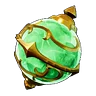
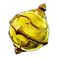
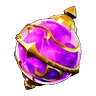
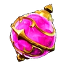
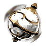

# 🔴 Сферы

<input type="search" class="pfq" name="pp-items-q" placeholder="Найти: сферы" autocomplete="off" autocorrect="off" autocapitalize="off" spellcheck="false" enterkeyhint="search">найдено 10

Мегасфера<small>🎯 14</small>

<h3>Мегасфера</h3>Обычный
Улучшенные характеристики позволяют ловить более широкий круг Палов. Сила поимки 14: чем больше число, тем проще поймать сильного пала.

🎯<small>Сила поимки</small><b>14</b>

⚖️<small>Вес</small><b>0,1</b>

💰<small>Цена</small><b>460</b>

📘<small>Технология</small><b>ур. 14</b>

<h4>🔨 Крафт</h4>
<a class="ich" href="../../../4_spravochniki/predmety/материалы/#осколок-палдиума">Осколок палдиума<b>×1</b></a><a class="ich" href="../../../4_spravochniki/predmety/материалы/#металлический-слиток">Металлический слиток<b>×1</b></a><a class="ich" href="../../../4_spravochniki/predmety/материалы/#древесина">Древесина<b>×3</b></a><a class="ich" href="../../../4_spravochniki/predmety/материалы/#камень">Камень<b>×3</b></a>
<h5>Где сделать</h5>
<a class="ich" href="../../../4_spravochniki/predmety/постройки/#сферическая-мастерская">Сферическая Мастерская</a><a class="ich" href="../../../4_spravochniki/predmety/постройки/#конвейерная-фабрика-сфер">Конвейерная фабрика сфер</a><a class="ich" href="../../../4_spravochniki/predmety/постройки/#сборочная-линия-сфер-разв-цив">Сборочная линия сфер разв. цив.</a><a class="ich" href="../../../4_spravochniki/predmety/постройки/#древний-верстак">Древний верстак</a>

<h4>📍 Где взять</h4>

🛒Продаётся у торговцев<small>💰 460</small>

👤Стражник<small>×1–2</small><small>40 %</small>

👤Браконьер-стрелок<small>×1–2</small><small>40 %</small>

👤Стрелок Вигилантов<small>×1–2</small><small>40 %</small>

👤Элитный Вигилант<small>×1–2</small><small>40 %</small>

👤Браконьер-чистильщик<small>×1–2</small><small>40 %</small>

👤Охотник на новичков Ястреб<small>×1–2</small><small>40 %</small>

👤Закоренелый тиран Кнут<small>×1–2</small><small>40 %</small>

👤Ленивый шеф<small>×1–2</small><small>40 %</small>

👤Браконьер-технарь<small>×1–2</small><small>40 %</small>

👤Браконьер-арбалетчик<small>×1–2</small><small>40 %</small>

👤Браконьер-мечник<small>×1–2</small><small>40 %</small>

👤Охранник Вигилантов<small>×1–2</small><small>40 %</small>

👤Блейдер Вигилантов<small>×1–2</small><small>40 %</small>

👤Райот Вигилантов<small>×1–2</small><small>40 %</small>

👤Хайтеккер Вигилантов<small>×1–2</small><small>40 %</small>

👤Ветеран Вигилантов<small>×1–2</small><small>40 %</small>

👤Клинер Вигилантов<small>×1–2</small><small>40 %</small>

👤Ракетчик Вигилантов<small>×1–2</small><small>40 %</small>

👤Перехватчик Вигилантов<small>×1–2</small><small>40 %</small>

👤Вигилант-наездник<small>×1–2</small><small>40 %</small>

🧭Экспедиция: Холмы (старт)<small>×3–7</small><small>100 %</small>

📍Награда Заносчивого критика Палов<small>×4</small><small>100 %</small>

📍Миссия<small>×3</small><small>100 %</small>

📍Сундук в поселении: Холмы (старт)<small>×2–3</small><small>59 %</small>

📍Ящик снабжения (с неба): Холмы (старт)<small>×5–10</small><small>50 %</small>

🐑Пастбище: Викси сам даёт<small>×1</small><small>32 %</small>

📍Пещера Горного Потока<small>×1–2</small><small>28 %</small>

📍Лагерь врагов: Холмы (старт)<small>×1–2</small><small>26 %</small>

📍Мусорный сундук: Холмы (старт)<small>×3–5</small><small>25 %</small>

🎁Сундуки и ящики: Холмы (старт)<small>×1</small><small>19 %</small>

📍Сундук: Лес<small>×2–3</small><small>19 %</small>

📍Пещера Отдалённого Острова<small>×1</small><small>17 %</small>

📍Рыбный пруд на базе: Лес<small>×1–2</small><small>9,3 %</small>

📍Рыбалка: Лес<small>×1–2</small><small>8,2 %</small>

Из игры

Метательное приспособление для поимки Палов. Улучшенные характеристики позволяют ловить более широкий круг Палов.

Пал-сфера<small>🎯 7</small>

<h3>Пал-сфера</h3>Обычный
Серийная модель, эффективная только против Палов низкого уровня. Сила поимки 7: чем больше число, тем проще поймать сильного пала.

🎯<small>Сила поимки</small><b>7</b>

⚖️<small>Вес</small><b>0,1</b>

💰<small>Цена</small><b>80</b>

📘<small>Технология</small><b>ур. 2</b>

<h4>🔨 Крафт</h4>
<a class="ich" href="../../../4_spravochniki/predmety/материалы/#осколок-палдиума">Осколок палдиума<b>×1</b></a>
<h5>Где сделать</h5>
<a class="ich" href="../../../4_spravochniki/predmety/постройки/#сферическая-мастерская">Сферическая Мастерская</a><a class="ich" href="../../../4_spravochniki/predmety/постройки/#конвейерная-фабрика-сфер">Конвейерная фабрика сфер</a><a class="ich" href="../../../4_spravochniki/predmety/постройки/#сборочная-линия-сфер-разв-цив">Сборочная линия сфер разв. цив.</a><a class="ich" href="../../../4_spravochniki/predmety/постройки/#примитивный-верстак">Примитивный верстак</a><a class="ich" href="../../../4_spravochniki/predmety/постройки/#древний-верстак">Древний верстак</a>

<h4>📍 Где взять</h4>

🛒Продаётся у торговцев<small>💰 80</small>

👤Торговец Палами<small>×1–2</small><small>40 %</small>

👤Стражник<small>×1–2</small><small>40 %</small>

👤Браконьер-новичок<small>×1–2</small><small>40 %</small>

👤Охранник Вигилантов<small>×1–2</small><small>40 %</small>

👤Бродячий торговец<small>×1–2</small><small>40 %</small>

👤Браконьер-гренадер<small>×1–2</small><small>40 %</small>

👤Мошенница Джейд<small>×1–2</small><small>40 %</small>

👤Жаждущий внимания монстр Мишура<small>×1–2</small><small>40 %</small>

👤Любитель пиццы с ананасами Алоха<small>×1–2</small><small>40 %</small>

👤Воришка данго Ловкач<small>×1–2</small><small>40 %</small>

👤Аварийный мошенник Краш<small>×1–2</small><small>40 %</small>

👤Любитель курить на ходу Окурок<small>×1–2</small><small>40 %</small>

👤Безумный стрелок Клинт<small>×1–2</small><small>40 %</small>

👤Коровий вор Лассо<small>×1–2</small><small>40 %</small>

👤Злостный заёмщик Пинч<small>×1–2</small><small>40 %</small>

👤Стрелок Вигилантов<small>×1–2</small><small>40 %</small>

🧭Экспедиция: Холмы (старт)<small>×5–10</small><small>100 %</small>

📍Награда Заносчивого критика Палов<small>×10</small><small>100 %</small>

📍Миссия<small>×3</small><small>100 %</small>

🐑Пастбище: Викси сам даёт<small>×1</small><small>60 %</small>

📍Сундук в поселении: Холмы (старт)<small>×2–5</small><small>28 %</small>

🎁Сундуки и ящики: Холмы (старт)<small>×1</small><small>26 %</small>

📍Пещера Отдалённого Острова<small>×1–3</small><small>26 %</small>

📍Мусорный сундук: Холмы (старт)<small>×2–3</small><small>25 %</small>

📍Рыбный пруд на базе: Холмы (старт)<small>×1–3</small><small>8,8 %</small>

📍Рыбалка: Холмы (старт)<small>×1–3</small><small>8,2 %</small>

📍Сундук: Холмы (старт)<small>×3–5</small><small>0 %</small>

Из игры

Метательное приспособление для поимки Палов. Серийная модель, эффективная только против Палов низкого уровня.

Гигасфера<small>🎯 20</small>

<h3>Гигасфера</h3>Необычный
Позволяет ловить более сильных Палов. Сила поимки 20: чем больше число, тем проще поймать сильного пала.

🎯<small>Сила поимки</small><b>20</b>

⚖️<small>Вес</small><b>0,1</b>

💰<small>Цена</small><b>890</b>

📘<small>Технология</small><b>ур. 20</b>

<h4>🔨 Крафт</h4>
<a class="ich" href="../../../4_spravochniki/predmety/материалы/#осколок-палдиума">Осколок палдиума<b>×2</b></a><a class="ich" href="../../../4_spravochniki/predmety/материалы/#металлический-слиток">Металлический слиток<b>×2</b></a><a class="ich" href="../../../4_spravochniki/predmety/материалы/#древесина">Древесина<b>×5</b></a><a class="ich" href="../../../4_spravochniki/predmety/материалы/#камень">Камень<b>×5</b></a>
<h5>Где сделать</h5>
<a class="ich" href="../../../4_spravochniki/predmety/постройки/#сферическая-мастерская">Сферическая Мастерская</a><a class="ich" href="../../../4_spravochniki/predmety/постройки/#конвейерная-фабрика-сфер">Конвейерная фабрика сфер</a><a class="ich" href="../../../4_spravochniki/predmety/постройки/#сборочная-линия-сфер-разв-цив">Сборочная линия сфер разв. цив.</a><a class="ich" href="../../../4_spravochniki/predmety/постройки/#древний-верстак">Древний верстак</a>

<h4>📍 Где взять</h4>

🛒Продаётся у торговцев<small>💰 890</small>

👤Элитный браконьер<small>×1–2</small><small>40 %</small>

👤Браконьер-громила<small>×1–2</small><small>40 %</small>

👤Напористый интервьюер Гриль<small>×1–2</small><small>40 %</small>

👤Эльдер<small>×1–2</small><small>40 %</small>

🧭Экспедиция: Лес<small>×3–6</small><small>100 %</small>

🏟️Арена (первая победа)<small>×20</small><small>100 %</small>

🏟️Арена (повторно)<small>×1–2</small><small>100 %</small>

📍Награда Заносчивого критика Палов<small>×3</small><small>100 %</small>

📍Награда Надменного гурмана<small>×18</small><small>100 %</small>

📍Миссия<small>×3</small><small>100 %</small>

🎁Нефтяная вышка ур. 30: обычный сундук<small>×2–5</small><small>70 %</small>

📍Сундук в поселении: Лес<small>×2–4</small><small>62 %</small>

📍Ящик снабжения (с неба): Холмы (старт)<small>×3–5</small><small>50 %</small>

📍Сундук<small>×1–2</small><small>35 %</small>

📍Пещера Вулкана<small>×1–2</small><small>28 %</small>

📍Пещера Песчаных Дюн<small>×1–2</small><small>27 %</small>

📍Пещера Священной Горы<small>×1–3</small><small>26 %</small>

📍Лагерь врагов: Лес<small>×1–2</small><small>26 %</small>

📍Мусорный сундук: Лес<small>×2–3</small><small>25 %</small>

🎁Сундуки и ящики: Вулкан<small>×1</small><small>12 %</small>

📍Рыбный пруд на базе: Вулкан<small>×1–2</small><small>9,1 %</small>

📍Со дна моря (Магнит/спасение)<small>×2–4</small><small>8,7 %</small>

🐑Пастбище: Викси сам даёт<small>×1</small><small>8,6 %</small>

📍Рыбалка: Вулкан<small>×1–2</small><small>8,2 %</small>

📍Пещера Горного Потока<small>×1</small><small>8,1 %</small>

Из игры

Метательное приспособление для поимки Палов. Позволяет ловить более сильных Палов.

Терасфера<small>🎯 26</small>

<h3>Терасфера</h3>Необычный
Способно поймать довольно сильных Палов. Сила поимки 26: чем больше число, тем проще поймать сильного пала.

🎯<small>Сила поимки</small><b>26</b>

⚖️<small>Вес</small><b>0,1</b>

💰<small>Цена</small><b>1350</b>

📘<small>Технология</small><b>ур. 27</b>

<h4>🔨 Крафт</h4>
<a class="ich" href="../../../4_spravochniki/predmety/материалы/#осколок-палдиума">Осколок палдиума<b>×3</b></a><a class="ich" href="../../../4_spravochniki/predmety/материалы/#металлический-слиток">Металлический слиток<b>×3</b></a><a class="ich" href="../../../4_spravochniki/predmety/материалы/#древесина">Древесина<b>×8</b></a><a class="ich" href="../../../4_spravochniki/predmety/материалы/#камень">Камень<b>×8</b></a>
<h5>Где сделать</h5>
<a class="ich" href="../../../4_spravochniki/predmety/постройки/#конвейерная-фабрика-сфер">Конвейерная фабрика сфер</a><a class="ich" href="../../../4_spravochniki/predmety/постройки/#сборочная-линия-сфер-разв-цив">Сборочная линия сфер разв. цив.</a><a class="ich" href="../../../4_spravochniki/predmety/постройки/#древний-верстак">Древний верстак</a>

<h4>📍 Где взять</h4>

👤Коллекционер людей Схрон<small>×1–2</small><small>40 %</small>

🧭Экспедиция: Вулкан<small>×4–8</small><small>100 %</small>

🏟️Арена (повторно)<small>×1–2</small><small>100 %</small>

📍Награда Заносчивого критика Палов<small>×10</small><small>100 %</small>

📍Награда Надменного гурмана<small>×8</small><small>100 %</small>

📍Сундук в поселении: Пустыня<small>×2–5</small><small>62 %</small>

📍Ящик снабжения (с неба): Лес<small>×3–6</small><small>50 %</small>

📍Лагерь врагов: Лес<small>×1–3</small><small>26 %</small>

📍Мусорный сундук: Пустыня<small>×1–2</small><small>25 %</small>

📍Пещера Вулкана<small>×1</small><small>19 %</small>

📍Пещера Песчаных Дюн<small>×1</small><small>19 %</small>

📍Пещера Священной Горы<small>×1</small><small>19 %</small>

🎁Нефтяная вышка ур. 30: редкий сундук<small>×3–6</small><small>10 %</small>

📍Сундук<small>×1</small><small>8,8 %</small>

📍Рыбный пруд на базе: Вулкан<small>×1–2</small><small>8,2 %</small>

📍Рыбалка: Вулкан<small>×1</small><small>7,3 %</small>

📍Со дна моря (Магнит/спасение)<small>×1</small><small>6,5 %</small>

🎁Сундуки и ящики: Вулкан<small>×1</small><small>4,7 %</small>

🎁Сундуки и ящики: Пустыня<small>×1</small><small>1,9 %</small>

🐑Пастбище: Викси сам даёт<small>×1</small><small>0,5 %</small>

Из игры

Метательное приспособление для поимки Палов. Способно поймать довольно сильных Палов.

Легендарная сфера<small>🎯 38</small>

<h3>Легендарная сфера</h3>Редкий
Обладает высокой эффективностью, лишь единицы могут вырваться из его хватки. Сила поимки 38: чем больше число, тем проще поймать сильного пала.

🎯<small>Сила поимки</small><b>38</b>

⚖️<small>Вес</small><b>0,1</b>

💰<small>Цена</small><b>5570</b>

📘<small>Технология</small><b>ур. 44</b>

<h4>🔨 Крафт</h4>
<a class="ich" href="../../../4_spravochniki/predmety/материалы/#осколок-палдиума">Осколок палдиума<b>×5</b></a><a class="ich" href="../../../4_spravochniki/predmety/материалы/#слиток-пал-металла">Слиток Пал-Металла<b>×3</b></a><a class="ich" href="../../../4_spravochniki/predmety/материалы/#твёрдая-древесина">Твёрдая древесина<b>×3</b></a><a class="ich" href="../../../4_spravochniki/predmety/материалы/#камень">Камень<b>×20</b></a>
<h5>Где сделать</h5>
<a class="ich" href="../../../4_spravochniki/predmety/постройки/#сборочная-линия-сфер-разв-цив">Сборочная линия сфер разв. цив.</a><a class="ich" href="../../../4_spravochniki/predmety/постройки/#древний-верстак">Древний верстак</a>

<h4>📍 Где взять</h4>

🧭Экспедиция: Снега<small>×4–8</small><small>100 %</small>

🏟️Арена (повторно)<small>×1–2</small><small>100 %</small>

📍Награда Заносчивого критика Палов<small>×5</small><small>100 %</small>

📍Миссия<small>×5</small><small>100 %</small>

📍Эмиссар пустынного города<small>×1–3</small><small>100 %</small>

📍Сундук в поселении: Сакурадзима<small>×2–3</small><small>62 %</small>

📍Ящик снабжения (с неба): Сакурадзима<small>×2–5</small><small>50 %</small>

📍Лагерь врагов: Сакурадзима<small>×1–3</small><small>26 %</small>

📍Мусорный сундук: Сакурадзима<small>×1–3</small><small>25 %</small>

📍Пещера Цветущей Сакуры<small>×1</small><small>17 %</small>

📍Рыбный пруд на базе: Сакурадзима<small>×1–2</small><small>8,7 %</small>

📍Рыбалка: Сакурадзима<small>×1</small><small>7,4 %</small>

🎁Сундуки и ящики: Сакурадзима<small>×1–3</small><small>3,3 %</small>

🎁Сундуки и ящики: Снега<small>×1</small><small>0,5 %</small>

Из игры

Метательное приспособление для поимки Палов. Обладает высокой эффективностью, лишь единицы могут вырваться из его хватки.

Ультрасфера<small>🎯 33</small>

<h3>Ультрасфера</h3>Редкий
Лишь немногие Палы могут вырваться из его хватки. Сила поимки 33: чем больше число, тем проще поймать сильного пала.

🎯<small>Сила поимки</small><b>33</b>

⚖️<small>Вес</small><b>0,1</b>

💰<small>Цена</small><b>3300</b>

📘<small>Технология</small><b>ур. 35</b>

<h4>🔨 Крафт</h4>
<a class="ich" href="../../../4_spravochniki/predmety/материалы/#осколок-палдиума">Осколок палдиума<b>×5</b></a><a class="ich" href="../../../4_spravochniki/predmety/материалы/#слиток-рафинированного-металла">Слиток рафинированного металла<b>×3</b></a><a class="ich" href="../../../4_spravochniki/predmety/материалы/#древесина">Древесина<b>×10</b></a><a class="ich" href="../../../4_spravochniki/predmety/материалы/#камень">Камень<b>×10</b></a>
<h5>Где сделать</h5>
<a class="ich" href="../../../4_spravochniki/predmety/постройки/#сборочная-линия-сфер-разв-цив">Сборочная линия сфер разв. цив.</a><a class="ich" href="../../../4_spravochniki/predmety/постройки/#древний-верстак">Древний верстак</a>

<h4>📍 Где взять</h4>

🧭Экспедиция: Пустыня<small>×4–8</small><small>100 %</small>

🏟️Арена (повторно)<small>×1–2</small><small>100 %</small>

📍Награда Заносчивого критика Палов<small>×8</small><small>100 %</small>

📍Ящик снабжения (с неба): Пустыня<small>×2–4</small><small>50 %</small>

📍Сундук в поселении: Сакурадзима<small>×2–5</small><small>27 %</small>

📍Лагерь врагов: Пустыня<small>×1–3</small><small>27 %</small>

📍Пещера Цветущей Сакуры<small>×1–3</small><small>26 %</small>

📍Пещера Тэнраку<small>×1–3</small><small>25 %</small>

📍Мусорный сундук: Снега<small>×1–3</small><small>25 %</small>

📍Со дна моря (Магнит/спасение)<small>×1–3</small><small>22 %</small>

📍Рыбный пруд на базе: Сакурадзима<small>×1–2</small><small>9,1 %</small>

📍Рыбалка: Сакурадзима<small>×1–3</small><small>7,7 %</small>

🎁Сундуки и ящики: Снега<small>×1</small><small>2 %</small>

🎁Сундуки и ящики: Пустыня<small>×1</small><small>0,7 %</small>

Из игры

Метательное приспособление для поимки Палов. Лишь немногие Палы могут вырваться из его хватки.

Абсолютная сфера<small>🎯 44</small>

<h3>Абсолютная сфера</h3>Эпический
Обладает потрясающей эффективностью. Сила поимки 44: чем больше число, тем проще поймать сильного пала.

🎯<small>Сила поимки</small><b>44</b>

⚖️<small>Вес</small><b>0,1</b>

💰<small>Цена</small><b>12560</b>

📘<small>Технология</small><b>ур. 51</b>

<h4>🔨 Крафт</h4>
<a class="ich" href="../../../4_spravochniki/predmety/материалы/#осколок-палдиума">Осколок палдиума<b>×10</b></a><a class="ich" href="../../../4_spravochniki/predmety/материалы/#слиток-пал-металла">Слиток Пал-Металла<b>×5</b></a><a class="ich" href="../../../4_spravochniki/predmety/материалы/#твёрдая-древесина">Твёрдая древесина<b>×10</b></a><a class="ich" href="../../../4_spravochniki/predmety/материалы/#сталепластик">Сталепластик<b>×1</b></a>
<h5>Где сделать</h5>
<a class="ich" href="../../../4_spravochniki/predmety/постройки/#сборочная-линия-сфер-разв-цив">Сборочная линия сфер разв. цив.</a><a class="ich" href="../../../4_spravochniki/predmety/постройки/#древний-верстак">Древний верстак</a>

<h4>📍 Где взять</h4>

🧭Экспедиция: Сакурадзима<small>×4–8</small><small>100 %</small>

🏟️Арена (повторно)<small>×1–2</small><small>100 %</small>

📍Награда Заносчивого критика Палов<small>×7</small><small>100 %</small>

📍Миссия<small>×5</small><small>100 %</small>

📍Сундук в поселении: Фейбрейк<small>×2–3</small><small>62 %</small>

📍Ящик снабжения (с неба): Фейбрейк<small>×5–10</small><small>50 %</small>

📍Мусорный сундук: Фейбрейк<small>×1–3</small><small>25 %</small>

📍Со дна моря (Магнит/спасение)<small>×1–2</small><small>22 %</small>

📍Пещера Тэнраку<small>×1</small><small>20 %</small>

📍Лагерь врагов: Сакурадзима<small>×1</small><small>15 %</small>

📍Рыбный пруд на базе: Фейбрейк<small>×1</small><small>8,7 %</small>

📍Рыбалка: Фейбрейк<small>×1</small><small>7 %</small>

🎁Сундуки и ящики: Фейбрейк<small>×1–3</small><small>1,9 %</small>

🎁Сундуки и ящики: Сакурадзима<small>×1–3</small><small>0,8 %</small>

Из игры

Метательное приспособление для поимки Палов. Обладает потрясающей эффективностью. Способно поймать почти всех Палов.

Соллайт сфера<small>🎯 58</small>

<h3>Соллайт сфера</h3>Эпический
Высокоуровневая сфера древней цивилизации, укрепившая союз людей и Палов. Сила поимки 58: чем больше число, тем проще поймать сильного пала.

🎯<small>Сила поимки</small><b>58</b>

⚖️<small>Вес</small><b>0,1</b>

💰<small>Цена</small><b>21000</b>

📘<small>Технология</small><b>ур. 67</b>

<h4>🔨 Крафт</h4>
<a class="ich" href="../../../4_spravochniki/predmety/материалы/#осколок-палдиума">Осколок палдиума<b>×30</b></a><a class="ich" href="../../../4_spravochniki/predmety/материалы/#соллайтовый-слиток">Соллайтовый слиток<b>×2</b></a><a class="ich" href="../../../4_spravochniki/predmety/материалы/#твёрдая-древесина">Твёрдая древесина<b>×10</b></a>
<h5>Где сделать</h5>
<a class="ich" href="../../../4_spravochniki/predmety/постройки/#древний-верстак">Древний верстак</a>

<h4>📍 Где взять</h4>

🧭Экспедиция: Санрич<small>×10–20</small><small>100 %</small>

📍Ящик снабжения (с неба): Санрич<small>×5–10</small><small>50 %</small>

📍Мусорный сундук: Санрич<small>×1–3</small><small>25 %</small>

📍Лагерь врагов: Санрич<small>×1–3</small><small>24 %</small>

📍Небесный свод Санрича<small>×1–3</small><small>17 %</small>

📍Рыбный пруд на базе: Мировое Древо<small>×1–3</small><small>11 %</small>

📍Рыбалка: Санрич<small>×1–3</small><small>8,1 %</small>

🎁Сундуки и ящики: Мировое Древо<small>×1–3</small><small>1,2 %</small>

🎁Сундуки и ящики: Санрич<small>×1–3</small><small>0,5 %</small>

Из игры

Метательное приспособление для поимки Палов. Высокоуровневая сфера древней цивилизации, укрепившая союз людей и Палов.

Сфера инфинити<small>🎯 50</small>

<h3>Сфера инфинити</h3>Эпический
Обладает феноменальной эффективностью и способно поймать даже необычных Палов. Сила поимки 50: чем больше число, тем проще поймать сильного пала.

🎯<small>Сила поимки</small><b>50</b>

⚖️<small>Вес</small><b>0,1</b>

💰<small>Цена</small><b>9080</b>

📘<small>Технология</small><b>ур. 58</b>

<h4>🔨 Крафт</h4>
<a class="ich" href="../../../4_spravochniki/predmety/материалы/#осколок-палдиума">Осколок палдиума<b>×15</b></a><a class="ich" href="../../../4_spravochniki/predmety/материалы/#сталепластик">Сталепластик<b>×1</b></a><a class="ich" href="../../../4_spravochniki/predmety/материалы/#твёрдая-древесина">Твёрдая древесина<b>×10</b></a><a class="ich" href="../../../4_spravochniki/predmety/материалы/#гексолит">Гексолит<b>×1</b></a>
<h5>Где сделать</h5>
<a class="ich" href="../../../4_spravochniki/predmety/постройки/#сборочная-линия-сфер-разв-цив">Сборочная линия сфер разв. цив.</a><a class="ich" href="../../../4_spravochniki/predmety/постройки/#древний-верстак">Древний верстак</a>

<h4>📍 Где взять</h4>

🧭Экспедиция: Фейбрейк<small>×4–8</small><small>100 %</small>

🏟️Арена (повторно)<small>×1–2</small><small>100 %</small>

📍Лагерь врагов: Сакурадзима<small>×1</small><small>15 %</small>

🎁Сундуки и ящики: Санрич<small>×1–3</small><small>1,9 %</small>

🎁Сундуки и ящики: Фейбрейк<small>×1–3</small><small>0,5 %</small>

Из игры

Метательное приспособление для поимки Палов. Обладает феноменальной эффективностью и способно поймать даже необычных Палов.

Древняя сфера<small>🎯 64</small>

<h3>Древняя сфера</h3>Легендарный
Абсолютная сфера, созданная как высшее достижение древней цивилизации и вобравшая силу Мирового Древа. Сила поимки 64: чем больше число, тем проще поймать сильного пала.

🎯<small>Сила поимки</small><b>64</b>

⚖️<small>Вес</small><b>0,1</b>

💰<small>Цена</small><b>122760</b>

📘<small>Технология</small><b>ур. 74</b>

<h4>🔨 Крафт</h4>
<a class="ich" href="../../../4_spravochniki/predmety/материалы/#осколок-палдиума">Осколок палдиума<b>×30</b></a><a class="ich" href="../../../4_spravochniki/predmety/материалы/#палкизитовый-слиток">Палкизитовый слиток<b>×6</b></a><a class="ich" href="../../../4_spravochniki/predmety/материалы/#таинственная-древесина">Таинственная древесина<b>×3</b></a>
<h5>Где сделать</h5>
<a class="ich" href="../../../4_spravochniki/predmety/постройки/#древний-верстак">Древний верстак</a>

<h4>📍 Где взять</h4>

🧭Экспедиция: Пустыня (сложная)<small>×10–20</small><small>100 %</small>

🏟️Арена (повторно)<small>×1–2</small><small>100 %</small>

📍Ящик снабжения (с неба): Санрич<small>×5–10</small><small>50 %</small>

📍Рыбный пруд на базе: Мировое Древо<small>×1</small><small>38 %</small>

📍Сундук: Мировое Древо<small>×1</small><small>21 %</small>

📍Мусорный сундук: Мировое Древо<small>×1–3</small><small>20 %</small>

📍Небесный свод Санрича<small>×1</small><small>18 %</small>

📍Рыбалка: Санрич<small>×1</small><small>7,8 %</small>

🎁Сундуки и ящики: Мировое Древо<small>×1–3</small><small>0,4 %</small>

Из игры

Метательное приспособление для поимки Палов. Абсолютная сфера, созданная как высшее достижение древней цивилизации и вобравшая силу Мирового Древа.

