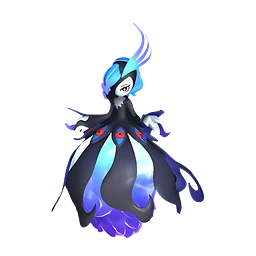
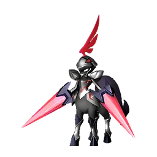
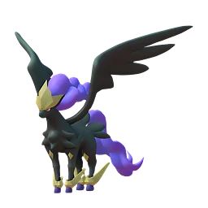
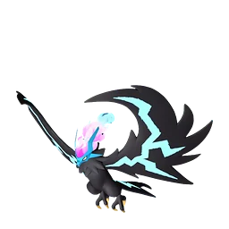
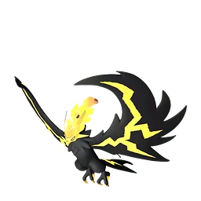

# Селесдир

👑 Альфа <button class="hlp" data-h="boss">?</button><h2>Селесдир</h2>
СтихияНейтральный

СлабостьТьма <b class="mx">×1,5</b>

<input type="radio" name="bmode" id="bm0" checked><label for="bm0">Альфа</label>

⭐Уровень<b>60</b>

<a class="md-button" href="../../map/?q=Селесдир">📍 На карте</a><a class="md-button" href="../../4_spravochniki/paly/celesdir/">Страница пала</a>

## 💥 Кем бить <button class="hlp" data-tip="Палы, которые бьют по слабости босса, — сверху самые эффективные (×1,5 и выше). Нажми на пала — откроется его сборка: там видно, сколько ударов нужно против этого босса.">?</button>

<a class="ctr card-link" href="../../4_spravochniki/paly/bellanoir/#bld"><b>Бэллануар</b>Тьма×1,5</a><a class="ctr card-link" href="../../4_spravochniki/paly/bellanoir_libero/#bld"><b>Бэллануар Либеро</b>Тьма×1,5</a><a class="ctr card-link" href="../../4_spravochniki/paly/necromus/#bld"><b>Некромус</b>Тьма×1,5</a><a class="ctr card-link" href="../../4_spravochniki/paly/frostallion_noct/#bld"><b>Фросталлион Нокт</b>Тьма×1,5</a><a class="ctr card-link" href="../../4_spravochniki/paly/dandilord/#bld"><b>Дандилорд</b>ТраваТьма×1,5</a><a class="ctr card-link" href="../../4_spravochniki/paly/bushi_noct/#bld"><b>Буси Нокт</b>ОгоньТьма×1,5</a><a class="ctr card-link" href="../../4_spravochniki/paly/helzephyr/#bld"><b>Хэлзефир</b>Тьма×1,5</a><a class="ctr card-link" href="../../4_spravochniki/paly/helzephyr_lux/#bld"><b>Хэлзефир Лакс</b>ТьмаМолния×1,5</a>

<a class="card-link" href="../../boss/alpha_jetragon/">← Джетрагон</a><a class="card-link" href="../../boss/alpha_neptilius/">Нептилиус →</a>

