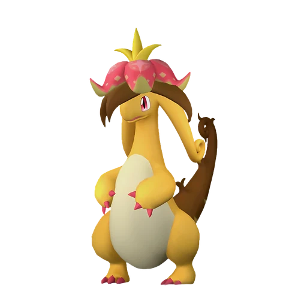

# Диноссум Лакс

👑 Альфа <button class="hlp" data-h="boss">?</button><h2>Диноссум Лакс</h2>
СтихияМолнияДракон

СлабостьЛёд <b class="mx">×1,5</b>Земля <b class="mx">×1,5</b>

<input type="radio" name="bmode" id="bm0" checked><label for="bm0">Альфа</label>

⭐Уровень<b>47</b>

<a class="md-button" href="../../map/?q=Диноссум Лакс">📍 На карте</a><a class="md-button" href="../../4_spravochniki/paly/dinossom_lux/">Страница пала</a>

## 💥 Кем бить <button class="hlp" data-tip="Палы, которые бьют по слабости босса, — сверху самые эффективные (×1,5 и выше). Нажми на пала — откроется его сборка: там видно, сколько ударов нужно против этого босса.">?</button>

<a class="ctr card-link" href="../../4_spravochniki/paly/frostallion/#bld"><b>Фросталлион</b>Лёд×1,5</a><a class="ctr card-link" href="../../4_spravochniki/paly/anubis/#bld"><b>Анубис</b>Земля×1,5</a><a class="ctr card-link" href="../../4_spravochniki/paly/bastigor/#bld"><b>Бастигор</b>Лёд×1,5</a><a class="ctr card-link" href="../../4_spravochniki/paly/moldron/#bld"><b>Молдрон</b>ОгоньЗемля×1,5</a><a class="ctr card-link" href="../../4_spravochniki/paly/moldron_cryst/#bld"><b>Молдрон Крист</b>ЛёдЗемля×1,5</a><a class="ctr card-link" href="../../4_spravochniki/paly/aegidron/#bld"><b>Аэгидрон</b>ДраконЗемля×1,5</a><a class="ctr card-link" href="../../4_spravochniki/paly/vanwyrm_cryst/#bld"><b>Ванвирм Крист</b>ЛёдТьма×1,5</a><a class="ctr card-link" href="../../4_spravochniki/paly/gildra/#bld"><b>Йомира</b>ТьмаЗемля×1,5</a>

<a class="card-link" href="../../boss/alpha_kingpaca_cryst/">← Кингпака Крист</a><a class="card-link" href="../../boss/alpha_anubis/">Анубис →</a>

