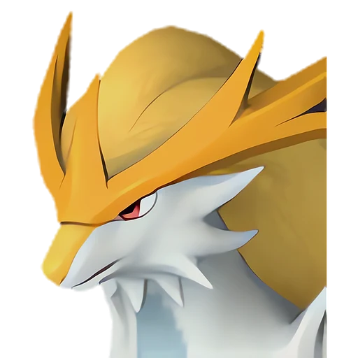
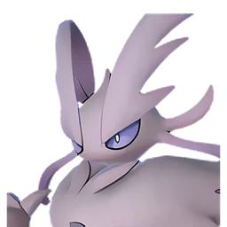
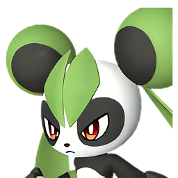
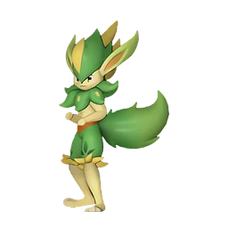
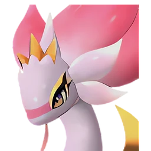
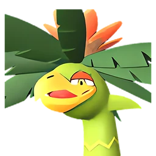

# Гилдейн

👑 Альфа <button class="hlp" data-h="boss">?</button><h2>Гилдейн</h2>
СтихияЗемля

СлабостьТрава <b class="mx">×1,5</b>

<input type="radio" name="bmode" id="bm0" checked><label for="bm0">Альфа</label>

⭐Уровень<b>58</b>

<a class="md-button" href="../../map/?q=Гилдейн">📍 На карте</a><a class="md-button" href="../../4_spravochniki/paly/gildane/">Страница пала</a>

## 💥 Кем бить <button class="hlp" data-tip="Палы, которые бьют по слабости босса, — сверху самые эффективные (×1,5 и выше). Нажми на пала — откроется его сборка: там видно, сколько ударов нужно против этого босса.">?</button>

<a class="ctr card-link" href="../../4_spravochniki/paly/dandilord/#bld"><b>Дандилорд</b>ТраваТьма×1,5</a><a class="ctr card-link" href="../../4_spravochniki/paly/lyleen/#bld"><b>Лилин</b>Трава×1,5</a><a class="ctr card-link" href="../../4_spravochniki/paly/silvance/#bld"><b>Сильванс</b>Трава×1,5</a><a class="ctr card-link" href="../../4_spravochniki/paly/leafan/#bld"><b>Лифан</b>Трава×1,5</a><a class="ctr card-link" href="../../4_spravochniki/paly/verdash/#bld"><b>Вердаш</b>Трава×1,5</a><a class="ctr card-link" href="../../4_spravochniki/paly/ophydia/#bld"><b>Офидия</b>ТраваВода×1,5</a><a class="ctr card-link" href="../../4_spravochniki/paly/palumba/#bld"><b>Палумба</b>Трава×1,5</a><a class="ctr card-link" href="../../4_spravochniki/paly/elizabee/#bld"><b>Элизаби</b>Трава×1,5</a>

<a class="card-link" href="../../boss/alpha_splatterina/">← Сплаттерина</a><a class="card-link" href="../../boss/alpha_whalaska_ignis/">Валаска Игнис →</a>

