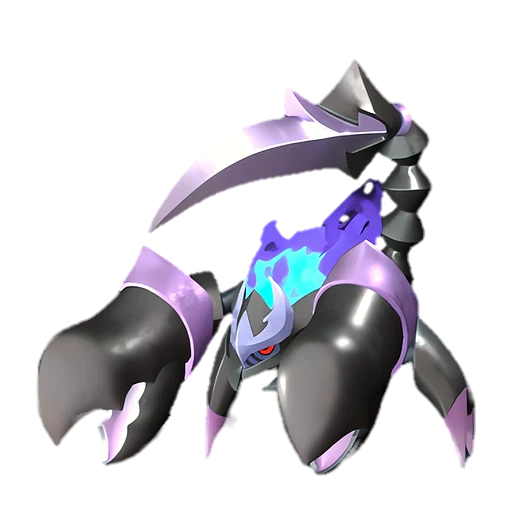
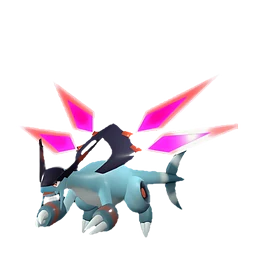
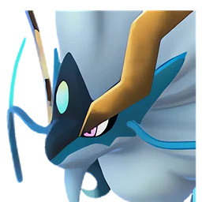
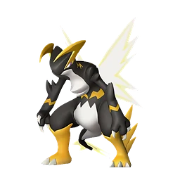
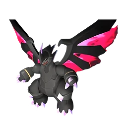

# Менастинг

👑 Альфа <button class="hlp" data-h="boss">?</button><h2>Менастинг</h2>
СтихияТьмаЗемля

СлабостьТрава <b class="mx">×1,5</b>Дракон <b class="mx">×1,5</b>

<input type="radio" name="bmode" id="bm0" checked><label for="bm0">Альфа</label>

⭐Уровень<b>44</b>

<a class="md-button" href="../../map/?q=Менастинг">📍 На карте</a><a class="md-button" href="../../4_spravochniki/paly/menasting/">Страница пала</a>

## 💥 Кем бить <button class="hlp" data-tip="Палы, которые бьют по слабости босса, — сверху самые эффективные (×1,5 и выше). Нажми на пала — откроется его сборка: там видно, сколько ударов нужно против этого босса.">?</button>

<a class="ctr card-link" href="../../4_spravochniki/paly/jetragon/#bld"><b>Джетрагон</b>Дракон×1,5</a><a class="ctr card-link" href="../../4_spravochniki/paly/shaolong/#bld"><b>Шаолонг</b>ДраконВода×1,5</a><a class="ctr card-link" href="../../4_spravochniki/paly/dandilord/#bld"><b>Дандилорд</b>ТраваТьма×1,5</a><a class="ctr card-link" href="../../4_spravochniki/paly/jormuntide_ignis/#bld"><b>Йормунтайд Игнис</b>ДраконОгонь×1,5</a><a class="ctr card-link" href="../../4_spravochniki/paly/blazamut_ryu/#bld"><b>Блазамут Рю</b>ДраконОгонь×1,5</a><a class="ctr card-link" href="../../4_spravochniki/paly/eidrolon_ignis/#bld"><b>Айдролон Игнис</b>ДраконОгонь×1,5</a><a class="ctr card-link" href="../../4_spravochniki/paly/orserk/#bld"><b>Орсерк</b>ДраконМолния×1,5</a><a class="ctr card-link" href="../../4_spravochniki/paly/astegon/#bld"><b>Астегон</b>ДраконТьма×1,5</a>

<a class="card-link" href="../../boss/alpha_sibelyx/">← Сибеликс</a><a class="card-link" href="../../boss/alpha_eye_of_cthulhu/">Глаз Ктулху →</a>

