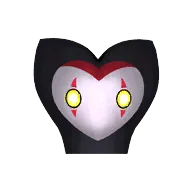
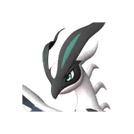

# Омаскул

👑 Альфа <button class="hlp" data-h="boss">?</button><h2>Омаскул</h2>
Тьма

Слабость: Дракон

<a class="md-button" href="../../map/?q=Омаскул">📍 На карте</a><a class="md-button" href="../../4_spravochniki/paly/omascul/">Страница пала</a>

=== "Альфа"

    

Уровень<b>55</b>

## 💥 Кем бить <button class="hlp" data-h="counter">?</button>

Палы, которые бьют по слабости босса. Нажми — откроется сборка пала, там видно, как он против этого босса.

<a class="mc card-link" href="../../4_spravochniki/paly/jetragon/#bld">Джетрагон</a><a class="mc card-link" href="../../4_spravochniki/paly/shaolong/#bld">Шаолонг</a><a class="mc card-link" href="../../4_spravochniki/paly/jormuntide_ignis/#bld">Йормунтайд Игнис</a><a class="mc card-link" href="../../4_spravochniki/paly/blazamut_ryu/#bld">Блазамут Рю</a><a class="mc card-link" href="../../4_spravochniki/paly/eidrolon_ignis/#bld">Айдролон Игнис</a><a class="mc card-link" href="../../4_spravochniki/paly/orserk/#bld">Орсерк</a><a class="mc card-link" href="../../4_spravochniki/paly/astegon/#bld">Астегон</a><a class="mc card-link" href="../../4_spravochniki/paly/eidrolon/#bld">Айдролон</a>

<a class="card-link" href="../../boss/alpha_smokie/">← Смоки</a><a class="card-link" href="../../boss/alpha_prunelia/">Прунелия →</a>

