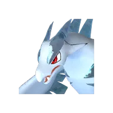
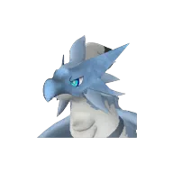

# Фэски

👑 Альфа <button class="hlp" data-h="boss">?</button><h2>Фэски</h2>
Дракон

Слабость: Лёд

<a class="md-button" href="../../map/?q=Фэски">📍 На карте</a><a class="md-button" href="../../4_spravochniki/paly/quivern/">Страница пала</a>

=== "Альфа"

    

Уровень<b>23</b>

## 💥 Кем бить <button class="hlp" data-h="counter">?</button>

Палы, которые бьют по слабости босса. Нажми — откроется сборка пала, там видно, как он против этого босса.

<a class="mc card-link" href="../../4_spravochniki/paly/frostallion/#bld">Фросталлион</a><a class="mc card-link" href="../../4_spravochniki/paly/bastigor/#bld">Бастигор</a><a class="mc card-link" href="../../4_spravochniki/paly/moldron_cryst/#bld">Молдрон Крист</a><a class="mc card-link" href="../../4_spravochniki/paly/vanwyrm_cryst/#bld">Ванвирм Крист</a><a class="mc card-link" href="../../4_spravochniki/paly/whalaska_ignis/#bld">Валаска Игнис</a><a class="mc card-link" href="../../4_spravochniki/paly/beakon_cryst/#bld">Райберд Крист</a><a class="mc card-link" href="../../4_spravochniki/paly/icelyn/#bld">Айселин</a><a class="mc card-link" href="../../4_spravochniki/paly/whalaska/#bld">Валаска</a>

