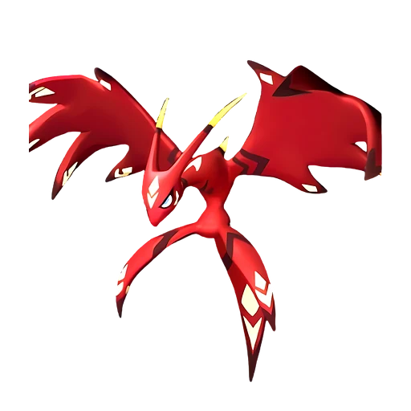
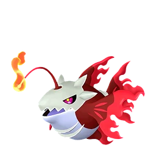
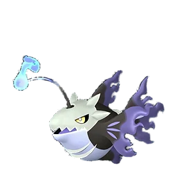

# Судзаку

👑 Альфа <button class="hlp" data-h="boss">?</button><h2>Судзаку</h2>
СтихияОгонь

СлабостьВода <b class="mx">×1,5</b>

<input type="radio" name="bmode" id="bm0" checked><label for="bm0">Альфа</label>

⭐Уровень<b>45</b>

<a class="md-button" href="../../map/?q=Судзаку">📍 На карте</a><a class="md-button" href="../../4_spravochniki/paly/suzaku/">Страница пала</a>

## 💥 Кем бить <button class="hlp" data-tip="Палы, которые бьют по слабости босса, — сверху самые эффективные (×1,5 и выше). Нажми на пала — откроется его сборка: там видно, сколько ударов нужно против этого босса.">?</button>

<a class="ctr card-link" href="../../4_spravochniki/paly/neptilius/#bld"><b>Нептилиус</b>Вода×1,5</a><a class="ctr card-link" href="../../4_spravochniki/paly/shaolong/#bld"><b>Шаолонг</b>ДраконВода×1,5</a><a class="ctr card-link" href="../../4_spravochniki/paly/ghangler_ignis/#bld"><b>Ганглер Игнис</b>ОгоньВода×1,5</a><a class="ctr card-link" href="../../4_spravochniki/paly/ghangler/#bld"><b>Ганглер</b>ТьмаВода×1,5</a><a class="ctr card-link" href="../../4_spravochniki/paly/jormuntide/#bld"><b>Йормунтайд</b>ДраконВода×1,5</a><a class="ctr card-link" href="../../4_spravochniki/paly/panthalus/#bld"><b>Панталус</b>Вода×1,5</a><a class="ctr card-link" href="../../4_spravochniki/paly/relaxaurus/#bld"><b>Релаксаурус</b>ДраконВода×1,5</a><a class="ctr card-link" href="../../4_spravochniki/paly/whalaska/#bld"><b>Валаска</b>ЛёдВода×1,5</a>

<a class="card-link" href="../../boss/alpha_jormuntide/">← Йормунтайд</a><a class="card-link" href="../../boss/alpha_kingpaca_cryst/">Кингпака Крист →</a>

