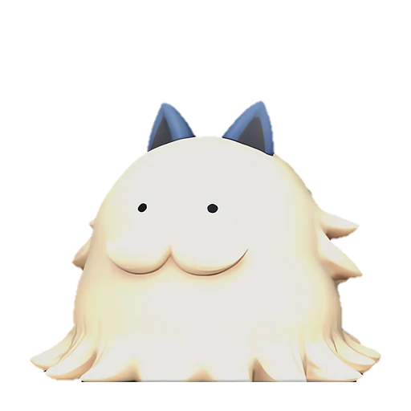
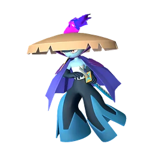
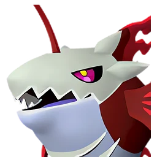
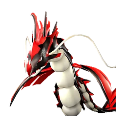
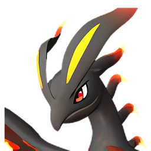
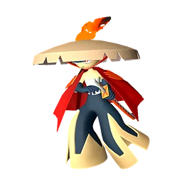
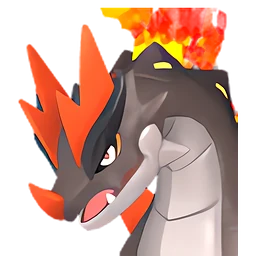
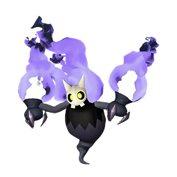

# Свипа

👑 Альфа <button class="hlp" data-h="boss">?</button><h2>Свипа</h2>
СтихияЛёд

СлабостьОгонь <b class="mx">×1,5</b>

<input type="radio" name="bmode" id="bm0" checked><label for="bm0">Альфа</label>

⭐Уровень<b>11</b>

<a class="md-button" href="../../map/?q=Свипа">📍 На карте</a><a class="md-button" href="../../4_spravochniki/paly/sweepa/">Страница пала</a>

## 💥 Кем бить <button class="hlp" data-tip="Палы, которые бьют по слабости босса, — сверху самые эффективные (×1,5 и выше). Нажми на пала — откроется его сборка: там видно, сколько ударов нужно против этого босса.">?</button>

<a class="ctr card-link" href="../../4_spravochniki/paly/bushi_noct/#bld"><b>Буси Нокт</b>ОгоньТьма×1,5</a><a class="ctr card-link" href="../../4_spravochniki/paly/ghangler_ignis/#bld"><b>Ганглер Игнис</b>ОгоньВода×1,5</a><a class="ctr card-link" href="../../4_spravochniki/paly/jormuntide_ignis/#bld"><b>Йормунтайд Игнис</b>ДраконОгонь×1,5</a><a class="ctr card-link" href="../../4_spravochniki/paly/blazamut_ryu/#bld"><b>Блазамут Рю</b>ДраконОгонь×1,5</a><a class="ctr card-link" href="../../4_spravochniki/paly/eidrolon_ignis/#bld"><b>Айдролон Игнис</b>ДраконОгонь×1,5</a><a class="ctr card-link" href="../../4_spravochniki/paly/bushi/#bld"><b>Буси</b>Огонь×1,5</a><a class="ctr card-link" href="../../4_spravochniki/paly/moldron/#bld"><b>Молдрон</b>ОгоньЗемля×1,5</a><a class="ctr card-link" href="../../4_spravochniki/paly/sootseer/#bld"><b>Гостлайт</b>ТьмаОгонь×1,5</a>

<a class="card-link" href="../../boss/alpha_gumoss/">← Гумосс</a><a class="card-link" href="../../boss/alpha_chillet/">Чиллет →</a>

