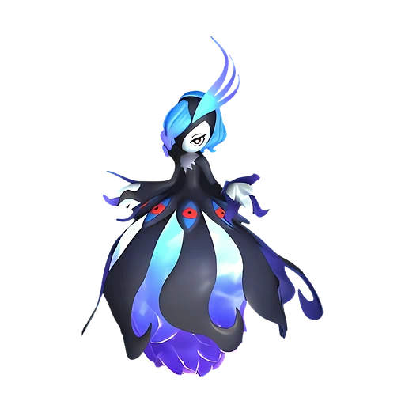

# Безумная Леди Бэллануар

⚔️ Рейд <button class="hlp" data-h="boss">?</button><h2>Бэллануар</h2>
СтихияТьма

СлабостьДракон <b class="mx">×1,5</b>

<input type="radio" name="bmode" id="bm0" checked><label for="bm0">Обычный</label>

⭐Уровень<b>35</b>

❤️Здоровье<b>333 000</b>

🎁 Награда Ультра-плита этого босса (100%) и ценные материалы

<a class="md-button" href="../../4_spravochniki/paly/bellanoir/">Страница пала</a>

## 💥 Кем бить <button class="hlp" data-tip="Палы, которые бьют по слабости босса, — сверху самые эффективные (×1,5 и выше). Нажми на пала — откроется его сборка: там видно, сколько ударов нужно против этого босса.">?</button>

<a class="ctr card-link" href="../../4_spravochniki/paly/relaxaurus/#bld"><b>Релаксаурус</b>ДраконВода×1,5</a><a class="ctr card-link" href="../../4_spravochniki/paly/silvegis/#bld"><b>Силвегис</b>Дракон×1,5</a><a class="ctr card-link" href="../../4_spravochniki/paly/azurobe/#bld"><b>Азуроб</b>ВодаДракон×1,5</a><a class="ctr card-link" href="../../4_spravochniki/paly/jetragon/#bld"><b>Джетрагон</b>Дракон×1,5</a><a class="ctr card-link" href="../../4_spravochniki/paly/shaolong/#bld"><b>Шаолонг</b>ДраконВода×1,5</a><a class="ctr card-link" href="../../4_spravochniki/paly/jormuntide_ignis/#bld"><b>Йормунтайд Игнис</b>ДраконОгонь×1,5</a><a class="ctr card-link" href="../../4_spravochniki/paly/blazamut_ryu/#bld"><b>Блазамут Рю</b>ДраконОгонь×1,5</a><a class="ctr card-link" href="../../4_spravochniki/paly/eidrolon_ignis/#bld"><b>Айдролон Игнис</b>ДраконОгонь×1,5</a>

## 🧠 Тактика

💡Вся команда 3–4 игрока: 2 бойца по слабости, 1 щит+лечение, 1 баффер (Орсерк+стрельба).

💡На ультра — палы 4★, души, лучшие пассивки

<a class="card-link" href="../../boss/astralym/">← Зенара и Астралим</a><a class="card-link" href="../../boss/bellanoir_libero/">Таинственная Леди Бэллануар Либеро →</a>

