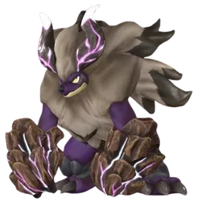
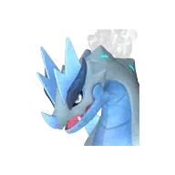

# Манифестация Вечного пламени Блазамут Рю

⚔️ Рейд <button class="hlp" data-h="boss">?</button><h2>Блазамут Рю</h2>
ДраконОгонь

Слабость: ВодаЛёд

<a class="md-button" href="../../4_spravochniki/paly/blazamut_ryu/">Страница пала</a>

=== "Обычный"

    

Уровень<b>55</b>

Здоровье<b>512 680</b>

    **Награда:** Ультра-плита этого босса (100%) и ценные материалы

=== "Ультра"

    

Уровень<b>80</b>

Здоровье<b>2 550 000</b>

    **Награда:** Лучшие материалы и чертежиⓘ

## 💥 Кем бить <button class="hlp" data-h="counter">?</button>

Палы, которые бьют по слабости босса. Нажми — откроется сборка пала, там видно, как он против этого босса.

<a class="mc card-link" href="../../4_spravochniki/paly/relaxaurus/#bld">Релаксаурус</a><a class="mc card-link" href="../../4_spravochniki/paly/ghangler/#bld">Ганглер</a><a class="mc card-link" href="../../4_spravochniki/paly/neptilius/#bld">Нептилиус</a><a class="mc card-link" href="../../4_spravochniki/paly/frostallion/#bld">Фросталлион</a><a class="mc card-link" href="../../4_spravochniki/paly/shaolong/#bld">Шаолонг</a><a class="mc card-link" href="../../4_spravochniki/paly/ghangler_ignis/#bld">Ганглер Игнис</a><a class="mc card-link" href="../../4_spravochniki/paly/bastigor/#bld">Бастигор</a><a class="mc card-link" href="../../4_spravochniki/paly/moldron_cryst/#bld">Молдрон Крист</a>

## 🧠 Тактика

Вся команда 3–4 игрока: 2 бойца по слабости, 1 щит+лечение, 1 баффер (Орсерк+стрельба). На ультра — палы 4★, души, лучшие пассивки

<a class="card-link" href="../../boss/boss/">← Лунный лорд</a><a class="card-link" href="../../boss/xenolord/">Захватчик из космоса Зенолорд →</a>

