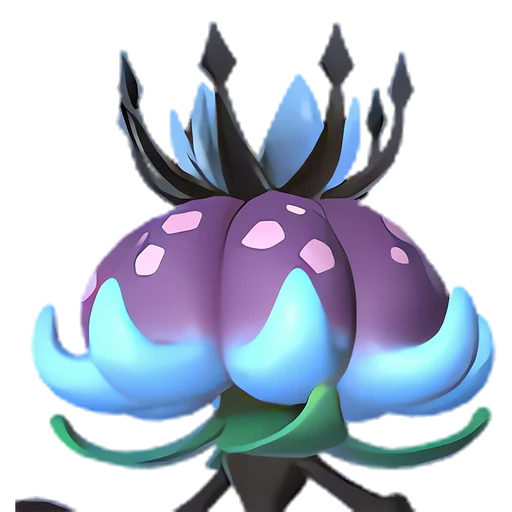

# Призрачный туман в тенях деревьев — Дандилорд

🌳 Мировое древо <button class="hlp" data-h="boss">?</button><h2>Дандилорд</h2>
СтихияТраваТьма

СлабостьОгонь <b class="mx">×1,5</b>Дракон <b class="mx">×1,5</b>

<input type="radio" name="bmode" id="bm0" checked><label for="bm0">Обычный</label>

⭐Уровень<b>78</b>

<a class="md-button" href="../../4_spravochniki/paly/dandilord/">Страница пала</a>

## 💥 Кем бить <button class="hlp" data-tip="Палы, которые бьют по слабости босса, — сверху самые эффективные (×1,5 и выше). Нажми на пала — откроется его сборка: там видно, сколько ударов нужно против этого босса.">?</button>

<a class="ctr card-link" href="../../4_spravochniki/paly/jetragon/#bld"><b>Джетрагон</b>Дракон×1,5</a><a class="ctr card-link" href="../../4_spravochniki/paly/shaolong/#bld"><b>Шаолонг</b>ДраконВода×1,5</a><a class="ctr card-link" href="../../4_spravochniki/paly/silvegis/#bld"><b>Силвегис</b>Дракон×1,5</a><a class="ctr card-link" href="../../4_spravochniki/paly/bushi_noct/#bld"><b>Буси Нокт</b>ОгоньТьма×1,5</a><a class="ctr card-link" href="../../4_spravochniki/paly/ghangler_ignis/#bld"><b>Ганглер Игнис</b>ОгоньВода×1,5</a><a class="ctr card-link" href="../../4_spravochniki/paly/jormuntide_ignis/#bld"><b>Йормунтайд Игнис</b>ДраконОгонь×1,5</a><a class="ctr card-link" href="../../4_spravochniki/paly/blazamut_ryu/#bld"><b>Блазамут Рю</b>ДраконОгонь×1,5</a><a class="ctr card-link" href="../../4_spravochniki/paly/eidrolon_ignis/#bld"><b>Айдролон Игнис</b>ДраконОгонь×1,5</a>

## 🧠 Тактика

💡Мини-босс Мирового Древа

<a class="card-link" href="../../boss/panthalus/">← Легендарный владыка морей Панталус</a><a class="card-link" href="../../boss/silvance/">Вечная пурпурная тень — Сильванс →</a>

