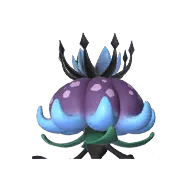
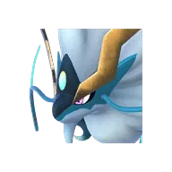
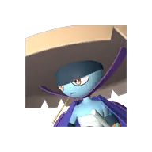
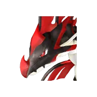
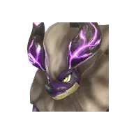
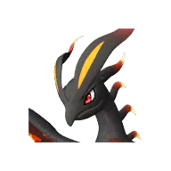

# Призрачный туман в тенях деревьев — Дандилорд

🌳 Мировое древо <button class="hlp" data-h="boss">?</button><h2>Дандилорд</h2>
ТраваТьма

Слабость: ДраконОгонь

<a class="md-button" href="../../4_spravochniki/paly/dandilord/">Страница пала</a>

=== "Обычный"

    

Уровень<b>78</b>

    **Награда:** ⓘ

## 💥 Кем бить <button class="hlp" data-h="counter">?</button>

Палы, которые бьют по слабости босса. Нажми — откроется сборка пала, там видно, как он против этого босса.

<a class="mc card-link" href="../../4_spravochniki/paly/shaolong/#bld">Шаолонг</a><a class="mc card-link" href="../../4_spravochniki/paly/jetragon/#bld">Джетрагон</a><a class="mc card-link" href="../../4_spravochniki/paly/silvegis/#bld">Силвегис</a><a class="mc card-link" href="../../4_spravochniki/paly/bushi_noct/#bld">Буси Нокт</a><a class="mc card-link" href="../../4_spravochniki/paly/ghangler_ignis/#bld">Ганглер Игнис</a><a class="mc card-link" href="../../4_spravochniki/paly/jormuntide_ignis/#bld">Йормунтайд Игнис</a><a class="mc card-link" href="../../4_spravochniki/paly/blazamut_ryu/#bld">Блазамут Рю</a><a class="mc card-link" href="../../4_spravochniki/paly/eidrolon_ignis/#bld">Айдролон Игнис</a>

## 🧠 Тактика

💡Мини-босс Мирового Древа

<a class="card-link" href="../../boss/panthalus/">← Легендарный владыка морей Панталус</a><a class="card-link" href="../../boss/silvance/">Вечная пурпурная тень — Сильванс →</a>

