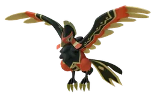

# Маркус и Фалерис

🏯 Башня <button class="hlp" data-h="boss">?</button><h2>Фалерис</h2>
Огонь

Слабость: Вода

📍 Башня Вигилантов

<a class="md-button" href="../../map/?q=Башня Вигилантов">📍 На карте</a><a class="md-button" href="../../4_spravochniki/paly/faleris/">Страница пала</a>

=== "Обычный"

    

Уровень<b>40</b>

Здоровье<b>72 900</b>

    **Награда:** Первая победа: опыт, очки древних технологий, продвижение сюжетаⓘ; сложный режим — ценные материалы (см. справочник «Башни»)

=== "Сложный"

    

Уровень<b>78</b>

Здоровье<b>526 900</b>

    **Награда:** Первая победа: опыт, очки древних технологий, продвижение сюжетаⓘ; сложный режим — ценные материалы (см. справочник «Башни»)

## 💥 Кем бить <button class="hlp" data-h="counter">?</button>

Палы, которые бьют по слабости босса. Нажми — откроется сборка пала, там видно, как он против этого босса.

<a class="mc card-link" href="../../4_spravochniki/paly/relaxaurus/#bld">Релаксаурус</a><a class="mc card-link" href="../../4_spravochniki/paly/ghangler/#bld">Ганглер</a><a class="mc card-link" href="../../4_spravochniki/paly/neptilius/#bld">Нептилиус</a><a class="mc card-link" href="../../4_spravochniki/paly/shaolong/#bld">Шаолонг</a><a class="mc card-link" href="../../4_spravochniki/paly/ghangler_ignis/#bld">Ганглер Игнис</a><a class="mc card-link" href="../../4_spravochniki/paly/jormuntide/#bld">Йормунтайд</a><a class="mc card-link" href="../../4_spravochniki/paly/panthalus/#bld">Панталус</a><a class="mc card-link" href="../../4_spravochniki/paly/whalaska/#bld">Валаска</a>

## 🧠 Тактика

Держись за палом, кувырок (Ctrl) от больших атак, средняя кнопка мыши — приказ атаковать. Ограничение по времениⓘ

<a class="card-link" href="../../boss/orserk/">← Аксель и Орсерк</a><a class="card-link" href="../../boss/shadowbeak/">Виктор и Шэдоубик →</a>

