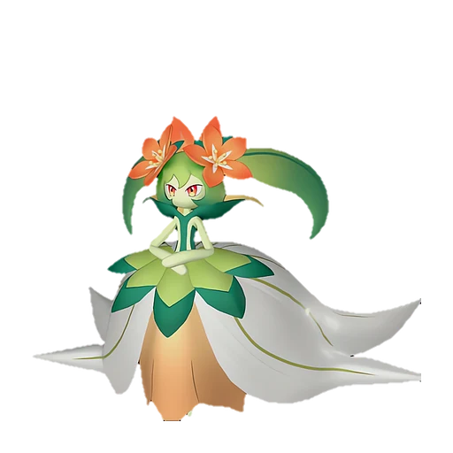
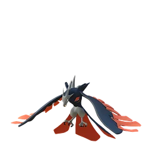
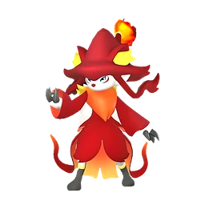
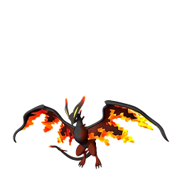

# Лили и Лилин

🏯 Башня <button class="hlp" data-h="boss">?</button><h2>Лилин</h2>🎖 Лили <small>лидер башни</small>
СтихияТрава

СлабостьОгонь <b class="mx">×1,5</b>

📍 Башня Организации по Защите Палов <small>(36, -311)</small>

<input type="radio" name="bmode" id="bm0" checked><label for="bm0">Обычный</label><input type="radio" name="bmode" id="bm1" ><label for="bm1">Сложный</label>

⭐Уровень<b>20</b>

❤️Здоровье<b>42 500</b>

🎁 Награда Первая победа: опыт, очки древних технологий, продвижение сюжета; сложный режим — ценные материалы (см. справочник «Башни»)

⭐Уровень<b>74</b>

❤️Здоровье<b>494 000</b>

🎁 Награда Первая победа: опыт, очки древних технологий, продвижение сюжета; сложный режим — ценные материалы (см. справочник «Башни»)

<a class="md-button" href="../../map/?q=Башня Организации по Защите Палов">📍 На карте</a><a class="md-button" href="../../4_spravochniki/paly/lyleen/">Страница пала</a>

## 💥 Кем бить <button class="hlp" data-tip="Палы, которые бьют по слабости босса, — сверху самые эффективные (×1,5 и выше). Нажми на пала — откроется его сборка: там видно, сколько ударов нужно против этого босса.">?</button>

<a class="ctr card-link" href="../../4_spravochniki/paly/vanwyrm/#bld"><b>Ванвирм</b>ОгоньТьма×1,5</a><a class="ctr card-link" href="../../4_spravochniki/paly/wixen/#bld"><b>Виксен</b>Огонь×1,5</a><a class="ctr card-link" href="../../4_spravochniki/paly/bushi_noct/#bld"><b>Буси Нокт</b>ОгоньТьма×1,5</a><a class="ctr card-link" href="../../4_spravochniki/paly/ghangler_ignis/#bld"><b>Ганглер Игнис</b>ОгоньВода×1,5</a><a class="ctr card-link" href="../../4_spravochniki/paly/jormuntide_ignis/#bld"><b>Йормунтайд Игнис</b>ДраконОгонь×1,5</a><a class="ctr card-link" href="../../4_spravochniki/paly/blazamut_ryu/#bld"><b>Блазамут Рю</b>ДраконОгонь×1,5</a><a class="ctr card-link" href="../../4_spravochniki/paly/eidrolon_ignis/#bld"><b>Айдролон Игнис</b>ДраконОгонь×1,5</a><a class="ctr card-link" href="../../4_spravochniki/paly/bushi/#bld"><b>Буси</b>Огонь×1,5</a>

## 🧠 Тактика

💡Держись за палом, уклоняйся кувырком (на ПК <kbd>Ctrl</kbd>) от больших атак, отдавай палу приказ атаковать цель (на ПК <kbd>СКМ</kbd>)

<a class="card-link" href="../../boss/grizzbolt/">← Зои и Гриззболт</a><a class="card-link" href="../../boss/orserk/">Аксель и Орсерк →</a>

