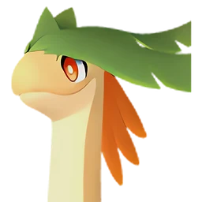
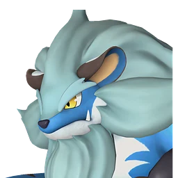
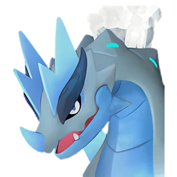
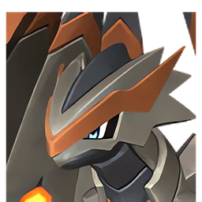

# Аксель и Орсерк

🏯 Башня <button class="hlp" data-h="boss">?</button><h2>Орсерк</h2>🎖 Аксель <small>лидер башни</small>
СтихияДраконМолния

СлабостьЛёд <b class="mx">×1,5</b>Земля <b class="mx">×1,5</b>

📍 Башня Братства Вечного Пламени <small>(-587, -517)</small>

<input type="radio" name="bmode" id="bm0" checked><label for="bm0">Обычный</label><input type="radio" name="bmode" id="bm1" ><label for="bm1">Сложный</label>

⭐Уровень<b>30</b>

❤️Здоровье<b>53 750</b>

🎁 Награда Первая победа: опыт, очки древних технологий, продвижение сюжета; сложный режим — ценные материалы (см. справочник «Башни»)

⭐Уровень<b>76</b>

❤️Здоровье<b>514 800</b>

🎁 Награда Первая победа: опыт, очки древних технологий, продвижение сюжета; сложный режим — ценные материалы (см. справочник «Башни»)

<a class="md-button" href="../../map/?q=Башня Братства Вечного Пламени">📍 На карте</a><a class="md-button" href="../../4_spravochniki/paly/orserk/">Страница пала</a>

## 💥 Кем бить <button class="hlp" data-tip="Палы, которые бьют по слабости босса, — сверху самые эффективные (×1,5 и выше). Нажми на пала — откроется его сборка: там видно, сколько ударов нужно против этого босса.">?</button>

<a class="ctr card-link" href="../../4_spravochniki/paly/moldron/#bld"><b>Молдрон</b>ОгоньЗемля×1,5</a><a class="ctr card-link" href="../../4_spravochniki/paly/braloha/#bld"><b>Бралоха</b>ТраваЗемля×1,5</a><a class="ctr card-link" href="../../4_spravochniki/paly/frostallion/#bld"><b>Фросталлион</b>Лёд×1,5</a><a class="ctr card-link" href="../../4_spravochniki/paly/anubis/#bld"><b>Анубис</b>Земля×1,5</a><a class="ctr card-link" href="../../4_spravochniki/paly/bastigor/#bld"><b>Бастигор</b>Лёд×1,5</a><a class="ctr card-link" href="../../4_spravochniki/paly/moldron_cryst/#bld"><b>Молдрон Крист</b>ЛёдЗемля×1,5</a><a class="ctr card-link" href="../../4_spravochniki/paly/aegidron/#bld"><b>Аэгидрон</b>ДраконЗемля×1,5</a><a class="ctr card-link" href="../../4_spravochniki/paly/vanwyrm_cryst/#bld"><b>Ванвирм Крист</b>ЛёдТьма×1,5</a>

## 🧠 Тактика

💡Держись за палом, уклоняйся кувырком (на ПК <kbd>Ctrl</kbd>) от больших атак, отдавай палу приказ атаковать цель (на ПК <kbd>СКМ</kbd>)

<a class="card-link" href="../../boss/lyleen/">← Лили и Лилин</a><a class="card-link" href="../../boss/faleris/">Маркус и Фалерис →</a>

