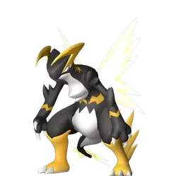

# Аксель и Орсерк

🏯 Башня <button class="hlp" data-h="boss">?</button><h2>Орсерк</h2>
ДраконМолния

Слабость: ЗемляЛёд

📍 Башня Братства Вечного Пламени

<a class="md-button" href="../../map/?q=Башня Братства Вечного Пламени">📍 На карте</a><a class="md-button" href="../../4_spravochniki/paly/orserk/">Страница пала</a>

=== "Обычный"

    

Уровень<b>30</b>

Здоровье<b>53 750</b>

    **Награда:** Первая победа: опыт, очки древних технологий, продвижение сюжетаⓘ; сложный режим — ценные материалы (см. справочник «Башни»)

=== "Сложный"

    

Уровень<b>76</b>

Здоровье<b>514 800</b>

    **Награда:** Первая победа: опыт, очки древних технологий, продвижение сюжетаⓘ; сложный режим — ценные материалы (см. справочник «Башни»)

## 💥 Кем бить <button class="hlp" data-h="counter">?</button>

Палы, которые бьют по слабости босса. Нажми — откроется сборка пала, там видно, как он против этого босса.

<a class="mc card-link" href="../../4_spravochniki/paly/moldron/#bld">Молдрон</a><a class="mc card-link" href="../../4_spravochniki/paly/braloha/#bld">Бралоха</a><a class="mc card-link" href="../../4_spravochniki/paly/frostallion/#bld">Фросталлион</a><a class="mc card-link" href="../../4_spravochniki/paly/anubis/#bld">Анубис</a><a class="mc card-link" href="../../4_spravochniki/paly/bastigor/#bld">Бастигор</a><a class="mc card-link" href="../../4_spravochniki/paly/moldron_cryst/#bld">Молдрон Крист</a><a class="mc card-link" href="../../4_spravochniki/paly/aegidron/#bld">Аэгидрон</a><a class="mc card-link" href="../../4_spravochniki/paly/vanwyrm_cryst/#bld">Ванвирм Крист</a>

## 🧠 Тактика

💡Держись за палом, кувырок (Ctrl) от больших атак, средняя кнопка мыши — приказ атаковать.

💡Ограничение по времени&lt;span class=&quot;unv&quot; title=&quot;Ещё перепроверяется&quot;&gt;ⓘ&lt;/span&gt;

<a class="card-link" href="../../boss/lyleen/">← Лили и Лилин</a><a class="card-link" href="../../boss/faleris/">Маркус и Фалерис →</a>

