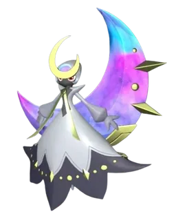
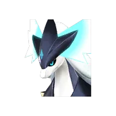
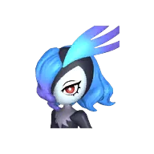
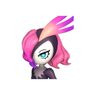
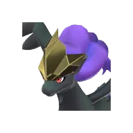
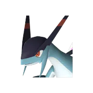

# Сая и Селена

🏯 Башня <button class="hlp" data-h="boss">?</button><h2>Селена</h2>
ТьмаНейтральный

Слабость: ДраконТьма

📍 Башня Лунных Цветов

<a class="md-button" href="../../map/?q=Башня Лунных Цветов">📍 На карте</a><a class="md-button" href="../../4_spravochniki/paly/selyne/">Страница пала</a>

=== "Обычный"

    

Уровень<b>55</b>

Здоровье<b>234 900</b>

    **Награда:** Первая победа: опыт, очки древних технологий, продвижение сюжетаⓘ; сложный режим — ценные материалы (см. справочник «Башни»)

=== "Сложный"

    

Уровень<b>80</b>

Здоровье<b>567 300</b>

    **Награда:** Первая победа: опыт, очки древних технологий, продвижение сюжетаⓘ; сложный режим — ценные материалы (см. справочник «Башни»)

## 💥 Кем бить <button class="hlp" data-h="counter">?</button>

Палы, которые бьют по слабости босса. Нажми — откроется сборка пала, там видно, как он против этого босса.

<a class="mc card-link" href="../../4_spravochniki/paly/relaxaurus_lux/#bld">Релаксаурус Лакс</a><a class="mc card-link" href="../../4_spravochniki/paly/relaxaurus/#bld">Релаксаурус</a><a class="mc card-link" href="../../4_spravochniki/paly/silvegis/#bld">Силвегис</a><a class="mc card-link" href="../../4_spravochniki/paly/bellanoir/#bld">Бэллануар</a><a class="mc card-link" href="../../4_spravochniki/paly/bellanoir_libero/#bld">Бэллануар Либеро</a><a class="mc card-link" href="../../4_spravochniki/paly/necromus/#bld">Некромус</a><a class="mc card-link" href="../../4_spravochniki/paly/frostallion_noct/#bld">Фросталлион Нокт</a><a class="mc card-link" href="../../4_spravochniki/paly/jetragon/#bld">Джетрагон</a>

## 🧠 Тактика

Держись за палом, кувырок (Ctrl) от больших атак, средняя кнопка мыши — приказ атаковать. Ограничение по времениⓘ
