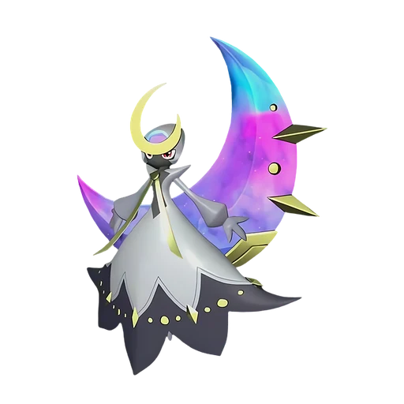
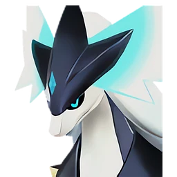

# Сая и Селена

🏯 Башня <button class="hlp" data-h="boss">?</button><h2>Селена</h2>🎖 Сая <small>лидер башни</small>
СтихияТьмаНейтральный

СлабостьТьма <b class="mx">×1,5</b>Дракон <b class="mx">×1,5</b>

📍 Башня Лунных Цветов <small>(-597, 206)</small>

<input type="radio" name="bmode" id="bm0" checked><label for="bm0">Обычный</label><input type="radio" name="bmode" id="bm1" ><label for="bm1">Сложный</label>

⭐Уровень<b>55</b>

❤️Здоровье<b>234 900</b>

🎁 Награда Первая победа: опыт, очки древних технологий, продвижение сюжета; сложный режим — ценные материалы (см. справочник «Башни»)

⭐Уровень<b>80</b>

❤️Здоровье<b>567 300</b>

🎁 Награда Первая победа: опыт, очки древних технологий, продвижение сюжета; сложный режим — ценные материалы (см. справочник «Башни»)

<a class="md-button" href="../../map/?q=Башня Лунных Цветов">📍 На карте</a><a class="md-button" href="../../4_spravochniki/paly/selyne/">Страница пала</a>

## 💥 Кем бить <button class="hlp" data-tip="Палы, которые бьют по слабости босса, — сверху самые эффективные (×1,5 и выше). Нажми на пала — откроется его сборка: там видно, сколько ударов нужно против этого босса.">?</button>

<a class="ctr card-link" href="../../4_spravochniki/paly/relaxaurus_lux/#bld"><b>Релаксаурус Лакс</b>ДраконМолния×1,5</a><a class="ctr card-link" href="../../4_spravochniki/paly/relaxaurus/#bld"><b>Релаксаурус</b>ДраконВода×1,5</a><a class="ctr card-link" href="../../4_spravochniki/paly/silvegis/#bld"><b>Силвегис</b>Дракон×1,5</a><a class="ctr card-link" href="../../4_spravochniki/paly/bellanoir/#bld"><b>Бэллануар</b>Тьма×1,5</a><a class="ctr card-link" href="../../4_spravochniki/paly/bellanoir_libero/#bld"><b>Бэллануар Либеро</b>Тьма×1,5</a><a class="ctr card-link" href="../../4_spravochniki/paly/necromus/#bld"><b>Некромус</b>Тьма×1,5</a><a class="ctr card-link" href="../../4_spravochniki/paly/frostallion_noct/#bld"><b>Фросталлион Нокт</b>Тьма×1,5</a><a class="ctr card-link" href="../../4_spravochniki/paly/jetragon/#bld"><b>Джетрагон</b>Дракон×1,5</a>

## 🧠 Тактика

💡Держись за палом, уклоняйся кувырком (на ПК <kbd>Ctrl</kbd>) от больших атак, отдавай палу приказ атаковать цель (на ПК <kbd>СКМ</kbd>)

<a class="card-link" href="../../boss/shadowbeak/">← Виктор и Шэдоубик</a><a class="card-link" href="../../boss/bastigor/">Бьёрн и Бастигор →</a>

