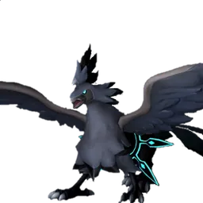

# Виктор и Шэдоубик

🏯 Башня <button class="hlp" data-h="boss">?</button><h2>Шэдоубик</h2>
Тьма

Слабость: Дракон

📍 Башня Отряда Генетических Исследований

<a class="md-button" href="../../map/?q=Башня Отряда Генетических Исследований">📍 На карте</a><a class="md-button" href="../../4_spravochniki/paly/shadowbeak/">Страница пала</a>

=== "Обычный"

    

Уровень<b>50</b>

Здоровье<b>105 000</b>

    **Награда:** Первая победа: опыт, очки древних технологий, продвижение сюжетаⓘ; сложный режим — ценные материалы (см. справочник «Башни»)

=== "Сложный"

    

Уровень<b>80</b>

Здоровье<b>570 000</b>

    **Награда:** Первая победа: опыт, очки древних технологий, продвижение сюжетаⓘ; сложный режим — ценные материалы (см. справочник «Башни»)

## 💥 Кем бить <button class="hlp" data-h="counter">?</button>

Палы, которые бьют по слабости босса. Нажми — откроется сборка пала, там видно, как он против этого босса.

<a class="mc card-link" href="../../4_spravochniki/paly/relaxaurus_lux/#bld">Релаксаурус Лакс</a><a class="mc card-link" href="../../4_spravochniki/paly/relaxaurus/#bld">Релаксаурус</a><a class="mc card-link" href="../../4_spravochniki/paly/silvegis/#bld">Силвегис</a><a class="mc card-link" href="../../4_spravochniki/paly/jetragon/#bld">Джетрагон</a><a class="mc card-link" href="../../4_spravochniki/paly/shaolong/#bld">Шаолонг</a><a class="mc card-link" href="../../4_spravochniki/paly/jormuntide_ignis/#bld">Йормунтайд Игнис</a><a class="mc card-link" href="../../4_spravochniki/paly/blazamut_ryu/#bld">Блазамут Рю</a><a class="mc card-link" href="../../4_spravochniki/paly/eidrolon_ignis/#bld">Айдролон Игнис</a>

## 🧠 Тактика

Держись за палом, кувырок (Ctrl) от больших атак, средняя кнопка мыши — приказ атаковать. Ограничение по времениⓘ

<a class="card-link" href="../../boss/faleris/">← Маркус и Фалерис</a><a class="card-link" href="../../boss/selyne/">Сая и Селена →</a>

