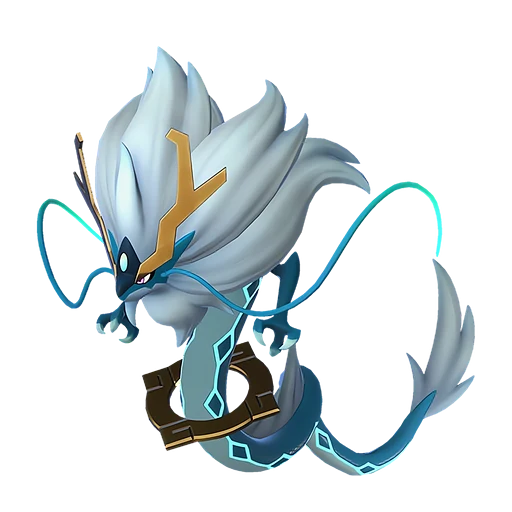
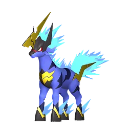
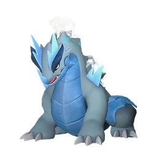
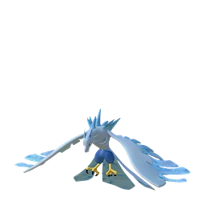

# Аури и Шаолонг

🏯 Башня <button class="hlp" data-h="boss">?</button><h2>Шаолонг</h2>🎖 Аури <small>лидер башни</small>
СтихияДраконВода

СлабостьМолния <b class="mx">×1,5</b>Лёд <b class="mx">×1,5</b>

📍 Башня Завета Лазурных Небес <small>(-423, -1425)</small>

<input type="radio" name="bmode" id="bm0" checked><label for="bm0">Обычный</label><input type="radio" name="bmode" id="bm1" ><label for="bm1">Сложный</label>

⭐Уровень<b>68</b>

❤️Здоровье<b>327 600</b>

🎁 Награда Первая победа: опыт, очки древних технологий, продвижение сюжета; сложный режим — ценные материалы (см. справочник «Башни»)

⭐Уровень<b>80</b>

❤️Здоровье<b>501 600</b>

🎁 Награда Первая победа: опыт, очки древних технологий, продвижение сюжета; сложный режим — ценные материалы (см. справочник «Башни»)

<a class="md-button" href="../../map/?q=Башня Завета Лазурных Небес">📍 На карте</a><a class="md-button" href="../../4_spravochniki/paly/shaolong/">Страница пала</a>

## 💥 Кем бить <button class="hlp" data-tip="Палы, которые бьют по слабости босса, — сверху самые эффективные (×1,5 и выше). Нажми на пала — откроется его сборка: там видно, сколько ударов нужно против этого босса.">?</button>

<a class="ctr card-link" href="../../4_spravochniki/paly/relaxaurus_lux/#bld"><b>Релаксаурус Лакс</b>ДраконМолния×1,5</a><a class="ctr card-link" href="../../4_spravochniki/paly/azurmane/#bld"><b>Азурмейн</b>Молния×1,5</a><a class="ctr card-link" href="../../4_spravochniki/paly/frostallion/#bld"><b>Фросталлион</b>Лёд×1,5</a><a class="ctr card-link" href="../../4_spravochniki/paly/orserk/#bld"><b>Орсерк</b>ДраконМолния×1,5</a><a class="ctr card-link" href="../../4_spravochniki/paly/bastigor/#bld"><b>Бастигор</b>Лёд×1,5</a><a class="ctr card-link" href="../../4_spravochniki/paly/helzephyr_lux/#bld"><b>Хэлзефир Лакс</b>ТьмаМолния×1,5</a><a class="ctr card-link" href="../../4_spravochniki/paly/moldron_cryst/#bld"><b>Молдрон Крист</b>ЛёдЗемля×1,5</a><a class="ctr card-link" href="../../4_spravochniki/paly/vanwyrm_cryst/#bld"><b>Ванвирм Крист</b>ЛёдТьма×1,5</a>

## 🧠 Тактика

💡Держись за палом, уклоняйся кувырком (на ПК <kbd>Ctrl</kbd>) от больших атак, отдавай палу приказ атаковать цель (на ПК <kbd>СКМ</kbd>)

<a class="card-link" href="../../boss/bastigor/">← Бьёрн и Бастигор</a><a class="card-link" href="../../boss/astralym/">Зенара и Астралим →</a>

