# Партнёрские навыки

У каждого пала есть партнёрский навык. Он включается по-разному: из команды, когда пал выпущен, верхом, по кнопке или на базе. Нажмите на карточку, чтобы открыть страницу пала.

<input type="search" class="pk-q" placeholder="Пал или навык…" autocomplete="off" aria-label="Поиск по палу или навыку">
<button type="button" class="pk-c on" data-g="">Все</button><button type="button" class="pk-c" data-g="Из команды">🎒 Из команды</button><button type="button" class="pk-c" data-g="Когда выпущен">🐾 Когда выпущен</button><button type="button" class="pk-c" data-g="Верхом">🐎 Верхом</button><button type="button" class="pk-c" data-g="По кнопке">🔘 По кнопке</button><button type="button" class="pk-c" data-g="На базе">🏠 На базе</button>

<button type="button" class="pk-c" data-t="урон">⚔️ урон</button><button type="button" class="pk-c" data-t="защита">🛡 защита</button><button type="button" class="pk-c" data-t="вес">🎒 вес</button><button type="button" class="pk-c" data-t="добыча">⛏ добыча</button><button type="button" class="pk-c" data-t="дроп">🎁 дроп</button><button type="button" class="pk-c" data-t="передвижение">💨 передвижение</button><button type="button" class="pk-c" data-t="лечение">💚 лечение</button><button type="button" class="pk-c" data-t="работа">🔨 работа</button><button type="button" class="pk-c" data-t="усиление стихии">✨ усиление стихии</button><button type="button" class="pk-c" data-t="поимка">🎯 поимка</button><button type="button" class="pk-c" data-t="опыт">⭐ опыт</button><button type="button" class="pk-c" data-t="разведка/скрытность">👁 разведка/скрытность</button><button type="button" class="pk-c" data-t="прочее">• прочее</button>

<a class="pk" href="../../4_spravochniki/paly/cattiva/" data-g="Из команды" data-t="вес" data-q="каттива cattiva котопомощь"><b>Каттива</b>Котопомощь🎒 вес</a><a class="pk" href="../../4_spravochniki/paly/celaray/" data-g="Из команды" data-t="урон|передвижение" data-q="селарай celaray глайдер ласкового ветра"><b>Селарай</b>Глайдер ласкового ветра⚔️ урон💨 передвижение</a><a class="pk" href="../../4_spravochniki/paly/celaray_lux/" data-g="Из команды" data-t="урон|передвижение" data-q="селарай лакс celaray lux глайдер электрического ветра"><b>Селарай Лакс</b>Глайдер электрического ветра⚔️ урон💨 передвижение</a><a class="pk" href="../../4_spravochniki/paly/cremis/" data-g="Из команды" data-t="урон" data-q="кремис cremis мягкая шерсть"><b>Кремис</b>Мягкая шерсть⚔️ урон</a><a class="pk" href="../../4_spravochniki/paly/croajiro_noct/" data-g="Из команды" data-t="урон|передвижение" data-q="кроадзиро нокт croajiro noct теневая стойка"><b>Кроадзиро Нокт</b>Теневая стойка⚔️ урон💨 передвижение</a><a class="pk" href="../../4_spravochniki/paly/herbil/" data-g="Из команды" data-t="прочее" data-q="хербил herbil импульс хербила"><b>Хербил</b>Импульс Хербила• прочее</a><a class="pk" href="../../4_spravochniki/paly/teafant/" data-g="Из команды" data-t="лечение" data-q="тифант teafant исцеляющий душ"><b>Тифант</b>Исцеляющий душ💚 лечение</a><a class="pk" href="../../4_spravochniki/paly/gumoss/" data-g="Из команды" data-t="урон|вес|добыча" data-q="гумосс gumoss помощь в рубке"><b>Гумосс</b>Помощь в рубке⚔️ урон🎒 вес⛏ добыча</a><a class="pk" href="../../4_spravochniki/paly/pupperai/" data-g="Из команды" data-t="урон" data-q="паппирай pupperai старательная поддержка"><b>Паппирай</b>Старательная поддержка⚔️ урон</a><a class="pk" href="../../4_spravochniki/paly/penking/" data-g="Из команды" data-t="дроп" data-q="пенкинг penking отважный воин морей"><b>Пенкинг</b>Отважный воин морей🎁 дроп</a><a class="pk" href="../../4_spravochniki/paly/penking_lux/" data-g="Из команды" data-t="урон" data-q="пенкинг лакс penking lux непреклонный водный генерал"><b>Пенкинг Лакс</b>Непреклонный водный генерал⚔️ урон</a><a class="pk" href="../../4_spravochniki/paly/hoocrates/" data-g="Из команды" data-t="урон" data-q="хукрат hoocrates мудрость тьмы"><b>Хукрат</b>Мудрость тьмы⚔️ урон</a><a class="pk" href="../../4_spravochniki/paly/melpaca/" data-g="Из команды" data-t="защита|передвижение" data-q="мелпака melpaca шерсть пака-пака"><b>Мелпака</b>Шерсть пака-пака🛡 защита💨 передвижение</a><a class="pk" href="../../4_spravochniki/paly/daedream/" data-g="Из команды" data-t="урон" data-q="даэдрим daedream погоня за мечтой"><b>Даэдрим</b>Погоня за мечтой⚔️ урон</a><a class="pk" href="../../4_spravochniki/paly/flambelle/" data-g="Из команды" data-t="лечение" data-q="фламбелль flambelle магмовые слезы"><b>Фламбелль</b>Магмовые слезы💚 лечение</a><a class="pk" href="../../4_spravochniki/paly/rooby/" data-g="Из команды" data-t="защита" data-q="руби rooby маленькие искры"><b>Руби</b>Маленькие искры🛡 защита</a><a class="pk" href="../../4_spravochniki/paly/killamari/" data-g="Из команды" data-t="передвижение" data-q="килламари killamari жареный кальмар"><b>Килламари</b>Жареный кальмар💨 передвижение</a><a class="pk" href="../../4_spravochniki/paly/killamari_primo/" data-g="Из команды" data-t="передвижение" data-q="килламари примо killamari primo мечта на сковородке"><b>Килламари Примо</b>Мечта на сковородке💨 передвижение</a><a class="pk" href="../../4_spravochniki/paly/fuddler/" data-g="Из команды" data-t="урон|вес|добыча" data-q="фуддлер fuddler помощь в добыче руды"><b>Фуддлер</b>Помощь в добыче руды⚔️ урон🎒 вес⛏ добыча</a><a class="pk" href="../../4_spravochniki/paly/caprity/" data-g="Из команды" data-t="лечение" data-q="каприти caprity сбор ягод"><b>Каприти</b>Сбор ягод💚 лечение</a><a class="pk" href="../../4_spravochniki/paly/caprity_noct/" data-g="Из команды" data-t="прочее" data-q="каприти нокт caprity noct сбор ядовитых желез"><b>Каприти Нокт</b>Сбор ядовитых желез• прочее</a><a class="pk" href="../../4_spravochniki/paly/swee/" data-g="Из команды" data-t="урон|защита" data-q="сви swee мофу-мофу-мофу"><b>Сви</b>Мофу-мофу-мофу⚔️ урон🛡 защита</a><a class="pk" href="../../4_spravochniki/paly/turtacle/" data-g="Из команды" data-t="вес|добыча" data-q="туртакл turtacle колючий носильщик"><b>Туртакл</b>Колючий носильщик🎒 вес⛏ добыча</a><a class="pk" href="../../4_spravochniki/paly/turtacle_terra/" data-g="Из команды" data-t="урон|вес" data-q="туртакл терра turtacle terra сверкающий носильщик"><b>Туртакл Терра</b>Сверкающий носильщик⚔️ урон🎒 вес</a><a class="pk" href="../../4_spravochniki/paly/hangyu/" data-g="Из команды" data-t="передвижение" data-q="хангю hangyu небесные качели"><b>Хангю</b>Небесные качели💨 передвижение</a><a class="pk" href="../../4_spravochniki/paly/hangyu_cryst/" data-g="Из команды" data-t="передвижение" data-q="хангю крист hangyu cryst морозные качели"><b>Хангю Крист</b>Морозные качели💨 передвижение</a><a class="pk" href="../../4_spravochniki/paly/sparkit/" data-g="Из команды" data-t="урон|усиление стихии" data-q="спаркит sparkit статическое электричество"><b>Спаркит</b>Статическое электричество⚔️ урон✨ усиление стихии</a><a class="pk" href="../../4_spravochniki/paly/kelpsea/" data-g="Из команды" data-t="урон|усиление стихии" data-q="келпси kelpsea обливание водой"><b>Келпси</b>Обливание водой⚔️ урон✨ усиление стихии</a><a class="pk" href="../../4_spravochniki/paly/kelpsea_ignis/" data-g="Из команды" data-t="урон|усиление стихии" data-q="келпси игнис kelpsea ignis обливание лавой"><b>Келпси Игнис</b>Обливание лавой⚔️ урон✨ усиление стихии</a><a class="pk" href="../../4_spravochniki/paly/ribbuny/" data-g="Из команды" data-t="урон|работа" data-q="риббани ribbuny улыбчивая леди-кролик"><b>Риббани</b>Улыбчивая леди-кролик⚔️ урон🔨 работа</a><a class="pk" href="../../4_spravochniki/paly/ribbuny_botan/" data-g="Из команды" data-t="урон|работа" data-q="риббани ботан ribbuny botan дубасящий травяной кролик"><b>Риббани Ботан</b>Дубасящий травяной кролик⚔️ урон🔨 работа</a><a class="pk" href="../../4_spravochniki/paly/jelliette/" data-g="Из команды" data-t="дроп|передвижение" data-q="джелиэтта jelliette дроп джелиэтты"><b>Джелиэтта</b>Дроп Джелиэтты🎁 дроп💨 передвижение</a><a class="pk" href="../../4_spravochniki/paly/jellroy/" data-g="Из команды" data-t="дроп|передвижение" data-q="джелрой jellroy дроп джелроя"><b>Джелрой</b>Дроп Джелроя🎁 дроп💨 передвижение</a><a class="pk" href="../../4_spravochniki/paly/gloopie/" data-g="Из команды" data-t="прочее" data-q="глуппи gloopie липкая принцесса"><b>Глуппи</b>Липкая принцесса• прочее</a><a class="pk" href="../../4_spravochniki/paly/gloopie_primo/" data-g="Из команды" data-t="защита" data-q="глуппи примо gloopie primo чавкающая принцесса"><b>Глуппи Примо</b>Чавкающая принцесса🛡 защита</a><a class="pk" href="../../4_spravochniki/paly/galeclaw/" data-g="Из команды" data-t="передвижение" data-q="эрмург galeclaw глайд на эрмурге"><b>Эрмург</b>Глайд на Эрмурге💨 передвижение</a><a class="pk" href="../../4_spravochniki/paly/wispaw/" data-g="Из команды" data-t="урон|поимка" data-q="виспау wispaw одержимая кошка">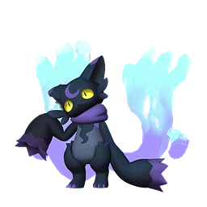<b>Виспау</b>Одержимая кошка⚔️ урон🎯 поимка</a><a class="pk" href="../../4_spravochniki/paly/univolt/" data-g="Из команды" data-t="урон" data-q="юнивольт univolt молниеносный рывок"><b>Юнивольт</b>Молниеносный рывок⚔️ урон</a><a class="pk" href="../../4_spravochniki/paly/gobfin/" data-g="Из команды" data-t="урон" data-q="гобфин gobfin акулка-злюка">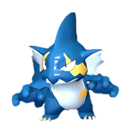<b>Гобфин</b>Акулка-злюка⚔️ урон</a><a class="pk" href="../../4_spravochniki/paly/gobfin_ignis/" data-g="Из команды" data-t="урон" data-q="гобфин игнис gobfin ignis акулка-злюка"><b>Гобфин Игнис</b>Акулка-злюка⚔️ урон</a><a class="pk" href="../../4_spravochniki/paly/loupmoon/" data-g="Из команды" data-t="урон|передвижение" data-q="лупмун loupmoon острые когти тьмы"><b>Лупмун</b>Острые когти тьмы⚔️ урон💨 передвижение</a><a class="pk" href="../../4_spravochniki/paly/loupmoon_cryst/" data-g="Из команды" data-t="урон" data-q="лупмун крист loupmoon cryst острые когти льда"><b>Лупмун Крист</b>Острые когти льда⚔️ урон</a><a class="pk" href="../../4_spravochniki/paly/arsox/" data-g="Из команды" data-t="прочее" data-q="арсокс arsox согревающее тело"><b>Арсокс</b>Согревающее тело• прочее</a><a class="pk" href="../../4_spravochniki/paly/muffly/" data-g="Из команды" data-t="поимка" data-q="маффли muffly пушистик-кругляш"><b>Маффли</b>Пушистик-кругляш🎯 поимка</a><a class="pk" href="../../4_spravochniki/paly/bristla/" data-g="Из команды" data-t="урон|усиление стихии" data-q="бристла bristla взгляд принцессы"><b>Бристла</b>Взгляд принцессы⚔️ урон✨ усиление стихии</a><a class="pk" href="../../4_spravochniki/paly/elphidran/" data-g="Из команды" data-t="дроп|передвижение" data-q="элфидран elphidran добросердечный святой дракон"><b>Элфидран</b>Добросердечный святой дракон🎁 дроп💨 передвижение</a><a class="pk" href="../../4_spravochniki/paly/elphidran_aqua/" data-g="Из команды" data-t="урон|защита|передвижение" data-q="элфидран аква elphidran aqua добросердечный водный дракон"><b>Элфидран Аква</b>Добросердечный водный дракон⚔️ урон🛡 защита💨 передвижение</a><a class="pk" href="../../4_spravochniki/paly/vanwyrm/" data-g="Из команды" data-t="урон" data-q="ванвирм vanwyrm воздушный налётчик"><b>Ванвирм</b>Воздушный налётчик⚔️ урон</a><a class="pk" href="../../4_spravochniki/paly/vanwyrm_cryst/" data-g="Из команды" data-t="урон" data-q="ванвирм крист vanwyrm cryst воздушный налётчик"><b>Ванвирм Крист</b>Воздушный налётчик⚔️ урон</a><a class="pk" href="../../4_spravochniki/paly/vaelet/" data-g="Из команды" data-t="дроп|усиление стихии" data-q="ваэлет vaelet очищение земли"><b>Ваэлет</b>Очищение земли🎁 дроп✨ усиление стихии</a><a class="pk" href="../../4_spravochniki/paly/beegarde/" data-g="Из команды" data-t="прочее" data-q="бигард beegarde рабочая пчелка"><b>Бигард</b>Рабочая пчелка• прочее</a><a class="pk" href="../../4_spravochniki/paly/grintale/" data-g="Из команды" data-t="прочее" data-q="гринтэйл grintale сияющий кошачий глаз"><b>Гринтэйл</b>Сияющий кошачий глаз• прочее</a><a class="pk" href="../../4_spravochniki/paly/gorirat_terra/" data-g="Из команды" data-t="передвижение" data-q="горират терра gorirat terra максимальная мощь гориллы"><b>Горират Терра</b>Максимальная мощь гориллы💨 передвижение</a><a class="pk" href="../../4_spravochniki/paly/surfent_terra/" data-g="Из команды" data-t="прочее" data-q="серфент терра surfent terra пловец песков"><b>Серфент Терра</b>Пловец песков• прочее</a><a class="pk" href="../../4_spravochniki/paly/robinquill/" data-g="Из команды" data-t="урон" data-q="робинквилл robinquill мастер стрельбы из лука"><b>Робинквилл</b>Мастер стрельбы из лука⚔️ урон</a><a class="pk" href="../../4_spravochniki/paly/robinquill_terra/" data-g="Из команды" data-t="передвижение" data-q="робинквилл терра robinquill terra мастер натягивания лука"><b>Робинквилл Терра</b>Мастер натягивания лука💨 передвижение</a><a class="pk" href="../../4_spravochniki/paly/flopie/" data-g="Из команды" data-t="дроп" data-q="флопи flopie заяц-помощник"><b>Флопи</b>Заяц-помощник🎁 дроп</a><a class="pk" href="../../4_spravochniki/paly/katress/" data-g="Из команды" data-t="дроп|поимка" data-q="катресс katress зловещая тёмная магия"><b>Катресс</b>Зловещая тёмная магия🎁 дроп🎯 поимка</a><a class="pk" href="../../4_spravochniki/paly/elgrove_cryst/" data-g="Из команды" data-t="урон" data-q="элгрув крист elgrove cryst угроза вечной мерзлоты"><b>Элгрув Крист</b>Угроза вечной мерзлоты⚔️ урон</a><a class="pk" href="../../4_spravochniki/paly/lunaris/" data-g="Из команды" data-t="вес|поимка" data-q="лунарис lunaris антигравитация"><b>Лунарис</b>Антигравитация🎒 вес🎯 поимка</a><a class="pk" href="../../4_spravochniki/paly/fenglope_lux/" data-g="Из команды" data-t="дроп|передвижение" data-q="фенглоп лакс fenglope lux грозовое облако"><b>Фенглоп Лакс</b>Грозовое облако🎁 дроп💨 передвижение</a><a class="pk" href="../../4_spravochniki/paly/dinossom/" data-g="Из команды" data-t="защита" data-q="диноссум dinossom цветочный дракон"><b>Диноссум</b>Цветочный дракон🛡 защита</a><a class="pk" href="../../4_spravochniki/paly/dinossom_lux/" data-g="Из команды" data-t="защита" data-q="диноссум лакс dinossom lux грозоцветный дракон"><b>Диноссум Лакс</b>Грозоцветный дракон🛡 защита</a><a class="pk" href="../../4_spravochniki/paly/bushi_noct/" data-g="Из команды" data-t="урон" data-q="буси нокт bushi noct тёмная фиолетовая молния"><b>Буси Нокт</b>Тёмная фиолетовая молния⚔️ урон</a><a class="pk" href="../../4_spravochniki/paly/munchill/" data-g="Из команды" data-t="вес" data-q="манчилл munchill холодная пасть"><b>Манчилл</b>Холодная пасть🎒 вес</a><a class="pk" href="../../4_spravochniki/paly/finsider_ignis/" data-g="Из команды" data-t="урон|вес" data-q="финсайдер игнис finsider ignis пылающая комната">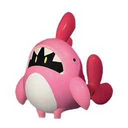<b>Финсайдер Игнис</b>Пылающая комната⚔️ урон🎒 вес</a><a class="pk" href="../../4_spravochniki/paly/petallia_ignis/" data-g="Из команды" data-t="урон|лечение" data-q="петаллия игнис petallia ignis пыл духа цветов"><b>Петаллия Игнис</b>Пыл духа цветов⚔️ урон💚 лечение</a><a class="pk" href="../../4_spravochniki/paly/dazzi/" data-g="Из команды" data-t="прочее" data-q="даззи dazzi дочь грома"><b>Даззи</b>Дочь грома• прочее</a><a class="pk" href="../../4_spravochniki/paly/dazzi_noct/" data-g="Из команды" data-t="прочее" data-q="даззи нокт dazzi noct дочь тёмного грома"><b>Даззи Нокт</b>Дочь тёмного грома• прочее</a><a class="pk" href="../../4_spravochniki/paly/foxcicle/" data-g="Из команды" data-t="урон|усиление стихии" data-q="фоксайкл foxcicle путеводная аврора">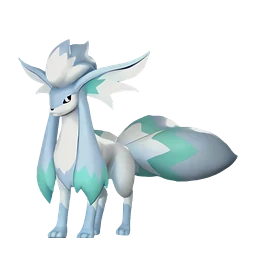<b>Фоксайкл</b>Путеводная Аврора⚔️ урон✨ усиление стихии</a><a class="pk" href="../../4_spravochniki/paly/rayhound_cryst/" data-g="Из команды" data-t="защита|передвижение" data-q="райхаунд крист rayhound cryst буревой пёс">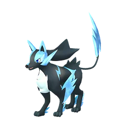<b>Райхаунд Крист</b>Буревой пёс🛡 защита💨 передвижение</a><a class="pk" href="../../4_spravochniki/paly/menasting/" data-g="Из команды" data-t="защита|добыча" data-q="менастинг menasting стальной скорпион"><b>Менастинг</b>Стальной скорпион🛡 защита⛏ добыча</a><a class="pk" href="../../4_spravochniki/paly/menasting_terra/" data-g="Из команды" data-t="защита|добыча" data-q="менастинг терра menasting terra золотой скорпион"><b>Менастинг Терра</b>Золотой скорпион🛡 защита⛏ добыча</a><a class="pk" href="../../4_spravochniki/paly/needoll/" data-g="Из команды" data-t="урон" data-q="нидолл needoll обними меня"><b>Нидолл</b>Обними меня⚔️ урон</a><a class="pk" href="../../4_spravochniki/paly/needoll_noct/" data-g="Из команды" data-t="урон" data-q="нидолл нокт needoll noct обнимаю тебя крепко"><b>Нидолл Нокт</b>Обнимаю тебя крепко⚔️ урон</a><a class="pk" href="../../4_spravochniki/paly/reindrix/" data-g="Из команды" data-t="прочее" data-q="рейндрикс reindrix прохладное тело"><b>Рейндрикс</b>Прохладное тело• прочее</a><a class="pk" href="../../4_spravochniki/paly/moldron_cryst/" data-g="Из команды" data-t="урон" data-q="молдрон крист moldron cryst владыка льда"><b>Молдрон Крист</b>Владыка льда⚔️ урон</a><a class="pk" href="../../4_spravochniki/paly/broncherry/" data-g="Из команды" data-t="прочее" data-q="брончерри broncherry цветущий дракон первой любви"><b>Брончерри</b>Цветущий дракон первой любви• прочее</a><a class="pk" href="../../4_spravochniki/paly/broncherry_aqua/" data-g="Из команды" data-t="прочее" data-q="брончерри аква broncherry aqua цветущий дракон чистоты"><b>Брончерри Аква</b>Цветущий дракон чистоты• прочее</a><a class="pk" href="../../4_spravochniki/paly/dumud/" data-g="Из команды" data-t="урон" data-q="думад dumud улучшение почвы"><b>Думад</b>Улучшение почвы⚔️ урон</a><a class="pk" href="../../4_spravochniki/paly/dumud_gild/" data-g="Из команды" data-t="дроп" data-q="думад гилд dumud gild золотой урожай"><b>Думад Гилд</b>Золотой урожай🎁 дроп</a><a class="pk" href="../../4_spravochniki/paly/kitsun/" data-g="Из команды" data-t="урон|защита" data-q="кицун kitsun солнечный волк">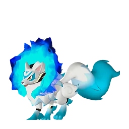<b>Кицун</b>Солнечный волк⚔️ урон🛡 защита</a><a class="pk" href="../../4_spravochniki/paly/kitsun_noct/" data-g="Из команды" data-t="урон|защита" data-q="кицун нокт kitsun noct мрачный волк"><b>Кицун Нокт</b>Мрачный волк⚔️ урон🛡 защита</a><a class="pk" href="../../4_spravochniki/paly/blazehowl/" data-g="Из команды" data-t="усиление стихии|добыча" data-q="блейзхаул blazehowl лев преисподней">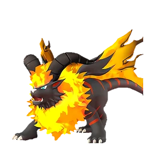<b>Блейзхаул</b>Лев Преисподней✨ усиление стихии⛏ добыча</a><a class="pk" href="../../4_spravochniki/paly/blazehowl_noct/" data-g="Из команды" data-t="усиление стихии|добыча" data-q="блейзхаул нокт blazehowl noct лев чёрного пламени">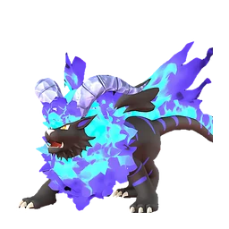<b>Блейзхаул Нокт</b>Лев Чёрного пламени✨ усиление стихии⛏ добыча</a><a class="pk" href="../../4_spravochniki/paly/warsect/" data-g="Из команды" data-t="прочее" data-q="ворсект warsect чёрная броня единства"><b>Ворсект</b>Чёрная броня единства• прочее</a><a class="pk" href="../../4_spravochniki/paly/warsect_terra/" data-g="Из команды" data-t="урон" data-q="ворсект терра warsect terra золотая броня единства"><b>Ворсект Терра</b>Золотая броня единства⚔️ урон</a><a class="pk" href="../../4_spravochniki/paly/frostplume/" data-g="Из команды" data-t="передвижение" data-q="фростплюм frostplume павлиний выпад">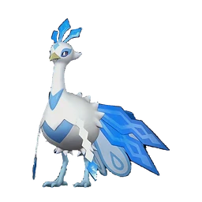<b>Фростплюм</b>Павлиний выпад💨 передвижение</a><a class="pk" href="../../4_spravochniki/paly/majex/" data-g="Из команды" data-t="урон" data-q="маджекс majex заклинание тёмной лисицы">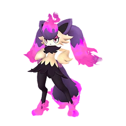<b>Маджекс</b>Заклинание тёмной лисицы⚔️ урон</a><a class="pk" href="../../4_spravochniki/paly/sibelyx_primo/" data-g="Из команды" data-t="защита" data-q="сибеликс примо sibelyx primo мистические золотые нити"><b>Сибеликс Примо</b>Мистические золотые нити🛡 защита</a><a class="pk" href="../../4_spravochniki/paly/maraith/" data-g="Из команды" data-t="прочее" data-q="мараит maraith посланник загробного мира"><b>Мараит</b>Посланник загробного мира• прочее</a><a class="pk" href="../../4_spravochniki/paly/jormuntide/" data-g="Из команды" data-t="урон" data-q="йормунтайд jormuntide морской дракон, зовущий бурю"><b>Йормунтайд</b>Морской дракон, зовущий бурю⚔️ урон</a><a class="pk" href="../../4_spravochniki/paly/jormuntide_ignis/" data-g="Из команды" data-t="урон" data-q="йормунтайд игнис jormuntide ignis лавовый дракон, зовущий бурю"><b>Йормунтайд Игнис</b>Лавовый дракон, зовущий бурю⚔️ урон</a><a class="pk" href="../../4_spravochniki/paly/quivern/" data-g="Из команды" data-t="урон" data-q="фэски quivern милосердие небесного дракона"><b>Фэски</b>Милосердие небесного дракона⚔️ урон</a><a class="pk" href="../../4_spravochniki/paly/kikit/" data-g="Из команды" data-t="защита" data-q="бронебол kikit пляжный катящийся мяч"><b>Бронебол</b>Пляжный катящийся мяч🛡 защита</a><a class="pk" href="../../4_spravochniki/paly/reptyro/" data-g="Из команды" data-t="вес|добыча" data-q="рептиро reptyro зверь, пожирающий руду">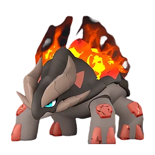<b>Рептиро</b>Зверь, пожирающий руду🎒 вес⛏ добыча</a><a class="pk" href="../../4_spravochniki/paly/reptyro_cryst/" data-g="Из команды" data-t="вес|добыча" data-q="рептиро крист reptyro cryst зверь, пожирающий лёд">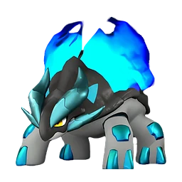<b>Рептиро Крист</b>Зверь, пожирающий лёд🎒 вес⛏ добыча</a><a class="pk" href="../../4_spravochniki/paly/pierdon/" data-g="Из команды" data-t="урон" data-q="пиродон pierdon сила камня"><b>Пиродон</b>Сила камня⚔️ урон</a><a class="pk" href="../../4_spravochniki/paly/pierdon_cryst/" data-g="Из команды" data-t="прочее" data-q="пиродон крист pierdon cryst сила кристалла"><b>Пиродон Крист</b>Сила кристалла• прочее</a><a class="pk" href="../../4_spravochniki/paly/cryolinx/" data-g="Из команды" data-t="дроп" data-q="криолинкс cryolinx охотник на драконов">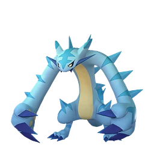<b>Криолинкс</b>Охотник на драконов🎁 дроп</a><a class="pk" href="../../4_spravochniki/paly/cryolinx_terra/" data-g="Из команды" data-t="урон" data-q="криолинкс терра cryolinx terra могучая рука разрушения"><b>Криолинкс Терра</b>Могучая рука разрушения⚔️ урон</a><a class="pk" href="../../4_spravochniki/paly/snugloo/" data-g="Из команды" data-t="разведка/скрытность" data-q="снаглоу snugloo невидимый глаз"><b>Снаглоу</b>Невидимый глаз👁 разведка/скрытность</a><a class="pk" href="../../4_spravochniki/paly/wumpo_botan/" data-g="Из команды" data-t="урон|защита" data-q="вумпо ботан wumpo botan южный гигант"><b>Вумпо Ботан</b>Южный гигант⚔️ урон🛡 защита</a><a class="pk" href="../../4_spravochniki/paly/sootseer/" data-g="Из команды" data-t="урон" data-q="гостлайт sootseer расхититель могил"><b>Гостлайт</b>Расхититель могил⚔️ урон</a><a class="pk" href="../../4_spravochniki/paly/carnibora/" data-g="Из команды" data-t="урон" data-q="карнибора carnibora цепкий язык"><b>Карнибора</b>Цепкий язык⚔️ урон</a><a class="pk" href="../../4_spravochniki/paly/blazamut/" data-g="Из команды" data-t="урон|защита" data-q="блазамут blazamut кайзер магмы"><b>Блазамут</b>Кайзер магмы⚔️ урон🛡 защита</a><a class="pk" href="../../4_spravochniki/paly/blazamut_ryu/" data-g="Из команды" data-t="урон" data-q="блазамут рю blazamut ryu кайзер драконов"><b>Блазамут Рю</b>Кайзер драконов⚔️ урон</a><a class="pk" href="../../4_spravochniki/paly/prixter/" data-g="Из команды" data-t="урон" data-q="скорпио prixter неядовитый скорпион">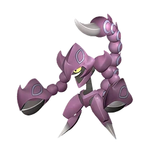<b>Скорпио</b>Неядовитый скорпион⚔️ урон</a><a class="pk" href="../../4_spravochniki/paly/tetroise_primo/" data-g="Из команды" data-t="прочее" data-q="тетроис примо tetroise primo камневал - древняя черепаха"><b>Тетроис Примо</b>Камневал - Древняя черепаха• прочее</a><a class="pk" href="../../4_spravochniki/paly/nyafia/" data-g="Из команды" data-t="урон" data-q="няфия nyafia кошачий обстрел">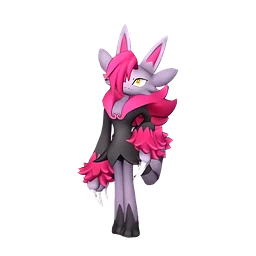<b>Няфия</b>Кошачий обстрел⚔️ урон</a><a class="pk" href="../../4_spravochniki/paly/xenovader/" data-g="Из команды" data-t="урон" data-q="зеноведа xenovader неизвестный захватчик"><b>Зеноведа</b>Неизвестный захватчик⚔️ урон</a><a class="pk" href="../../4_spravochniki/paly/xenogard/" data-g="Из команды" data-t="урон" data-q="зеногард xenogard неизвестный нарушитель"><b>Зеногард</b>Неизвестный нарушитель⚔️ урон</a><a class="pk" href="../../4_spravochniki/paly/nitemary/" data-g="Из команды" data-t="прочее" data-q="найтмери nitemary призрачный кролик-похититель душ"><b>Найтмери</b>Призрачный кролик-похититель душ• прочее</a><a class="pk" href="../../4_spravochniki/paly/nitemary_botan/" data-g="Из команды" data-t="защита" data-q="найтмери ботан nitemary botan призрачный кролик-пленитель душ">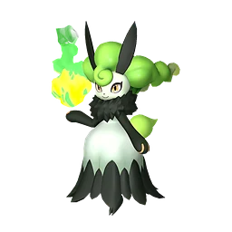<b>Найтмери Ботан</b>Призрачный кролик-пленитель душ🛡 защита</a><a class="pk" href="../../4_spravochniki/paly/omascul/" data-g="Из команды" data-t="опыт" data-q="омаскул omascul танец масок"><b>Омаскул</b>Танец масок⭐ опыт</a><a class="pk" href="../../4_spravochniki/paly/whalaska/" data-g="Из команды" data-t="передвижение" data-q="валаска whalaska холодный китоход"><b>Валаска</b>Холодный китоход💨 передвижение</a><a class="pk" href="../../4_spravochniki/paly/whalaska_ignis/" data-g="Из команды" data-t="передвижение" data-q="валаска игнис whalaska ignis тёплый китоход"><b>Валаска Игнис</b>Тёплый китоход💨 передвижение</a><a class="pk" href="../../4_spravochniki/paly/verdash/" data-g="Из команды" data-t="передвижение" data-q="вердаш verdash звёздный акробат равнин"><b>Вердаш</b>Звёздный акробат равнин💨 передвижение</a><a class="pk" href="../../4_spravochniki/paly/splatterina/" data-g="Из команды" data-t="дроп" data-q="сплаттерина splatterina клинок безумной любви"><b>Сплаттерина</b>Клинок безумной любви🎁 дроп</a><a class="pk" href="../../4_spravochniki/paly/bulldosu/" data-g="Из команды" data-t="урон|защита" data-q="буллдос bulldosu аура ёкодзуна"><b>Буллдос</b>Аура ёкодзуна⚔️ урон🛡 защита</a><a class="pk" href="../../4_spravochniki/paly/celesdir/" data-g="Из команды" data-t="урон|лечение|передвижение" data-q="селесдир celesdir очищающее благословение"><b>Селесдир</b>Очищающее благословение⚔️ урон💚 лечение💨 передвижение</a><a class="pk" href="../../4_spravochniki/paly/celesdir_noct/" data-g="Из команды" data-t="урон" data-q="селесдир нокт celesdir noct благословение хаоса"><b>Селесдир Нокт</b>Благословение хаоса⚔️ урон</a><a class="pk" href="../../4_spravochniki/paly/silvegis/" data-g="Из команды" data-t="защита" data-q="силвегис silvegis щит эгиды"><b>Силвегис</b>Щит Эгиды🛡 защита</a><a class="pk" href="../../4_spravochniki/paly/valentail/" data-g="Из команды" data-t="передвижение" data-q="валентейл valentail кошка-тянучка">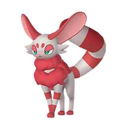<b>Валентейл</b>Кошка-тянучка💨 передвижение</a><a class="pk" href="../../4_spravochniki/paly/snock/" data-g="Из команды" data-t="урон" data-q="снок snock дэн-дэн батарея">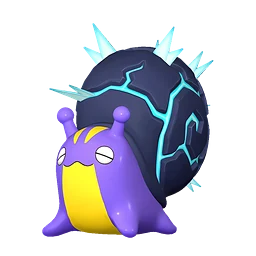<b>Снок</b>Дэн-дэн батарея⚔️ урон</a><a class="pk" href="../../4_spravochniki/paly/snock_terra/" data-g="Из команды" data-t="урон|защита" data-q="снок терра snock terra дон-дон панцирь">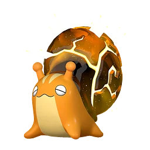<b>Снок Терра</b>Дон-дон панцирь⚔️ урон🛡 защита</a><a class="pk" href="../../4_spravochniki/paly/souffline/" data-g="Из команды" data-t="поимка" data-q="суффлин souffline фея одуванчиков"><b>Суффлин</b>Фея одуванчиков🎯 поимка</a><a class="pk" href="../../4_spravochniki/paly/lapiron/" data-g="Из команды" data-t="защита" data-q="лапирон lapiron земля - мой друг">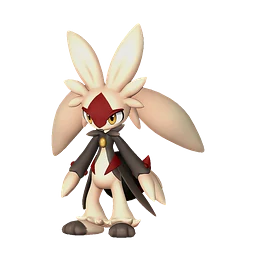<b>Лапирон</b>Земля - мой друг🛡 защита</a><a class="pk" href="../../4_spravochniki/paly/hoodle/" data-g="Из команды" data-t="урон" data-q="худл hoodle притаившийся в пустоте">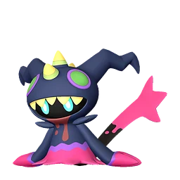<b>Худл</b>Притаившийся в пустоте⚔️ урон</a><a class="pk" href="../../4_spravochniki/paly/slowatt/" data-g="Из команды" data-t="урон" data-q="слоуватт slowatt переключатель расслабления">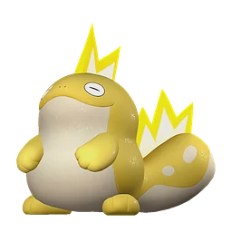<b>Слоуватт</b>Переключатель расслабления⚔️ урон</a><a class="pk" href="../../4_spravochniki/paly/bakemi/" data-g="Из команды" data-t="прочее" data-q="бакеми bakemi улыбчивая нежить"><b>Бакеми</b>Улыбчивая нежить• прочее</a><a class="pk" href="../../4_spravochniki/paly/solmora/" data-g="Из команды" data-t="прочее" data-q="солмора solmora харизматичная рыбка">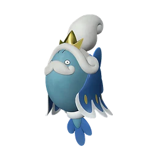<b>Солмора</b>Харизматичная рыбка• прочее</a><a class="pk" href="../../4_spravochniki/paly/solmora_lux/" data-g="Из команды" data-t="урон" data-q="солмора лакс solmora lux плазменная рыбка">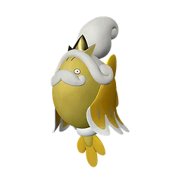<b>Солмора Лакс</b>Плазменная рыбка⚔️ урон</a><a class="pk" href="../../4_spravochniki/paly/lapure/" data-g="Из команды" data-t="прочее" data-q="немофи lapure длиннорукавная поддержка">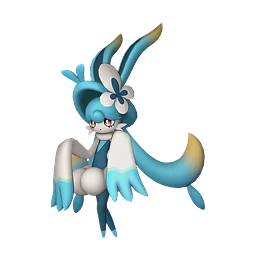<b>Немофи</b>Длиннорукавная поддержка• прочее</a><a class="pk" href="../../4_spravochniki/paly/tropicaw/" data-g="Из команды" data-t="защита" data-q="тропикау tropicaw танец цветов"><b>Тропикау</b>Танец цветов🛡 защита</a><a class="pk" href="../../4_spravochniki/paly/flaracle/" data-g="Из команды" data-t="урон" data-q="фларакл flaracle пылающее будущее">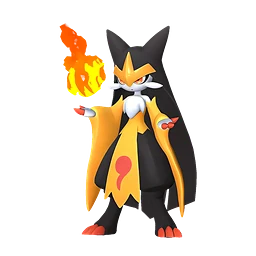<b>Фларакл</b>Пылающее будущее⚔️ урон</a><a class="pk" href="../../4_spravochniki/paly/ophydia/" data-g="Из команды" data-t="урон" data-q="офидия ophydia величественный туман">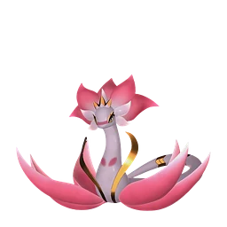<b>Офидия</b>Величественный туман⚔️ урон</a><a class="pk" href="../../4_spravochniki/paly/dupin/" data-g="Из команды" data-t="урон|лечение" data-q="дупин dupin трик-шоу рапи-рапи">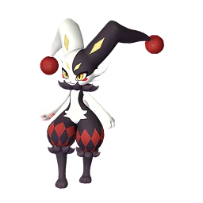<b>Дупин</b>Трик-шоу Рапи-Рапи⚔️ урон💚 лечение</a><a class="pk" href="../../4_spravochniki/paly/roujay/" data-g="Из команды" data-t="урон" data-q="роуджей roujay тёмная чудовищная птица"><b>Роуджей</b>Тёмная чудовищная птица⚔️ урон</a><a class="pk" href="../../4_spravochniki/paly/venusa/" data-g="Из команды" data-t="урон" data-q="медуна venusa змеиная мудрость">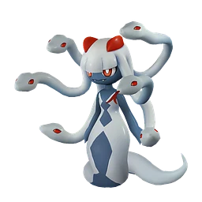<b>Медуна</b>Змеиная мудрость⚔️ урон</a><a class="pk" href="../../4_spravochniki/paly/loomen/" data-g="Из команды" data-t="урон" data-q="люмен loomen зачарованный фонарь">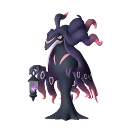<b>Люмен</b>Зачарованный фонарь⚔️ урон</a><a class="pk" href="../../4_spravochniki/paly/wistella/" data-g="Из команды" data-t="защита" data-q="вистелла wistella скрытая тёмная энергия"><b>Вистелла</b>Скрытая тёмная энергия🛡 защита</a><a class="pk" href="../../4_spravochniki/paly/solenne/" data-g="Из команды" data-t="урон" data-q="соленна solenne незапятнанная леди-одиночка"><b>Соленна</b>Незапятнанная леди-одиночка⚔️ урон</a><a class="pk" href="../../4_spravochniki/paly/renjishi/" data-g="Из команды" data-t="урон" data-q="рэндзиши renjishi масштабная схватка">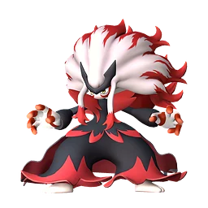<b>Рэндзиши</b>Масштабная схватка⚔️ урон</a><a class="pk" href="../../4_spravochniki/paly/aegidron/" data-g="Из команды" data-t="урон" data-q="аэгидрон aegidron несокрушимый крепостной дракон"><b>Аэгидрон</b>Несокрушимый крепостной дракон⚔️ урон</a><a class="pk" href="../../4_spravochniki/paly/orserk/" data-g="Из команды" data-t="урон|защита" data-q="орсерк orserk свирепый громовой дракон"><b>Орсерк</b>Свирепый громовой дракон⚔️ урон🛡 защита</a><a class="pk" href="../../4_spravochniki/paly/faleris/" data-g="Из команды" data-t="усиление стихии|добыча" data-q="фалерис faleris хищник пламени">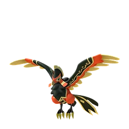<b>Фалерис</b>Хищник пламени✨ усиление стихии⛏ добыча</a><a class="pk" href="../../4_spravochniki/paly/faleris_aqua/" data-g="Из команды" data-t="дроп" data-q="фалерис аква faleris aqua хищник прилива">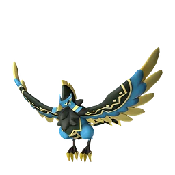<b>Фалерис Аква</b>Хищник прилива🎁 дроп</a><a class="pk" href="../../4_spravochniki/paly/silvance/" data-g="Из команды" data-t="урон" data-q="сильванс silvance хранитель спор"><b>Сильванс</b>Хранитель спор⚔️ урон</a><a class="pk" href="../../4_spravochniki/paly/dandilord/" data-g="Из команды" data-t="урон" data-q="дандилорд dandilord страж тумана"><b>Дандилорд</b>Страж тумана⚔️ урон</a><a class="pk" href="../../4_spravochniki/paly/xenolord/" data-g="Из команды" data-t="урон" data-q="зенолорд xenolord метеоритные крылья"><b>Зенолорд</b>Метеоритные крылья⚔️ урон</a><a class="pk" href="../../4_spravochniki/paly/cave_bat/" data-g="Из команды" data-t="дроп" data-q="пещерная летучая мышь cave bat поддержка летучих мышей"><b>Пещерная летучая мышь</b>Поддержка летучих мышей🎁 дроп</a><a class="pk" href="../../4_spravochniki/paly/demon_eye/" data-g="Из команды" data-t="урон" data-q="демонический глаз demon eye демоническое зрение"><b>Демонический глаз</b>Демоническое зрение⚔️ урон</a><a class="pk" href="../../4_spravochniki/paly/enchanted_sword/" data-g="Из команды" data-t="дроп" data-q="зачарованный меч enchanted sword зачарование"><b>Зачарованный меч</b>Зачарование🎁 дроп</a><a class="pk" href="../../4_spravochniki/paly/illuminant_bat/" data-g="Из команды" data-t="дроп" data-q="светящаяся летучая мышь illuminant bat поддержка летучих мышей"><b>Светящаяся летучая мышь</b>Поддержка летучих мышей🎁 дроп</a><a class="pk" href="../../4_spravochniki/paly/chikipi/" data-g="Когда выпущен" data-t="прочее" data-q="чикипи chikipi яйцеклад"><b>Чикипи</b>Яйцеклад• прочее</a><a class="pk" href="../../4_spravochniki/paly/mau/" data-g="Когда выпущен" data-t="прочее" data-q="мау mau кошке — золотая монета"><b>Мау</b>Кошке — золотая монета• прочее</a><a class="pk" href="../../4_spravochniki/paly/mau_cryst/" data-g="Когда выпущен" data-t="прочее" data-q="мау крист mau cryst ледяной сюрприз"><b>Мау Крист</b>Ледяной сюрприз• прочее</a><a class="pk" href="../../4_spravochniki/paly/felbat/" data-g="Когда выпущен" data-t="урон|лечение" data-q="фелбэт felbat кража жизни"><b>Фелбэт</b>Кража жизни⚔️ урон💚 лечение</a><a class="pk" href="../../4_spravochniki/paly/elizabee/" data-g="Когда выпущен" data-t="прочее" data-q="элизаби elizabee воля королевы"><b>Элизаби</b>Воля королевы• прочее</a><a class="pk" href="../../4_spravochniki/paly/lovander/" data-g="Когда выпущен" data-t="урон|лечение" data-q="ловандер lovander иссушение сердца"><b>Ловандер</b>Иссушение сердца⚔️ урон💚 лечение</a><a class="pk" href="../../4_spravochniki/paly/leafan/" data-g="Когда выпущен" data-t="урон|защита" data-q="лифан leafan полная самоотдача">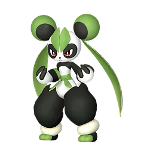<b>Лифан</b>Полная самоотдача⚔️ урон🛡 защита</a><a class="pk" href="../../4_spravochniki/paly/gildra/" data-g="Когда выпущен" data-t="прочее" data-q="йомира gildra с того света"><b>Йомира</b>С того света• прочее</a><a class="pk" href="../../4_spravochniki/paly/mimog/" data-g="Когда выпущен" data-t="разведка/скрытность" data-q="мимидог mimog взлом замков">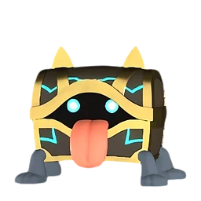<b>Мимидог</b>Взлом замков👁 разведка/скрытность</a><a class="pk" href="../../4_spravochniki/paly/astralym/" data-g="Когда выпущен" data-t="прочее" data-q="астралим astralym -">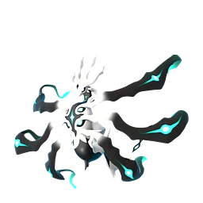<b>Астралим</b>-• прочее</a><a class="pk" href="../../4_spravochniki/paly/kingpaca/" data-g="Верхом" data-t="защита|передвижение" data-q="кингпака kingpaca король мускулов"><b>Кингпака</b>Король мускулов🛡 защита💨 передвижение</a><a class="pk" href="../../4_spravochniki/paly/kingpaca_cryst/" data-g="Верхом" data-t="защита|передвижение" data-q="кингпака крист kingpaca cryst холоднокровный король"><b>Кингпака Крист</b>Холоднокровный король🛡 защита💨 передвижение</a><a class="pk" href="../../4_spravochniki/paly/rushoar/" data-g="Верхом" data-t="добыча" data-q="рашоа rushoar твердоголовый"><b>Рашоа</b>Твердоголовый⛏ добыча</a><a class="pk" href="../../4_spravochniki/paly/eikthyrdeer/" data-g="Верхом" data-t="передвижение|добыча" data-q="иктирдир eikthyrdeer хранитель леса"><b>Иктирдир</b>Хранитель леса💨 передвижение⛏ добыча</a><a class="pk" href="../../4_spravochniki/paly/eikthyrdeer_terra/" data-g="Верхом" data-t="передвижение" data-q="иктирдир тэрра eikthyrdeer terra хранитель золотого леса"><b>Иктирдир Тэрра</b>Хранитель золотого леса💨 передвижение</a><a class="pk" href="../../4_spravochniki/paly/direhowl/" data-g="Верхом" data-t="передвижение" data-q="дайэхаул direhowl оседлать дайэхаула"><b>Дайэхаул</b>Оседлать Дайэхаула💨 передвижение</a><a class="pk" href="../../4_spravochniki/paly/sweepa/" data-g="Верхом" data-t="защита" data-q="свипа sweepa король мофу-мофу"><b>Свипа</b>Король мофу-мофу🛡 защита</a><a class="pk" href="../../4_spravochniki/paly/azurobe/" data-g="Верхом" data-t="урон" data-q="азуроб azurobe танец парящей воды"><b>Азуроб</b>Танец парящей воды⚔️ урон</a><a class="pk" href="../../4_spravochniki/paly/azurobe_cryst/" data-g="Верхом" data-t="урон" data-q="азуроб крист azurobe cryst танец парящего льда"><b>Азуроб Крист</b>Танец парящего льда⚔️ урон</a><a class="pk" href="../../4_spravochniki/paly/nitewing/" data-g="Верхом" data-t="прочее" data-q="найтвинг nitewing спутник в путешествии">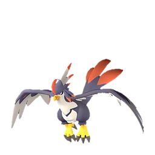<b>Найтвинг</b>Спутник в путешествии• прочее</a><a class="pk" href="../../4_spravochniki/paly/univolt_cryst/" data-g="Верхом" data-t="урон|усиление стихии" data-q="юнивольт крист univolt cryst буря ледяных лепестков"><b>Юнивольт Крист</b>Буря ледяных лепестков⚔️ урон✨ усиление стихии</a><a class="pk" href="../../4_spravochniki/paly/tarantriss/" data-g="Верхом" data-t="передвижение" data-q="тарантрисс tarantriss сети тарантрисс"><b>Тарантрисс</b>Сети Тарантрисс💨 передвижение</a><a class="pk" href="../../4_spravochniki/paly/polapup/" data-g="Верхом" data-t="передвижение" data-q="полапап polapup наездник снежной горы"><b>Полапап</b>Наездник снежной горы💨 передвижение</a><a class="pk" href="../../4_spravochniki/paly/polapup_terra/" data-g="Верхом" data-t="передвижение" data-q="полапап терра polapup terra скользящий снежной горы">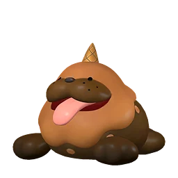<b>Полапап Терра</b>Скользящий снежной горы💨 передвижение</a><a class="pk" href="../../4_spravochniki/paly/surfent/" data-g="Верхом" data-t="прочее" data-q="серфент surfent пловец морей">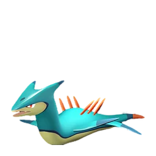<b>Серфент</b>Пловец морей• прочее</a><a class="pk" href="../../4_spravochniki/paly/helzephyr/" data-g="Верхом" data-t="урон" data-q="хэлзефир helzephyr крылья преисподней"><b>Хэлзефир</b>Крылья Преисподней⚔️ урон</a><a class="pk" href="../../4_spravochniki/paly/helzephyr_lux/" data-g="Верхом" data-t="урон" data-q="хэлзефир лакс helzephyr lux громовые крылья"><b>Хэлзефир Лакс</b>Громовые крылья⚔️ урон</a><a class="pk" href="../../4_spravochniki/paly/fenglope/" data-g="Верхом" data-t="передвижение" data-q="фенглоп fenglope ветер и тучи"><b>Фенглоп</b>Ветер и тучи💨 передвижение</a><a class="pk" href="../../4_spravochniki/paly/mammorest/" data-g="Верхом" data-t="добыча" data-q="мамморест mammorest геокрушитель"><b>Мамморест</b>Геокрушитель⛏ добыча</a><a class="pk" href="../../4_spravochniki/paly/mammorest_cryst/" data-g="Верхом" data-t="добыча" data-q="мамморест крист mammorest cryst криокрушитель"><b>Мамморест Крист</b>Криокрушитель⛏ добыча</a><a class="pk" href="../../4_spravochniki/paly/pyrin/" data-g="Верхом" data-t="урон" data-q="пирин pyrin красный заяц">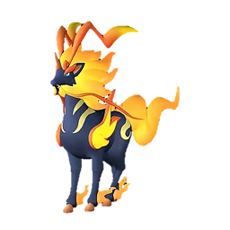<b>Пирин</b>Красный Заяц⚔️ урон</a><a class="pk" href="../../4_spravochniki/paly/pyrin_noct/" data-g="Верхом" data-t="урон" data-q="пирин нокт pyrin noct чёрный заяц">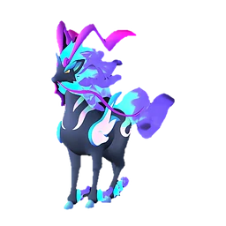<b>Пирин Нокт</b>Чёрный Заяц⚔️ урон</a><a class="pk" href="../../4_spravochniki/paly/relaxaurus/" data-g="Верхом" data-t="урон|вес" data-q="релаксаурус relaxaurus голодная ракета"><b>Релаксаурус</b>Голодная ракета⚔️ урон🎒 вес</a><a class="pk" href="../../4_spravochniki/paly/relaxaurus_lux/" data-g="Верхом" data-t="урон|вес" data-q="релаксаурус лакс relaxaurus lux ракетная вечеринка"><b>Релаксаурус Лакс</b>Ракетная вечеринка⚔️ урон🎒 вес</a><a class="pk" href="../../4_spravochniki/paly/beakon/" data-g="Верхом" data-t="урон" data-q="райберд beakon гром с неба"><b>Райберд</b>Гром с неба⚔️ урон</a><a class="pk" href="../../4_spravochniki/paly/beakon_cryst/" data-g="Верхом" data-t="урон" data-q="райберд крист beakon cryst небесный град">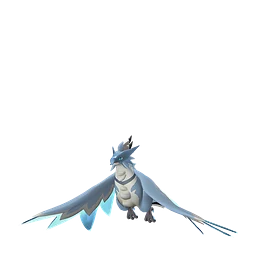<b>Райберд Крист</b>Небесный град⚔️ урон</a><a class="pk" href="../../4_spravochniki/paly/ghangler/" data-g="Верхом" data-t="усиление стихии" data-q="ганглер ghangler проводник ночной тьмы"><b>Ганглер</b>Проводник ночной тьмы✨ усиление стихии</a><a class="pk" href="../../4_spravochniki/paly/ghangler_ignis/" data-g="Верхом" data-t="усиление стихии" data-q="ганглер игнис ghangler ignis знаменитый шеф морских глубин"><b>Ганглер Игнис</b>Знаменитый шеф морских глубин✨ усиление стихии</a><a class="pk" href="../../4_spravochniki/paly/rayhound/" data-g="Верхом" data-t="усиление стихии|передвижение" data-q="райхаунд rayhound грозовой пёс">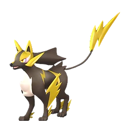<b>Райхаунд</b>Грозовой пёс✨ усиление стихии💨 передвижение</a><a class="pk" href="../../4_spravochniki/paly/mossanda/" data-g="Верхом" data-t="урон|вес" data-q="моссанда mossanda панда-гранатомётчик"><b>Моссанда</b>Панда-гранатомётчик⚔️ урон🎒 вес</a><a class="pk" href="../../4_spravochniki/paly/mossanda_lux/" data-g="Верхом" data-t="урон|вес" data-q="моссанда лакс mossanda lux панда-гранатомётчик"><b>Моссанда Лакс</b>Панда-гранатомётчик⚔️ урон🎒 вес</a><a class="pk" href="../../4_spravochniki/paly/chillet/" data-g="Верхом" data-t="урон" data-q="чиллет chillet верткая ласка"><b>Чиллет</b>Верткая ласка⚔️ урон</a><a class="pk" href="../../4_spravochniki/paly/chillet_ignis/" data-g="Верхом" data-t="урон" data-q="чиллет игнис chillet ignis искрящаяся ласка">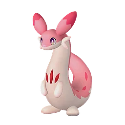<b>Чиллет Игнис</b>Искрящаяся ласка⚔️ урон</a><a class="pk" href="../../4_spravochniki/paly/ragnahawk/" data-g="Верхом" data-t="урон" data-q="рагнахавк ragnahawk пламенные крылья">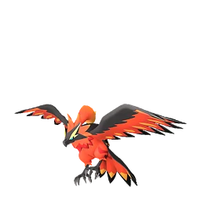<b>Рагнахавк</b>Пламенные крылья⚔️ урон</a><a class="pk" href="../../4_spravochniki/paly/moldron/" data-g="Верхом" data-t="урон" data-q="молдрон moldron владыка магмы">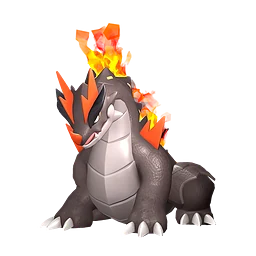<b>Молдрон</b>Владыка магмы⚔️ урон</a><a class="pk" href="../../4_spravochniki/paly/palumba/" data-g="Верхом" data-t="передвижение" data-q="палумба palumba самба-шаг"><b>Палумба</b>Самба-шаг💨 передвижение</a><a class="pk" href="../../4_spravochniki/paly/braloha/" data-g="Верхом" data-t="прочее" data-q="бралоха braloha тёплый денёк"><b>Бралоха</b>Тёплый денёк• прочее</a><a class="pk" href="../../4_spravochniki/paly/shroomer/" data-g="Верхом" data-t="прочее" data-q="шрумер shroomer споры роста"><b>Шрумер</b>Споры роста• прочее</a><a class="pk" href="../../4_spravochniki/paly/shroomer_noct/" data-g="Верхом" data-t="прочее" data-q="шрумер нокт shroomer noct дымящиеся споры"><b>Шрумер Нокт</b>Дымящиеся споры• прочее</a><a class="pk" href="../../4_spravochniki/paly/suzaku/" data-g="Верхом" data-t="усиление стихии" data-q="судзаку suzaku огненные крылья"><b>Судзаку</b>Огненные крылья✨ усиление стихии</a><a class="pk" href="../../4_spravochniki/paly/suzaku_aqua/" data-g="Верхом" data-t="усиление стихии" data-q="судзаку аква suzaku aqua водные крылья">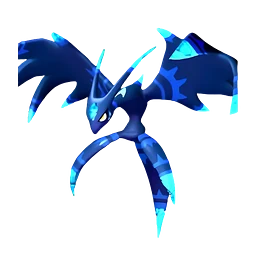<b>Судзаку Аква</b>Водные крылья✨ усиление стихии</a><a class="pk" href="../../4_spravochniki/paly/dazemu/" data-g="Верхом" data-t="передвижение" data-q="дазему dazemu песчаный рывок">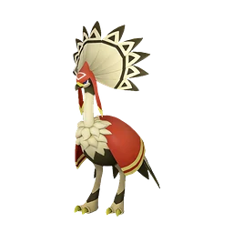<b>Дазему</b>Песчаный рывок💨 передвижение</a><a class="pk" href="../../4_spravochniki/paly/quivern_botan/" data-g="Верхом" data-t="урон" data-q="фэски ботан quivern botan милосердие травяного дракона"><b>Фэски Ботан</b>Милосердие травяного дракона⚔️ урон</a><a class="pk" href="../../4_spravochniki/paly/yakumo/" data-g="Верхом" data-t="прочее" data-q="якумо yakumo рыбак рыбака видит издалека">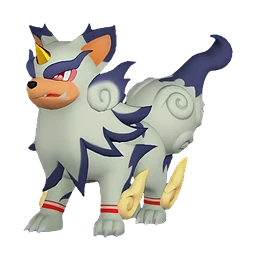<b>Якумо</b>Рыбак рыбака видит издалека• прочее</a><a class="pk" href="../../4_spravochniki/paly/starryon/" data-g="Верхом" data-t="передвижение" data-q="старрион starryon ночной танцор"><b>Старрион</b>Ночной танцор💨 передвижение</a><a class="pk" href="../../4_spravochniki/paly/starryon_primo/" data-g="Верхом" data-t="передвижение" data-q="старрион примо starryon primo танцор света"><b>Старрион Примо</b>Танцор света💨 передвижение</a><a class="pk" href="../../4_spravochniki/paly/wumpo/" data-g="Верхом" data-t="прочее" data-q="вумпо wumpo гигант снежных гор"><b>Вумпо</b>Гигант снежных гор• прочее</a><a class="pk" href="../../4_spravochniki/paly/dualith/" data-g="Верхом" data-t="прочее" data-q="дуалит dualith лесной лазер"><b>Дуалит</b>Лесной лазер• прочее</a><a class="pk" href="../../4_spravochniki/paly/dualith_noct/" data-g="Верхом" data-t="прочее" data-q="дуалит нокт dualith noct лазер порчи"><b>Дуалит Нокт</b>Лазер порчи• прочее</a><a class="pk" href="../../4_spravochniki/paly/tetroise/" data-g="Верхом" data-t="прочее" data-q="тетроис tetroise камнепад - древняя черепаха"><b>Тетроис</b>Камнепад - Древняя черепаха• прочее</a><a class="pk" href="../../4_spravochniki/paly/gildane/" data-g="Верхом" data-t="урон|усиление стихии" data-q="гилдейн gildane благословение песчаной бури">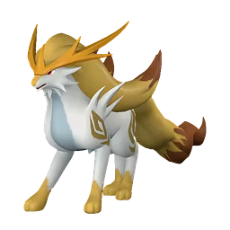<b>Гилдейн</b>Благословение песчаной бури⚔️ урон✨ усиление стихии</a><a class="pk" href="../../4_spravochniki/paly/astegon/" data-g="Верхом" data-t="урон|добыча" data-q="астегон astegon дракон в чёрных доспехах"><b>Астегон</b>Дракон в чёрных доспехах⚔️ урон⛏ добыча</a><a class="pk" href="../../4_spravochniki/paly/azurmane/" data-g="Верхом" data-t="передвижение" data-q="азурмейн azurmane плазморывок"><b>Азурмейн</b>Плазморывок💨 передвижение</a><a class="pk" href="../../4_spravochniki/paly/eidrolon/" data-g="Верхом" data-t="урон|передвижение" data-q="айдролон eidrolon свободный крылатый дракон"><b>Айдролон</b>Свободный крылатый дракон⚔️ урон💨 передвижение</a><a class="pk" href="../../4_spravochniki/paly/eidrolon_ignis/" data-g="Верхом" data-t="урон|передвижение" data-q="айдролон игнис eidrolon ignis гневный крылатый дракон"><b>Айдролон Игнис</b>Гневный крылатый дракон⚔️ урон💨 передвижение</a><a class="pk" href="../../4_spravochniki/paly/dynamoff/" data-g="Верхом" data-t="передвижение" data-q="динамофф dynamoff электростимулированная инкубация"><b>Динамофф</b>Электростимулированная инкубация💨 передвижение</a><a class="pk" href="../../4_spravochniki/paly/grizzbolt/" data-g="Верхом" data-t="урон|вес" data-q="гриззболт grizzbolt жёлтый бронетанк"><b>Гриззболт</b>Жёлтый бронетанк⚔️ урон🎒 вес</a><a class="pk" href="../../4_spravochniki/paly/shadowbeak/" data-g="Верхом" data-t="урон|передвижение" data-q="шэдоубик shadowbeak модифицированные гены"><b>Шэдоубик</b>Модифицированные гены⚔️ урон💨 передвижение</a><a class="pk" href="../../4_spravochniki/paly/selyne/" data-g="Верхом" data-t="урон" data-q="селена selyne звёздная тьма"><b>Селена</b>Звёздная тьма⚔️ урон</a><a class="pk" href="../../4_spravochniki/paly/bastigor/" data-g="Верхом" data-t="урон" data-q="бастигор bastigor сокрушительная буря"><b>Бастигор</b>Сокрушительная буря⚔️ урон</a><a class="pk" href="../../4_spravochniki/paly/shaolong/" data-g="Верхом" data-t="урон" data-q="шаолонг shaolong властелин лазурного неба"><b>Шаолонг</b>Властелин Лазурного неба⚔️ урон</a><a class="pk" href="../../4_spravochniki/paly/hartalis/" data-g="Верхом" data-t="передвижение" data-q="харталис hartalis священный барьер"><b>Харталис</b>Священный барьер💨 передвижение</a><a class="pk" href="../../4_spravochniki/paly/paladius/" data-g="Верхом" data-t="передвижение" data-q="паладиус paladius небесный святой рыцарь"><b>Паладиус</b>Небесный святой рыцарь💨 передвижение</a><a class="pk" href="../../4_spravochniki/paly/necromus/" data-g="Верхом" data-t="передвижение" data-q="некромус necromus тёмный рыцарь бездны"><b>Некромус</b>Тёмный рыцарь бездны💨 передвижение</a><a class="pk" href="../../4_spravochniki/paly/frostallion/" data-g="Верхом" data-t="урон|усиление стихии" data-q="фросталлион frostallion ледяной пегас"><b>Фросталлион</b>Ледяной Пегас⚔️ урон✨ усиление стихии</a><a class="pk" href="../../4_spravochniki/paly/frostallion_noct/" data-g="Верхом" data-t="урон|усиление стихии" data-q="фросталлион нокт frostallion noct тёмный пегас"><b>Фросталлион Нокт</b>Тёмный Пегас⚔️ урон✨ усиление стихии</a><a class="pk" href="../../4_spravochniki/paly/neptilius/" data-g="Верхом" data-t="урон" data-q="нептилиус neptilius властелин океана"><b>Нептилиус</b>Властелин океана⚔️ урон</a><a class="pk" href="../../4_spravochniki/paly/jetragon/" data-g="Верхом" data-t="урон|вес" data-q="джетрагон jetragon воздушные ракеты"><b>Джетрагон</b>Воздушные ракеты⚔️ урон🎒 вес</a><a class="pk" href="../../4_spravochniki/paly/panthalus/" data-g="Верхом" data-t="урон" data-q="панталус panthalus хранитель эха"><b>Панталус</b>Хранитель эха⚔️ урон</a><a class="pk" href="../../4_spravochniki/paly/blue_slime/" data-g="Верхом" data-t="прочее" data-q="синий слизень blue slime тело слизня"><b>Синий слизень</b>Тело слизня• прочее</a><a class="pk" href="../../4_spravochniki/paly/green_slime/" data-g="Верхом" data-t="прочее" data-q="зеленый слизень green slime тело слизня"><b>Зеленый слизень</b>Тело слизня• прочее</a><a class="pk" href="../../4_spravochniki/paly/illuminant_slime/" data-g="Верхом" data-t="прочее" data-q="светящийся слизень illuminant slime тело слизня"><b>Светящийся слизень</b>Тело слизня• прочее</a><a class="pk" href="../../4_spravochniki/paly/purple_slime/" data-g="Верхом" data-t="прочее" data-q="фиолетовый слизень purple slime тело слизня"><b>Фиолетовый слизень</b>Тело слизня• прочее</a><a class="pk" href="../../4_spravochniki/paly/rainbow_slime/" data-g="Верхом" data-t="прочее" data-q="радужный слизень rainbow slime тело слизня"><b>Радужный слизень</b>Тело слизня• прочее</a><a class="pk" href="../../4_spravochniki/paly/red_slime/" data-g="Верхом" data-t="прочее" data-q="красный слизень red slime тело слизня"><b>Красный слизень</b>Тело слизня• прочее</a><a class="pk" href="../../4_spravochniki/paly/lamball/" data-g="По кнопке" data-t="защита" data-q="ламболл lamball пуховый щит"><b>Ламболл</b>Пуховый щит🛡 защита</a><a class="pk" href="../../4_spravochniki/paly/lifmunk/" data-g="По кнопке" data-t="урон" data-q="лифманк lifmunk лифманк рекойл"><b>Лифманк</b>Лифманк Рекойл⚔️ урон</a><a class="pk" href="../../4_spravochniki/paly/fuack/" data-g="По кнопке" data-t="урон" data-q="камоноске fuack серфинг-слэм"><b>Камоноске</b>Серфинг-слэм⚔️ урон</a><a class="pk" href="../../4_spravochniki/paly/fuack_ignis/" data-g="По кнопке" data-t="урон" data-q="камоноске игнис fuack ignis пламенный натиск"><b>Камоноске Игнис</b>Пламенный натиск⚔️ урон</a><a class="pk" href="../../4_spravochniki/paly/croajiro/" data-g="По кнопке" data-t="урон|передвижение" data-q="кроадзиро croajiro подготовка к прыжку"><b>Кроадзиро</b>Подготовка к прыжку⚔️ урон💨 передвижение</a><a class="pk" href="../../4_spravochniki/paly/jolthog/" data-g="По кнопке" data-t="урон|усиление стихии" data-q="джолтхог jolthog электрошоковая бомба"><b>Джолтхог</b>Электрошоковая бомба⚔️ урон✨ усиление стихии</a><a class="pk" href="../../4_spravochniki/paly/jolthog_cryst/" data-g="По кнопке" data-t="урон|усиление стихии" data-q="джолтхог крист jolthog cryst ледяная бомба"><b>Джолтхог Крист</b>Ледяная бомба⚔️ урон✨ усиление стихии</a><a class="pk" href="../../4_spravochniki/paly/depresso/" data-g="По кнопке" data-t="передвижение|работа" data-q="депрессо depresso доза кофеина"><b>Депрессо</b>Доза кофеина💨 передвижение🔨 работа</a><a class="pk" href="../../4_spravochniki/paly/pengullet/" data-g="По кнопке" data-t="урон" data-q="пенгуллет pengullet пенгуллетомёт"><b>Пенгуллет</b>Пенгуллетомёт⚔️ урон</a><a class="pk" href="../../4_spravochniki/paly/pengullet_lux/" data-g="По кнопке" data-t="урон" data-q="пенгуллет лакс pengullet lux пенгуллет-лаксомёт"><b>Пенгуллет Лакс</b>Пенгуллет-Лаксомёт⚔️ урон</a><a class="pk" href="../../4_spravochniki/paly/tanzee/" data-g="По кнопке" data-t="урон" data-q="танзи tanzee веселая стрельба"><b>Танзи</b>Веселая стрельба⚔️ урон</a><a class="pk" href="../../4_spravochniki/paly/tanzee_ignis/" data-g="По кнопке" data-t="урон" data-q="танзи игнис tanzee ignis весёлая пальба"><b>Танзи Игнис</b>Весёлая пальба⚔️ урон</a><a class="pk" href="../../4_spravochniki/paly/nox/" data-g="По кнопке" data-t="разведка/скрытность" data-q="нокс nox кудэрэ"><b>Нокс</b>Кудэрэ👁 разведка/скрытность</a><a class="pk" href="../../4_spravochniki/paly/foxparks/" data-g="По кнопке" data-t="урон" data-q="фокспаркс foxparks пламенные объятия"><b>Фокспаркс</b>Пламенные объятия⚔️ урон</a><a class="pk" href="../../4_spravochniki/paly/foxparks_cryst/" data-g="По кнопке" data-t="урон" data-q="фокспаркс крист foxparks cryst морозные объятия"><b>Фокспаркс Крист</b>Морозные объятия⚔️ урон</a><a class="pk" href="../../4_spravochniki/paly/tombat/" data-g="По кнопке" data-t="разведка/скрытность" data-q="томбат tombat чутьё бакэнэко"><b>Томбат</b>Чутьё Бакэнэко👁 разведка/скрытность</a><a class="pk" href="../../4_spravochniki/paly/tocotoco/" data-g="По кнопке" data-t="урон" data-q="токотоко tocotoco яйцемёт"><b>Токотоко</b>Яйцемёт⚔️ урон</a><a class="pk" href="../../4_spravochniki/paly/cawgnito/" data-g="По кнопке" data-t="прочее" data-q="когнито cawgnito ночная чудовищная птица"><b>Когнито</b>Ночная чудовищная птица• прочее</a><a class="pk" href="../../4_spravochniki/paly/cinnamoth/" data-g="По кнопке" data-t="работа" data-q="синнамос cinnamoth загадочные чешуйки"><b>Синнамос</b>Загадочные чешуйки🔨 работа</a><a class="pk" href="../../4_spravochniki/paly/leezpunk/" data-g="По кнопке" data-t="прочее" data-q="лизпанк leezpunk невидимость"><b>Лизпанк</b>Невидимость• прочее</a><a class="pk" href="../../4_spravochniki/paly/leezpunk_ignis/" data-g="По кнопке" data-t="прочее" data-q="лизпанк игнис leezpunk ignis невидимость"><b>Лизпанк Игнис</b>Невидимость• прочее</a><a class="pk" href="../../4_spravochniki/paly/gorirat/" data-g="По кнопке" data-t="урон" data-q="горират gorirat максимальный режим гориллы"><b>Горират</b>Максимальный режим гориллы⚔️ урон</a><a class="pk" href="../../4_spravochniki/paly/wixen/" data-g="По кнопке" data-t="урон|усиление стихии" data-q="виксен wixen госпожа лисица"><b>Виксен</b>Госпожа лисица⚔️ урон✨ усиление стихии</a><a class="pk" href="../../4_spravochniki/paly/wixen_noct/" data-g="По кнопке" data-t="урон|усиление стихии" data-q="виксен нокт wixen noct госпожа тёмная лисица"><b>Виксен Нокт</b>Госпожа тёмная лисица⚔️ урон✨ усиление стихии</a><a class="pk" href="../../4_spravochniki/paly/elgrove/" data-g="По кнопке" data-t="урон" data-q="элгрув elgrove природная угроза"><b>Элгрув</b>Природная угроза⚔️ урон</a><a class="pk" href="../../4_spravochniki/paly/bushi/" data-g="По кнопке" data-t="прочее" data-q="буси bushi фиолетовая молния"><b>Буси</b>Фиолетовая молния• прочее</a><a class="pk" href="../../4_spravochniki/paly/finsider/" data-g="По кнопке" data-t="урон|усиление стихии" data-q="финсайдер finsider водяной триггер"><b>Финсайдер</b>Водяной триггер⚔️ урон✨ усиление стихии</a><a class="pk" href="../../4_spravochniki/paly/petallia/" data-g="По кнопке" data-t="лечение" data-q="петаллия petallia благословение духа цветов"><b>Петаллия</b>Благословение духа цветов💚 лечение</a><a class="pk" href="../../4_spravochniki/paly/incineram/" data-g="По кнопке" data-t="прочее" data-q="инсинерам incineram когтистый охотник пламени"><b>Инсинерам</b>Когтистый охотник пламени• прочее</a><a class="pk" href="../../4_spravochniki/paly/incineram_noct/" data-g="По кнопке" data-t="прочее" data-q="инсинерам нокт incineram noct когтистый охотник тьмы"><b>Инсинерам Нокт</b>Когтистый охотник тьмы• прочее</a><a class="pk" href="../../4_spravochniki/paly/digtoise/" data-g="По кнопке" data-t="добыча" data-q="дигтос digtoise дробящий бур"><b>Дигтос</b>Дробящий бур⛏ добыча</a><a class="pk" href="../../4_spravochniki/paly/sibelyx/" data-g="По кнопке" data-t="прочее" data-q="сибеликс sibelyx мистический шёлковый покров"><b>Сибеликс</b>Мистический шёлковый покров• прочее</a><a class="pk" href="../../4_spravochniki/paly/icelyn/" data-g="По кнопке" data-t="урон|усиление стихии" data-q="айселин icelyn ведьминский холод"><b>Айселин</b>Ведьминский холод⚔️ урон✨ усиление стихии</a><a class="pk" href="../../4_spravochniki/paly/skutlass/" data-g="По кнопке" data-t="прочее" data-q="скатласс skutlass рвать плоть, ломать кости"><b>Скатласс</b>Рвать плоть, ломать кости• прочее</a><a class="pk" href="../../4_spravochniki/paly/skutlass_ignis/" data-g="По кнопке" data-t="прочее" data-q="скатласс игнис skutlass ignis жечь плоть, разрубать кости"><b>Скатласс Игнис</b>Жечь плоть, разрубать кости• прочее</a><a class="pk" href="../../4_spravochniki/paly/anubis/" data-g="По кнопке" data-t="урон" data-q="анубис anubis хранитель пустыни"><b>Анубис</b>Хранитель пустыни⚔️ урон</a><a class="pk" href="../../4_spravochniki/paly/prixter_lux/" data-g="По кнопке" data-t="урон" data-q="скорпио лакс prixter lux низкочастотный скорпион"><b>Скорпио Лакс</b>Низкочастотный скорпион⚔️ урон</a><a class="pk" href="../../4_spravochniki/paly/smokie/" data-g="По кнопке" data-t="добыча|разведка/скрытность" data-q="смоки smokie верный пёс смоки"><b>Смоки</b>Верный пёс Смоки⛏ добыча👁 разведка/скрытность</a><a class="pk" href="../../4_spravochniki/paly/dogen/" data-g="По кнопке" data-t="прочее" data-q="ванфу dogen молитва возвращения"><b>Ванфу</b>Молитва возвращения• прочее</a><a class="pk" href="../../4_spravochniki/paly/knocklem/" data-g="По кнопке" data-t="урон|защита" data-q="теранайт knocklem режим стального стража"><b>Теранайт</b>Режим стального стража⚔️ урон🛡 защита</a><a class="pk" href="../../4_spravochniki/paly/knocklem_ignis/" data-g="По кнопке" data-t="урон|защита" data-q="теранайт игнис knocklem ignis режим железного стража"><b>Теранайт Игнис</b>Режим железного стража⚔️ урон🛡 защита</a><a class="pk" href="../../4_spravochniki/paly/lyleen/" data-g="По кнопке" data-t="лечение" data-q="лилин lyleen богиня урожая"><b>Лилин</b>Богиня урожая💚 лечение</a><a class="pk" href="../../4_spravochniki/paly/lyleen_noct/" data-g="По кнопке" data-t="лечение" data-q="лилин нокт lyleen noct богиня таинственного света"><b>Лилин Нокт</b>Богиня таинственного света💚 лечение</a><a class="pk" href="../../4_spravochniki/paly/bellanoir/" data-g="По кнопке" data-t="прочее" data-q="бэллануар bellanoir око кошмара"><b>Бэллануар</b>Око кошмара• прочее</a><a class="pk" href="../../4_spravochniki/paly/bellanoir_libero/" data-g="По кнопке" data-t="прочее" data-q="бэллануар либеро bellanoir libero кошмарный взгляд"><b>Бэллануар Либеро</b>Кошмарный взгляд• прочее</a><a class="pk" href="../../4_spravochniki/paly/eye_of_cthulhu/" data-g="По кнопке" data-t="прочее" data-q="глаз ктулху eye of cthulhu рывок глаза ктулху"><b>Глаз Ктулху</b>Рывок глаза Ктулху• прочее</a><a class="pk" href="../../4_spravochniki/paly/vixy/" data-g="На базе" data-t="прочее" data-q="викси vixy копай здесь, кон-кон!"><b>Викси</b>Копай здесь, кон-кон!• прочее</a><a class="pk" href="../../4_spravochniki/paly/clovee/" data-g="На базе" data-t="прочее" data-q="клови clovee счастливый клевер"><b>Клови</b>Счастливый клевер• прочее</a><a class="pk" href="../../4_spravochniki/paly/woolipop/" data-g="На базе" data-t="прочее" data-q="вулипоп woolipop кэнди-поп"><b>Вулипоп</b>Кэнди-поп• прочее</a><a class="pk" href="../../4_spravochniki/paly/woolipop_terra/" data-g="На базе" data-t="прочее" data-q="вулипоп терра woolipop terra горький поп"><b>Вулипоп Терра</b>Горький Поп• прочее</a><a class="pk" href="../../4_spravochniki/paly/mozzarina/" data-g="На базе" data-t="прочее" data-q="моззарина mozzarina дойка"><b>Моззарина</b>Дойка• прочее</a><a class="pk" href="../../4_spravochniki/paly/amione/" data-g="На базе" data-t="прочее" data-q="амиона amione магическая двойная сила"><b>Амиона</b>Магическая двойная сила• прочее</a><a class="pk" href="../../4_spravochniki/paly/puffolt/" data-g="На базе" data-t="прочее" data-q="пуффольт puffolt искрящийся усилитель"><b>Пуффольт</b>Искрящийся усилитель• прочее</a><a class="pk" href="../../4_spravochniki/paly/katress_ignis/" data-g="На базе" data-t="прочее" data-q="катресс игнис katress ignis пылкое тёмное искусство"><b>Катресс Игнис</b>Пылкое тёмное искусство• прочее</a><a class="pk" href="../../4_spravochniki/paly/lullu/" data-g="На базе" data-t="передвижение" data-q="нежноцвет lullu цветочное усиление"><b>Нежноцвет</b>Цветочное усиление💨 передвижение</a><a class="pk" href="../../4_spravochniki/paly/sekhmet/" data-g="На базе" data-t="передвижение|работа" data-q="сехмет sekhmet императрица пустыни"><b>Сехмет</b>Императрица пустыни💨 передвижение🔨 работа</a><a class="pk" href="../../4_spravochniki/paly/prunelia/" data-g="На базе" data-t="прочее" data-q="прунелия prunelia молитва об урожае"><b>Прунелия</b>Молитва об урожае• прочее</a><a class="pk" href="../../4_spravochniki/paly/smokie_cryst/" data-g="На базе" data-t="работа" data-q="смоки крист smokie cryst верный пёс смоки крист"><b>Смоки Крист</b>Верный пёс Смоки Крист🔨 работа</a><a class="pk" href="../../4_spravochniki/paly/mycora/" data-g="На базе" data-t="прочее" data-q="микора mycora чарующие споры"><b>Микора</b>Чарующие споры• прочее</a>

Ничего не найдено. Попробуйте другое имя или снимите фильтр.

