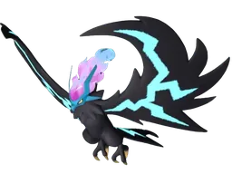
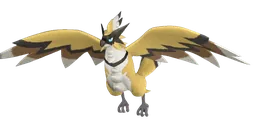

<h1>Энциклопедия Palworld</h1>
Всё о Palworld v1.0.5 на русском: уровни 0–80, 299 палов, 1599 предметов, боссы, пассивки, разведение и секреты.

<input id="home-q" type="search" placeholder="Спроси что угодно: «кто лучше копает», «чем бить Зои», «где взять серу»…" autocomplete="off">

<a class="tile" href="gallery/">🐾<b>Палы</b><small>галерея с фильтрами</small></a><a class="tile" href="4_spravochniki/bossy/">👑<b>Боссы</b><small>башни, рейды, альфы</small></a><a class="tile" href="guide/03_prohozhdenie_1_80/">🗺️<b>Прохождение</b><small>с 1 до 80 уровня</small></a><a class="tile" href="2_mehaniki/passivki/">✨<b>Пассивки</b><small>лучшие наборы</small></a><a class="tile" href="guide/sekrety/">🤫<b>Секреты</b><small>пасхалки и тайники</small></a><a class="tile" href="map/">📍<b>Карта</b><small>альфы, башни, телепорты</small></a><a class="tile" href="4_spravochniki/predmety/">🎒<b>Предметы</b><small>где взять и крафт</small></a><a class="tile" href="compare/">⚔️<b>Сравнить</b><small>два пала рядом</small></a><a class="tile" href="https://t.me/PalGuideBot">🤖<b>Бот @PalGuideBot</b><small>спроси в Telegram</small></a>

<h2>⭐ Пал дня</h2>

